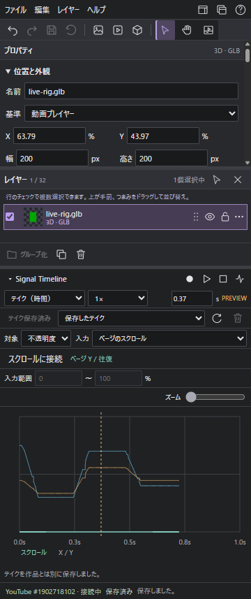

# 3D Layer v1 検証記録

起点は `5490ab4`、作業先は `.work/creator-editor` / `codex/creator-editor-spike`。DesignDocument v10、World Runtime 1.3.0。Manifestの変更なし。

## コミットと段階検証

| 段階 | コミット | 検証 |
| --- | --- | --- |
| GLB、共有描画、共通レイヤーと保存 | `99a86b4` | 型チェック・ビルド・lint、3Dフロー成功。初回全体289成功/2失敗/10スキップ。素材追加欄が1段増えて一覧が縮む回帰を修正し、失敗したドラッグ2件と3Dフローの3件を再検証して成功 |
| クリップ時計、速度、停止、ループ、フェード | `c6d5a5f` | 関連25件成功。実ピクセルのアニメーション、録画・逆シークの完全一致を含む |
| 既存追従、向き、速度別クリップ、Studio | `7760c95` | 関連29件成功、独立Studioの制作・録画・再接続1件成功 |
| 指定ボーンの視線 | `f3920ec` | 関連9件成功。回転制限、減衰、同じポーズへの加算、OFFで元ピクセルへ復帰 |
| 安全性・GPU資源・時刻復旧・実サイト | 最終差分 | モーフ/クリップの展開予算、共有キーデータ、名前のないノード、画像実デコード、GPU解放を検証。最終集計は下記 |

## 自動テスト

- 最終集計: **317件中306件成功、11件スキップ、失敗0（2 workers、6.0分）**。実サイト用などのopt-inは通常の全体実行ではスキップする。
- 最終段階の再実行で既存の数値スクラブ1件に非同期取り込み待ちの競合を検出。選択が表示されてもアセットlease完了まで入力は無効なため、入力可能になるまでテストが待つよう修正。該当3回と関連12件が成功し、その後の全体317件も上記の結果で完了。
- 型チェック: メイン、DOMのないWorld Runtime、DOM/ChromeのないEditor Coreの3構成で成功。
- lintと実験用distビルドは成功。
- v1〜v9のfixture移行、既存の画像・動画・カード・グループ・マスク・シグナル、Studio通信、保存・破棄・Undo/Redoを回帰検証。
- GLBの不正な範囲・循環・外部参照・拡張・骨格・重複チャンネルを拒否。約1.4MiBのデータを32回モーフとして参照する展開増幅も拒否する。
- ブラウザーの実WebGLコンテキストを `WEBGL_lose_context` で失わせ、復旧を確認。2D素材を残して3Dを削除するとコンテキストを解放し、Undoで再作成する。
- 同じJS実装の記録・再生・逆シークは評価結果が完全一致。NodeとChromeの比較は超越関数の最下位桁の差を考慮して1e-9以内とする。
- 別ページで保存したテイクの時刻が、新しいページのHost時計を上回る場合も、ライブ復帰時に凍結しない。フェード途中の値を保って時刻を補正する。

実行コマンド:

```powershell
npm run lint
npm run build
# buildには3構成のtypecheckを含む
$env:PLAYWRIGHT_BROWSERS_PATH='C:/Users/sm787/GitHub-Projects/web-world-themes/.work/browsers'
$env:WW_TEST_PROFILE_ROOT=Join-Path $env:TEMP 'ww-3d-test'
npm test -- --workers=2 --reporter=line
node scripts/benchmark-models.mjs
$env:WW_LIVE_3D='1'
npm test -- tests/model-live.spec.ts --workers=1 --reporter=line
```

## 実YouTube（fixtureと別の検証）

Chrome for Testing 153.0.8010.12、ログインしていない独立プロファイル、実際のYouTubeと公式サイドパネルで成功。ページ本文の差し替えやiframeは使用していない。最終確認の一連のフローは26.6秒。

- GLBを追加し、画面/プレイヤー基準の共通配置と3D設定を編集。
- 任意名のクリップを待機・歩行・走行へ割り当て、加速追従→走行→停止距離到達→待機へ切り替え。
- 指定ボーンの視線を有効化し、保存。
- 操作を明示的に録画し、保存したテイクでポーズをシーク。プレビュー中に動かしたライブマウスが混入しない。
- YouTube再読み込み、サイドパネル再接続、保存テイクの読み直し、ライブ復帰。
- 実ウィンドウ幅1366/1920/1000pxで、動画設定ボタンを実際にクリック。
- シアター、全画面、スクロール、YouTubeロゴからホームへのSPA遷移と戻る操作。DOM文書のトークンが維持されたことも確認。
- 強さ0%でオーバーレイを撤去。

[実行記録](3d-layer-v1-live.json)




## 性能

測定環境: Windows、Core i7-13650HX、Intel UHD / ANGLE D3D11、Node 24.16.0。独立した計測実行の値を保存しており、全体テストの並列実行による値とは分けている。

| 対象 | 結果 |
| --- | --- |
| 8個の画像、既存追従の純粋評価 | 中央値0.0095ms、p95 0.0128ms |
| 8個の3D、時計・追従・速度別切替・視線の純粋評価 | 中央値0.0116ms、p95 0.0157ms |
| 8体をまとめた描画CPU（WebGL→2D転送を含む） | p95 4.7ms |
| GPUタイマークエリ | 最後の有効値 約2.03ms。分位数・GPU使用率ではない |
| 素材の描画頻度 | 約28.2fps（上限30fps） |
| ページTaskDuration差分 | 約12.5%相当/1コア。fixtureの4秒測定で、YouTube全体のCPU率ではない |
| JS使用ヒープ | 約10.5MiB。GC後の保持量やピークではない |
| 共有資源 | WebGL 1、原本資源1、geometry 1、texture 9（スキン用を含む）、16 draw calls/192 triangles |
| 転送面 | 2,880,000 bytes、約2.75MiB |

初回描画にはシェーダー準備などの一時コストがあり、この計測の最大CPUは約71.8ms。実サイトのFPS統計にはテイク停止・遷移中の空白が含まれるため、定常性能として引用しない。

fixtureは自作の8頂点/12三角形、2ボーン、3クリップ、1pxの埋め込みテクスチャを持つ小さなリグ。8体でも幾何・テクスチャは共有する。重い作者モデルを8体動かせるという保証にはしない。GPUクエリはWebGL処理の区間であり、ブラウザーの合成処理全体・GPUメモリ実割当・消費電力は測定していない。

[生の計測値と除外範囲](3d-layer-v1-benchmarks.json)

## 保持した範囲と制限

- mainは`022a576`のまま、通常版distの12ファイルは作業前とSHA-256が一致、Manifest差分なし。[分離の確認記録](3d-layer-v1-isolation.json)。実験用distだけを作成する。
- 2Dとの任意の前後関係、グループ/個別マスクはDOMの同じ合成経路を使う。3Dモデル同士の立体的な交差、Web UIの奥への遮蔽は行わない。
- 埋め込みPNG/JPEGの未圧縮GLB。Draco/Meshopt/KTX2、外部URL、Blender独自ノード、任意スクリプトは対象外。
- 3Dは8個、原本32MiB。その他の展開予算と対応する表現は[設計・操作ガイド](3d-layer-v1.md)を参照。
- ボーンの向きはリグ依存。自動判定、IK、Root Motionからの移動抽出、トゥーン・輪郭線は未実装。
- 作者の実モデル、複雑な顔/衣装/多数マテリアル、長時間運転、別GPU/Chrome版、ネイティブサイドパネルの分割線を手でドラッグする確認は未実施。
- 実サイトのグループマスクは既存経路の回帰を引き継ぎ、今回の2D+3D混合グループの停止/再開はfixtureで確認した。3Dを含む全組み合わせを実YouTubeで網羅したという意味ではない。
