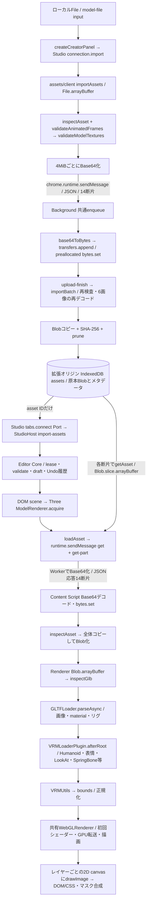
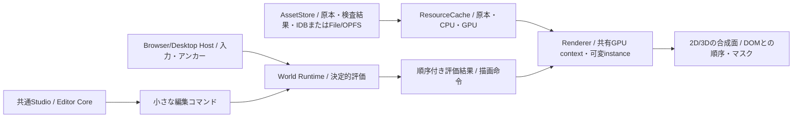

# VRM読み込み性能調査

調査日: 2026-10-19。起点: `codex/creator-editor-spike` / `90926a6`。

## 結果

主な負担は、原本のJSON/Base64往復と共有Workerの待ち行列、繰り返す検証、初回WebGL描画だった。GLTFLoaderとVRM初期化だけで約1分を消費する状態は再現しなかった。

同じRendererを使う拡張ページで、既存転送経路の中央値は3,601ms、File直接は710ms、IndexedDB直接は450ms。経路・重複処理を変える余地は大きい。一方、実YouTubeと単独ページではHost、UI、継続更新などの負荷が違うため、この比率をそのままYouTubeの高速化率とはしない。

今回は計測・比較ページ・最小iframeプローブまで。Rendererの移設、保存形式、作品データ、Chrome権限、モデルの品質は変更していない。

## 計測条件と限界

- Chrome for Testing 153.0.8010.12、Windows、Core i7-13650HX / 14コア20スレッド、約15.7GiB RAM。
- ANGLE / Intel UHD Graphics / D3D11。同じPC・ブラウザーで順次実行し、計測中に別のテストを並列実行しなかった。ユーザーの普段のChromeプロファイルではない。
- 同じローカル原本57,185,776 bytes（54.5366MiB）。ファイル名の「1.0.0」とは異なり、内部の拡張は**VRM 0.x**。今回の大容量実測をVRM 1.0の実測とは扱わない。VRM 1.0は自作fixtureで回帰確認した。
- アバター原本、テクスチャ、アバターのスクリーンショットは追加・コミットしていない。
- 各条件3回。「初回」は新しいChromeプロファイルとRenderer。OSのファイルキャッシュ、GPUドライバーのキャッシュは消去していない。「2・3回目」も新しいWebGLコンテキストと再パースであり、モデル/GPUのResourceCache再利用ではない。
- Aでは実YouTube、retro、公式サイドパネルを使い、YouTube動画は一時停止した。A′/B/Cは拡張ページで初期ポーズを描画する比較条件。すべて同じThree.js 0.186.1 / three-vrm 3.5.5、MToon、リグ、既存の未使用頂点除去、カメラ、照明、AA、300×300描画面、WebGL→2Dコピーを使う。A′/B/Cの非透明ピクセル数はすべて7,360だった。
- 区間は各コンテキストの`performance.now()`の差で計測する。計測IDとコンテキスト実体IDを付け、別の時計の開始値を差し引かない。全体Aはテスト制御側の単一の単調時計、A′/B/Cはページ内の単一時計で測る。
- `parse.gltf-inclusive`はテクスチャ処理・VRM afterRootを含む。テクスチャの並行区間は同じ時計内の和集合で扱い、個々の待ち時間を足してparse時間と重複加算しない。
- 「表示」は最初のWebGL描画、2Dコピー、2回のrequestAnimationFrame後、非透明ピクセルの存在を確認した時点。物理ディスプレイへの提示時刻ではない。Aの全体値にはポーリング等の制御遅延が含まれる。

## 実際のデータフロー（コードで確認）

54.5MiB原本を公式サイドパネルから追加した場合:



| 場所 | 実際の関数・役割 |
|---|---|
| `src/editor/panel.ts` | `.model-file`のchange → `actions.imageImport` |
| `src/studio/app.ts`, `src/browser/studio-client.ts` | 共通UIからconnection.import。32MiB超ではStudio自身がimportAssetsを呼び、保存後にasset IDだけをHostへ送る |
| `src/assets/client.ts` | `importAssets`, `request`, `loadAsset`, `loadAssetMetadata`。原本のBase64送信・取得と再結合 |
| `src/assets/validation.ts`, `transfers.ts` | ネイティブtoBase64/fromBase64、検証用正規表現、4MiB断片、順序検査、事前確保バッファ |
| `src/background/index.ts` | `enqueue`, `handle`, `importBatch`, `owner`, `leaseAssets`, `prune`。読み出しと書き込み・保持・整理が同じPromiseキューに入る |
| `src/assets/repository.ts` | `getAsset`, `changeAssets`。DB `web-world-themes-assets` v1 / object store `assets`。Blobとleaseを同じ行で保持 |
| `src/assets/inspect.ts`, `glb.ts`, `vrm.ts`, `decode.ts` | コンテナ、参照、URI、資源予算の検証。`inspectGlb`はBINをsliceしてコピー。`validateModelTextures`は再びinspectし、埋め込み画像をcreateImageBitmapで検証・close |
| `src/browser/studio-host.ts`, `storage-adapter.ts`, `src/editor-core/session.ts` | `import-assets` → stored-assets参照、lease、作品全体照合、model3d追加。54.5MiB原本をHostから再アップロードする経路は既に除去されている |
| `src/renderers/three/models.ts`, `vrm-player.ts` | `acquire`, `attach`, `paint`。GLTF/VRM構築、bounds、1個のWebGLコンテキスト、レイヤーcanvasへのコピー、VRM固有更新 |

小容量（32MiB以下）の独立Studio importには、Studio PortでBase64をHostへ送り、Fileを作り直してimportAssetsを呼ぶ別経路がある。今回の54.5MiB実測とは分ける。クイック/インページ編集ではFileが初めからContent Scriptにあり、importAssetsがそこから始まる。

Chrome runtime/Portの通常通信はJSONシリアライズであり、ArrayBufferのtransfer listには置き換えられない。[Chrome公式の通信仕様](https://developer.chrome.com/docs/extensions/develop/concepts/messaging)

## 全体の比較（ms）

| 条件 | 初回 | 2回目 | 3回目 | 中央値 |
|---|---:|---:|---:|---:|
| A: 実YouTube・現行経路・計測ON | 8,276 | 4,212 | 5,880 | 5,880 |
| A′: 拡張ページ・現行の保存/取得経路 | 3,746 | 3,601 | 3,513 | 3,601 |
| B: 拡張ページ・File直接 | 1,102 | 710 | 496 | 710 |
| C: 拡張ページ・IndexedDB Blob直接 | 997 | 450 | 391 | 450 |
| 参考: 既存dist・実YouTube・計測OFF | 14,784 | 6,531 | 6,903 | 6,903 |

A′とB/Cは描画部分を共用し、B/Cにはチャンク・Base64がない。Bは安全検査のため一度Fileを読み、共通Rendererに渡すBlobを作るため、Renderer内でも再度arrayBufferを読む。これは最も攻めた直接経路より保守的な比較である。Cは準備として同じimportAssetsで保存し、その準備時間を別にして測る。保存済み作品の再表示に相当し、初回の保存を無料扱いした比較ではない。各試行の間にModelSurface.destroyでgeometry/material/bitmapを明示解放し、Renderer/contextも破棄した。表の全体値には表示後のピクセル確認・診断ログ回収も含む。JSONの`extension:benchmark.total`はその回収前、2RAF後の区切りである。

中央値でA′→Bは約80%短縮、A′→Cは約88%短縮。実YouTubeのAとの全差を純粋な通信コストと解釈しない。既存distとの数値差も、計測前後の高速化実装や計測オーバーヘッドの証明ではない。YouTube、Chrome/ドライバーのウォームアップ、スケジューリングで変動するうえ、計測OFFは最初のコピー完了、ONは2RAF後まで待っている。

## Aの区間別実測（ms）

行には包含関係がある。**全行の合計は全体時間にならない。** 小数第1位まで丸めた。

| 区間 | 初回 | 2回目 | 3回目 |
|---|---:|---:|---:|
| File.arrayBuffer | 153.8 | 69.6 | 37.7 |
| Studio inspectAsset | 171.8 | 312.0 | 145.1 |
| Studioテクスチャ検証（内部の再inspect含む） | 470.0 | 246.9 | 158.9 |
| アップロード断片全体（変換・RPC・Worker待ち含む） | 1,777.8 | 1,127.0 | 1,004.7 |
| upload-finish往復（再検証・保存等含む） | 772.5 | 451.4 | 786.4 |
| ↳ IndexedDB書き込みトランザクション | 60.4 | 43.5 | 95.0 |
| IndexedDB取得API累計（metadata/get/14断片） | 11.1 | 6.2 | 9.5 |
| 取得断片がWorkerキューで待った累計 | 761.4 | 320.0 | 565.1 |
| ダウンロード断片全体（RPC・変換・再結合） | 2,117.1 | 1,154.4 | 2,083.3 |
| ↳ Content Script Base64デコード | 238.9 | 132.1 | 297.8 |
| ↳ bytes.set再結合 | 16.9 | 11.5 | 19.6 |
| ダウンロード後inspectAsset | 156.6 | 147.3 | 243.8 |
| 全体コピーとBlob作成 | 37.2 | 20.9 | 40.9 |
| Renderer Blob.arrayBuffer | 147.5 | 55.1 | 72.8 |
| Renderer inspectGlb | 181.2 | 128.6 | 90.2 |
| GLTFLoader.parseAsync全体 | 161.9 | 76.8 | 138.4 |
| ↳ テクスチャ待ちの和集合（5件並行・parse内） | 101.8 | 51.2 | 93.9 |
| ↳ VRMLoaderPlugin.afterRoot（parse内） | 11.2 | 1.7 | 2.8 |
| VRMUtils後処理 | 146.9 | 41.5 | 72.5 |
| bounds計算 | 31.8 | 13.6 | 23.4 |
| WebGLRenderer/context作成 | 16.8 | 5.1 | 8.6 |
| 最初のrender（シェーダー・GPU転送を含むCPU側待ち） | 1,185.1 | 149.7 | 234.9 |
| 最初の2Dコピー | 0.5 | 0.2 | 0.3 |
| 最初のpaint開始→2RAF後（上記描画を含む） | 1,371.7 | 169.2 | 290.0 |
| File選択操作→表示確認まで | **8,276.5** | **4,212.5** | **5,880.0** |

初回8,276msのうち、**断片のアップロード＋ダウンロード区間が3,895ms**、GLTF解析162ms、VRM後処理＋bounds179ms、最初の描画から表示確認可能まで1,372msだった。残りはファイル・繰り返す検証・コピー・保存・Host/UI同期など。上記転送区間はキュー待ちや変換を含む壁時計時間であり、IPCの純粋な搬送時間とは呼ばない。

詳細計測の先行試行では合計16,139msも観測した。その回はget/get-partのWorker待ちが合計7,710ms、GLTF解析166ms、初回render1,346msだった（試行中の集計ログによる値。最終3回の表とは別）。追加のキュー調査1回は9,092msで、lease更新224ms、release更新168ms、各操作後prune433ms、get-part待ち699msを確認した。保持・整理処理が読み出しと競合することは確認できたが、先行試行の7.7秒全てを特定のlease操作へ帰属させる証拠はない。

**約60秒は再現しなかったため、その60秒を事後的に分割した数値は提示できない。** 同じ計測ビルドを問題のChromeプロファイルで使うと、同じIDの区間ログを取得できる。

### 転送量と変換

- 原本: 57,185,776 bytes。アップロード14断片、ダウンロード14断片。
- バイナリ本体相当は2方向で114,371,552 bytes。Base64本文は合計152,495,472文字（片道76,247,736文字）。JSON外枠・メタデータやChrome内部コピーは別。実際のIPCバイト数/内部UTF表現を測った値ではない。
- バルク経路はupload-start/14parts/finishとget/14partsの**31 RPC（要求＋応答で62メッセージ）**。本体を含むRPCは28。これ以外にStudio Port、metadata、lease、validate、release、診断バッチがある。全拡張通信の総数ではない。
- 初回Base64変換の累計は約572ms（Studio encode35、Worker decode274、Worker encode24、Content decode239）。変換だけを高速化しても、3,895msの転送区間全体は消えない。
- 初回の原本検査は6回で約1,119ms。これとは別に、事前の画像デコード検証がStudioとWorkerで各6件、計約424ms。GLTFLoaderも必要な画像をデコードする。
- `changeAssets`はgetAllし、lease/pruneでもBlobを含む行をputする。物理Blobファイルを毎回丸ごとコピーしているとまでは確認していない。

### CPU、JSヒープ、GPU

実YouTube Aのページtarget TaskDuration差分は5,752 / 1,379 / 2,158ms、計測後JSヒープは64.4 / 66.6 / 87.5MiB。YouTube、retro、Studio、Runtimeを含み、Worker/GPUプロセスのCPUを含まない。ArrayBufferの外部領域、ピークJSヒープ、GPU実メモリの代用にはならない。

Rendererは1 context / 1 instance、5 geometries / 8 textures、10 draw calls / 126,470 triangles。GPU資源の**コード上の推定**は176,450,404 bytes（168.3MiB）、レイヤー面は360,000 bytes。Aの直近描画GPUクエリーは6.28 / 4.14 / 5.01msだった。これらは初回GPUアップロード/コンパイルの内訳やGPU使用率ではない。B/Cは静止した初回1フレームだけでクエリーを回収できずGPU時間はnull。

CPU使用率全体、Worker/GPUプロセスCPU、真のピークメモリ、GPU使用率・実VRAM、シェーダー準備とアップロードの個別時間、ディスプレイ提示時刻は未計測。`render`で1.2秒待ったことから、GPUが1.2秒演算したとは推測しない。

## ボトルネックの優先順位

1. **大容量データのJSON往復と、保持・整理を共有するキュー。** 本体は毎回2方向に運ばれる。最終初回の転送区間3.9秒、取得キュー待ち0.76秒。先行試行では待ちが7.7秒まで増えた。
2. **同じ原本への繰り返し検査・デコード・コピー。** 初回検査＋事前画像デコードは約1.54秒。安全検査を捨てるのではなく、信頼境界と検査済み結果の寿命を整理する必要がある。
3. **初回WebGL描画の長い同期処理。** 初回render1.19秒、同じプロセスの再表示で0.15〜0.23秒。Shader/GPUの内訳は未分離。
4. **GLTF/VRM解析と後処理。** Aのparse77〜162ms、後処理42〜147ms。今回は解析ライブラリ自体の全面置換を優先する根拠はない。
5. **ストレージ媒体そのもの。** 最終初回のIDB書き込み60ms、直接CのBlob読み出し25〜32ms。現時点でOPFSへ移すだけの効果は限定的と推定する。

## 方式の比較

| 方式 | 確認したこと | 期待する効果と代償 | 判断 |
|---|---|---|---|
| A. 現行チャンクを改善 | 変換は初回約572ms、再結合は両方向計約46ms。JSON/待ちの方が大きい | 読み出しを整理処理から分離、重複leaseの抑制、pruneの集約、読み出し用Blob参照の短期保持。単なる断片サイズ変更では頭打ち。削除とleaseの競合は引き続き直列化が必要 | 最初の小さな改善候補 |
| B. MessageChannel + ArrayBuffer | 実Content Scriptのisolated world→拡張iframeへ57,185,776 bytesの合成ゼロバッファを所有権移譲し、受信数と送信元detachを確認。3回134/178/166ms | Chrome runtimeの直接代替ではなく、別の通信橋が必要。合成データのACK往復であり、実VRMのFile I/O・検査・保存・描画や両方向転送を含まない。内部の物理コピーゼロも保証しない。認証/再接続/要求世代の設計が要る | バイナリ橋の候補。単独で採用決定しない |
| C. 拡張iframe + IDB直接 | 実YouTube内で原本を直接読み、透明なMToon表示まで927ms。別の新規プロファイルでの追加試行は2,866ms。変更前と同じMV3 CSP、Chrome ID、IDB原本を利用。クリック透過で動画設定ボタンを操作できた | ページとの原本往復を排除できる。代わりに合成面・全画面・再接続・座標・権限境界の設計が必要。単一iframeのcanvasではDOMの2Dと任意に挟み込めない | 効果は実証。全Renderer移設にはまだ進まない |
| D. OPFS + AssetStore | OPFS性能は未測定。現行IDBの直接Cは既に速い | 将来の巨大原本、範囲I/O、Worker内同期I/O、デスクトップFileStoreへの境界に適する。quota、原子更新、GC、IDBからの移行が増える。GLTFLoader.parseAsyncの全体ArrayBuffer要求も消えない | AssetStore境界を先に作り、媒体交換は後 |
| E. ResourceCache | GLBはasset IDで共有。VRMはserial付きキーで毎回独立パースする | 原本/検査結果、CPUの不変geometry/texture、GPU資源、VRM可変instanceを分離。再追加/複製/Undo時の繰り返しを減らせる。表情/ボーン/LookAt/Springのインスタンス状態を共有してはいけない | 大容量を何体も扱うには重要 |
| F. Worker / OffscreenCanvas / compileAsync | Workerへのモデル移設、compileAsyncのA/B実測は未実施。初回renderの同期負担は実測した | 検証・準備のWorker化はUIの応答性に有効。GPU総仕事量やIPCを自動的には減らさない。Three/VRMのDOM依存、画像デコード、コンテキスト復旧と資源の所有権を監査する必要がある | 部分的なWorker化、シェーダー準備を別々に検証 |

MessagePortにはtransfer listがあるが、転送後は送信側の所有権を失う。[HTML標準](https://html.spec.whatwg.org/multipage/web-messaging.html)

OPFSの同期アクセスはDedicated Worker向け。媒体を替えても、オリジン間のバイナリ経路は別問題として残る。[web.devのOPFS解説](https://web.dev/articles/origin-private-file-system)

Three.jsには`compileAsync`があり、`KHR_parallel_shader_compile`を利用する。テクスチャ転送や全ての初回準備まで非同期化する保証はなく、今回の改善秒数は未確認。[WebGLRenderer公式API](https://threejs.org/docs/pages/WebGLRenderer) / [Three.jsのOffscreenCanvas解説](https://threejs.org/manual/pages/offscreencanvas.html)

## C: iframeの成立性と未解決事項

検証用ビルドだけで`diagnostics/asset-benchmark.html`をYouTubeへweb_accessible_resourcesとして公開した。通常manifestは変更しない。外部スクリプト、unsafe-eval、追加権限は使わない。CSPはそのまま`script-src 'self'; object-src 'none'`。GLB外部URIの拒否も既存のまま。

拡張iframeが上位の拡張オリジンのIDBを参照できることは今回の原本で実証した。Chromeの拡張オリジンに対するストレージ分割の例外とも一致する。[ChromeのStorage仕様](https://developer.chrome.com/docs/extensions/develop/concepts/storage-and-cookies) / [Web Accessible Resources](https://developer.chrome.com/docs/extensions/reference/manifest/web-accessible-resources) / [拡張CSP](https://developer.chrome.com/docs/extensions/reference/manifest/content-security-policy)

| 論点 | 今回の結果 / 残ること |
|---|---|
| オリジン・透過・CSP | chrome-extensionオリジン、同じchrome.runtime.id、body背景rgba(0,0,0,0)、原本の非透明描画を確認。IDB共有のための権限追加は不要だった |
| クリック透過 | iframe側pointer-events:none。実YouTubeの設定ボタンと設定メニューをクリックできた。編集ハンドルは今後もページ側に置く必要がある |
| 全画面 | 今回のYouTubeはHTML要素が全画面対象。body直下のiframeは全画面中もready状態を維持した。player内へ作り直す試行では旧Frame参照が閉じた。現在のiframeをFrameLocatorで取り直す追加試験でも、全画面切り替え後に`ready:false / Error: invalid probe grant`を確認。新しいdocumentが同じnonceを再claimし、使い切ったgrantを拒否された。単なるテスト参照の問題ではなく、player配下のiframeの再読み込みと認証再接続が未対応。再読み込みを起こした内部要因までは特定していない |
| スタッキング・マスク | bodyの1枚iframeでDOMの画像と3Dを任意に交互配置できることは検証していない。親のopacity/クリップだけで既存のグループマスク全てを再現できるとはしない。子のcontentへページが直接アクセスできないため、現行canvasの単純な移動では済まない |
| 通信の安全性 | Workerから選択済みasset IDに対するタブ限定・1回・60秒のgrantを発行し、iframeがclaimする。windowメッセージはparent/source/origin/nonceを検査し、プローブはバイト数だけを返信。原本や任意Chromeコマンドは返さない。ただしDOM上のnonceはページからも見える。本番の編集命令の認証をnonceとwindow.postMessageだけに委ねてはいけない |
| GPU負荷 | iframeも1個のWebGL contextを作り、同じ推定168.3MiBを必要とする。現行表示と並行させたプローブでは2つのcontext/モデルが存在し、資源は共有されない。iframe化だけでGPU/VRAMを節約できるとはしない |
| SPA・移動・復旧 | iframe方式についてはSPA/全ての全画面対象/通常Chromeプロファイル/マルチモデルの長時間試験は未実施。取り外すとWebContentsと資源を失う前提で、世代管理と再ロードが必要 |

再現: プロファイル用拡張を読み込む → 原本を保存 → 実YouTube用にgrantを発行 → bodyへiframeを作成してstored表示 → 全画面・解除 → 原iframeを削除 → 新grantでmovie_player配下へ作成 → 全画面。自動プローブは`tests/asset-load-benchmark.spec.ts`の`iframeProbe`。`WW_ASSET_IFRAME_TEST=1`で単独実行できる。成功した部分と、player配下の失敗をJSONへ別々に残す。今回の単独プローブはplayerFrameRetainedのassertで1件失敗した。安全な再接続を実装せずに、grantの使い回しで通す変更は行っていない。これは全画面対応済みの製品実装ではない。

## 短期の推奨実装順序

1. **読み出しと整理処理の待ち行列を分離する。** 原本Blobは不変とし、読み出し中は参照を保持する。lease更新/削除の整合性は維持し、pruneはバッチ化・重複抑制する。最初にここだけ変更し、同じ計測器で比較する。現在の0.32〜0.76秒の取得待ちと大きな外れ値を抑える候補。
2. **検査済みAssetRecordを共有する。** authoritativeな検証をWorker/AssetStoreで一度行い、ハッシュ・検証器バージョン・GPU見積もりを結び付ける。Rendererの外部URI拒否や防御を残し、同じBINの6回コピーや画像の重複デコードを減らす。今回の初回約1.54秒が対象だが、全削減を保証しない。
3. **バイナリ経路を一つだけ試作して比較する。** Studioから同一オリジンのBlobステージングを使い、WorkerへIDを渡す方法や、認証したバイナリ橋を小さなフラグで比較する。最も大きい3.9秒の転送区間を狙う。C直接表示が速いことだけを理由に、現行DOM合成を一度に移設しない。
4. **初回シェーダー/テクスチャ準備を個別計測する。** compileAsync、必要なテクスチャの準備、context維持を別条件で試す。低負荷GPUでのUI停止を減らす一方、不要素材の先行アップロードは避ける。
5. **VRMのResourceCacheを整備する。** raw/CPU/GPU/可変instanceを分け、複製・Undo・画面外での保持方針を試す。現在は同じ原本でもVRMは再パースし、推定資源256MiB/ページのため本アバター2体は入らない。共有の正しさを検証する前に予算だけを上げない。

モデルやテクスチャの見た目を損なう削減は、上記の初期対策に含めない。

## 長期構成への接続



Runtimeは引き続き数値と状態だけを評価し、GLTFLoader、Chrome通信、IDBを持たない。AssetStoreとRendererの実行場所はHostが選ぶ。Browserでは拡張オリジンのResource Serviceを候補とし、Desktopではファイル保存へ接続する。保存形式はasset ID参照のまま維持できる。

GPU資源はWebGL contextごとの所有物であり、別iframeや別ウィンドウ間でそのまま共有しない。同じGPUバックエンド内ではgeometry/textureを共有しつつ、Humanoid/表情/LookAt/SpringBone/AnimationMixerは個別instanceにする。単なるSkeletonUtils.cloneだけではVRMコンポーネントの参照を安全に複製できない。

将来のハイブリッド合成には、UI/2D/3Dを順序付きの合成面として扱う必要がある。1枚の全画面iframeへ全部を集約する案は、既存のDOMレイヤーとの前後関係を制限する。代案は複数の合成面、あるいは認証された経路でのImageBitmap等の受け渡しだが、コピー、バックプレッシャー、破棄、マスク、全画面を別に検証する。今回それらを実装済みとはしない。

Workerはまず検証・ハッシュ・準備から導入し、Rendererを移す場合も入力・評価結果・資源の境界を維持する。これにより視線・表情・外部モーション・ライティング・奥行きはRenderer/instance側へ追加でき、World RuntimeやStudioのChrome依存を増やさずに済む。

## 計測コードと再実行

- `src/diagnostics/asset-profile.ts`: 共有ID、コンテキスト実体ID、最大8,192区間/コンテキスト、batch送信。ファイル名やページ情報は記録しない。永続保存・通常の行動追跡はしない。
- `src/diagnostics/asset-profile-summary.ts`: 同一時計内の区間和集合、転送回数/文字数の集計。
- `src/diagnostics/asset-benchmark.html/ts`: A′/B/C比較。既存ModelRendererに読み出し関数だけを渡し、描画を共用する。これはRenderer移設ではない。
- `scripts/build.mjs`: `WW_ASSET_PROFILE=1`のみ`.work/asset-profile-dist`に診断ページ/限定WARを出す。通常manifestと既存distはそのまま。通常構成の検証も`WW_BUILD_OUT=.work/asset-regression-dist`で別出力可能。
- `tests/asset-load-benchmark.spec.ts`: 自作fixture、明示opt-inの実YouTube/原本比較、iframeプローブ。
- `scripts/summarize-asset-load.mjs`: 数値だけの[集計JSON](benchmarks/vrm-load-2026-10-19.json)を生成する。完全なlocal spanはignored `.work/verification/asset-load-*.json`。

```powershell
$env:WW_ASSET_PROFILE='1'
npm run build
```

コマンドは専用worktree `.work/creator-editor`で実行する。Chromeでこのworktreeの`.work/asset-profile-dist`を読み込み、`chrome-extension://<extension-id>/diagnostics/asset-benchmark.html`を開く。Fileを選び、A′/Bを実行する。Cは「保存のみ」で準備してから実行する。実アバターをソースへコピーする必要はない。

```powershell
$env:WW_TEST_EXTENSION_PATH='.work/asset-profile-dist'
$env:WW_ASSET_PROFILE_TEST='1'
$env:WW_ASSET_BENCH_LIVE='1'
$env:WW_VRM_FILE='<ローカルVRMの絶対パス>'
$env:PLAYWRIGHT_BROWSERS_PATH='<インストール済みPlaywright Chromiumの親ディレクトリ>'
npm test -- tests/asset-profile.spec.ts tests/asset-load-benchmark.spec.ts
node scripts/summarize-asset-load.mjs
```

追加のキュー調査は`WW_ASSET_BENCH_QUEUE=1`（1回・別JSON）、既存distの参考値は`WW_ASSET_BENCH_BASELINE=1`かつ`WW_TEST_EXTENSION_PATH=dist`。比較器3条件だけを再測定する場合は`WW_ASSET_BENCH_CONTROLS=1`で既存Aのレポートを保持する。単独iframeの全画面ゲートは`WW_ASSET_IFRAME_TEST=1`を設定し、`--grep 'fullscreen lifecycle probe'`で実行する（現時点では上記の再読み込みによって失敗する）。通常版の検証に戻る際はこれらのopt-in環境変数を解除する。

## 検証の区分

- **実サイト**: 上記Aを3回、既存distの参考値3回、キュー調査1回。原本のピクセル描画、公式サイドパネルから追加・削除・保存、YouTube readyState4/errorなしを確認。YouTube全モード/SPA/長時間/複数原本の全面回帰ではない。
- **拡張オリジン**: A′/B/Cを各3回、同一Renderer/原本/面サイズで比較。最小iframeは表示・ストレージ共有・通常のクリック透過・HTML全画面で成功、player配下の全画面再接続で失敗。
- **自動テスト**: 型チェック3構成、lint、通常構成/計測構成のビルドが成功。素材/3D/VRM/画像/グループマスク/保存/履歴/Studio/サイドパネル/Runtime境界の関連回帰**90件成功**。最終差分で通常構成の計測無効化・GPU解放・VRM保存を確認した**9件も成功**。計測系は**6件成功、通常ビルド用1件は計測ビルドでskip**（その1件は通常構成の90件で成功）。追加の実サイトiframe全画面ゲートは**1件失敗**し、再接続の制約を記録した。全テスト一括再実行は今回の対象外。

最終方針は未決定。短期はキュー・検証・バイナリ経路を分けて改善することを推奨し、全面移設は合成面と全画面復旧の検証後に判断する。
