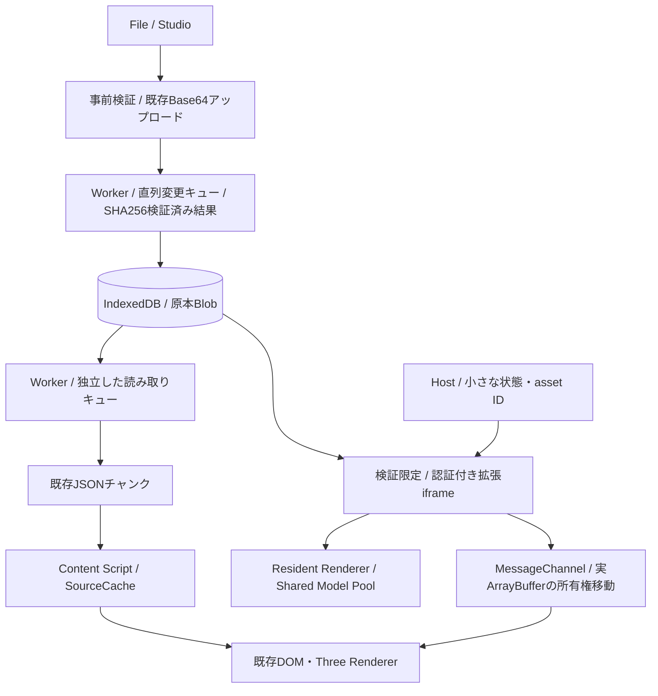

# Asset Runtime v1 検証結果

2026-10-20 / 起点 `bd29d00` / `codex/creator-editor-spike`。
設計は [asset-runtime-v1.md](asset-runtime-v1.md)、数値と全試行は [benchmark JSON](benchmarks/asset-runtime-2026-10-20.json)。

## 判断

Stage 1は既存経路へ実装した。読み取りを保守処理の後ろへ並べず、変更のないBlob行の再保存をやめ、内容で確認した検証結果と変更不能なBlobを再利用する。

短期の次候補は、**既存DOM Rendererを維持した認証付きバイナリ取得**。保存済みモデルの表示中央値はチャンク2,424ms、バイナリ1,042ms。現在の2D/3Dの順序とグループCSSマスクを保ちやすい。

Resident Rendererは900msで表示でき、原本をContent Scriptへ送らず、3体の大容量VRMでジオメトリと画像ソースを共有できた。長期候補として有効。ただし単一iframeとページ側2Dの交互合成、グループ境界、Worker再起動後の権限復旧を解決するまで、制作環境の既定にはしない。

独自バイナリ形式を作るWorld Asset Compilerは、現時点で優先しない。原本・メタデータの準備と、最終Renderer内のGPUウォームアップ・共有を先に進める。

## 条件

- 同じ原本57,185,776 bytes（54.5366MiB）。内部仕様は **VRM 0.x**。VRM 1.0の実アバター実測ではない。VRM 1.0は自作fixtureで確認した。
- Windows（kernel 10.0.26200）、Core i7-13650HX、20論理CPU、16,873,545,728 bytes RAM。Chrome for Testing 153.0.8010.12。ANGLE / Intel UHD Graphics / D3D11。
- 専用プロファイル、1920×1000のChromeウィンドウ、レイヤー指定200px・内部300×300描画面。Labは簡易surfaceで、制作UIのCSS配置を再現していない。Lab内の各方式は同じsurfaceを使う。各計測を直列実行した。通常のChromeプロファイルと両worktreeの既存distは使わず、変更していない。
- 各シナリオ5回。再追加は20回。GPU準備は4方式×2ブラウザーセッション×5回。初回は新しいプロファイル、以降は同じプロセス。OSとGPUドライバーのキャッシュは消去していない。初回標本は各条件1件なので、厳密なコールド分布を保証しない。
- 中央値・最大・nearest-rank p95を記録した。5件のp95は最大と同じ。実行順によるドライバーキャッシュの影響が残る。改善率を別PCへ保証しない。
- 各コンテキスト内の`performance.now()`の差を使う。異なる時計の開始値を差し引かない。表示完了は既存Rendererの描画・コピー・2 RAFと非透明ピクセルの確認。物理ディスプレイへの提示時刻ではない。
- 原本、テクスチャ、アバターのスクリーンショットはコミットしていない。原本の外見・リグ・モーションを変える軽量化は実施していない。

## 経路とモジュール



| モジュール                                                        | 変更・責務                                                                                                  |
| ----------------------------------------------------------------- | ----------------------------------------------------------------------------------------------------------- |
| `src/assets/work-queue.ts`                                        | 同時実行数と待機件数を制限。Workerの変更は1、読み取りは2                                                    |
| `src/background/index.ts`                                         | 読み取りを分離。lease/pruneは変更行だけ更新。原本のSHA-256が一致したWorker内の検証済み結果を再利用          |
| `src/assets/source-cache.ts`                                      | 同一IDの要求を統合。失敗は保存しない。1利用者の中断で他利用者を止めない。LRU・容量・期限                    |
| `src/assets/client.ts`                                            | 2件の取得、32件の待機、96MiBのBlob保持。各断片間で中断を確認。余分な原本コピーを削減                        |
| `src/assets/verified-source.ts`                                   | 検査直後に作った変更不能なBlobへ、再利用できるGPU予算検査結果を関連付ける。名前やメタデータだけでは作れない |
| `src/assets/glb.ts`                                               | 検査中のBINを読み取り用viewにする。範囲・有限値・外部URL・画像などの検査は維持                              |
| `src/diagnostics/asset-runtime-broker.ts`                         | tab/documentと承認済みIDに結び付いた、短命・使い捨てのiframe認証                                            |
| `src/diagnostics/asset-runtime-host.ts`                           | Content Scriptの検証用ブリッジ。世代・要求ID、snapshot再送、再接続、バイナリ取得                            |
| `src/diagnostics/asset-runtime-lab.ts` / `asset-runtime-scene.ts` | IDBを直接読み、既存ModelRendererを使う。別の3D描画実装は作らない                                            |
| `src/diagnostics/shared-model-pool.ts`                            | 実験限定の参照カウント、未使用LRU、224MiBの共有資源予算。使用中の資源は追い出さない                         |
| `src/diagnostics/asset-gpu-preparation.ts`                        | 明示的なテクスチャ準備、compileAsync、GPU queryとAPIのCPU時間計測                                           |

通常ビルドはLabのWAR・通信ハンドラー・Content Script操作APIを公開しない。`manifest.json`、Chrome権限、IndexedDBの版、DesignDocument v11は変更していない。旧DesignDocumentの移行処理、Editor Core、World Runtimeは維持した。

SourceCacheの期限による整理は次の要求時に行う。Rendererの終了では即時clearするため、既存経路で最後のモデルを消してScene自体を閉じた場合まで常駐を保証しない。常駐・再追加の実測はStage 4の検証実装の値である。

## Stage 1の前後

5回の中央値 / 最大（ms）。同じファイルを再度インポートする条件であり、保存済みIDだけの配置とは異なる。

| 条件                                 | 改善前 中央 / 最大 | 改善後 中央 / 最大 |
| ------------------------------------ | -----------------: | -----------------: |
| 実YouTube・retro・公式サイドパネル   |      7,119 / 9,254 |      3,762 / 6,125 |
| 拡張ページ・保存とチャンク取得を含む |      3,948 / 4,109 |      3,030 / 4,234 |
| 同じRendererへFile直接               |        644 / 1,066 |        627 / 1,065 |
| 同じRendererへIDB直接                |          482 / 963 |          471 / 998 |

実YouTubeの中央値は今回約47%短縮したが、初回最大値と直接読み込みの基準値も併記した。保存経路の初回最大値は改善していない。

Worker RPCの待機時間の合計中央値は2,215→258ms。合計は複数要求の観測値であり、そのまま全体の経過時間へ加算する値ではない。転送単位は変更しておらず、実YouTubeのbulk RPCは前後とも31回、Base64本体は152,495,472文字だった。Stage 1だけで原本往復を解消したとは扱わない。

raw原本は往復114,371,552 bytes相当。bulk 31要求は応答と合わせて62メッセージで、別途lease・検証・診断等がある。同時要求の統合は有効だが、通常Sceneの終了時にはSourceCacheも解放する。

改善後の主な区間。内側の区間は外側に含まれるため、この表を縦に足さない。

| 区間                                         | 初回 / 5回の中央値 ms |
| -------------------------------------------- | --------------------: |
| File読み取り                                 |              65 / 146 |
| importerコンテナ検査                         |             104 / 119 |
| importer画像デコード検証（内側の検査を含む） |             307 / 144 |
| アップロード断片全体                         |         1,422 / 1,088 |
| upload-finish RPC                            |             611 / 167 |
| Worker SHA-256                               |               56 / 46 |
| Workerコンテナ検査                           |   96 / 検証済み再利用 |
| Workerテクスチャ検証                         |  321 / 検証済み再利用 |
| IDB書き込みtransaction                       |              95 / 103 |
| Renderer側の原本取得全体                     |         1,141 / 1,155 |
| ダウンロード後の検査                         |               70 / 92 |
| Renderer Blob→ArrayBuffer                    |               79 / 78 |
| GLTF parse（画像とVRM afterRootを含む）      |              114 / 96 |
| VRM後処理                                    |               50 / 42 |
| bounds                                       |               15 / 13 |
| 最初のrender                                 |             597 / 167 |
| 最初の描画〜2 RAF                            |             678 / 203 |

### 前回8,276msの内訳

前回の同一traceで、重複しない大区間は保存まで3,350.2、取得2,328.7、Blob読み取り147.5、Renderer検査181.2、GLTF解析161.9、VRM後処理146.9、bounds31.8、初回描画〜2 RAF 1,371.7ms。合計7,719.9ms、残り556.6ms。

「約3秒」の大部分は、粗い一覧に含まれていなかった検証・保存・Blob処理などで説明できる。残る556.6msは、過去ログの計測点だけではUI・通信・テストのポーリング等へ正確に配賦できない。別コンテキストの開始値を引いて穴埋めはしていない。今回のテスト制御側の全体値にも操作開始・ポーリングの遅延が含まれる。

## 保存済み原本の比較

実YouTube上、5回。取得と実表示を分けた比較。モデルは同じ。

| 経路                | 取得区間 中央 / 最大 ms | 表示 中央 / 最大 ms | 原本の移動                                                   |
| ------------------- | ----------------------: | ------------------: | ------------------------------------------------------------ |
| Stage 1後のチャンク |           1,749 / 2,706 |       2,424 / 4,718 | 14断片、raw 57,185,776 bytes相当をBase64で受信               |
| MessageChannel      |               148 / 172 |       1,042 / 1,130 | raw 57,185,776 bytesを1回転送。送信ArrayBufferのdetachを確認 |
| Resident            |               1.0 / 1.1 |         900 / 1,171 | Content Scriptへの原本移動0 bytes                            |

**取得区間の終点は同一ではない**。チャンクは検査済みBlob、バイナリは受信ArrayBuffer、Residentの1msはIDBのBlobハンドル取得。ResidentのBlob→ArrayBuffer読み取りは描画準備側に含まれる。速度の判断は右の表示完了を用いる。バイナリ経路には、現行RendererのBlobラップ・再読み取りが残る。

通信ログの`binaryBytes`は原本の実転送量、`messages`はLabのrequest/reply等、`smallBytes`は小さな制御requestのJSON文字数。診断結果の収集通信まで含む全wire byte数ではない。Chrome JSON RPC数とMessagePortメッセージ数は別に数えている。

別のResident初回試行は1,997ms、ウォーム4件は815〜884ms。接続の作り直しから表示まで5件の中央値888、最大973ms。5回のYouTube全画面ではfullscreen要素はHTMLで、iframeを内側に保てた。YouTube設定メニューは実際にクリックできた。

fixtureではプレイヤー要素だけの全画面、iframe再生成5回、同じURLへの再読み込み5回を確認した。再読み込みでは旧ticketを再利用せず、世代と認証を更新してsnapshotを再送する。ページ側からの偽ticketは拒否する。通常表示のiframeとキャンバスはクリック透過。OFFで撤去する。

## 常駐・共有と負荷

| シナリオ                                   | 件数 |  中央 / 最大 / p95 ms |
| ------------------------------------------ | ---: | --------------------: |
| 同じ大容量VRMを3体表示                     |    5 | 1,730 / 3,108 / 3,108 |
| 常駐資源から削除・再追加                   |   20 |       687 / 985 / 914 |
| ページ再読み込み＋再認証＋表示             |    5 | 4,224 / 5,263 / 5,263 |
| lease/release/prune 17要求と読み込みの競合 |    5 | 2,733 / 3,554 / 3,554 |
| 同時実行した保守処理                       |    5 | 2,051 / 2,074 / 2,074 |
| 異なる3原本を順に表示                      |    5 |   841 / 1,018 / 1,018 |
| 大容量3体＋別のVRM2体                      |    5 | 1,625 / 2,054 / 2,054 |

異なる原本は大容量アバター1つと自作の小型VRM2つ。同じ54.5MiB級の異種モデルを5つ測った結果ではない。3体の大容量モデルで共有geometryは5個、共有画像Sourceは5個。VRMのHumanoid、骨格、morph influence、表情、LookAt、SpringBone、AnimationMixer、MToon material/UV状態は個別。geometry、画像のSourceだけを共有し、Texture自体のUV変換も共有しない。fixtureで片方の表情とUV/morphを変え、他方に影響しないことを確認した。

共有資源の推定値は約168.3MiBで、3インスタンス合計の推定は176,489,956 bytes。これは安全予算の計算値。実GPUメモリを計測した値ではない。全体256MiBの制限を引き上げて3体を通したわけではない。

複合シーンはさらに自作2D画像20枚と、各モデルsceneの既存Ambient/Directional lightを使った。2DはLabのDOM画像で、20枚の独立した高解像度作品の再現ではない。3Dは既存30fps上限に対し、定常28.35〜29.28fps、CPU frame p95 6.0〜10.3ms、最後に取得できたGPU query 7.9〜15.1ms。GPU queryは区間全体のp95でもGPU使用率でもない。読み込み待ちを含むrolling FPSは別の値になるため、定常値の前に観測をリセットした。

20回の追加・削除は各回診断用の強制GC後に確認した。常駐待機のJS heapは7,301,140→7,407,716 bytes、ArrayBuffer等のbacking storageは54,625,456 bytesで一定。完全解放では参照・context・geometry等の所有数は0、backing storageは3,783,254 bytesへ低下した。

ただし冷開始はheap4,475,108 / backing1,923,691 bytes、全実験後のheapは9,767,588 bytesだった。コード/JIT・診断などを含む指標で、増分のretainerは未解析。プロセス全メモリが冷開始と同じになったとは言えない。長期リーク不存在、物理VRAMの回収時刻、ピークメモリ、GPU使用率は未確認。

## GPU準備とCompiler

File直接の同じモデル、4方式×2ブラウザーセッション×5回。2セッション目は同じプロファイルを閉じて再起動した。毎回新しいWebGL contextであり、GPUハンドルの永続化ではない。

| 準備                          | session 1 初回 / 中央 / 最大 ms | session 2 初回 / 中央 / 最大 ms |
| ----------------------------- | ------------------------------: | ------------------------------: |
| なし                          |             1,136 / 681 / 1,136 |                 612 / 612 / 718 |
| material textureをinitTexture |             1,107 / 623 / 1,107 |                 660 / 660 / 699 |
| compileAsync                  |                 995 / 700 / 995 |                 619 / 619 / 695 |
| 両方                          |                 936 / 610 / 936 |                 652 / 581 / 685 |

初回の準備なしrender586.2msのうち、シェーダー関連APIのCPU時間は497.7ms、特に`getProgramInfoLog`が492.5ms。テクスチャ関連APIのCPU時間は約33ms。残りにはThreeの準備、モーフ/スキン処理、buffer・draw等がある。これはAPI内で待ったCPU側時間で、純粋なGPUコンパイル時間ではない。過去の1,185msを、この新しい測定の比率で遡って分割していない。

両方を準備した初回はtexture API25.9ms、GPUのtexture command bracket8.12ms、compileAsync84.4ms、その後のrender280.3ms。render内にも`getProgramInfoLog`待ち222msが残った。compileAsyncだけで待ちがすべて消えるとは言えない。残る待ちをMToonや特定ドライバーの一要因へ断定しない。

compileAsyncの初回は82.9→18.4ms（両方では84.4→17.9ms）と2セッション目で短縮した。キャッシュの効果と整合するが、OS/ドライバーのどのキャッシュかは未分離。ウォームな全体時間はばらつき、compileAsyncだけで常に全体が速くなる結果ではない。

material textureのGPU queryはミップ生成等も含む。モーフ・ボーンの全GPU転送とGPUコンパイルを完全に二分した値は取得できていない。シェーダーのエラー検査をOFFにして数字を作る変更はしていない。

| Compiler候補                  | 今回の判断                                                                                          |
| ----------------------------- | --------------------------------------------------------------------------------------------------- |
| 内容hash・検証済みメタデータ  | 有効。既存IDを使い、再検証と要求を統合する                                                          |
| サムネイル                    | 次段階の制作UI向け。埋め込みthumbnailを含め、安全に抽出する。今回は生成速度を未計測                 |
| 独自モデル形式                | GLTF parseが前回162ms、今回中央値96ms。転送・shader待ちの対策より優先する根拠がない                 |
| texture/compileAsyncの準備    | 有効な区間がある。最終contextでの完全なウォームアップと資源保持を先に検証する                       |
| VRMの解析済みインスタンス生成 | 残る課題。今回は各VRMを個別parse後に共有する。安全なVRM component factoryなしにsceneだけcloneしない |
| LOD・品質低下                 | 外見を変えずに改善できたため、初手には採用しない。作者の方針を受ける別機能として検討する            |

`compileAsync`はKHR_parallel_shader_compileを利用するAPI。今回のGPUでは対応していた。[Three.js公式API](https://threejs.org/docs/pages/WebGLRenderer)と、固定版`node_modules/three/src/renderers/webgl/WebGLProgram.js`の初回利用時の情報取得処理を確認した。

## 再生中YouTubeへの影響

広告でない同じ動画ソースが連続再生している区間を各5件、約3秒ずつ測った。loadedmetadataによる世代変更、再生停止、負のカウンター差は無効とする。映像はこの試行では約24fps。

| 条件                  | droppedVideoFramesの増加量（5件） |
| --------------------- | --------------------------------- |
| 無負荷                | 0 / 0 / 0 / 0 / 0                 |
| チャンク経路          | 10 / 0 / 0 / 0 / 0                |
| バイナリ経路          | 0 / 0 / 0 / 0 / 0                 |
| Resident              | 0 / 0 / 0 / 0 / 0                 |
| 5モデル＋2D20枚の更新 | 0 / 0 / 0 / 0 / 0                 |

各方式は順番に試している。後の方式はGPUドライバーのキャッシュが効く可能性があるため、コールド条件でも欠落0と保証しない。入力遅延や長時間視聴、全機種の負荷も保証しない。

最初の計測では同一video要素で再生時間・総フレームが戻り、readyState 0の区間もあった。この結果を欠落0とするのは不適切なので破棄した。広告状態とloadedmetadataの世代を観測し直し、今回の有効25区間にはこの問題がなかった。

## 採用前の制約と移行順

1. **次の実装**: バイナリbridgeを正式なHost/Storage Adapterへ分離し、原本を承認済みasset IDだけで取得する。lease・取り消し・タイムアウト・Worker再起動時の再承認を追加する。既存チャンクへ戻せるflagを残す。Chrome runtimeはJSON通信であり、今回のArrayBuffer転送は別のMessageChannelである。[Chrome公式仕様](https://developer.chrome.com/docs/extensions/develop/concepts/messaging)
2. **原本の取り込み**: 信頼された拡張オリジンのAssetStoreでstaging Blobを保存し、WorkerへIDを渡す方式を検証する。現在は新規importのアップロード往復が残る。書き込み・検証・leaseの原子性を維持する。
3. **Preparedと常駐**: IDは原本SHA-256。派生キーはhash＋変換器/validator版＋オプション。版が変われば原本から再作成する。今回の共有キーはThree/three-vrm/頂点処理版を含む。GPU資源はRenderer世代内だけ保持する。
4. **要求状態**: 現在はloading→ready/errorとcancel。仮表示・低品質は実際に派生を生成した場合だけrepresentationとして追加する。未実装の品質状態をreadyと返さない。使用中の資源を追い出さず、未使用LRUから解放する。全コンテキスト共通のメモリ予算・優先度は未実装。
5. **Residentの合成**: iframeの上下に2Dを置く帯状の合成は、自作fixtureの実スクリーンショットのピクセルで確認した。ページ側2Dを個々の3Dの間へ挟む構成にはなっていない。ページ祖先のグループマスクもiframe内へ自動継承しない。共有合成境界、mask座標、2D/3Dの順序を決めてから一単位ずつ移す。全Rendererを一度に置換しない。
6. **再起動の取り決め**: ticketは1回・30秒、sessionは対象tabとIDリストに限定。接続ごとに新generationと鍵を発行し、旧応答を捨て、snapshot/ACK後に操作する。今回、Rendererの再生成は復旧するが、Worker側sessionはメモリのみ。Worker自身の再起動・10分の期限後は信頼されたStudioから新規承認が必要。永続的な認証成功を保証していない。
7. **全面移行のゲート**: WorldFrame、アンカーとviewport、group/maskを数値snapshotとして送り、従来Rendererと比較する。シアター・狭幅・SPAでの制作UIとの統合、任意の重なり順、異なる大容量原本5つ、長時間・GPU context喪失からの複合復帰は追加検証が必要。
8. **Desktop Host**: Editor Core/World RuntimeはIDと評価値を扱い続ける。SourceのBlob取得をファイルAdapterへ、認証/MessagePortをHost通信へ差し替える。GPUハンドルやVRM componentを作品JSONへ保存しない。Rendererの種類と存続範囲はHostが決める。

既存の64MiB/原本、256MiB/保存、256MiB/ページ推定GPU予算は維持した。異なる54.5MiB級5原本は現行の保存予算にも入らない。大容量素材を扱う全体予算を、単純な上限引き上げで代替しない。

拡張iframeの公開はLab HTMLだけをYouTube向けに許可し、鍵・asset allowlistを別に照合する。[Web Accessible Resources公式仕様](https://developer.chrome.com/docs/extensions/reference/manifest/web-accessible-resources)。CSPは既存の`script-src 'self'; object-src 'none'`を維持する。モデルから外部URLを読み込まず、任意JSを実行しない。

## 検証と再実行

Stage 1の全体回帰は330成功・15条件付きskip。最終通常ビルドの全体回帰は**333成功・24条件付きskip（11.7分）**。skipは明示的な実サイト・私有原本・診断ビルド用テストであり、成功件数へ入れていない。別途、診断ビルドの機能fixture、実サイトの各5回測定、20回の解放、GPUの40試行を実行した。型チェック3設定、lint、通常と診断ビルドも通過した。

追加したfixtureは、キュー分離、同一取得の統合、キャンセル、失敗再試行、容量LRU、検証済みBlob、認証拒否と再接続、バイナリのdetach、独立した表情/morph/UV、共有参照と解放を確認する。既存の保存・破棄・Undo/Redo・データ移行・2D・動画・マスク・Runtimeの回帰も実行する。

再読み込みの初回測定は、破棄済みCDP contextをテストが参照して失敗した。テスト側で古いcontextを除外して再取得し、5回を完了した。計測失敗をRendererの改善値へ含めていない。

失敗の再現条件は、連続したページ再読み込み後に`Runtime.enable`で列挙したcontext IDを、そのまま順に評価する旧helper。3回目の再読み込みで`Cannot find context with specified id`となった。動画計測の旧条件は`video`先頭のカウンターをソースの切り替えを確認せずに差し引くもの。14.33→1.76秒、総フレーム433→48という区間があり、無効とした。修正版は広告とmetadata世代の変化を除き、有効区間5件を要求する。

| 段階                              | コミット  |
| --------------------------------- | --------- |
| Stage 1 / 既存経路                | `16a3e35` |
| Stage 2 / Resident                | `1e2bf44` |
| Stage 3 / バイナリ比較            | `82c8d23` |
| Stage 4 / 共有キャッシュ          | `675174c` |
| Stage 5 / GPU・再生品質・シナリオ | `e19c659` |

mainは`022a576e5fb486b5c2fe5632feee66fcb018c953`のまま。mainと実験worktreeの既存`dist/content/index.js`のSHA-256は作業前と一致した。

実行例（専用worktreeでPowerShell）:

```powershell
$env:AROUND_ASSET_PROFILE='1'
node scripts/build.mjs
$env:AROUND_TEST_EXTENSION_PATH='.work/asset-profile-dist'
$env:PLAYWRIGHT_BROWSERS_PATH='C:/Users/sm787/GitHub-Projects/web-world-themes/.work/browsers'
$env:AROUND_VRM_FILE='<ローカル原本のフルパス>'
# 機能検証
$env:AROUND_ASSET_LAB_TEST='1'
node scripts/test.mjs tests/asset-runtime-lab.spec.ts --workers=1
# 実サイト測定は必要なflagだけ明示し、直列実行する
# AROUND_ASSET_RESIDENT_LIVE / AROUND_ASSET_BINARY_LIVE / AROUND_ASSET_CACHE_LIVE
# AROUND_ASSET_GPU_LIVE / AROUND_ASSET_SCENARIOS_LIVE / AROUND_ASSET_QUALITY_LIVE
node scripts/test.mjs tests/asset-runtime-performance.spec.ts --workers=1
node scripts/summarize-asset-runtime.mjs
```

計測用Labは`chrome-extension://<拡張ID>/diagnostics/asset-runtime-lab.html`。通常ビルドには含めない。通常候補のビルド出力は`.work/asset-regression-dist`に分けている。
