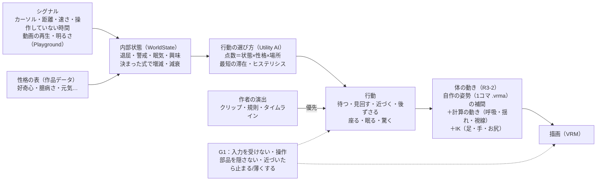

# キャラの自律行動：調べと設計案

2026-11-05、Claude Code。コードは変えていない。本格的な実装も始めていない。対象は翔太のアイデア「キャラが内部状態と周りの環境から、行動と体の動きをその場で作る」。Playground と予定は [playground-plan.md](playground-plan.md)。

## 読んだもの・読めなかったもの

- 読んだ：AGENTS.md、[r3-plan.md](r3-plan.md)、[product-design.md](product-design.md)、[spatial-design.md](spatial-design.md) の4節（キャラ）・7節（世界の状態の3分類）・8節（動画シグナル）・10節（性能の予算）、`src/characters/`、`src/assets/vrma.ts`、`src/world/models.ts`・`motion.ts`、`src/signals/`、`src/host/`、`src/sites/`、`src/browser/`
- ~~読めなかった：製品の設計書（Claude Docs）の6節~~ → **2026-11-05 に写しを受け取った**（[product-design-snapshot.md](product-design-snapshot.md)）。下の「設計書との食い違いと直したこと」で合わせ直した

## 設計書との食い違いと直したこと（2026-11-05）

| 項目               | この文書の最初の案                       | 設計書                                                                                                                                           | 直したこと                                                                                                                                                                                                            |
| ------------------ | ---------------------------------------- | ------------------------------------------------------------------------------------------------------------------------------------------------ | --------------------------------------------------------------------------------------------------------------------------------------------------------------------------------------------------------------------- |
| 歩く               | 「R3〜コンテストでは作らない」           | 標準の動作で walk は必須。R3 は「待つ・歩く・座る」。「間の自動補完」で近ければ歩く。一方で「動きの3段階」には「歩かずに移る」もある             | 歩くは**翔太が作る walk.vrma（作った動き）で再生する**。計算で歩行を作ることはしない。設計書の中で「歩かずに移る」と「近ければ歩く」の両方があるので、**どちらを優先するかを翔太に確かめたい**（下の3節の表に書いた） |
| 性格               | R4 で性格のつまみ4本を作品データに入れる | 「動きの設計の段階」0（性格を選ぶ）は**後で**。R6 のあと、感情ごとの動作がそろってから決め直す。動作が少ないうちは見た目がほとんど変わらないため | R4 では**性格のつまみを作品に出さない**。感情の上がり方・下がり方の係数はエンジンの既定値として持ち、R6 のあとに性格として外に出す                                                                                    |
| 行動の選び方の材料 | 内部状態とシグナルだけ                   | **部品の「できること」**（動画カード＝座る・寝転ぶ・覗き込む、プレーヤーの上の縁＝腰かけて見る、など。シムズの冷蔵庫と同じ考え方）               | Utility AI の点数に、「近くの部品が持つできること」を入れる。部品とできることの対応はアダプター（`src/sites/`）が持つ                                                                                                 |
| 内部状態の名前     | 退屈・警戒・眠気・興味                   | 感情は「怖い・安心・楽しい」など（R4）。怖いは楽しいより優先。台本は「怯えている」（旧：機械の部屋の台本）                                       | 内部状態を**怖い・安心・楽しい・退屈**を中心に組み直す（眠気・興味は次に回す）。Playground の最小の形の「驚き（警戒）」は「怖い」の一部として扱う                                                                     |
| よける             | 「R3 では薄くするだけ、よけるは後」      | G1 とキャラ：「止めるのではなく、よける（dodge）」。よけきれないときは今までどおり消える                                                         | 変えない（R3 は薄くするだけ）。dodge は R4 の「場所と自動の移動」と一緒に作る                                                                                                                                         |

## 設計書の更新との関係（2026-11-06）

設計書に「空間の設計思想（2026-11-06 決定）」が増え、最初の作品は「機械の部屋」から「生活感のある高品質な部屋」に変わった（[product-design-snapshot.md](product-design-snapshot.md)）。この文書への影響は次のとおり。

| 項目             | 前の前提                                           | 今の扱い                                                                                                                                                                                                                                                                                                                                  |
| ---------------- | -------------------------------------------------- | ----------------------------------------------------------------------------------------------------------------------------------------------------------------------------------------------------------------------------------------------------------------------------------------------------------------------------------------- |
| 台本と「怖い」   | 機械の部屋で、奥の「何か」に怯えるトルーシェ（旧） | 台本は新しい作品で書き直す（翔太がこれから決める）。内部状態の**怖い・安心・楽しい・退屈**はそのまま。設計書の感情（R4）と音の節に、作品によらない仕組みとして残っている。「怖い」の出どころ（奥の影・フラッシュ）は台本の話なので、エンジンはカーソルの急な接近などのどのサイトにもあるシグナルだけで上げ下げする（今の作りのまま）      |
| キャラのいる場所 | ページの部品の縁と、プレーヤーの中だけ             | 世界の奥行きが**部屋（UI の奥）・UI の板・UI の手前**の3つになる。自律の行動に「どの奥行きにいるか」と「奥行きを移る」が加わる候補（逃げる＝部屋へ下がる、近づく＝手前へ出る、など）。手前で操作部品を横切る道は選ばず、横切るのは奥か操作部品のない所（設計書）。奥行きを持つのは R5 の組み直しの後なので、R4 の自律の最小の形は変えない |
| 隠れる           | 枠の陰に隠れる（旧の台本）                         | 家具の裏に隠れる（部屋の奥行きの情報で決める）。部屋の形の情報が要るので R5・R6 の後                                                                                                                                                                                                                                                      |

## 言葉の決まり

- 「感情」「気持ち」は、**内部状態の名前**として使う。「本当に感情や意識がある」とは書かない・言わない（UI の文言も「退屈の度合い」「警戒の度合い」のように、状態の値として見せる）
- LLM と AI の API は使わない。常時の接続や課金を前提にしない。決まった数式・表・状態機械だけで動く
- **キャラの動きと自律行動は、サイトの言葉で書かない**（2026-11-05、翔太の決定）。書いてよいのは、部品の種類（縁・床・操作部品など。`data-around-surface` の種類と、アダプターが渡す位置の基準）と、どのサイトにもあるシグナル（カーソル・スクロール・操作していない時間・`<video>` の再生と一時停止など）だけ。YouTube の部品名（`ytd-*`・`#movie_player` など）やサイトの名前で分ける処理は、アダプター（`src/sites/`）に置く
  - 確かめ方：同じ作品・同じ動きが、アダプターを替えるだけで YouTube と Playground の両方で動くこと。位置の基準は両方のアダプターで同じ定数（`src/sites/anchors.ts` の `SHARED_DECORATION_ANCHORS`）を使う
  - 自律の段階（R4）の e2e は、Playground と YouTube の模擬ページの両方で同じ期待値を回す

## 0. 結論

| 問い                | 答え                                                                                                                                                                                                                                                                          |
| ------------------- | ----------------------------------------------------------------------------------------------------------------------------------------------------------------------------------------------------------------------------------------------------------------------------- |
| 今の作りでできるか  | **土台はある。** world の時計と状態、シグナル（ポインター・距離・角度・速さ・操作していない時間・スクロール・動画の再生）、VRM の描画、1コマの .vrma、体型の測定、G1 の守りは使える。足りないのは「内部状態」「行動の選び方」「計算の動きの重ね」「姿勢の間の補間と IK」の4つ |
| どう作るか          | **欲求と状態の数値（決まった式で増減）→ Utility AI で行動を選ぶ（最短の滞在時間とヒステリシス付き）→ 行動ごとの姿勢と計算の動き → IK。** ビヘイビアツリーは使わない（作者がノーコードで触るには、数値の表のほうが分かりやすい）                                               |
| R3-2・R4 との重なり | **大きく重なる。** R3-2（計算の動きを重ねる）は自律の「体」、R4（感情と場所）は自律の「頭」そのもの。新しい段階を作るより、R3-2 と R4 の中身をこの方向に寄せるのがよい（7節）                                                                                                 |
| 自然さ              | 待つ・見回す・振り向く・驚く・座る・眠るは、自作の姿勢＋計算＋IK で届く見込み。**歩くは難しい**（製品の決定「歩かずに移る」とも合う）。立ち上がる・座り込む（姿勢の間の移り）は、補間だけだと不自然になりやすく、中間の姿勢が要る（3節）                                      |
| ライブラリ          | three-procedural-locomotion は MIT で、作りも参考になるが、v0.1.0・作者1人・数日前に公開。**依存にしない。考え方を参考にし、要れば小さな部品だけを MIT の表示付きで取り込む**（6節）                                                                                          |

## 1. 今の作りでどこまでできるか

| 要るもの           | 今あるもの                                                                                                                                                                                                                         | 判定                                                                                                                                                |
| ------------------ | ---------------------------------------------------------------------------------------------------------------------------------------------------------------------------------------------------------------------------------- | --------------------------------------------------------------------------------------------------------------------------------------------------- |
| 時計と決定的な評価 | world の `step`（`evaluateWorld`）、入力列から同じ結果。乱数は seed を状態に持つ決まり（spatial-design.md 0節）                                                                                                                    | **できる**                                                                                                                                          |
| 周りの環境         | シグナルの登録表（`src/signals/registry.ts`）：`mouse-x/y`・`layer-distance`・`layer-angle`・`mouse-speed`・`idle`（操作していない時間）・`scroll`、動画の再生（`PlaybackSource`）。操作面と接近（G1.2 の `environment.approach`） | **できる**（カーソルとの距離・急接近・退屈の元になる「操作していない時間」がそろっている）                                                          |
| 置き場所           | 座れる縁は R3-3 の予定（まだない）。部品の位置はアダプターが持つ                                                                                                                                                                   | **R3-3 待ち**                                                                                                                                       |
| 内部状態の保存     | WorldState（その場の状態）。永続の記憶は段階7の Memory Repository（既定 OFF・明示のオプトイン）                                                                                                                                    | その場の状態は**できる**。「何度も驚かされると警戒する」は、まずページを開いている間だけにする。ページをまたいで覚えるのは段階7の記憶の仕組みを待つ |
| 体の動き           | VRM の描画、.vrma の再生（R3-1）、視線・頭の向き、揺れもの、表情                                                                                                                                                                   | 再生は**できる**。重ね・補間・IK は**ない**（R3-2）                                                                                                 |
| 体型の違い         | `measureBody`・`classifyBody`（R3-1）                                                                                                                                                                                              | **使える**（4節）                                                                                                                                   |
| 作者の演出         | 作者のクリップの指定、シグナルの規則、タイムライン（テイク）                                                                                                                                                                       | **ある**。自律との優先順位は新しく決める（2節）                                                                                                     |
| 操作性             | キャラは入力を受けない。接近で止まる（G1.2）。薄くする（R3-3 の予定）                                                                                                                                                              | **ある**                                                                                                                                            |

## 2. 構成案



### 内部状態

| 状態 | 増える                                                         | 減る                                                         | 例                                                        |
| ---- | -------------------------------------------------------------- | ------------------------------------------------------------ | --------------------------------------------------------- |
| 退屈 | 操作していない時間、同じ場所にいる時間                         | 動画の盛り上がり（明るさの変化・再生の再開）、カーソルの接近 | 退屈が高い → 足をぶらぶら、見回す、伸びをする             |
| 警戒 | カーソルの急接近（`mouse-speed`×`layer-distance`）、驚いた回数 | 時間で減衰                                                   | 警戒が高い → 驚く閾値が下がる、距離を取る                 |
| 眠気 | 動画を見ている時間、夜（Host が渡す時刻帯）                    | 驚き、カーソルの接近                                         | 眠気が高い → 座る、うとうと、眠る                         |
| 興味 | 好奇心×カーソルのゆっくりした接近                              | 時間で減衰                                                   | 興味が高い → カーソルを見る、近づく（小さく、縁の上だけ） |

> 2026-11-05：設計書に合わせて、R4 の中心は **怖い・安心・楽しい・退屈** にする（上の表は最初の案のまま残す）。怖いは楽しいより優先する。

- 式は「前の値＋入力×係数−減衰×経過時間」を 0〜1 に切ったもの。係数は、R4 ではエンジンの既定値（性格として外に出すのは R6 のあと）
- 「何度も驚かされると警戒する」は、警戒の減衰を遅く・増え方を大きくするだけで表せる（驚いた回数そのものを数えて上限付きで持つ）

### 性格と行動の傾向（作品データ、ノーコード）

> 2026-11-05：設計書では性格（動きの設計の段階0）は R6 のあと。下は**そのときの形の案**として残す。R4 で作品に入れるのは、行動の ON/OFF と、部品ごとの「この部品では必ずこれ」の上書き（設計書の段階1）まで。

作品データに入るのは数値と対応表だけ。JS・式の文字列・シェーダーは入れない（AGENTS.md）。

```json
{
  "temperament": { "curiosity": 0.7, "timidity": 0.4, "energy": 0.5, "sleepiness": 0.3 },
  "behaviors": [
    { "id": "fidget", "weight": 1.0, "enabled": true },
    { "id": "approach-cursor", "weight": 0.6, "enabled": true },
    { "id": "sleep", "weight": 0.8, "enabled": true }
  ]
}
```

- 行動の種類（`fidget` など）と、その点数の式はエンジンの登録表に置く。作品は ID・重み・ON/OFF だけを選ぶ（今のシグナルの登録表と同じ考え方）
- 編集画面は、性格のつまみ（4本）と、行動の一覧の ON/OFF と重みの3つで足りる。「臆病で眠たがり」のようなプリセットも、つまみの値の組として用意できる
- 版は1段上げる（v15）。キャラの `character` の中に足す

### 作者の演出を壊さない

| 優先 | 何                                                         | 自律の扱い                                                                                 |
| ---- | ---------------------------------------------------------- | ------------------------------------------------------------------------------------------ |
| 1    | G1（操作性）・緊急 OFF・reduced-motion                     | 自律も止まる。reduced-motion では待つ姿勢だけ                                              |
| 2    | 作者のタイムライン・シグナルの規則で指定したクリップ・姿勢 | その間、自律は行動を選ばない（体の小さな計算の動き＝呼吸・まばたきだけ残すかは作者が選ぶ） |
| 3    | 作者が「自律にまかせる」とした時間・場所                   | 自律が行動を選ぶ                                                                           |

- 既定は「作者が何も指定していない時間だけ自律」。今の作品の動きは、そのまま変わらない（キャラの設定に自律がない作品は今と同じ）

### 決定的であること

- 行動の選び方は、同じ入力列・seed から同じ結果になる純粋な関数にする（world の決まり）。同じ点数のときは ID の順。揺らぎは状態に持った seed から作る
- 内部状態は録画（テイク）に入る。Host の制限（接近の停止など）は今どおり録画に入れない

## 3. 動きごとの難しさ

「計算だけ」＝呼吸・揺れ・視線・頭の向きなど、骨の角度を式で足すだけ。「姿勢＋IK」＝翔太が Blender で作る1コマの .vrma を補間し、足・手・お尻を IK で合わせる。「作った動き」＝数秒の動作を作る必要がある。

| 動き                         | 区分                                     | 3頭身（トルーシェ）                              | 等身大に近い体型 | 見立て                                                                                                           |
| ---------------------------- | ---------------------------------------- | ------------------------------------------------ | ---------------- | ---------------------------------------------------------------------------------------------------------------- |
| 待つ（呼吸・重心の揺れ）     | 計算だけ                                 | 易しい。体が小さいので揺れを小さく               | 易しい           | R3-2 の中心                                                                                                      |
| 見回す・振り向く             | 計算だけ（頭→胸→腰の順に遅れて回る）     | 易しい。頭が大きいので首の角度を小さく           | 易しい           | 視線の仕組みの延長                                                                                               |
| 足をぶらぶら                 | 計算だけ（座った姿勢の膝下に振り子）     | 易しい。ただし長いスカートで見えにくい           | 易しい           | 座った姿勢が前提                                                                                                 |
| 驚く（びくっ・後ずさり）     | 姿勢＋計算（驚いた姿勢へ速く寄せて戻す） | ふつう。腕が短いので手の位置を IK で調整         | ふつう           | 「驚きの姿勢」1コマが要る。後ずさりは半歩（足の IK）                                                             |
| 座る（座った状態）           | 姿勢＋IK（お尻を縁に、足を下へ）         | ふつう。R3-0 で椅子の型は確認済み                | ふつう           | お尻の接点（R3-2 の予定）                                                                                        |
| 座り込む・立ち上がる（移り） | **作った動きか、中間の姿勢2〜3コマ**     | 難しい。体型で腰の道すじが大きく違う             | 難しい           | 1コマ同士の補間だけだと、腰が浮いたり沈んだりして見える。中間の姿勢を足すか、Blender の短い動作が要る            |
| 眠る（座ったまま・寝転ぶ）   | 姿勢＋計算（呼吸を深く・頭を垂れる）     | ふつう                                           | ふつう           | 「寝転ぶ」は床に触れる所が多く、IK より姿勢を作るほうが早い                                                      |
| 近づく（数歩）               | **難しい**                               | 難しい。足が短く歩幅が小さい                     | 難しい           | 製品の決定は「歩かずに移る」。近づくのは跳ねる・身を乗り出す・1〜2歩の小さな移動にとどめる                       |
| 歩く（何歩も）               | 作った動き（翔太の walk.vrma）           | とても難しい（足が短く、スカートで脚が見えない） | 難しい           | 計算の歩行は作らない。設計書では walk は標準の必須の動作。「歩かずに移る」との優先は翔太に確かめる（2026-11-05） |

- 3頭身は、腕と足が短く頭が重いので、等身大の動き（手を顔に・腕を組む）が届かないことが多い。逆に、計算の小さな揺れは等身大より「かわいく」見えやすい。**3頭身は計算の動きと、専用の姿勢を中心にする**のがよい
- 長いスカートは、脚の動き（ぶらぶら・後ずさり）を隠す。トルーシェで脚の動きを見せたいなら、斜めの向き（R3 の案 A）と組み合わせる

## 4. VRM ごとの骨と体型の違い

- 骨の名前は中の形（`HUMAN_BONES`、VRM 1.0 の名前）でそろっているので、計算の動きは名前で骨を指せる。指・目・顎・上胸は無いモデルがある（トルーシェは上胸・目・顎なし）。**無い骨には動きを足さない**（必須の骨は `measureBody` の `REQUIRED` と同じ）
- 量の調整は体型の測定を使う
  - 揺れや身を乗り出す量 → 身長に比例
  - 後ずさりの歩幅 → 足の長さ（`legLength`）に比例
  - 首の回る量 → 頭身が小さいほど小さく（頭が重く見えるので）
  - 手の届く範囲（IK）→ 腕の長さ（`armLength`）。届かない姿勢は、より単純な姿勢に切り替える（product-design.md の決まり）
- 段階の判定（`classifyBody`）の使い方
  - 段階1（崩れる体型）：自作の姿勢のうち「どのモデルにも当てられる版」は使わない。計算の動きと、そのキャラ専用の姿勢だけ
  - 段階2：どのモデルにも当てられる姿勢＋計算の動き
  - 自律の行動の一覧は同じ。行動ごとに「使える姿勢がなければ、その行動は選ばない」とする（点数を0）
- **分からない**：同じ1コマの姿勢を、体型の違うモデルに当てたときの崩れ方（腕が体に入る・足が浮く）。試し方：翔太の素体とトルーシェと、再配布できる VRM（Playground 用）の3体に、同じ姿勢5種を当てて正面と横から描く（R3-0 の試しの道具がそのまま使える）

## 5. 複数のキャラの性能

- 今の記録（[r3-plan.md](r3-plan.md) の Codex の交互計測）：トルーシェ1体の定常で、拡張の CPU 時間は中央値 0.8ms・p95 1.9ms／フレーム。キャラなしは 0.0ms。つまり **VRM 1体の描画と姿勢の更新で約 0.8ms**
- 自律を足したときの見積もり（測っていない）

| 中身                                        | 1体あたり（見積もり） | 根拠                                                                                                   |
| ------------------------------------------- | --------------------- | ------------------------------------------------------------------------------------------------------ |
| 内部状態の更新と行動の選び方                | 0.02〜0.05ms          | 数値の式が十数個と、行動10個ほどの点数。world の今のシグナルの評価（32規則×64キーで 0.05ms）より小さい |
| 姿勢の補間・計算の動き・IK（2本の骨×4か所） | 0.1〜0.3ms            | 骨50本ほどの角度の足し算と、解析解の IK                                                                |
| VRM の描画と 2D への写し（今の方式）        | 約 0.8ms              | 上の記録                                                                                               |
| 合計                                        | **約 1.0〜1.2ms**     |                                                                                                        |

- 2体で約 2〜2.4ms、3体で約 3〜3.6ms。spatial-design.md の主スレッドの目標（合計 4ms）に対し、**3体が上限の目安**。描画を 30fps に落とす（姿勢の更新は 30fps のまま決定的に）と、描画分がほぼ半分になる
- 減らす手：同じ合成単位で canvas を共有する（spatial-design.md 6節の「段階5」の課題）、見えないキャラは描かない、止まっている間は描かない
- **測るなら**：Codex の計測の道具（`docs/benchmarks/r31-fix/repro/perf.spec.ts`）で、キャラ1・2・3体の定常を2組だけ。合否の交互計測はしない。今回は測っていない（自律のコードがまだ無いので、測っても描画の分しか分からない）

## 6. ライブラリの候補

| 候補                                                                                        | ライセンス                    | 中身                                                                                                                                                                                                                                                                | 判断                                                                                                                                                                                                                                                                                                                                                                      |
| ------------------------------------------------------------------------------------------- | ----------------------------- | ------------------------------------------------------------------------------------------------------------------------------------------------------------------------------------------------------------------------------------------------------------------- | ------------------------------------------------------------------------------------------------------------------------------------------------------------------------------------------------------------------------------------------------------------------------------------------------------------------------------------------------------------------------- |
| [three-procedural-locomotion](https://github.com/PabloMesquida/three-procedural-locomotion) | MIT（2026, Pablo Mesquida）   | 歩く・走る・向きを変える・しゃがむ・跳ぶを計算で作る。2本の骨の IK、足の接地、腕と指の振り子、ばね、seed で決まる揺らぎ。TypeScript 約9,500行。依存は three だけ。src の中で `Math.random`・`performance.now`・`Date.now` を読んでいない（seed と経過時間で決まる） | **依存にはしない。考え方を参考にし、要るなら小さな部品（`TwoBoneIK`・ばね・振り子）だけを MIT の表示付きで取り込む。** 理由：v0.1.0・npm 未公開・作者1人・数日前の公開。主な価値は「歩く」で、製品の決定「歩かずに移る」とずれる。中に状態（ばね）を持つので、使うなら world の固定の刻みで進め、状態を WorldState に出す必要がある。同梱のモデル（`modelos/`）は使わない |
| three.js の `CCDIKSolver`（`three/examples/jsm/animation`）                                 | MIT（three と同じ、もう同梱） | 多関節の CCD 法の IK                                                                                                                                                                                                                                                | **使ってよい**が、足・腕は2本の骨なので、解析解（自前の数十行）のほうが速く、結果が安定する。尻尾・耳など3本以上の骨で要るときに使う                                                                                                                                                                                                                                      |
| @pixiv/three-vrm の lookAt・SpringBone                                                      | MIT（もう同梱）               | 視線と揺れもの                                                                                                                                                                                                                                                      | **今のまま使う**（R3-1 までと同じ）                                                                                                                                                                                                                                                                                                                                       |
| ビヘイビアツリー・Utility AI のライブラリ                                                   | —                             | —                                                                                                                                                                                                                                                                   | **入れない**。行動の数は10ほどで、表と式で足りる。決定的・作品データの検証の都合でも、自前の小さな評価のほうがよい                                                                                                                                                                                                                                                        |

## 7. R3-2・R4 の計画をどう寄せるか

| 段階             | 今の予定                                                                                          | 寄せ方                                                                                                                                                                                                                                                   |
| ---------------- | ------------------------------------------------------------------------------------------------- | -------------------------------------------------------------------------------------------------------------------------------------------------------------------------------------------------------------------------------------------------------- |
| R3-2             | 段階1の計算の動き（呼吸・横揺れ・まばたき・跳ねる・震える）、床の補正、お尻の接点、座るときの斜め | **そのまま、自律の「体」として作る。** 足すのは①姿勢の間の補間（1コマの .vrma 同士を、腰の道すじを決めて移る）②2本の骨の IK（足・手・お尻）③計算の動きの「強さ」を外から渡せる形（自律の状態が強さを変える）。これで自律がなくても、作者は今どおり使える |
| R3-3             | 座れる縁、ページの層の新しい置き方                                                                | 変えない。自律の「場所」の候補になる                                                                                                                                                                                                                     |
| R3-4             | 瞬間移動・跳ねる・縁の動作、きっかけ                                                              | **きっかけの選び方を、自律の行動の選び方に置き換える。** 「カーソル」「新しいコメント」「動画の停止」は、内部状態の入力にする                                                                                                                            |
| R4（感情と場所） | 感情、部品の「できること」、場所と自動の移動（設計書）                                            | **自律の「頭」：感情（怖い・安心・楽しい・退屈）・部品のできること・Utility AI・作者の演出との優先順位・dodge。** 性格のつまみは入れない（R6 のあと）。作品データ v15                                                                                    |
| 段階7            | 永続の記憶                                                                                        | 「何度も驚かされると警戒する」をページをまたいで覚えるのはここ。それまではページの中だけ                                                                                                                                                                 |

## できる・難しい・分からない

| 区分       | 項目                                                                                                                                                                                                                                                                                                         |
| ---------- | ------------------------------------------------------------------------------------------------------------------------------------------------------------------------------------------------------------------------------------------------------------------------------------------------------------ |
| できる     | 内部状態と Utility AI を world の決定的な評価に入れる。性格を数値の表で作品に持たせる。待つ・見回す・振り向く・驚く・座る・眠るを、自作の姿勢＋計算＋IK で作る。体型の測定で量を合わせる。G1 の守りの中で動かす                                                                                              |
| 難しい     | 座り込む・立ち上がるの移り（中間の姿勢か短い動作が要る）。歩く。3頭身で手を顔などに届かせる。スカートで隠れる脚の動きを見せる                                                                                                                                                                                |
| 分からない | ①同じ姿勢を体型の違う3体に当てたときの崩れ方（4節の試し方）②自律の「自然さ」が見る人に伝わるか（翔太が見て決めるしかない。12月の頭に判断の日を置く：[playground-plan.md](playground-plan.md) 11節）③自律＋VRM 3体の実際の CPU 時間（5節の測り方）④Claude Docs の設計書との食い違い（中身をもらって確かめる） |

# 動作の割り当ての提案（2026-11-05、翔太の OK 済み。組み込みは下の「割り当ての組み込み」）

手元の Mixamo 由来の 36 本（`C:\Users\sm787\Desktop\ローポリモデル用\out\anim\trusie\*.vrma`）を、トルーシェ（`out\trusie.vrm`）で headless の画面の外で再生し、各動作の5コマ（始め・1/4・半分・3/4・終わり）を並べた一覧を作った。一覧の画像はトルーシェが写っているので**手元にだけ置き、コミットしない**（`.work/chunk3-autonomy/.work/motion-sheet/trusie-motions-1.png`・`-2.png`、作ったスクリプトも同じ場所）。

- この表は提案だった。翔太の OK（2026-11-05）を受けて、自律の行動ごとに動作を当てる仕組みを足し、手元の YouTube の作品で確かめた
- Mixamo 由来の動作を使うのは、手元の YouTube の作品だけ。Playground の出力・標準の動作・配る作品には入れない（1コマの姿勢を切り出したものも入れない）
- 区間は5コマと各動作の記録（`*.json` の長さ・ループ・根の移動量）から選んだ見立て。細かい切り出しの秒は、組み込むときに動かして確かめる
- 根が動く動作（移動量が 0 でないもの）は、エンジンの移動（`shiftMovedModels`）と二重に動かないよう、根の移動を外して使う

| 自律の役目                     | 合う動作（秒）                                                                                       | 区間                                 | 速さ                                  |
| ------------------------------ | ---------------------------------------------------------------------------------------------------- | ------------------------------------ | ------------------------------------- |
| 何もないとき（rest）           | `idle`（Bored、10.7s、ループ）                                                                       | 全体                                 | 1.0                                   |
| 退屈が高い                     | `idle_think`（4.2s）・`idle_lean`（2.0s）                                                            | 全体                                 | 1.0                                   |
| 見回す                         | `idle`（Bored）の中の首振り／`peek`（物陰から覗く、3.0s）                                            | `idle` 2.7〜8.0s／`peek` 全体        | 1.0                                   |
| 驚く（速い接近の始まり）       | `surprised`（4.0s）／`react`（3.7s）                                                                 | `surprised` 0〜1.0s／`react` 0〜1.8s | 1.3（短く）                           |
| 逃げる（flee、移る途中）       | `jump`（その場で跳ぶ、2.6s）                                                                         | 0.6〜1.9s（踏み切り〜着地）          | 1.5（エンジンの跳ねる高さに合わせる） |
| 逃げた先で警戒する             | `scared`（10.1s、ループ）                                                                            | 全体                                 | 1.0                                   |
| 近づく（approach、遅い接近）   | `walk`（1.0s、0.61 m/s）                                                                             | 全体（ループ）                       | 0.5（エンジンの 70 px/s に合わせる）  |
| 近づいて身を乗り出す（lean+）  | `lean_wall`（1.9s）                                                                                  | 全体                                 | 1.0                                   |
| 家に帰る（return）             | `run`（0.7s、1.15 m/s）／`run_goofy`（0.6s）                                                         | 全体（ループ）                       | 1.0                                   |
| 跳ねて戻る（hop back）         | `jump`                                                                                               | 0.6〜1.9s                            | 1.2                                   |
| ぶら下がる（hang）             | `hang`（2.3s、ループ）                                                                               | 全体                                 | 1.0                                   |
| 縁で止まる・ふらつく           | `stop_at_edge`（2.8s、前へ 0.99m）・`teeter`（4.8s）・`edge_slip`（2.5s）                            | `stop_at_edge` 1.4s〜／他は全体      | 1.0                                   |
| 下へ降りる                     | `jump_down_3`（2.7s、下へ 0.44m）                                                                    | 全体                                 | 1.0                                   |
| 上へ登る                       | `climb_up`（3.8s、上へ 0.61m）                                                                       | 全体                                 | 1.0                                   |
| 座って待つ                     | `sit`（4.3s、ループ）・`sit_2`（4.0s）                                                               | 全体                                 | 1.0                                   |
| 座って足をぶらぶら（dangle）   | なし（計算の動き＋自作の姿勢で作る）。`sit_3` は座ったまま動きが小さい                               | —                                    | —                                     |
| 居眠り（doze）                 | なし（計算の動き＋自作の姿勢で作る）                                                                 | —                                    | —                                     |
| 腕を広げる                     | なし（計算の動き＋自作の姿勢で作る）。`greet`・`dance_2` に近いコマがあるが、5コマでは確かめきれない | —                                    | —                                     |
| 呼ぶ（招く）                   | `beckon`（2.6s）                                                                                     | 全体                                 | 1.0                                   |
| 目が回る（何度も驚かされた後） | `idle_dizzy`（4.3s）                                                                                 | 全体                                 | 1.0                                   |
| 起き上がる                     | `get_up`（2.3s）                                                                                     | 全体                                 | 1.0                                   |

役目に当てなかったもの：`cry`・`dance`・`dance_2`・`greet`・`push_button`・`run_look_back`・`run_wobbly`・`sit_typing`・`wobble`・`jump_up`・`jump_down`・`jump_down_2`（作者の演出の候補として残す）。

## 割り当ての組み込み（v15 `behaviourMotions`、`20e2645`）

今の自律の行動（休む・逃げる・近づく・居眠り・家に帰る）ごとに、キャラの動作の1つ・流す区間（秒）・速さを作品に持たせる。表の「驚く」「警戒する」「ぶら下がる」などは、自律にその行動がまだないので、当てる先がない（行動が増えたら、同じ形で名前を足す）。

| 項目       | 中身と上限                                                                                                                            |
| ---------- | ------------------------------------------------------------------------------------------------------------------------------------- |
| 置き場所   | `character.behaviourMotions`（v15、省略＝割り当てなし。今までどおり計算の動きだけ）                                                   |
| 行動の名前 | `rest`・`flee`・`approach`・`doze`・`return` だけ（`src/world/autonomy.ts` の `BEHAVIOURS` と一致することを unit で確かめる）         |
| 動作       | そのキャラの動作の id。動作を消すと、その割り当ても消える（クリップの番号が null になるのと同じ）                                     |
| 区間       | 0 ≤ から ＜ まで ≤ 動作の長さ（0.01 秒刻み）。1コマの姿勢（長さ 0）は 0〜0 だけ                                                       |
| 速さ       | 0.25〜4 倍（0.01 刻み）                                                                                                               |
| 流し方     | 行動が始まった時刻からの経過×速さを、区間の中で繰り返す。同じ入力なら同じコマ（決定的）。行動が変わると、今までの切り替えの重ねで移る |
| 流さない時 | 作者の動き（経路・時間のある動作）が出ている間、G1.2 の接近で止められている間、reduced-motion、自律が off、計算の動きが off           |
| エディター | 性格のスライダーの下に、行動ごとの表（動作・から・まで・速さ）。動作を選ぶと、その動作の全体・速さ 1 から始まる                       |

手元の YouTube の作品での確かめ（`tests/behaviour-motions-live.spec.ts`、`AROUND_LIVE_BEHAVIOUR_MOTIONS=1`、`AROUND_CHARACTER_VRM`・`AROUND_CHARACTER_MOTIONS` で手元のファイルを指す。リポジトリにはモデルも動作も入れない）：トルーシェ＋表の4本（`idle` 0〜10.66s・`jump` 0.6〜1.9s を 1.5 倍・`walk` 0〜0.96s を 0.5 倍・`run` 0〜0.73s）。

| 行動     | 描かれていたコマ     | 画像（手元だけ、`.work/chunk3-autonomy/.work/behaviour-motions-live/`） |
| -------- | -------------------- | ----------------------------------------------------------------------- |
| 休む     | `idle` の 9.7s       | `rest.png`：右下に座っている                                            |
| 逃げる   | `jump` の 0.61s      | `flee.png`：映っていない（下の「気になっている点」）                    |
| 家に帰る | `run` の 0.01〜0.17s | `return.png`：右上から走って戻ってくる                                  |
| 近づく   | `walk` の 0.62s      | `approach.png`：左へ歩いて寄っている                                    |

今の形のテストで3回回して、休む・逃げる・家に帰るは3回とも、近づくは2回、それぞれの動作が区間の中で流れた（届かなかった1回は、家に帰る途中からガードが描画を止めたままだった）。それより前の2回は、テストが行動の瞬間を読み損ねていた（読み方を直した）。保存した作品（素材を除いた層の JSON）は `.work/behaviour-motions-live/design-kept.json`。翔太の Chrome では、エディターでトルーシェと4本を読み込み、自律を on にして、表の通りに選べば同じになる。

# 塊3の完了報告（2026-11-05、Claude Code）

ブランチ `codex/chunk3-autonomy`（worktree `.work/chunk3-autonomy`）。塊2を `codex/creator-editor-spike` に取り込んだ `1702837`（とその上の docs の `c6e3ced`）の上に載せ直した。**中核を触った**（`src/host/`・`src/sites/`・`src/world/`・`src/design/schema.ts`・`src/design/migrations.ts`・`playwright.config.ts`、と `src/renderers/dom/scene.ts`）。**作品データの版を v14 → v15 に上げた**（この塊で1段だけ）。Codex の検証では e2e 全件（Windows）を回してほしい。

## 変更点と理由

| コミット  | 中身                                                                                                                                                                                                                                                                                       | 理由                                                                                                                                                             |
| --------- | ------------------------------------------------------------------------------------------------------------------------------------------------------------------------------------------------------------------------------------------------------------------------------------------ | ---------------------------------------------------------------------------------------------------------------------------------------------------------------- |
| `27d23d8` | 操作帯（上 64px・下 112px）を、**バーが出ている間だけ**守る。アダプターが videoSlot に「バーが隠れている」の class（YouTube は `ytp-autohide`）を渡し、ローカルの面の shadow root に `:host-context(.ytp-autohide){clip-path:none}` を置く。帯の切り抜きが既定で、class がある間だけ外れる | バーが出る最初のフレームに間に合わせるため。rAF や Observer の時刻ではなく、ブラウザーのスタイルの再計算が切り替えるので、class が外れたフレームから帯は切られる |
| `3ea7eb3` | 本物の YouTube での帯の確認（`tests/bands-live.spec.ts`、`AROUND_LIVE_BANDS=1`）：ポインター・`k`・矢印・Tab・一時停止・終了画面・広告                                                                                                                                                     | 依頼の「最初のフレームで帯の中のキャラの画素が0」を実サイトで                                                                                                    |
| `435ca2d` | プレーヤーの上の押せるもの（終了画面のカード・自動再生の次の動画とカウントダウン・カードのティーザー・商品・提案・広告のリンク）を操作面 `player.overlay.*` として渡す。ローカルの面の中身を、見えている面の周りでくり抜く（`path(evenodd)`）                                              | リンクやフォーカスできる箱は、今の `control` の選択子では漏れていた。重なり順だけに頼らない                                                                      |
| `83601bb` | v15：`character.personality`（臆病さ・好奇心・眠りやすさ、0〜1、0.01 刻み）、`computedMotion`（省略＝on）、`autonomy`（省略＝off）。移行 `migrateV14ToV15`、`history-v14.json`                                                                                                             | 性格と、作者が計算の動き・自律を止めるスイッチ                                                                                                                   |
| `0e2aae1` | 最小の自律（`src/world/autonomy.ts`、純粋な関数）：退屈・警戒・眠気の内部状態と、Utility AI（休む・逃げる・近づく・居眠り・家に帰る）。驚かされた回数の記憶                                                                                                                                | 依頼の2                                                                                                                                                          |
| `3e3e3d0` | エディター：計算の動き・自律のチェック、性格の3つのスライダー（自律が off の間は無効）                                                                                                                                                                                                     | 依頼の3                                                                                                                                                          |
| `51dd990` | 動きを**レイアウトで**動かす（`shiftMovedModels`：根の層の枠・範囲・位置をずらす）。逃げ先・近づく先を、住んでいる部品（アンカーの枠）の中に収める。Playground の住人をプレーヤーの右下（x 0.9・y 0.74）に置き、自律を on                                                                  | CSS の translate では、ガードと面の切り抜きが家の位置の範囲のままで、動いたキャラが切り抜かれて消えた                                                            |
| `f972cce` | 逃げるときの余白を「描く幅と高さの半分」に。本物の YouTube での自律の確認（`tests/autonomy-live.spec.ts`）                                                                                                                                                                                 | 箱の一部が部品の外へ出ていた                                                                                                                                     |
| `b6720e8` | シアターモードと全画面で右下に付いていくかの確認。自律の短い CPU 計測（`tests/r32-perf.spec.ts` に `body`／`autonomy` を足した）                                                                                                                                                           | 依頼の1・4                                                                                                                                                       |

### 重要な実装：帯の守り方（設計の理由・流れ・トレードオフ）

- **流れ**：アダプターは「バーが隠れている」ことを表す class 名だけを渡す（`barsHiddenClass`）。Renderer は名前の形（`^[A-Za-z][\w-]*$`）を確かめてから、ローカルの面の shadow root の `<style data-bars>` に1行の規則を書く。帯の切り抜き（`--around-decoration-clip`）は既定のまま
- **理由**：「バーが出る最初のフレーム」に間に合わせる方法として、こちらの rAF や MutationObserver で切り替えると、YouTube が class を外したフレームと、こちらが切り抜きを戻すフレームの間に1フレーム以上の遅れが出る。スタイルの再計算に任せれば、class が外れたその描画から切り抜きが効く
- **トレードオフ**：広告・メニュー・エラー・中央のボタンがあるときはローカルの面を使わない（今まで通り）ので、その間の帯は**常に**守られる（バーが隠れていてもキャラは帯に入れない）。作品データからは class 名もセレクターも受け取らない（アダプターが持つ）
- **わざと壊して確かめた**：規則を逆にしたビルド（模擬ページ）で `tests/operation-bands.spec.ts` が落ちる

### 自律の記憶の層

驚かされた回数（`startles`）は、**このページの中だけ**（`WorldState`）に持つ。録画の再生で同じ結果になり、決定的。ページをまたいで覚えるのは設計書の段階7（永続の記憶）で、同意と保存の場所が要るので、ここでは入れない。新しいキャラの `autonomy` は既定で off（古い作品の動きを変えないため）。

### G1 と作者の動き

- 作者の動作（経路・時間のある動作）が出ている間は、自律の動きを重ねない（`authorActive`）
- G1.2 の接近で止められている間も、自律の移動（位置だけ、骨は休みの姿勢）は進める。逃げる途中で固まらない（`yielding`）
- キャラは入力を受けない。操作面の守り（切り抜き・停止）は、動いた後の位置で判定される（レイアウトで動かすため）

## 設計書と違う判断

- `docs/autonomy-plan.md` 7節では「性格のつまみは R6 のあと」としていたが、依頼に従い v15 で性格の3つの数を入れた。行動の選び方は性格を係数に使うだけで、つまみの意味は今後も変えられる（値は 0〜1 の数だけ）
- 動作の割り当て（`behaviourMotions`）は、報告の後で翔太の OK を受けて足した。版を v16 に上げず、この塊の v15 に入れた（v15 はまだ検証前で、どこにも配っていないため。「1回の作業で版上げは1段まで」の中に収めた）。旧版にこの項目があれば、v14→v15 の段で拒否する

## 計測

短い計測（仮説の確認。合否は Codex の交互計測）。本物の YouTube・headless・1600×900、マネキンの住人1体、定常の5秒、2組（順を入れ替え）。[結果](benchmarks/chunk3/autonomy-short-cpu.json)

| 組  | 自律 off（中央値 / p95 ms） | 自律 on（中央値 / p95 ms） |
| --- | --------------------------- | -------------------------- |
| 1   | 0.70 / 1.60                 | 0.70 / 1.50                |
| 2   | 0.70 / 1.40                 | 0.80 / 1.50                |

差は 0.1ms の刻みの中（ポインターを動かさない場面。逃げる・近づくの最中は測っていない）。起動直後の性能（塊2から持ち越しの「未判定」）は、新しい測り方（8組以上・同じ版どうしの振れの幅、`around-perf`）で Codex が決着をつける。

## テスト

| 種類            | 件数・結果                                                                                                                                                                                                                                                                                                                                                                 |
| --------------- | -------------------------------------------------------------------------------------------------------------------------------------------------------------------------------------------------------------------------------------------------------------------------------------------------------------------------------------------------------------------------- |
| unit            | 566 通過（新規：`autonomy` 8・`character-v15`・`behaviour-motions` 7）                                                                                                                                                                                                                                                                                                     |
| 型・lint        | 通過                                                                                                                                                                                                                                                                                                                                                                       |
| e2e（触った所） | `operation-bands`（3）・`operation-player-overlays`（2）・`character-autonomy-editor`・`playground`（6）・`operation-controls`、版の期待値を変えた spec（`creator-editor`・`effect-editor`・`group-editor`・`media2-editor`・`motion-editor` ほか）。全件は回していない                                                                                                    |
| 実サイト        | `bands-live`（ポインター・`k`・ArrowRight・Tab で問題 0・帯の画素 0、一時停止でポインターが上＝帯 0、広告で帯 0）。`autonomy-live` 2件（家・逃げる・帰る・近づく、シアターモード・全画面）。`behaviour-motions-live`（手元のモデル、今の形で3回）。割り当ての後の e2e：`playground`・`model-editor`・`vrm-editor`・`character-autonomy-editor`・`model-animation` 13件通過 |
| CI              | 載せ直す前の `aa383b7` は通過。載せ直した後：`f972cce` 通過、`b6720e8` 失敗（lint：計測の JSON の書式、`08de13d` で直した。e2e：`g13-sparse-visual` 1件。製品コードが同じ前後のコミットでは通り、手元で単独 3/3 通過したので揺れとして記録）、報告の `08de13d` 通過                                                                                                        |

## スクリーンショット

| 場面                                           | YouTube                                                                                                                                                                                                                         | Playground                                                            |
| ---------------------------------------------- | ------------------------------------------------------------------------------------------------------------------------------------------------------------------------------------------------------------------------------- | --------------------------------------------------------------------- |
| 家（右下）                                     | [youtube-home](screenshots/chunk3/youtube-home.png)                                                                                                                                                                             | [playground-home](screenshots/chunk3/playground-home.png)             |
| 速い接近で逃げた                               | [youtube-fled](screenshots/chunk3/youtube-fled.png)（上の帯の分は切られている）                                                                                                                                                 | [playground-fled](screenshots/chunk3/playground-fled.png)             |
| 帰った                                         | [youtube-returned](screenshots/chunk3/youtube-returned.png)                                                                                                                                                                     | [playground-returned](screenshots/chunk3/playground-returned.png)     |
| 遅い接近で近づいた                             | [youtube-approached](screenshots/chunk3/youtube-approached.png)                                                                                                                                                                 | [playground-approached](screenshots/chunk3/playground-approached.png) |
| シアターモード・全画面                         | [theater](screenshots/chunk3/youtube-theater.png)・[fullscreen](screenshots/chunk3/youtube-fullscreen.png)                                                                                                                      | —                                                                     |
| 広告とその後（帯の確認、桃色の四角が試験の絵） | [advert](screenshots/chunk3/bands-advert.png)・[after](screenshots/chunk3/bands-advert-after.png)・[bars hidden](screenshots/chunk3/bands-hidden.png)・[paused, pointer over](screenshots/chunk3/bands-paused-pointer-over.png) | —                                                                     |

## 分かったこと・気になっている点

- **YouTube は一時停止中でも、ポインターが離れるとバーを隠す**（`ytp-autohide` が付く）。そのときは帯にキャラが入ってよい扱いになる（バーが見えていないので）
- **終了画面は headless で確かめられなかった**（プレーヤーがエラーになる）。模擬ページの e2e でだけ確かめた。翔太の手元の確認が要る
- **ガードが一瞬止めると、キャラが消える**（前からあるガードの動き。塊3の退行ではない）：①プレーヤーの class が変わる間（バーが出る・消える）の HOLD、100〜180ms。②メニュー扱いの部品（窓全体を守る）が見えている間。実サイトの確認で、逃げる・近づくの画面を撮ると映っていなかったのはこれ（`AROUND_GUARD_TRACE` のビルドで原因を記録した）。足した overlay の選択子を外しても HOLD は残ったので、塊3の変更が原因ではない。止まっている間は自律の状態も進まない（再開すると続きから）。①はバーの出入りのたびに起きるので、見た目では「バーが出るときにキャラが一瞬消える」。影響は「見た目」、頻度は「いつも」。直すならガードの HOLD の範囲を、動いた部品の近くだけに絞る案（設計に関わるので直していない）
- **ガードの停止は長く続くことがある**：トルーシェの確かめの1回では、家に帰る途中から近づくの終わりまで（15秒ほど）止まったままだった（`data-safety-limited`）。また、ポインターが操作部品の近くにある間は G1.2 の接近の保持で世界の時計が止まり、逃げた先の絵が映らなかった（モデルの時刻が 0.9 秒たっても同じ）。どちらも割り当ての前からあるガードの動き。影響は「見た目」（キャラが消える・止まる）、頻度は「条件がそろうと」。止めた理由ごとに範囲を絞る（動いた部品の近くだけ、メニュー扱いは窓全体でなくメニューの範囲だけ）のが直し方の案。ガードの設計に関わるので直していない。どこまで直すかは翔太が決める
- 押せる overlay の上にキャラが重なると、ガードはキャラを止める（くり抜くのではなく消える）
- スクリーンショットを撮ると、描画が一瞬止まることがある。撮るのは1回ずつ、間を空ける
- 揺れ：`operation-controls` の「ガードが外れる間も開いたまま」が、まとめて回したときに1回落ち、塊2・塊3の両方で単独 3/3 通過。`autonomy-live` の準備でエディターの接続待ちが1回落ちた
- 利用者が実際に保存した過去の JSON での v15 の移行は、まだ確かめていない

## 次の担当への引き継ぎ

- e2e 全件（Windows）を回してほしい（中核を触った）
- `docs/spatial-design.md` の「段階ごとの版」の表に v15 の行を足す（この報告のコミットで足した）
- 危ないと思う所：`shiftMovedModels` は根の層の枠を動かすので、子の層やガードの範囲がそれに付いてくるかは、根が1つの作品でしか確かめていない。帯の規則は `:host-context` に頼っている（Chrome にしかない。拡張は Chrome だけなので今はよい）
- 試していないこと：複数のキャラの自律、逃げる・近づくの最中の CPU、SPA 遷移の直後の自律の状態（ページごとに初期化されるはず）
- 動作の割り当ては組み込んだ（`behaviourMotions`）。表の区間は5コマからの見立てなので、翔太が手元で見て直す。Mixamo 由来の動作は手元の作品だけに使う（Playground・標準の動作・配る作品には入れていない。コミットの中身を `trusie`・`.vrma`・`.vrm` で検索して0件）
- ガードの停止が長い件（上）をどう扱うかを決めてほしい
