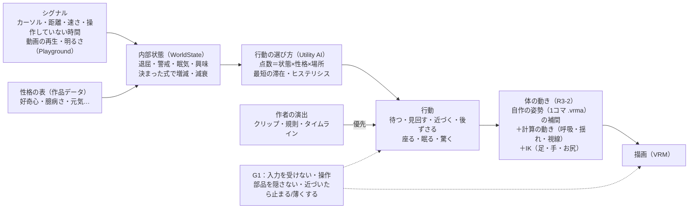

# キャラの自律行動：調べと設計案

2026-11-05、Claude Code。コードは変えていない。本格的な実装も始めていない。対象は翔太のアイデア「キャラが内部状態と周りの環境から、行動と体の動きをその場で作る」。Playground と予定は [playground-plan.md](playground-plan.md)。

## 読んだもの・読めなかったもの

- 読んだ：AGENTS.md、[r3-plan.md](r3-plan.md)、[product-design.md](product-design.md)、[spatial-design.md](spatial-design.md) の4節（キャラ）・7節（世界の状態の3分類）・8節（動画シグナル）・10節（性能の予算）、`src/characters/`、`src/assets/vrma.ts`、`src/world/models.ts`・`motion.ts`、`src/signals/`、`src/host/`、`src/sites/`、`src/browser/`
- ~~読めなかった：製品の設計書（Claude Docs）の6節~~ → **2026-11-05 に写しを受け取った**（[product-design-snapshot.md](product-design-snapshot.md)）。下の「設計書との食い違いと直したこと」で合わせ直した

## 設計書との食い違いと直したこと（2026-11-05）

| 項目               | この文書の最初の案                       | 設計書                                                                                                                                           | 直したこと                                                                                                                                                                                                            |
| ------------------ | ---------------------------------------- | ------------------------------------------------------------------------------------------------------------------------------------------------ | --------------------------------------------------------------------------------------------------------------------------------------------------------------------------------------------------------------------- |
| 歩く               | 「R3〜コンテストでは作らない」           | 標準の動作で walk は必須。R3 は「待つ・歩く・座る」。「間の自動補完」で近ければ歩く。一方で「動きの3段階」には「歩かずに移る」もある             | 歩くは**翔太が作る walk.vrma（作った動き）で再生する**。計算で歩行を作ることはしない。設計書の中で「歩かずに移る」と「近ければ歩く」の両方があるので、**どちらを優先するかを翔太に確かめたい**（下の3節の表に書いた） |
| 性格               | R4 で性格のつまみ4本を作品データに入れる | 「動きの設計の段階」0（性格を選ぶ）は**後で**。R6 のあと、感情ごとの動作がそろってから決め直す。動作が少ないうちは見た目がほとんど変わらないため | R4 では**性格のつまみを作品に出さない**。感情の上がり方・下がり方の係数はエンジンの既定値として持ち、R6 のあとに性格として外に出す                                                                                    |
| 行動の選び方の材料 | 内部状態とシグナルだけ                   | **部品の「できること」**（動画カード＝座る・寝転ぶ・覗き込む、プレーヤーの上の縁＝腰かけて見る、など。シムズの冷蔵庫と同じ考え方）               | Utility AI の点数に、「近くの部品が持つできること」を入れる。部品とできることの対応はアダプター（`src/sites/`）が持つ                                                                                                 |
| 内部状態の名前     | 退屈・警戒・眠気・興味                   | 感情は「怖い・安心・楽しい」など（R4）。怖いは楽しいより優先。台本は「怯えている」                                                               | 内部状態を**怖い・安心・楽しい・退屈**を中心に組み直す（眠気・興味は次に回す）。Playground の最小の形の「驚き（警戒）」は「怖い」の一部として扱う                                                                     |
| よける             | 「R3 では薄くするだけ、よけるは後」      | G1 とキャラ：「止めるのではなく、よける（dodge）」。よけきれないときは今までどおり消える                                                         | 変えない（R3 は薄くするだけ）。dodge は R4 の「場所と自動の移動」と一緒に作る                                                                                                                                         |

## 言葉の決まり

- 「感情」「気持ち」は、**内部状態の名前**として使う。「本当に感情や意識がある」とは書かない・言わない（UI の文言も「退屈の度合い」「警戒の度合い」のように、状態の値として見せる）
- LLM と AI の API は使わない。常時の接続や課金を前提にしない。決まった数式・表・状態機械だけで動く

## 0. 結論

| 問い                | 答え                                                                                                                                                                                                                                                                          |
| ------------------- | ----------------------------------------------------------------------------------------------------------------------------------------------------------------------------------------------------------------------------------------------------------------------------- |
| 今の作りでできるか  | **土台はある。** world の時計と状態、シグナル（ポインター・距離・角度・速さ・操作していない時間・スクロール・動画の再生）、VRM の描画、1コマの .vrma、体型の測定、G1 の守りは使える。足りないのは「内部状態」「行動の選び方」「計算の動きの重ね」「姿勢の間の補間と IK」の4つ |
| どう作るか          | **欲求と状態の数値（決まった式で増減）→ Utility AI で行動を選ぶ（最短の滞在時間とヒステリシス付き）→ 行動ごとの姿勢と計算の動き → IK。** ビヘイビアツリーは使わない（作者がノーコードで触るには、数値の表のほうが分かりやすい）                                               |
| R3-2・R4 との重なり | **大きく重なる。** R3-2（計算の動きを重ねる）は自律の「体」、R4（感情と場所）は自律の「頭」そのもの。新しい段階を作るより、R3-2 と R4 の中身をこの方向に寄せるのがよい（7節）                                                                                                 |
| 自然さ              | 待つ・見回す・振り向く・驚く・座る・眠るは、自作の姿勢＋計算＋IK で届く見込み。**歩くは難しい**（製品の決定「歩かずに移る」とも合う）。立ち上がる・座り込む（姿勢の間の移り）は、補間だけだと不自然になりやすく、中間の姿勢が要る（3節）                                      |
| ライブラリ          | three-procedural-locomotion は MIT で、作りも参考になるが、v0.1.0・作者1人・数日前に公開。**依存にしない。考え方を参考にし、要れば小さな部品だけを MIT の表示付きで取り込む**（6節）                                                                                          |

## 1. 今の作りでどこまでできるか

| 要るもの           | 今あるもの                                                                                                                                                                                                                         | 判定                                                                                                                                                |
| ------------------ | ---------------------------------------------------------------------------------------------------------------------------------------------------------------------------------------------------------------------------------- | --------------------------------------------------------------------------------------------------------------------------------------------------- |
| 時計と決定的な評価 | world の `step`（`evaluateWorld`）、入力列から同じ結果。乱数は seed を状態に持つ決まり（spatial-design.md 0節）                                                                                                                    | **できる**                                                                                                                                          |
| 周りの環境         | シグナルの登録表（`src/signals/registry.ts`）：`mouse-x/y`・`layer-distance`・`layer-angle`・`mouse-speed`・`idle`（操作していない時間）・`scroll`、動画の再生（`PlaybackSource`）。操作面と接近（G1.2 の `environment.approach`） | **できる**（カーソルとの距離・急接近・退屈の元になる「操作していない時間」がそろっている）                                                          |
| 置き場所           | 座れる縁は R3-3 の予定（まだない）。部品の位置はアダプターが持つ                                                                                                                                                                   | **R3-3 待ち**                                                                                                                                       |
| 内部状態の保存     | WorldState（その場の状態）。永続の記憶は段階7の Memory Repository（既定 OFF・明示のオプトイン）                                                                                                                                    | その場の状態は**できる**。「何度も驚かされると警戒する」は、まずページを開いている間だけにする。ページをまたいで覚えるのは段階7の記憶の仕組みを待つ |
| 体の動き           | VRM の描画、.vrma の再生（R3-1）、視線・頭の向き、揺れもの、表情                                                                                                                                                                   | 再生は**できる**。重ね・補間・IK は**ない**（R3-2）                                                                                                 |
| 体型の違い         | `measureBody`・`classifyBody`（R3-1）                                                                                                                                                                                              | **使える**（4節）                                                                                                                                   |
| 作者の演出         | 作者のクリップの指定、シグナルの規則、タイムライン（テイク）                                                                                                                                                                       | **ある**。自律との優先順位は新しく決める（2節）                                                                                                     |
| 操作性             | キャラは入力を受けない。接近で止まる（G1.2）。薄くする（R3-3 の予定）                                                                                                                                                              | **ある**                                                                                                                                            |

## 2. 構成案



### 内部状態

| 状態 | 増える                                                         | 減る                                                         | 例                                                        |
| ---- | -------------------------------------------------------------- | ------------------------------------------------------------ | --------------------------------------------------------- |
| 退屈 | 操作していない時間、同じ場所にいる時間                         | 動画の盛り上がり（明るさの変化・再生の再開）、カーソルの接近 | 退屈が高い → 足をぶらぶら、見回す、伸びをする             |
| 警戒 | カーソルの急接近（`mouse-speed`×`layer-distance`）、驚いた回数 | 時間で減衰                                                   | 警戒が高い → 驚く閾値が下がる、距離を取る                 |
| 眠気 | 動画を見ている時間、夜（Host が渡す時刻帯）                    | 驚き、カーソルの接近                                         | 眠気が高い → 座る、うとうと、眠る                         |
| 興味 | 好奇心×カーソルのゆっくりした接近                              | 時間で減衰                                                   | 興味が高い → カーソルを見る、近づく（小さく、縁の上だけ） |

> 2026-11-05：設計書に合わせて、R4 の中心は **怖い・安心・楽しい・退屈** にする（上の表は最初の案のまま残す）。怖いは楽しいより優先する。

- 式は「前の値＋入力×係数−減衰×経過時間」を 0〜1 に切ったもの。係数は、R4 ではエンジンの既定値（性格として外に出すのは R6 のあと）
- 「何度も驚かされると警戒する」は、警戒の減衰を遅く・増え方を大きくするだけで表せる（驚いた回数そのものを数えて上限付きで持つ）

### 性格と行動の傾向（作品データ、ノーコード）

> 2026-11-05：設計書では性格（動きの設計の段階0）は R6 のあと。下は**そのときの形の案**として残す。R4 で作品に入れるのは、行動の ON/OFF と、部品ごとの「この部品では必ずこれ」の上書き（設計書の段階1）まで。

作品データに入るのは数値と対応表だけ。JS・式の文字列・シェーダーは入れない（AGENTS.md）。

```json
{
  "temperament": { "curiosity": 0.7, "timidity": 0.4, "energy": 0.5, "sleepiness": 0.3 },
  "behaviors": [
    { "id": "fidget", "weight": 1.0, "enabled": true },
    { "id": "approach-cursor", "weight": 0.6, "enabled": true },
    { "id": "sleep", "weight": 0.8, "enabled": true }
  ]
}
```

- 行動の種類（`fidget` など）と、その点数の式はエンジンの登録表に置く。作品は ID・重み・ON/OFF だけを選ぶ（今のシグナルの登録表と同じ考え方）
- 編集画面は、性格のつまみ（4本）と、行動の一覧の ON/OFF と重みの3つで足りる。「臆病で眠たがり」のようなプリセットも、つまみの値の組として用意できる
- 版は1段上げる（v15）。キャラの `character` の中に足す

### 作者の演出を壊さない

| 優先 | 何                                                         | 自律の扱い                                                                                 |
| ---- | ---------------------------------------------------------- | ------------------------------------------------------------------------------------------ |
| 1    | G1（操作性）・緊急 OFF・reduced-motion                     | 自律も止まる。reduced-motion では待つ姿勢だけ                                              |
| 2    | 作者のタイムライン・シグナルの規則で指定したクリップ・姿勢 | その間、自律は行動を選ばない（体の小さな計算の動き＝呼吸・まばたきだけ残すかは作者が選ぶ） |
| 3    | 作者が「自律にまかせる」とした時間・場所                   | 自律が行動を選ぶ                                                                           |

- 既定は「作者が何も指定していない時間だけ自律」。今の作品の動きは、そのまま変わらない（キャラの設定に自律がない作品は今と同じ）

### 決定的であること

- 行動の選び方は、同じ入力列・seed から同じ結果になる純粋な関数にする（world の決まり）。同じ点数のときは ID の順。揺らぎは状態に持った seed から作る
- 内部状態は録画（テイク）に入る。Host の制限（接近の停止など）は今どおり録画に入れない

## 3. 動きごとの難しさ

「計算だけ」＝呼吸・揺れ・視線・頭の向きなど、骨の角度を式で足すだけ。「姿勢＋IK」＝翔太が Blender で作る1コマの .vrma を補間し、足・手・お尻を IK で合わせる。「作った動き」＝数秒の動作を作る必要がある。

| 動き                         | 区分                                     | 3頭身（トルーシェ）                              | 等身大に近い体型 | 見立て                                                                                                           |
| ---------------------------- | ---------------------------------------- | ------------------------------------------------ | ---------------- | ---------------------------------------------------------------------------------------------------------------- |
| 待つ（呼吸・重心の揺れ）     | 計算だけ                                 | 易しい。体が小さいので揺れを小さく               | 易しい           | R3-2 の中心                                                                                                      |
| 見回す・振り向く             | 計算だけ（頭→胸→腰の順に遅れて回る）     | 易しい。頭が大きいので首の角度を小さく           | 易しい           | 視線の仕組みの延長                                                                                               |
| 足をぶらぶら                 | 計算だけ（座った姿勢の膝下に振り子）     | 易しい。ただし長いスカートで見えにくい           | 易しい           | 座った姿勢が前提                                                                                                 |
| 驚く（びくっ・後ずさり）     | 姿勢＋計算（驚いた姿勢へ速く寄せて戻す） | ふつう。腕が短いので手の位置を IK で調整         | ふつう           | 「驚きの姿勢」1コマが要る。後ずさりは半歩（足の IK）                                                             |
| 座る（座った状態）           | 姿勢＋IK（お尻を縁に、足を下へ）         | ふつう。R3-0 で椅子の型は確認済み                | ふつう           | お尻の接点（R3-2 の予定）                                                                                        |
| 座り込む・立ち上がる（移り） | **作った動きか、中間の姿勢2〜3コマ**     | 難しい。体型で腰の道すじが大きく違う             | 難しい           | 1コマ同士の補間だけだと、腰が浮いたり沈んだりして見える。中間の姿勢を足すか、Blender の短い動作が要る            |
| 眠る（座ったまま・寝転ぶ）   | 姿勢＋計算（呼吸を深く・頭を垂れる）     | ふつう                                           | ふつう           | 「寝転ぶ」は床に触れる所が多く、IK より姿勢を作るほうが早い                                                      |
| 近づく（数歩）               | **難しい**                               | 難しい。足が短く歩幅が小さい                     | 難しい           | 製品の決定は「歩かずに移る」。近づくのは跳ねる・身を乗り出す・1〜2歩の小さな移動にとどめる                       |
| 歩く（何歩も）               | 作った動き（翔太の walk.vrma）           | とても難しい（足が短く、スカートで脚が見えない） | 難しい           | 計算の歩行は作らない。設計書では walk は標準の必須の動作。「歩かずに移る」との優先は翔太に確かめる（2026-11-05） |

- 3頭身は、腕と足が短く頭が重いので、等身大の動き（手を顔に・腕を組む）が届かないことが多い。逆に、計算の小さな揺れは等身大より「かわいく」見えやすい。**3頭身は計算の動きと、専用の姿勢を中心にする**のがよい
- 長いスカートは、脚の動き（ぶらぶら・後ずさり）を隠す。トルーシェで脚の動きを見せたいなら、斜めの向き（R3 の案 A）と組み合わせる

## 4. VRM ごとの骨と体型の違い

- 骨の名前は中の形（`HUMAN_BONES`、VRM 1.0 の名前）でそろっているので、計算の動きは名前で骨を指せる。指・目・顎・上胸は無いモデルがある（トルーシェは上胸・目・顎なし）。**無い骨には動きを足さない**（必須の骨は `measureBody` の `REQUIRED` と同じ）
- 量の調整は体型の測定を使う
  - 揺れや身を乗り出す量 → 身長に比例
  - 後ずさりの歩幅 → 足の長さ（`legLength`）に比例
  - 首の回る量 → 頭身が小さいほど小さく（頭が重く見えるので）
  - 手の届く範囲（IK）→ 腕の長さ（`armLength`）。届かない姿勢は、より単純な姿勢に切り替える（product-design.md の決まり）
- 段階の判定（`classifyBody`）の使い方
  - 段階1（崩れる体型）：自作の姿勢のうち「どのモデルにも当てられる版」は使わない。計算の動きと、そのキャラ専用の姿勢だけ
  - 段階2：どのモデルにも当てられる姿勢＋計算の動き
  - 自律の行動の一覧は同じ。行動ごとに「使える姿勢がなければ、その行動は選ばない」とする（点数を0）
- **分からない**：同じ1コマの姿勢を、体型の違うモデルに当てたときの崩れ方（腕が体に入る・足が浮く）。試し方：翔太の素体とトルーシェと、再配布できる VRM（Playground 用）の3体に、同じ姿勢5種を当てて正面と横から描く（R3-0 の試しの道具がそのまま使える）

## 5. 複数のキャラの性能

- 今の記録（[r3-plan.md](r3-plan.md) の Codex の交互計測）：トルーシェ1体の定常で、拡張の CPU 時間は中央値 0.8ms・p95 1.9ms／フレーム。キャラなしは 0.0ms。つまり **VRM 1体の描画と姿勢の更新で約 0.8ms**
- 自律を足したときの見積もり（測っていない）

| 中身                                        | 1体あたり（見積もり） | 根拠                                                                                                   |
| ------------------------------------------- | --------------------- | ------------------------------------------------------------------------------------------------------ |
| 内部状態の更新と行動の選び方                | 0.02〜0.05ms          | 数値の式が十数個と、行動10個ほどの点数。world の今のシグナルの評価（32規則×64キーで 0.05ms）より小さい |
| 姿勢の補間・計算の動き・IK（2本の骨×4か所） | 0.1〜0.3ms            | 骨50本ほどの角度の足し算と、解析解の IK                                                                |
| VRM の描画と 2D への写し（今の方式）        | 約 0.8ms              | 上の記録                                                                                               |
| 合計                                        | **約 1.0〜1.2ms**     |                                                                                                        |

- 2体で約 2〜2.4ms、3体で約 3〜3.6ms。spatial-design.md の主スレッドの目標（合計 4ms）に対し、**3体が上限の目安**。描画を 30fps に落とす（姿勢の更新は 30fps のまま決定的に）と、描画分がほぼ半分になる
- 減らす手：同じ合成単位で canvas を共有する（spatial-design.md 6節の「段階5」の課題）、見えないキャラは描かない、止まっている間は描かない
- **測るなら**：Codex の計測の道具（`docs/benchmarks/r31-fix/repro/perf.spec.ts`）で、キャラ1・2・3体の定常を2組だけ。合否の交互計測はしない。今回は測っていない（自律のコードがまだ無いので、測っても描画の分しか分からない）

## 6. ライブラリの候補

| 候補                                                                                        | ライセンス                    | 中身                                                                                                                                                                                                                                                                | 判断                                                                                                                                                                                                                                                                                                                                                                      |
| ------------------------------------------------------------------------------------------- | ----------------------------- | ------------------------------------------------------------------------------------------------------------------------------------------------------------------------------------------------------------------------------------------------------------------- | ------------------------------------------------------------------------------------------------------------------------------------------------------------------------------------------------------------------------------------------------------------------------------------------------------------------------------------------------------------------------- |
| [three-procedural-locomotion](https://github.com/PabloMesquida/three-procedural-locomotion) | MIT（2026, Pablo Mesquida）   | 歩く・走る・向きを変える・しゃがむ・跳ぶを計算で作る。2本の骨の IK、足の接地、腕と指の振り子、ばね、seed で決まる揺らぎ。TypeScript 約9,500行。依存は three だけ。src の中で `Math.random`・`performance.now`・`Date.now` を読んでいない（seed と経過時間で決まる） | **依存にはしない。考え方を参考にし、要るなら小さな部品（`TwoBoneIK`・ばね・振り子）だけを MIT の表示付きで取り込む。** 理由：v0.1.0・npm 未公開・作者1人・数日前の公開。主な価値は「歩く」で、製品の決定「歩かずに移る」とずれる。中に状態（ばね）を持つので、使うなら world の固定の刻みで進め、状態を WorldState に出す必要がある。同梱のモデル（`modelos/`）は使わない |
| three.js の `CCDIKSolver`（`three/examples/jsm/animation`）                                 | MIT（three と同じ、もう同梱） | 多関節の CCD 法の IK                                                                                                                                                                                                                                                | **使ってよい**が、足・腕は2本の骨なので、解析解（自前の数十行）のほうが速く、結果が安定する。尻尾・耳など3本以上の骨で要るときに使う                                                                                                                                                                                                                                      |
| @pixiv/three-vrm の lookAt・SpringBone                                                      | MIT（もう同梱）               | 視線と揺れもの                                                                                                                                                                                                                                                      | **今のまま使う**（R3-1 までと同じ）                                                                                                                                                                                                                                                                                                                                       |
| ビヘイビアツリー・Utility AI のライブラリ                                                   | —                             | —                                                                                                                                                                                                                                                                   | **入れない**。行動の数は10ほどで、表と式で足りる。決定的・作品データの検証の都合でも、自前の小さな評価のほうがよい                                                                                                                                                                                                                                                        |

## 7. R3-2・R4 の計画をどう寄せるか

| 段階             | 今の予定                                                                                          | 寄せ方                                                                                                                                                                                                                                                   |
| ---------------- | ------------------------------------------------------------------------------------------------- | -------------------------------------------------------------------------------------------------------------------------------------------------------------------------------------------------------------------------------------------------------- |
| R3-2             | 段階1の計算の動き（呼吸・横揺れ・まばたき・跳ねる・震える）、床の補正、お尻の接点、座るときの斜め | **そのまま、自律の「体」として作る。** 足すのは①姿勢の間の補間（1コマの .vrma 同士を、腰の道すじを決めて移る）②2本の骨の IK（足・手・お尻）③計算の動きの「強さ」を外から渡せる形（自律の状態が強さを変える）。これで自律がなくても、作者は今どおり使える |
| R3-3             | 座れる縁、ページの層の新しい置き方                                                                | 変えない。自律の「場所」の候補になる                                                                                                                                                                                                                     |
| R3-4             | 瞬間移動・跳ねる・縁の動作、きっかけ                                                              | **きっかけの選び方を、自律の行動の選び方に置き換える。** 「カーソル」「新しいコメント」「動画の停止」は、内部状態の入力にする                                                                                                                            |
| R4（感情と場所） | 感情、部品の「できること」、場所と自動の移動（設計書）                                            | **自律の「頭」：感情（怖い・安心・楽しい・退屈）・部品のできること・Utility AI・作者の演出との優先順位・dodge。** 性格のつまみは入れない（R6 のあと）。作品データ v15                                                                                    |
| 段階7            | 永続の記憶                                                                                        | 「何度も驚かされると警戒する」をページをまたいで覚えるのはここ。それまではページの中だけ                                                                                                                                                                 |

## できる・難しい・分からない

| 区分       | 項目                                                                                                                                                                                                                                                                                                         |
| ---------- | ------------------------------------------------------------------------------------------------------------------------------------------------------------------------------------------------------------------------------------------------------------------------------------------------------------ |
| できる     | 内部状態と Utility AI を world の決定的な評価に入れる。性格を数値の表で作品に持たせる。待つ・見回す・振り向く・驚く・座る・眠るを、自作の姿勢＋計算＋IK で作る。体型の測定で量を合わせる。G1 の守りの中で動かす                                                                                              |
| 難しい     | 座り込む・立ち上がるの移り（中間の姿勢か短い動作が要る）。歩く。3頭身で手を顔などに届かせる。スカートで隠れる脚の動きを見せる                                                                                                                                                                                |
| 分からない | ①同じ姿勢を体型の違う3体に当てたときの崩れ方（4節の試し方）②自律の「自然さ」が見る人に伝わるか（翔太が見て決めるしかない。12月の頭に判断の日を置く：[playground-plan.md](playground-plan.md) 11節）③自律＋VRM 3体の実際の CPU 時間（5節の測り方）④Claude Docs の設計書との食い違い（中身をもらって確かめる） |
