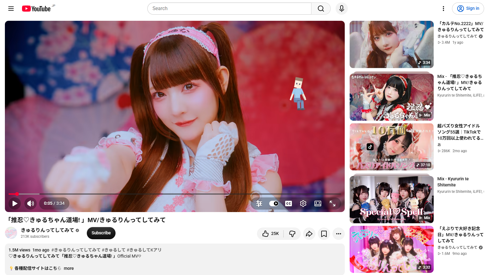
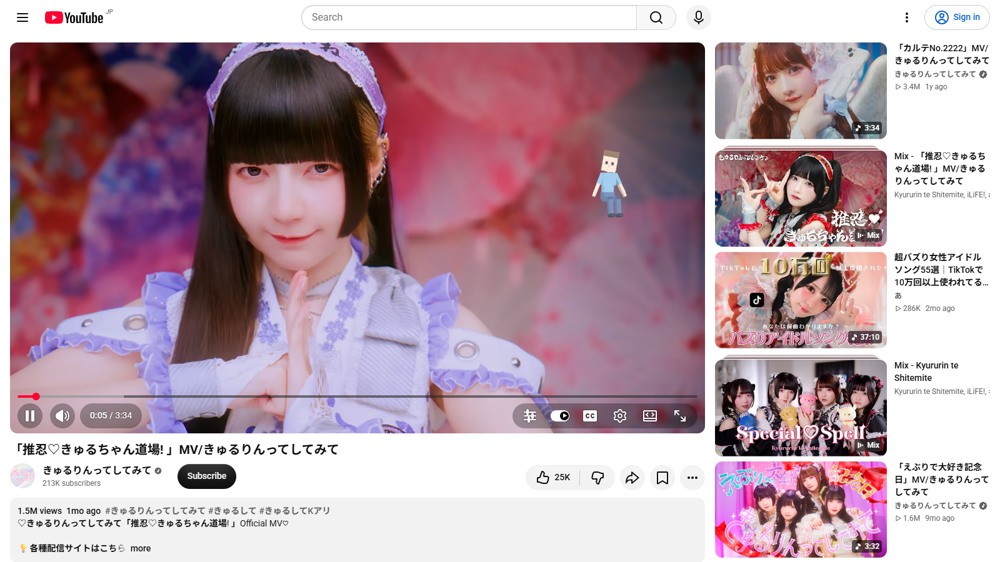
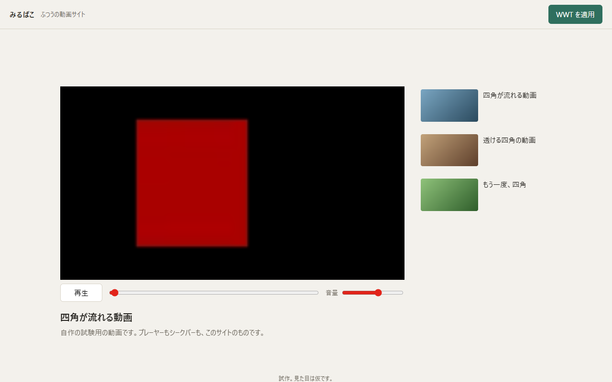
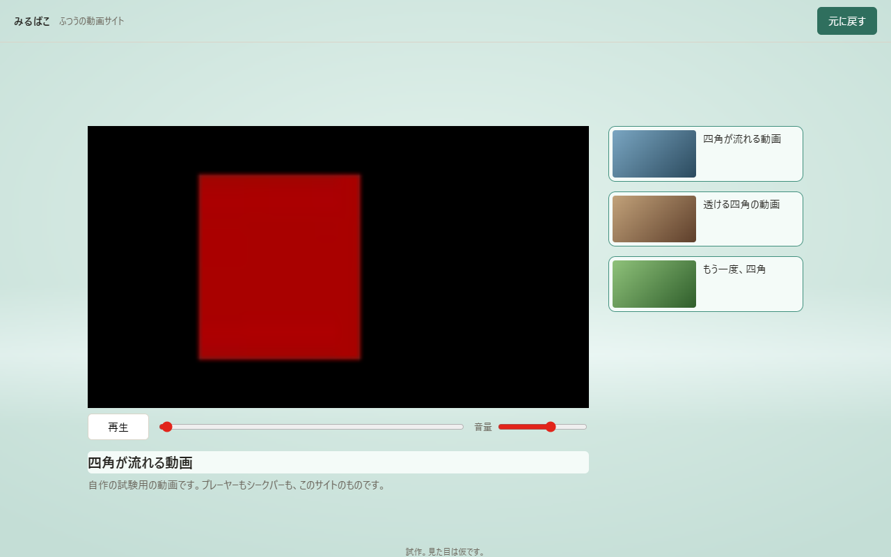
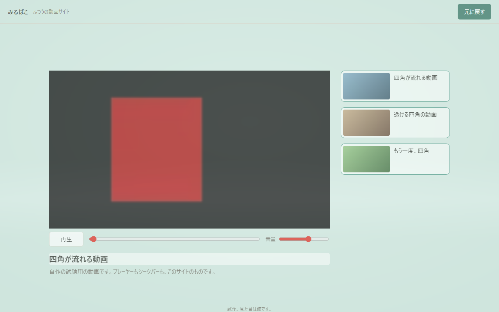

# 塊1の修正・塊2（R3-2）の独立検証

2026-11-05、Codex。`around-verify` に従い、`docs/playground-plan.md` の「塊1の修正」と `docs/r3-plan.md` の「塊2の完了報告」を検証した。

**塊1の起動差は同一版の振れの範囲内。塊2はマネキン起動の性能基準が未達。** Windows の全件と対象 SHA の CI は通過した。実 YouTube と Playground で座り姿勢・見下ろし・跳ねを確認し、YouTube の上64pxの保護帯にはキャラの画素が出ていなかった。塊2のマネキン起動 p95 は5.10 → 6.90 ms。製品コードを変更せずに報告する。

## 比較対象と実行条件

| 役割                       | 固定したコミット                           | detached worktree          |
| -------------------------- | ------------------------------------------ | -------------------------- |
| 塊1の前（R3-1 修正の最後） | `447b2bf31e319051e327f9ada2b83954276b8ff8` | `.work/verify-chunk2-base` |
| 塊1の修正                  | `7688942481dde8002a93a4ac7c271e783013e179` | `.work/verify-chunk2-fix`  |
| 塊2                        | `842e42f2c69abd633b96efcedeeb919951730fcc` | `.work/verify-chunk2-head` |

`git worktree add --detach` で3つに分け、それぞれのツリーで型チェックと通常ビルドを実行した。同じ lockfile の `node_modules` と Chromium を共用。ブラウザーは未ログインの新しいプロファイルを使い、headless または画面外。塊2は `src/world`、`src/host`、`src/content`、`src/sites`、`scripts/build.mjs`、`playwright.config.ts` を変更したため Windows の全 e2e を実行した。

塊1の修正は前回報告の `7eafd12` から `src` を変えず、境界 lint とテストを変えた。塊2の差分は全体92ファイル、2,325行追加・228行削除。`src`・`scripts`・`tests`・Playwright 設定に限ると79ファイル、2,178行追加・225行削除。manifest の権限、作品 v14 の schema・移行は3版で一致。履歴のファイル名と `git log --all --stat` では私用 `PochibyKT_Pochi*` を検出しなかった。

[再現手順](benchmarks/chunk2-verification/repro/README.md)、[テスト結果](benchmarks/chunk2-verification/checks.json)、[組ごとの値](benchmarks/chunk2-verification/pairs.md)。

## 主張と結果

| #   | 主張                                                                    | 確かめ方                                                                                         | 結果                                                                                                                                                     |
| --- | ----------------------------------------------------------------------- | ------------------------------------------------------------------------------------------------ | -------------------------------------------------------------------------------------------------------------------------------------------------------- |
| A1  | 塊1前後の起動 p95 は、同一版の振れで説明できる範囲か                    | 先に447b2bf同士8組、次に447b2bfと7688942を8組。フレーム数、処理の長さ、動画の落ちを同じ6秒で採る | 同一版は組差 −8.30〜+4.60 ms、前後差は −3.10〜+1.30 ms。前後8組のフレームをまとめた p95 は 4.00 → 3.80 ms                                                |
| A2  | 音量は押す直前の箱を使い、本物の部品への mousedown と音量変化を要求する | 旧テストと差分比較、実 YouTube、古い座標と別の押下先をそれぞれ作る                               | 前後1/1ずつ通過。古い座標は箱の照合で失敗、同じ箱で押下先だけを替えると `mousedown target` で失敗                                                        |
| A3  | Chrome API 境界を指定した書き方で抜けられない                           | 両版の ESLint に `src/host/world-session.ts` として違反を入力                                    | ドット、角括弧、`const c = chrome`、optional chain、`globalThis`・`window`・`self`、`window['chrome']` を拒否。`src/browser`、ローカル変数、型参照を許可 |
| B4  | 同じ層の座り、斜め、見下ろし、跳ねが両サイトで動く                      | 同じマネキンと2姿勢を使い、pose と画面を観測                                                     | 両サイトで座り・25°・動画一時停止の見下ろし・再生の跳ねを確認。YouTube の動作の撮影は y=.42                                                              |
| B5  | Playground の背景は中身の下で、文字と動画を覆わない                     | 背景の画像を読込後、静止フレームの画素・余白・文字を確認                                         | 背景は `BODY` 内で z-index −1、動画718×403の比較領域は全画素一致。見出しは読め、計算上のコントラスト比15.31:1                                            |
| B6  | 作者の動作中は呼吸とまばたきだけが加わる                                | `evaluateModels` に時間つきクリップ・移動する経路を入れ、優先だけを無効化                        | 通常版2/2通過、故障版2/2失敗。腰・体の向き・移動の追加が消え、呼吸とまばたきが残ることを確認                                                             |
| B7  | 体の計算にサイトの名前と部品名を使わない                                | `body-motion.ts`、`models.ts`、`two-bone-ik.ts`、`vrm-player.ts` の検索と入力・購読を読む        | 4ファイルに該当なし。入力は時刻・姿勢・シード・ポインター・待機・スクロール・共通の動画イベント                                                          |
| B8  | 操作面を守り、YouTube の上64pxにはキャラを描き出さない                  | 座標・実ボタンの宛先と状態、クリップ内の不透明画素、切り抜き故障                                 | 対象の保護帯に入る不透明画素1,492のうち表示可能0。Playground の重なりでも実クリックが届き、切り抜きを外すとボタンの画素が変わった                        |
| B9  | 76か所の `check()` は判定を変えない                                     | `7793d5f` の置き換えを数え、代表4 spec を両版で実行                                              | 76か所の置換を確認。対象17/17、比較16/17。比較で一度落ちた既存ケースは前後の再実行で各5/5                                                                |
| B10 | g11 は開発フラグのフックを使い、+2msを検出する                          | フラグ・バンドルと g11 実測を確認、ui1 も独立に校正                                              | g11 の中央値/p95 は +2.00/+2.00 ms、ui1 は +2.00/+2.05 ms                                                                                                |
| B11 | 塊2のキャラなし・1体の負荷が予算に入る                                  | 7688942と842e42fを実 YouTube で交互に比較                                                        | 3場面各4組。マネキン起動の p95 が +1.80 ms で基準超過。ほか8区間は基準内                                                                                 |

## 見た目と操作

Playground では配布作品の自作マネキンを使った。YouTube では同じ座り・立ちの VRMA と層データを使用し、`siteId` を替え、サイト固有の着せ替えルールと背景を外した。縁の確認は元の x=.86、y=0。見下ろしと跳ねを見える位置で撮るときは YouTube の y を .42 に変更した。

| 項目                                   | Playground                                     | 実 YouTube（842e42f）                                                |
| -------------------------------------- | ---------------------------------------------- | -------------------------------------------------------------------- |
| 座り・向き                             | `seat=true`、25°                               | `seat=true`、25°                                                     |
| 動画を一時停止した後の頭のピッチの標本 | +5.853°                                        | +8.391°                                                              |
| 再生した後の腰の上下の標本             | +0.082（身長比）                               | +0.088（身長比）                                                     |
| 視聴ページの操作                       | キャラがボタンに重なる配置でも同じ画素と押下先 | y=.42 でネイティブ再生ボタンの `elementFromPoint` と再生・停止を確認 |

| Playground の縁                                         | YouTube の見下ろし                                                           | YouTube の跳ね                                                          |
| ------------------------------------------------------- | ---------------------------------------------------------------------------- | ----------------------------------------------------------------------- |
|  |  |  |

| Playground 適用前                                                              | 通常版の適用後                                                              | underlay を外した故障版                                                         |
| ------------------------------------------------------------------------------ | --------------------------------------------------------------------------- | ------------------------------------------------------------------------------- |
|  |  |  |

PNG の読み込み完了を待ち、約0.392秒で止まった動画の時刻と画素が前後で同じことを確かめた。比較した289,354画素のうち、通常版で変わった画素は0、故障版では289,354。見出しの実スタイルは `rgb(35,33,29)` と `rgb(244,251,248)`。画像を開いて、見出し、説明、カード、再生ボタンが読めることを確認した。通常版で Alt+Shift+Q の解除と再適用も通過、console/CSP エラーは0。先の試行では画像の読み込み完了を待っておらず、故障版の動画も一致していた。[画素とコントラストの記録](benchmarks/chunk2-verification/pg-pixel-proof.json)

YouTube の比較でプレーヤーは `(16,68,1112,625.5)`、縁のキャンバスは両版とも `(897.3125,-27,150,190)`。最終試行は両版とも `inset(64px 0px 112px)` の動画内レイヤー。上64pxに重なるキャラの不透明画素は比較版1,748・対象1,492で、クリップを通る画素は双方0だった。描画の `pointer-events` は双方 `none`。y=.42 では双方で本物の再生ボタンを押して動画の状態が変わり、拡張の表示OFFでキャラが消えた。初回の別レイアウトの数値と画像も残した。[比較・対象の観測](benchmarks/chunk2-verification/youtube-head-g1.json)

## 退行と前からある残件

| 分類                        | 比較した結果                                                                                                                                                                                   | 影響と頻度、本物の YouTube                                                       | 扱い                                                                                                 |
| --------------------------- | ---------------------------------------------------------------------------------------------------------------------------------------------------------------------------------------------- | -------------------------------------------------------------------------------- | ---------------------------------------------------------------------------------------------------- |
| 性能の退行（今回の条件）    | マネキン起動の拡張 CPU p95 が5.10 → 6.90 ms。4組中3組が個別にも +1ms を超えた                                                                                                                  | 起動時のフレームの処理が増える。計測した4組では3組。実 YouTube                   | 塊2の性能基準は未達。起動の CPU プロファイルを取り、モデル準備と pose 評価を区分してから扱いを決める |
| 前からある見た目の残件      | 既存 `r32-live` は縁の差分427画素で失敗。対象の実画像で差分は y=56〜67 のみ、上64pxの保護帯は0画素。比較版の初回の画面にも同じ隙間に胴体の一部が見えた。別のレイアウトでは両版とも見えなかった | ヘッダー下12pxの隙間で体の一部だけが見える。レイアウトによって起きる。実 YouTube | 「縁ではいつも何も見えない」は未達。試験は画素の位置を判定し、保護帯と隙間を分けると切り分けられる   |
| 未判定のクリップ観測        | 比較版初回のページ側レイヤーで、上帯にあるキャンバス標本49点が CSS パス内。実画面で確認できた体は隙間側。対象の最終試行は動画内レイヤーで標本0                                                 | 実際の保護帯への描画は確認できていない。実 YouTube で採取                        | CSS パス内の標本と合成後の画面を分けて保存。操作面に重なったとは判定しない                           |
| 前からある試験の残件        | 比較版の代表試験で `operation-controls` の開いた操作チェックが一度閉じ、状態の配列で失敗。対象の全件・代表試験は通過。対象ケースの再実行は前後5/5                                              | 検証上は操作チェックが一瞬閉じる。今回の模擬ページで1回。実 YouTube は未確認     | `check()` の呼出し自体ではなく、解除後のパネル状態の判定で失敗した。原因は未特定                     |
| 塊1の音量試験に残る判定の穴 | `event.target` を短くした `outerHTML` の文字列で照合するため、子に `ytp-volume-slider` がある親にも一致した。位置の照合が古い箱を拒否し、無関係な押下先は宛先の照合が拒否                      | 子と親の区別ができない。古い位置の故障版で1回。実 YouTube                        | 親子を区別する必要があるなら、入力時の DOM ノードと対象バーの包含関係で判定する                      |

初回の独立実サイト試験では、対象のキャラの移動オフセットが残った時点で見下ろしを待って失敗した。再実行では配置移動が完了してから、ネイティブボタンの試験と動画イベントによる姿勢の試験を分けて採った。既存の `r32-live` の失敗とは別に記録した。[427画素の位置](benchmarks/chunk2-verification/r32-edge-pixel-diff.json) · [対象のON](screenshots/chunk2-verification/youtube-r32-edge-on.png) · [対象のOFF](screenshots/chunk2-verification/youtube-r32-edge-off.png) · [比較版で隙間に見えた例](screenshots/chunk2-verification/first-youtube-fix-edge.png)

ESLint は `window['ch' + 'rome']` と `const w = window; w.chrome` を両版で見逃した。指定の違反は検出しており、これらは修正時点からある境界検査の範囲の不足。現行コード中でこの形の実使用を見つけた結果ではない。検査を広げる場合は、別名と動的プロパティをどう扱うかを決め、今回の2例を負の fixture にできる。[境界の入力と rule ID](benchmarks/chunk2-verification/static.json)

## わざと壊した検査

| 変えたもの                                    | 実行した検査                                                   | 結果                                                                                                                    |
| --------------------------------------------- | -------------------------------------------------------------- | ----------------------------------------------------------------------------------------------------------------------- |
| `src/host` として Chrome API への値参照を入力 | ESLint の実ルールで6経路とドット・追加の角括弧を検査           | 指定の経路は `no-restricted-globals` または `no-restricted-properties` で拒否。動的キーと `window` の別名は上記のとおり |
| 音量の箱を取った直後に実バーを90px動かす      | 古い位置で押した mousedown の箱の照合                          | 箱の y=398 → 308 が一致せず失敗                                                                                         |
| 箱は同じまま押下位置に無関係な要素を置く      | mousedown の宛先照合                                           | `verification-nonvolume` への押下を `mousedown target` で拒否                                                           |
| `authorActive` を無効にした専用ビルド         | 作者の時間つきクリップ・経路と計算の動きを同時に評価           | 両方で姿勢の許可リストの判定が失敗                                                                                      |
| Playground の underlay スロットを外す         | 適用前後で静止した動画の画素を比較                             | 画像を読み終えた故障版は動画が白くなり、画素一致の判定で失敗                                                            |
| 最終 `protectionClip` を全画面へ広げる        | マネキンを本物の再生ボタンに重ね、ボタンの画素とクリックを確認 | 通常版は88×38の画素が一致。故障版はキャラがボタン上に描かれ、画素比較で失敗。クリックは届いた                           |

故障版は `.work` 内だけで組み立てた。製品のソース、既存テスト、通常の `dist` の差分は0。音量は既存テストを複製した診断用の試行でのみ移動を挿入した。

[通常の切り抜き](screenshots/chunk2-verification/pg-normal-overlap.png) · [切り抜きなし](screenshots/chunk2-verification/pg-clip-overlap.png) · [音量の入力記録](benchmarks/chunk2-verification/native-inputs.json)

## 性能の方法と校正

- g11 は `scripts/g11/build.mjs` が計測用に `__AROUND_G11__=true` を渡す。`src/diagnostics/g11-hooks.ts` がコントローラー、再計算、記録のフックを登録する。通常ビルドはフラグが `false`。公式ビルドの起動時にフック version 1 と refresh の存在を確認した。ソースの置換や計測用の権限追加はない。
- g11 のビルドは rAF を測る。A/B の比較には、3版で同じ ui1 isolated world v3 を使い、rAF に加えてタイマー、Observer、イベント、Promise の継続などを採った。文書開始からの rAF 境界に各コールの長さを置き、コールがないフレームも集計。起動は遷移先の `[0, 6000)` ms。定常は8秒待った後の6秒、SPA は検索の開始から6秒。起動には Studio で保存した PNG 1層を使用した。
- 校正の初回は再生が落ち着く前の0ms区間に起動処理が混ざり、p95 は g11 +1.45 ms、ui1 +0.80 ms。8秒待った再校正ではそれぞれ +2.00、+2.05 ms。最初の結果も保存した。
- Windows、Chromium、解像度・背景負荷の実測値は各組の JSON に記録。表示あり・画面外、1920×1080・倍率1。広告、プロモーション、非表示、標本不足、キャラの実 GPU 条件で採否を決めた。背景 CPU は参考値。CPU の大小で組を選ばない。
- CPU はページ主スレッドで計測した拡張のコールバック時間。GPU は実 GPU の描画時間の直近値を150msごとに読んだ参考値。動画は `getVideoPlaybackQuality` の差分。検索 SPA で動画カウンターがリセットされた区間は動画の集計から外す。拡張を読み込まない比較は未実施。
- ブラウザー全体の目安には文書の rAF 間隔を JSON に残した。Chrome Tracing の AnimationFrame の処理時間は採っていない。

### A. 塊1の起動

`447b2bf` 同士を先に8組、`447b2bf` と `7688942` を次に8組採った。どちらも有効組は1〜8。広告が観測された窓を各15区間取り直し、集計から除外した。Chromium `143.0.7499.4`、1920×1080、倍率1。背景 CPU は同一版で3.73〜15.36%、前後比較で2.64〜12.40%。

| 比較       | 組ごとの p95 差の範囲                  | 組差の中央値 | 全フレームの CPU 中央値 左→右 | 全フレームの CPU p95 左→右 |
| ---------- | -------------------------------------- | ------------ | ----------------------------- | -------------------------- |
| 同一版8組  | −8.30〜+4.60 ms（絶対値の最大8.30 ms） | −0.45 ms     | 0.00 → 0.00 ms                | 6.40 → 5.70 ms             |
| 塊1前後8組 | −3.10〜+1.30 ms（絶対値の最大3.10 ms） | −0.15 ms     | 0.00 → 0.10 ms                | 4.00 → 3.80 ms             |

前後8組の p95 の差はすべて、同一版8組で観測した符号付きの範囲内。前回の +2.50 ms も今回の同一版の実測範囲内にあり、今回の前後比較でその増加は再現しなかった。この範囲は8組の観測値。同一版でも1組目は左279・右505フレームに対し p95 が10.00 → 1.70 ms、5組目は406 → 254フレームで p95 が +4.60 ms、6秒の拡張コール合計差は +1.5 msだった。フレーム数と、1フレームへ集まった処理を分けて読む必要がある。

前後比較の6秒の rAF は合計 3,457 → 3,532、1組あたりの中央値は 447.5 → 436。8回の拡張コールの合計時間は 2,917.1 → 2,763.1 ms。1回のコールの p95 は 0.90 → 0.80 ms。動画は同一版が 0/870 → 1/872、前後が 1/876 → 2/864（drop/total）。2・5・10・16ms以上の件数、各組の rAF、動画の落ちと生データを保存した。[組別の値](benchmarks/chunk2-verification/pairs.md) · [同一版](benchmarks/chunk2-verification/AA.json) · [前後比較](benchmarks/chunk2-verification/AB.json)

### B. 塊2のキャラ1体

`7688942` と `842e42f` を、場面ごとに4組ずつ AB/BA で比較した。最初は同じプロファイルで3場面を切り替え、トルーシェを取り込む前に両版の Studio が「保存する素材が見つかりません」となった。この試行は、保存済み作品を検証コードから直接切り替えた後の事象。途中データを残し、正式採取では各場面を独立した新規プロファイルで用意した。

マネキンは生成した VRM と `stand.vrma`、トルーシェは `AROUND_VRM_FILE` の `trusie.vrm` と `AROUND_VRMA_DIR` の `idle.vrma` を使った。idle は約10.67秒。両版で選択中の clip は0、再生位置が進んだことを記録した。モデルは Studio から読み込んだ。実素材はリポジトリに置かず、ブラウザープロファイルを一時ディレクトリに分けた。各場面の採用組は1〜4。広告で取り直した窓はキャラなし7、マネキン2、トルーシェ0。背景 CPU は3.10〜12.91%。

| 場面          | 区間 | 拡張 CPU 中央値 前→後 (ms/フレーム) | p95 前→後 (ms/フレーム) | 増分 中央値 / p95 (ms) | 判定         |
| ------------- | ---- | ----------------------------------- | ----------------------- | ---------------------- | ------------ |
| キャラなし    | 起動 | 0.00 → 0.10                         | 4.50 → 4.50             | +0.10 / 0.00           | 基準内       |
| キャラなし    | 定常 | 0.00 → 0.00                         | 0.00 → 0.00             | 0.00 / 0.00            | 基準内       |
| キャラなし    | SPA  | 0.00 → 0.00                         | 1.50 → 1.70             | 0.00 / +0.20           | 基準内       |
| マネキン1体   | 起動 | 1.00 → 1.10                         | 5.10 → 6.90             | +0.10 / **+1.80**      | 超過         |
| マネキン1体   | 定常 | 0.70 → 0.80                         | 1.40 → 1.70             | +0.10 / +0.30          | 基準内       |
| マネキン1体   | SPA  | 0.00 → 0.00                         | 1.90 → 1.90             | 0.00 / 0.00            | 基準内       |
| トルーシェ1体 | 起動 | 1.10 → 1.10                         | 7.30 → 8.30             | 0.00 / +1.00           | 基準内、上限 |
| トルーシェ1体 | 定常 | 0.80 → 0.80                         | 2.00 → 2.00             | 0.00 / 0.00            | 基準内       |
| トルーシェ1体 | SPA  | 0.00 → 0.00                         | 2.50 → 1.30             | 0.00 / −1.20           | 基準内       |

各行は4組のフレームをまとめた値。基準は中央値 +0.5 ms、p95 +1.0 ms 以内。1体の定常時の行には、モデル以外のページ処理も含まれる。同じ採取でのキャラなし定常は中央値・p95 ともに0.00 msだった。検索 SPA は遷移前後で文書時計が同じことを確認。遷移先に元のプレーヤーがないため、SPA の値にはモデルを片付ける区間も入る。

マネキン起動の組ごとの p95 増分は +4.30 / +1.70 / +2.10 / 0.00 ms。起動の rAF 数の中央値は450.5 → 421、1回の拡張コールの p95 は0.80 → 1.00 ms。5ms以上のコール数の増加は主に1組目（12 → 25）に出た。塊2でどの処理がこの増加を起こしたかは未特定。同一版の振れを測った A はキャラなしの場面なので、マネキンの基準超過の判定には使っていない。[組別の値](benchmarks/chunk2-verification/pairs.md)

| GPU（Intel UHD / D3D11） | 起動の中央値 / p95 前→後 (ms) | 定常の中央値 / p95 前→後 (ms) |
| ------------------------ | ----------------------------- | ----------------------------- |
| マネキン                 | 1.53 / 3.94 → 1.79 / 4.06     | 1.07 / 1.88 → 1.22 / 2.06     |
| トルーシェ               | 1.75 / 5.59 → 1.67 / 5.90     | 1.22 / 2.35 → 1.27 / 2.03     |

GPU 定常は1場面・片側160標本。150msごとに直近の値を読んでおり、すべての描画フレームを集計した p95 ではない。検索 SPA には遷移前の最後の GPU 値が残る場合があるため、GPU の比較表は起動と定常に限定した。

| 動画 drop/total | 起動 前→後    | 定常 前→後    |
| --------------- | ------------- | ------------- |
| キャラなし      | 1/423 → 0/434 | 0/562 → 0/566 |
| マネキン        | 0/442 → 1/434 | 0/566 → 0/573 |
| トルーシェ      | 0/442 → 1/445 | 0/573 → 0/573 |
| 作品OFF（参考） | —             | 0/576 → 0/576 |

検索 SPA は動画の連続したカウンターが採れなかった。起動時の1フレームの落ちは記録した範囲の観測値。[キャラなし](benchmarks/chunk2-verification/B-quiet.json) · [マネキン](benchmarks/chunk2-verification/B-mannequin.json) · [トルーシェ](benchmarks/chunk2-verification/B-trusie.json)

## テストと CI

| 対象                 | unit               | e2e                                | ネイティブ枠                                                                            |
| -------------------- | ------------------ | ---------------------------------- | --------------------------------------------------------------------------------------- |
| 447b2bf CI           | 517通過・3スキップ | 274通過・61スキップ                | 4通過 [GitHub Actions](https://github.com/a3681299-png/around/actions/runs/41839637095) |
| 7688942 CI           | 524通過・3スキップ | 280通過・62スキップ                | 4通過 [GitHub Actions](https://github.com/a3681299-png/around/actions/runs/41987199472) |
| 842e42f CI           | 546通過・3スキップ | 282通過・64スキップ                | 4通過 [GitHub Actions](https://github.com/a3681299-png/around/actions/runs/41987868681) |
| 842e42f Windows 全件 | —                  | 282通過・64スキップ、失敗・flaky 0 | 全件に含む。18分31秒                                                                    |

- 代表 e2e は `operation-controls`、`backup`、`vrma-import`、`legacy-data`。`7793d5f` の差分では旧 `check()` 76か所を同じスイッチに対する `showArtwork` に置き換えた。追加したのは `toBeEnabled()` の待ちだけで、スイッチを入れる `check()` と後続の判定は残っている。代表試験は対象17通過・比較16通過と操作チェック1失敗。落ちたケースを選んで前後5/5通過。
- 実サイトの既存 `operation-live` は比較・対象とも各1/1通過。作品なし／ありの2区間ずつで、押下は実 `ytp-volume-slider-handle` に届き、音量が上がることと100%未満の判定も通過。独立のキャラ・入力試験は最終の比較・対象が各1/1通過。既存 `r32-live` は縁の差分の判定で1失敗。意図的な故障2件は期待どおりの失敗。
- Playground の追加正常系は3/3、作者優先の追加 unit は2/2。各故障版の成否は上の表に分離した。保護帯の比較と音量は未ログインの実 YouTube。ダーク／ライト、シアター／全画面、履歴、保存と復元は Windows 全件の模擬ページ側でも確認した。

## 翔太が手動で確かめること・次の担当へ

- ふだん使う Chrome の YouTube で音量バーと `k` キーを操作する。試験で再現したときは押した瞬間の要素と、プレーヤーの前後の座標を残す。
- マネキンの座り姿勢は自作の1コマの fixture。普段使うキャラで、斜めの角度、視線、足の接地を作品の配置と合わせて見る。YouTube の上の縁は既存の G1 の帯を維持し、見せる場所の変更は R3-3 で判断する。
- ログインが必要な投稿・登録済み状態、複数のキャラの性能、本番 Playground の配信は未確認。手元の Chrome で拡張の Alt+Shift+Q を押す場合は、作品が消えた後に再操作で戻るところまで確かめる。
