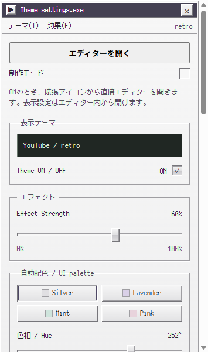
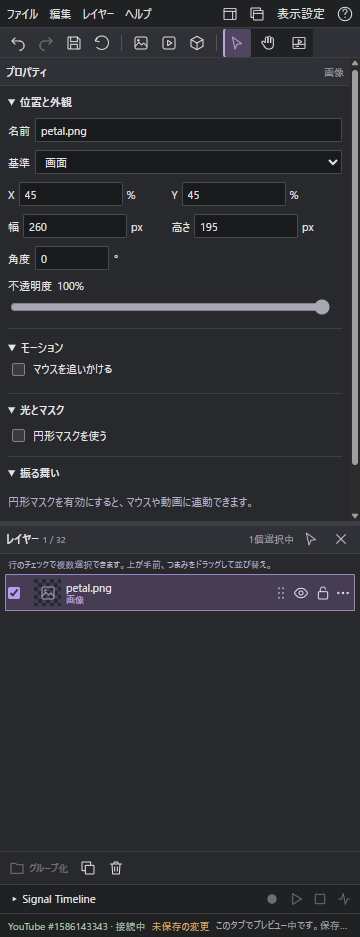
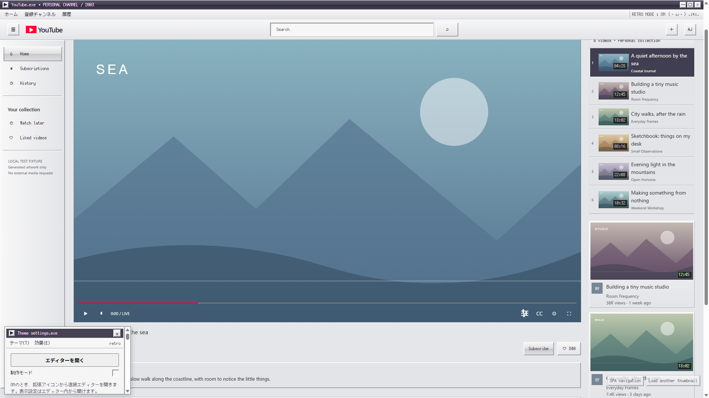

# エディターと表示設定の起動

依頼Gの追加項目。Chrome権限は既存の storage / sidePanel のまま。contextMenus、常時表示するページ上の起動ボタン、作品スキーマの変更は追加していない。

## 操作

| 入口                                  | 動作                                                                               |
| ------------------------------------- | ---------------------------------------------------------------------------------- |
| 設定画面の先頭「エディターを開く」    | 既存のChromeサイドパネルで、対象のYouTubeを開く                                    |
| 拡張アイコン・制作モードOFF（初期値） | 従来の設定Popupを開く                                                              |
| 拡張アイコン・制作モードON            | 設定を経由せずエディターを開く                                                     |
| Alt+Shift+E                           | 制作モードを問わずエディターを開く                                                 |
| エディター内「表示設定」              | ページ内なら既存の設定ウィンドウ、Studioなら対象タブを引き継ぐ設定ウィンドウを開く |
| 設定内「作品と設定のバックアップ」    | 拡張内の専用ページを開く                                                           |

ショートカットはmanifestのopen-editorコマンド。Alt+Shift+Eを提案するが、他の拡張・OSとの競合がない保証はない。chrome://extensions/shortcuts で変更できる。既存のサイドパネルが準備されていないタブでは、独立Studioウィンドウへフォールバックする。テーマOFFでもStudioの表示設定入口を使える。

起動時のユーザー操作を失わないよう、アイコン・コマンドのコールバックではストレージ読み込みを待たずsidePanel.openを呼ぶ。制作モードの変更はactionのPopup設定へ反映する。設定へ戻る操作は編集データやUndo/Redoを触らない。設定から戻るときも対象のタブIDを引き継ぐ。

## 設定ウィンドウの位置

通常時は動画の外、body直下へ配置する。サイトAdapterがプレイヤーの矩形を渡し、共通UIが右・左・下・上の空き領域を探す。幅が足りない場合は動画の下に出し、必要ならページを少しスクロールする。使用できる高さに収め、設定自体をスクロールできる。

タイトルバーをドラッグすると位置を chrome.storage.local の webWorldThemes.settings.position.v1 へ保存する。次回はその位置を優先し、画面外へはみ出す座標を収める。ユーザーが選んだ位置についてはプレイヤーとの重なりを自動で避けない。全画面中は利用可能な画面全体が動画なので、従来どおり設定を全画面要素の中へ重ねて操作する。

## 画面

自作のYouTube検証ページと、テスト専用Chromeを使用した。

設定Popupの先頭ボタンと制作モード:

エディター内の表示設定入口:

プレイヤーを避けた初期位置（1920×1080、テーマON）:

## 検証

tests/editor-entry.spec.ts は次を実際のChrome APIとネイティブウィンドウで確認する。

- OFF時の本物のaction Popupから、先頭ボタン1回でエディターへ入る。
- ON時のactionから直接起動し、ショートカットはON/OFFどちらでも動く。
- Studioと設定を往復しても未保存の下書きが残る。
- ページ内エディターから設定を経由してサイドパネルへ戻っても下書きが残る。
- 初期位置が、テーマON/OFFそれぞれで1920・1100・760px幅のプレイヤーと重ならない。
- ドラッグした位置がページ再読み込み後も残り、全画面中も設定を操作できる。

テスト専用コピーだけに_execute_actionのAlt+Shift+Yを登録する。これはChrome自身が通常のアイコンと同じPopup/onClicked経路を実行するコマンドであり、製品manifestには追加しない。RendererへのCDPキーイベントではChromeのアクセラレーターを検証できないため、Windowsでは生成したテスト用profileと拡張パスを所有するプロセス・前面ウィンドウを確認してキーを送る。CIでは独立Xvfb内の一意なタイトルのウィンドウへxdotoolで送る。失敗をskipしたりforceクリックへ置き換えたりしない。

tests/features.spec.ts で制作モードの初期値・共有・イベント解除、tests/settings-position.spec.ts で矩形配置を単体検証する。追加部分のe2eはローカルで計7ケース（バックアップ3件・起動4件）成功。全unitは306件成功。全e2eとGitHub Actionsの最終結果は完了報告と該当コミットのActionsを参照する。

全件実行で、既存の素材確認ヘルパーが未作成DBを空のまま作り、ストア欠落で停止する競合をtraceから確認した。ヘルパーを読み取り専用にし、DB未作成・ストア欠落・作成競合を固定入力のunit 3件で確認する。元の不正MIME拒否テストは変更せず、20回連続成功（51.4秒）。拒否・上限の期待値、skip、タイムアウトは変えていない。
