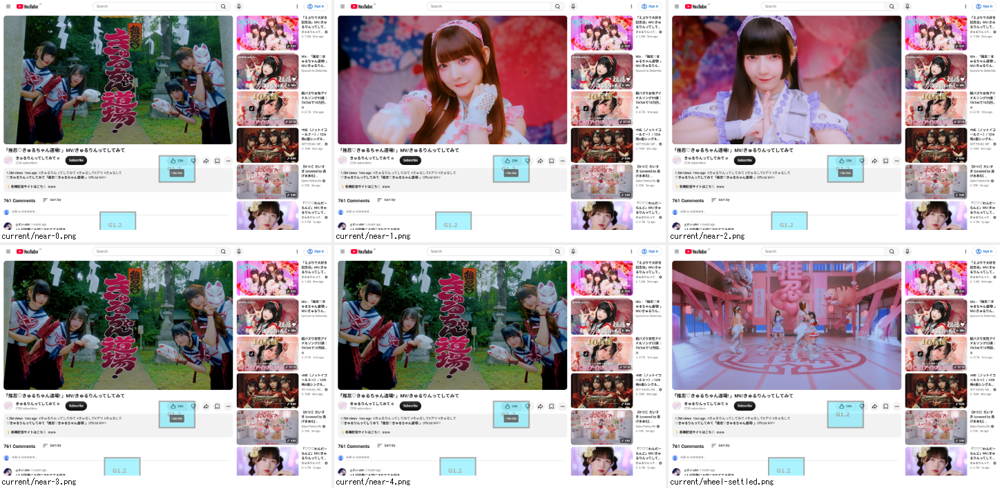
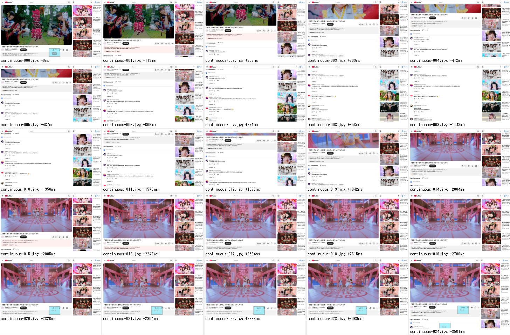
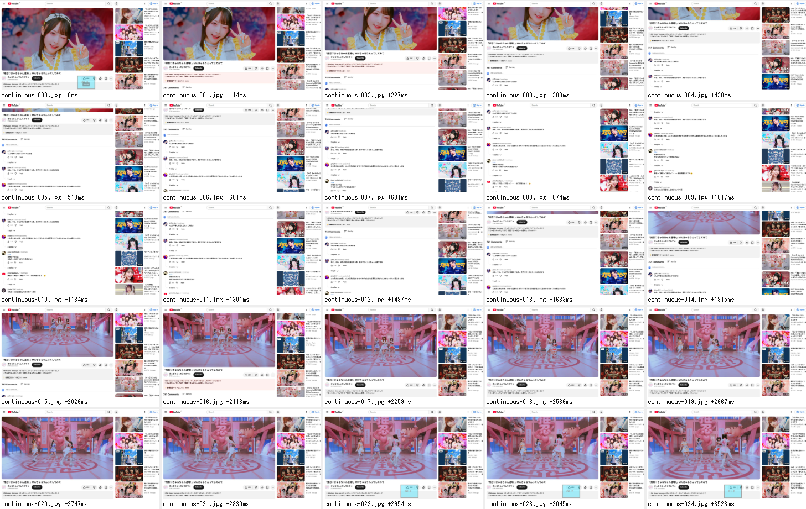

# G1.2 独立検証（Codex、2026-11-03）

対象は `codex/creator-editor-spike` の `557b978` → `67ad03d`。`docs/g12-plan.md` の D1〜D11 と結果を読み、`around-verify`・`around-live-test`・`around-perf` に従って検証した。製品コードと既存のテストは直していない。

**依頼された保護・索引・解除・テイク・実サイトの機能確認は合格。総合判定は性能の追加条件が基準を超えたため保留。** スクロール中の絵の消失は変更前にも確認した。D11 は厳密な「線分から72px以内」ではなく、線分を囲む矩形を72px広げる実装なので、設計の言葉を補う余地がある。

## 主張と結果

| #   | 主張                                                               | 確かめ方                                                                                           | 結果                                                                      |
| --- | ------------------------------------------------------------------ | -------------------------------------------------------------------------------------------------- | ------------------------------------------------------------------------- |
| 1   | 最後の切り抜きと入力の保護を弱めていない                           | `557b978` との関数本文比較、描画・入力の差分、①②④・D8 の e2e                                       | 確認。保護の5関数は同一。D8 以外に `validate` の判定変更なし              |
| 2   | D8 が、拡張のために押せない部品を見逃さない                        | `pointer-events` の書込先の確認、継承された `none` と、その下の押せるボタンを別々に照合            | 確認。押せるボタンが覆われた場合は引き続き失敗する                        |
| 3   | 128px の索引と全件走査が一致する                                   | 索引前の `2acc2b5` の実コードとの境界・乱数・状態遷移の差分試験                                    | **23,560件一致、相違0件**                                                 |
| 4   | 同じフレーム内の読み替えをキャッシュが見逃さない                   | 同一 geometry generation の新しい snapshot、focus だけの変更、描画配列の交換を 1〜3ms 間隔で与える | 確認。新しい原因とルートをすぐに反映                                      |
| 5   | 止めた原因が全部離れるまで放さず、グループはルート単位             | 2つの原因を順に解除する独立 unit、既存 unit と③の e2e                                              | 確認。最後の原因が離れて350msになるまで保持                               |
| 6   | 古いテイクは同じフレーム、新しいテイクには Host の制限を保存しない | 履歴 fixture と `557b978` の実 sampler の比較、既存 unit、録画経路の差分                           | **456地点一致**。ライブの制限を混ぜても再生用チェックポイントは汚れない   |
| 7   | 最後のコードで実サイトのテストが通る                               | `signal-timeline-live` を判定変更なしで別プロセスから3回                                           | **3/3成功**。ただしスクロール中の表示については下記の制限あり             |
| 8   | 部品に重なる層だけ止まり、離れた層は動く                           | 本物の YouTube の連続画像と座標、変更前との比較                                                    | 確認。近い層は固定、遠い層は25.48px移動。変更前は両方固定                 |
| 9   | 権限・作品データの安全性を変えていない                             | manifest・schema・validation の差分と CI、私用 VRM の履歴検索                                      | 差分なし。新しい実行形式の入口なし。`PochibyKT_Pochi*` の履歴への追加なし |
| 10  | 性能が基準内                                                       | 本物の YouTube で独立の4組の交互計測、+2ms の校正、別回の CPU プロファイル                         | **追加条件のスクロールと SPA は基準超過**。元の計測と同条件の再現ではない |

## 保護・索引・解除・互換の根拠

### 保護と D8

`guardPaint`・`safePaintRegions`・`pagePaintRegions`・`protectionClip`・`editorClaims` の関数本文を TypeScript AST から取り出し、`557b978` と文字列で照合した。5関数とも一致した。[SHA-256](benchmarks/g12-verification/protection-functions.json)。描画側の変更は footprint に `root` を渡す1行で、作品が入力を受けない設定は変わっていない。

`operation-guard.ts` の入力時の同期 `source.validate(surfaces, event)`、確定時の照合、`deferredFor() > 0` の HOLD、失敗の積算と停止・再開を差分で確認した。接近の保持状態を層ごとにする配線以外に、これらを弱める変更はなかった。

D8 は、押した点にある候補を照合するとき、現在の computed style が `pointer-events: none` の候補を除く。親からの継承も含む。既存 e2e は「その候補だけなら正常」と「その下に本来押せるボタンがあり、別の要素が覆うなら失敗」の両方を確かめている。後者も成功した。製品の `pointer-events` の書込みは拡張が所有する描画・編集要素に限られ、ネイティブのボタンや祖先を `none` に変える経路は見つからなかった。作品データにも任意 CSS の入口はない。この範囲では、D8 が拡張自身の入力妨害を隠す証拠はない。

①②④の e2e では、保持前後の clip-path の一致と、`elementFromPoint` がネイティブの Account ボタンを返すことも確認した。緊急OFFでは描画ホストとサイト属性が外れ、未保存の編集と Undo を保ったまま明示的に再開できた。

### 索引と同じフレームの再利用

参照側を模倣して書き直さず、`2acc2b5` の全件走査の `stepApproach` を取り出して現在の関数と比較した。帯の境界は y = −8192 / −256 / −128 / 0 / 128 / 256 / 8192。40px・72px の内外を 0.000001px ずらした場合、境界上の点と横断線分、高さ 0.001〜9000px の部品を含めた。さらに seed `671203` の1,000場面×16段階で、focus・drag・capture・押下・キー・非表示・覆ってよい面・ルート・outset を混ぜ、near と held を含む状態全体を比較した。[結果](benchmarks/g12-verification/index-differential.json)。

Host の独立ブラウザープローブでは、同じ generation のまま snapshot を交換した。結果は `[]` → `[root-a]` → `[root-a, root-b]`。その直後に新しい paint を渡すと `[root-a, root-b, root-new]` になった。geometry が同じでも focus の変化は新しい immutable snapshot になることを source 側でも確認した。[結果](benchmarks/g12-verification/frame-cache.json)。同じ入力のまま再利用する場合、解除が最大8ms遅れることはあるが、早く放す変更ではない。snapshot や paint を同じ object のまま外から書き換える使い方は、実際の source の契約にない。

D4 の独立試験では、同じルートを focus と capture の2部品で保持した。先の部品を放して350ms後も、残る部品で保持し続けた。最後の部品を放した349ms後には保持、350ms後には解除した。描画がなくなっても原因を残すこと、子の ID ではなくグループの root を保持することも確認した。

### テイク

既存 fixture の生成元は `188a4d8`。`557b978` からそのコミットまでの `src/world/`・`src/host/` に変更がないことを確認し、`557b978` の sampler でも fixture の期待8地点を再現した。そのうえで、全記録時刻・小数時刻・逆向きの seek を含む456地点を、新旧の実 sampler で比較した。すべて一致した。ライブの `approach` を与えた直後に通常の再生を読み直しても一致した。[結果](benchmarks/g12-verification/take-differential.json)。

新しい録画は `timeline.recordInput` → `takeInput()` を通り、`safeInteraction` と `approach` を保存しない。古い録画の `safeInteraction` の再生は残る。これは既存 unit と実サイトの録画・再読込でも確認した。

計画冒頭の「Runtime を1.4.0へ上げる」は実施されていない。結果の記録にあるとおり、WorldState と保存形式を変えずに実装したため。今回の履歴比較では版上げなしによる相違は出なかった。

## 本物の YouTube の画像

未ログインの新しいプロファイル、1440×1000、動画 `LC1a-DwUhls`。テスト用の水色 PNG を編集画面から取り込み、2層を「操作していない時間」で横に動かした。動きを見分けるため、33%上限の atmosphere を使った（D7 の接近制限も適用される）。通常の描画面ではプレーヤーの切り抜きに入る配置があり、動作の実演に使えなかった。通常の切り抜きは上記の比較と e2e で別に確認した。

ネイティブの高評価ボタンにポインターを置くと、変更後の held は近い `visual-0` だけ。5枚の画像で、近い層の左端は **688.61pxで固定**、遠い層は **430.94 → 456.42px**。変更前は held が両層で、遠い層も **423.13pxで固定**だった。画像を原寸と一覧で開き、水色の層と本物の文字、余分な塊がないことを目で確かめた。

| ビルド | 最初                                                             | 最後                                                             |
| ------ | ---------------------------------------------------------------- | ---------------------------------------------------------------- |
| 変更後 | [near-0](screenshots/g12-verification/current/near-0.png)        | [near-4](screenshots/g12-verification/current/near-4.png)        |
| 変更前 | [near-0](screenshots/g12-verification/before-557b978/near-0.png) | [near-4](screenshots/g12-verification/before-557b978/near-4.png) |

### 範囲外：ホイール中は絵が消える

同じ動く2層を置き、実際のホイール入力を下へ12回、上へ12回送った。スクリーンショット取得で入力を遅らせないよう、CDP screencast と各 rAF の visibility 記録を並行して取った。画像は70ms以上離れたものを保存したが、実際の画像間隔は一定ではない。正確な時刻は [変更後](benchmarks/g12-verification/visual-current.json)・[変更前](benchmarks/g12-verification/visual-before-557b978.json) の `captures` にある。

| ビルド    | 実際のホイール間隔の中央値 | 最初〜最後の入力間の rAF | 絵が hidden の rAF | 内訳                |
| --------- | -------------------------- | ------------------------ | ------------------ | ------------------- |
| 変更後    | 89.9ms                     | 195                      | **195（100%）**    | HOLD 2、SHIFTED 193 |
| `557b978` | 93.5ms                     | 201                      | **201（100%）**    | HOLD 1、SHIFTED 200 |

各25枚の連続画像でも、開始時にあった水色の絵がスクロール開始後に消え、停止後に戻るのを確認した。今回の連続入力中は「出たり消えたり」の反復より、**消えたまま**の状態だった。viewport 固定の層なので、画面の外へ流れたための消失ではない。HOLD の経路は変更前から同じで、今回は G1.2 の回帰を示す証拠にならない。

影響×頻度は **少し不便・表現が途切れる × 連続スクロール時はいつも（今回の条件）**。依頼で G1.2 の範囲外とされているため直していない。次に扱うなら、操作面の同期照合を残しつつ、読み取り保留中にどの絵まで隠すべきかを設計から検討する。単に HOLD を外す修正は勧めない。

[原寸の連続画像一覧](screenshots/g12-verification/index.html)。この一覧は動画ではなく、時刻付きの静止画。隙間の瞬間まで全て見えたとは主張しない。

`signal-timeline-live` の3回では、ポインター区間の各20標本が **20/20 hidden** だった。点 `(36,456.5)` の下に操作部品があった標本は7 / 6 / 4、GIF 自身の held は各0。HOLD / SHIFTED が表示を止めていた。このテストは opacity の追従・録画・再生などを検査するが、画面に絵が見え続けることを保証するテストではない。今回、テストの判定は変えていない。[各回の記録](benchmarks/g12-verification/summary.json)。

## 性能：追加の作品条件では基準超過

`scripts/ui1/build.mjs` の既存 isolated-world ラッパーで、拡張の rAF・イベント・タイマー・Observer・Promise 継続を測った。製品ソースの文字列置換は使っていない。0msのフレームも含めて拡張の callback 時間を合計する。+2msのビジーループを入れた校正版は中央値が **1.00 → 2.90ms（+1.90ms）**、p95 が **1.70 → 3.60ms（+1.90ms）**で、計測できていることを先に確認した。

- 比較は `557b978` / `67ad03d`。Chromium `143.0.7499.4`、Windows 11 Pro、i7-13650HX、1920×1080、deviceScaleFactor 1、画面外の表示あり。毎回新しい未ログインのプロファイル。動画は `LC1a-DwUhls`。[環境とビルドの識別情報](benchmarks/g12-verification/environment.json)。
- 32層。1層は常時表示して idle の X で動かし、残り31層はスクロールで opacity を変える。定常の前にフォーカスを外し、`native.approach` の issue が0であることを確認した。
- 起動は遷移から6秒、定常6秒、スクロールはホイール32回、SPA はネイティブ検索から結果ページへ移って6秒。順番は 前後 / 後前 / 前後 / 後前 の4組。
- 以下は各組の **中央値 / p95（ms/フレーム）**。最後の行は各組の「後−前」の中央値。基準は +0.5 / +1.0ms 以内。

| 場面       | 組1 前 → 後             | 組2 前 → 後             | 組3 前 → 後             | 組4 前 → 後             |
| ---------- | ----------------------- | ----------------------- | ----------------------- | ----------------------- |
| 起動       | 1.90/20.90 → 1.70/24.10 | 2.35/29.70 → 1.70/18.10 | 5.70/29.00 → 1.80/21.60 | 2.00/36.80 → 3.10/34.20 |
| 定常       | 1.20/1.80 → 1.20/1.80   | 1.30/2.00 → 1.20/1.70   | 1.00/1.70 → 1.10/1.70   | 1.10/3.10 → 1.00/1.50   |
| スクロール | 0.00/4.60 → 1.40/11.90  | 0.00/4.30 → 1.40/8.10   | 0.00/4.50 → 1.50/15.40  | 0.00/4.40 → 1.10/6.80   |
| SPA        | 0.00/11.50 → 1.70/15.70 | 0.00/13.00 → 1.40/17.50 | 0.00/8.10 → 1.40/10.80  | 0.00/6.70 → 1.30/11.60  |

| 場面       | 中央値の差 | p95の差   | この条件の判定           | 参考：rAF間隔のp95 前 → 後（各組の中央値） |
| ---------- | ---------- | --------- | ------------------------ | ------------------------------------------ |
| 起動       | −0.425     | −5.00     | 基準内、ただしばらつき大 | 116.30 → 76.35                             |
| 定常       | −0.05      | −0.15     | 基準内                   | 16.70 → 16.00                              |
| スクロール | **+1.40**  | **+5.55** | **基準超過（4組とも）**  | 22.15 → 26.80                              |
| SPA        | **+1.40**  | **+4.35** | **基準超過（4組とも）**  | 46.80 → 49.95                              |

[生データ（フレーム・callback・組ごとの値）](benchmarks/g12-verification/performance.json)。参考の rAF 間隔は Chrome trace の AnimationFrame 全体時間ではなく、合否には使っていない。動画の dropped frames・GPU時間・OS全体のバックグラウンドCPU・拡張なしの基準値はこの追加計測で取っていない。

計画書の最終6組とは、基準コミット（同書は `b4e88c8`）、URL、作品、SPA の行き先、強制描画の有無が違う。したがって「同じ条件の計測を再現して否定した」とは扱わない。新方式では遠い層が動き続けるため、旧方式と仕事量が違うことにも注意が要る。ただし今回の実際の作品条件で予算を超えた事実は残る。影響×頻度は暫定で **少し不便相当（CPU予算超過、体感への影響は未判定）× 条件がそろうと（32層＋動く層＋スクロール/検索遷移）**。入力が破綻したとは観測していない。

準備段階の4組は全32層をスクロール opacity にしていたため、変更前の定常中央値が0になった。動く層が見える定常の比較にならず、1層を常時動かす上記条件にした。[準備段階の値も保存](benchmarks/g12-verification/performance-initial.json)し、判定には混ぜていない。

### 別回の CPU プロファイル

基準超過の後、スクロールを新旧1回ずつプロファイルした。この回は計測表に混ぜていない。自己時間の上位5件は以下。すべて拡張の `content/index.js`。匿名関数は生成物の行で区別した。

| 変更前（約7.52秒の記録） | self ms | 変更後（約7.37秒の記録） | self ms |
| ------------------------ | ------- | ------------------------ | ------- |
| `fixedContainingBlock`   | 97.81   | `applyLayout`            | 299.52  |
| `above`                  | 61.02   | `fixedContainingBlock`   | 154.61  |
| `applyLayout`            | 52.67   | `rank2`                  | 112.85  |
| `draw`                   | 38.17   | anonymous（53370行）     | 60.76   |
| `rank2`                  | 34.31   | anonymous（54119行）     | 57.02   |

変更後の `stepApproach` 自己時間は25.63ms。主に目立ったのは描画・配置側だった。通常の4組でも、スクロール区間の rAF callback は前162〜170回に対して後689〜771回。処理が続く頻度の違いは記録から確認できるが、機能を一つずつ止める切り分けはしていないため、原因の断定はしない。[要約](benchmarks/g12-verification/cpu-summary.json)、[前](benchmarks/g12-verification/cpu-before.cpuprofile)、[後](benchmarks/g12-verification/cpu-current.cpuprofile)。

## D11 の補足：斜めの線分では余分に止める

`stepApproach` の `area` は、ポインターの始点・終点を囲む軸に平行な矩形に72pxを足したもの。索引も全件走査も同じ結果であり、`4d3f39b` の索引の不一致ではない。

独立の数値例：部品が `(0,0)〜(1000,800)`、ポインターが `(0,0) → (1000,800)` と一度に斜めに動き、層が `(0,700)〜(20,720)` にあると、その層は止まった。線分までの最短距離は約534pxだが、包絡矩形には入る。[再現値](benchmarks/g12-verification/d11-diagonal.json)。

影響×頻度は **見た目の動きが余分に止まる × まれ（大きい部品を長い斜め線分が横断）**。安全性を弱めるものではない。「線分の周り72px」をこの矩形と解釈すれば実装と一致する。厳密な距離を意図するなら不一致なので、まず D11 に範囲を図示して決めるのがよい。後者にする場合だけ判定の変更を検討する。今回は直していない。

## テストと CI

対象の CI は [d8d176f / run 41586931361](https://github.com/a3681299-png/around/actions/runs/41586931361)。全ジョブ成功。`67ad03d` は結果を追記した `[skip ci]` で、製品コードは `4d3f39b` と同じ。e2e 全件は手元で回し直していない。

| 区分                   | 実行したもの                                                              | 結果                                                 |
| ---------------------- | ------------------------------------------------------------------------- | ---------------------------------------------------- |
| CI unit                | 全件                                                                      | **409成功**                                          |
| CI e2e                 | 4 shard                                                                   | **251成功・60スキップ**（61/19、73/3、64/16、53/22） |
| CI native preflight    | ネイティブ入力の事前確認                                                  | **4成功**                                            |
| 手元 unit              | `operation-data`・`model-motion`・`signal-takes`                          | **42成功**                                           |
| 独立 unit              | 索引の全状態比較、D4/D1、保護関数比較、履歴テイク比較                     | **4成功**                                            |
| 手元 e2e               | `operation-safety` の①②④、③、D8                                           | **各1回、計3成功**                                   |
| 手元 e2e               | 同ファイルの緊急OFF・再開                                                 | **1成功**                                            |
| 独立ブラウザープローブ | 同フレームの snapshot・focus・paint の交換                                | **1成功**                                            |
| 実サイト               | `AROUND_LIVE_SIGNAL_TIMELINE=1`、既存 `signal-timeline-live`、trace build | **3回とも成功**                                      |
| 実サイト・目視         | 近い層/遠い層、ホイール、新旧別プロファイル                               | **2回の最終記録を取得・確認**                        |
| 実サイト・性能         | 校正2回＋4組8回、別の profile 2回                                         | **取得完了。性能基準は上記の2場面で超過**            |

独立プローブは `.work/g12v-probes/` に置いた。再現用の控えは [repro](benchmarks/g12-verification/repro/README.md)。テストコードと道具のソースを、今の結果に合わせて緩める変更はしていない。Chrome は headless または `launchExtension` の画面外設定、workers は1。通常版 dist は変更していない。

## 直していないもの・引き継ぎ

- **性能の追加条件**：無条件の合格とはしない。上記の32層条件を次の切り分け対象にし、仕事量の増加を含めた予算の扱いを決める。ガードを弱めて数値を下げる案は取らない。
- **ホイール中の消失**：変更前からの現象。依頼どおり G1.2 の外として報告のみ。動く層を viewport に置き、約90ms間隔でホイールを続けると見比べられる。
- **D11 の矩形**：厳密な72pxの帯を意図しているか、包絡矩形を許すかを設計に明記する。今の保守的な止まり方を今回の不合格理由にはしていない。
- **operation-live の video が2つになる型**：今回は再実行していない。変更前にも出て、入力先に拡張がなかったという翔太の判断に反する証拠は今回得ていない。再確認済みとも主張しない。
- **ログイン後のレイアウト・私用 VRM**：実サイトで未確認。必要なら、ログイン済みのページで近い/遠い層を置き、接近・解除・緊急OFFを同じ順で確認する。3D は公開の生成 fixture による unit の停止/継続を使い、私用の素材は使っていない。

今回の変更は、この報告と検証用の記録・画像だけ。検証中に同じブランチへ別作業の `1d0f57e` が入ったが、対象へ混ぜず、ビルド済みの `67ad03d` を使った。そのコミットと対象の製品ソースに差分がないことも最後に確認した。
