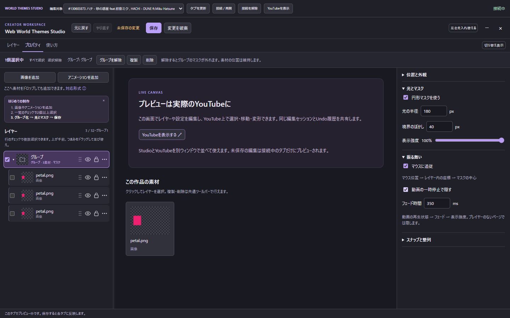
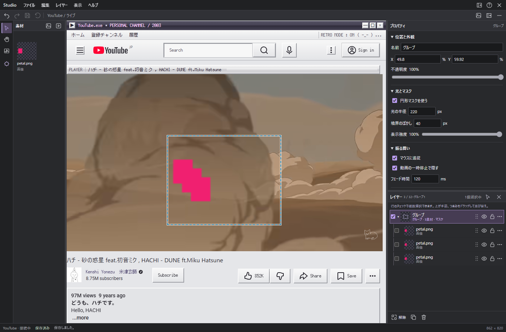

# インページStudioの操作と検証

> 現在の主要制作画面は[公式サイドパネル](side-panel-studio.md)です。以下は従来インページ方式の実装時点の記録で、横方向の予約幅とYouTubeの寸法計算には制約が残ります。

起点は `c23bed9`、ブランチは `codex/creator-editor-spike`。2026-10-18に専用worktreeで検証した。中央は実際のYouTubeタブで、iframe・画面転送・疑似プレビューは使っていない。

## 画面の比較

旧Studioは接続バー、アプリ見出し、タブ、選択操作が重なり、中央は別ウィンドウを見るための案内だった。新Studioは上部56pxの2段、左176px、右320px、下部24px。右のプロパティとレイヤーを上下に常時表示し、制作中も実サイトを直接操作できる。

- [旧Studio・1366px／未選択](screenshots/inpage-studio/before-1366.png)（今回の変更前）
- [旧Studio・1440px／編集中](screenshots/inpage-studio/before-edited-1440.png)（前回の実サイト検証から保存）
- [新Studio・1366px](screenshots/inpage-studio/after-1366.png)
- [新Studio・1920px](screenshots/inpage-studio/after-1920.png)
- [新Studio・狭幅430px](screenshots/inpage-studio/after-narrow.png)
- [独立Studioの共通Workbench](screenshots/inpage-studio/standalone-after.png)

画像はUIと表示領域の比較用。動画の再生時刻やYouTubeの推薦は一致させていない。旧画面は実装前の保存物を使い、新UIで旧画面を再現していない。

## 操作の流れ

| 操作             | 旧Studio                          | 新しいインページStudio                                                       |
| ---------------- | --------------------------------- | ---------------------------------------------------------------------------- |
| 制作開始         | 独立ウィンドウから対象へ接続      | YouTubeを開き、Popupの「Studioを開く（このタブ）」                           |
| 素材追加         | Studioで追加し、別のYouTubeを見る | 左の画像／アニメーションアイコン、ファイルメニュー、ドロップ                 |
| 複数選択         | 一覧のチェック、Ctrl／Shift       | 右下のチェック、選択数、すべて選択。既存キーも維持                           |
| グループ化       | 上の選択操作。プレビューは別画面  | 一覧下の「グループ化」、レイヤーメニュー、右クリック。不可理由はその場で表示 |
| 移動・変形       | YouTubeへ視線とフォーカスを移す   | 中央の実YouTubeでドラッグ・ハンドル操作。数値と同時更新                      |
| マスク           | プロパティへ切り替えて設定        | 左のマスクアイコンから右上の光とマスクへ。レイヤー一覧は表示したまま         |
| 保存・履歴       | 上部の文字ボタン                  | 共通アイコンとツールチップ。保存状態とエラーは下部                           |
| 動画を見る・検索 | 編集を閉じる／別画面へ移る        | 手の「サイト操作」ツール。パネルと作品を維持して動画・検索・リンクを操作     |

`V`は選択・変形、`H`はサイト操作、`C`はカード編集。サイト操作中、YouTubeにフォーカスがある場合は通常のキーを優先し、`V`で編集に戻る。Studio内にフォーカスがある場合は共通編集ショートカットを利用できる。入力欄・IME・メニュー・リサイズ境界ではその操作を優先する。

数値は直接入力でき、ラベルの左右ドラッグでも調整できる。Shiftで細かく調整、Escで中止、ドラッグ全体がUndo 1回。グループの既存制約（同じアンカー、連続した重なり順、ロック保護等）は維持した。

## 配置と復帰

- 左右パネル幅、左右入れ替え、上下の比率、折りたたみをUI設定へ保存。作品JSONには入れない。
- 1100px未満では素材棚を36pxのツール列へ、860px未満では右パネルも自動で畳む。作者の明示設定を優先する。
- 中央480pxを確保できない幅で右パネルを手動表示すると、一時的な重ね表示に切り替える。閉じれば中央へ戻る。
- 全画面は制作UI・確保領域・ハンドル・編集キーを休止し、動画操作を優先。既存Rendererが作品を扱う。終了すると同じパネル配置へ戻る。
- YouTubeの既存ノードをAdapterで移動しない。ネイティブの初期化やレスポンシブ処理による親変更と、拡張自身の変更は区別する。
- Studio終了・OFF・0%で専用CSS・属性・変数・Observer・イベントを解除する。前からあった同名の値とpriorityも復元する。
- 配置は従来の画面／プレイヤー座標。既存作品をパネルに合わせて書き換えない。パネル下に隠れた素材はパネルを畳んで操作できる。

## 共通化と互換性

`studio/workbench.ts` が表示を組み、既存のフォームとレイヤーツリーを使う。インページと独立Studioは同じWorkbench、クイック編集は同じフォーム／ツリー／コマンドのコンパクト表示。選択・変形・保存・Undoを二重実装していない。

`EditorTool`は編集セッションと復旧checkpointの省略可能な項目。古いcheckpointは選択ツールへ復元する。DesignDocument v7、旧形式の移行、asset ID、原本、IndexedDB、World Runtimeは変更していない。Chrome権限・依存パッケージも追加していない。

## 自動テスト

| 検証                                          | 結果                                                |
| --------------------------------------------- | --------------------------------------------------- |
| 型チェック（アプリ・pure Runtime・pure Core） | 成功                                                |
| lint                                          | 成功                                                |
| 専用worktreeのビルド                          | 成功                                                |
| 全体回帰（`af57c54`、249件）                  | 242成功・7スキップ、失敗0、10.0分                   |
| 最終の終了処理・Studio回帰                    | 15成功・失敗0、38.7秒（追加した即終了ケースを含む） |
| 実YouTubeの別実行                             | 1成功・失敗0、25.1秒（`cb8de2f`）                   |

通常実行で除外した7件は、実サイト検証のopt-in（旧light/darkが2件、旧UI・旧Studio・素材・レイアウト予備検証・新Studioが各1件）。新Studioの実サイト検証は明示的に別実行した。全体回帰後の変更は、終了直前のUI配置保存、終了ツールチップ、ヘルプ中のキー保護で、共有Studioの最終回帰で再確認した。

全体ログは `.work/verification/inpage-all.log`、最終UI回帰は `inpage-finish.log`。画像は目視確認と領域・操作のassertを併用し、内容が変わるYouTube映像を固定ピクセル差分の合否判定には使わない。

追加・更新したテストは次を対象にする。

- 新しい一画面で追加、直接移動、グループ、マスク、保存、通常の再読み込み。
- 同時表示、リサイズ、配置保存、左右入れ替え、狭幅と手動の重ね表示。
- サイト操作とカード編集、数値ドラッグ1操作のUndo／Redo／Esc、入力・メニューのキー保護。
- ネイティブ全画面、ヘルプ閉鎖、DOM／動画同一性、SPA、スクロール、OFF／0%と復帰。
- インページと独立Studio間の選択・変更・共通履歴、対象再読み込み、未保存の通信復旧。
- GIF・APNG・WebP・WebM・Lottie、再生設定、グループ、マスク、継承ロック、保存・破棄。
- 非表示で動画を停止・解放し、再表示で設定を復元。
- 32レイヤーのロック4・非表示4・複数選択、削除保護、Undo、1つの一覧スクロール。
- 関係のないDOM更新100回で、追加Adapterのレイアウト測定を予約しない。
- Core純粋型チェック、共通UIのChrome非依存、ツール変更が文書／履歴を変更しないこと。

旧機能の全体回帰にはデータ互換、Runtime決定性、シグナル記録再生、サンプラーとリソース解放、保存失敗・通信競合・ブラウザー再起動も含める。

## 実YouTube

専用一時プロファイルのChromium 153.0.8010.12とMV3拡張で、ログアウト状態の公開YouTubeを検証した。ページの差し替えは行っていない。

- 実サイトの同じ画面内で画像3枚を追加し、プレイヤー基準へ変更、チェック選択、グループ化、直接ドラッグ、円形マスク、マウス追従、保存。
- 実動画の再生／一時停止に連動した120msのフェード。
- 1366×900、1920×1080の中央領域と動画枠、430pxでの自動折りたたみ。
- ネイティブのシアターボタンと全画面ボタン、全画面終了。
- スクロールでプレイヤー基準の素材が追従。検索によるSPA遷移から戻っても編集を維持。
- 編集終了後の幅復帰、保存作品の再読み込み、Studio再起動、強さ0%でのUI・作品・CSSの撤去。

実行は `AROUND_LIVE_STUDIO_WORKSPACE=1 npm test -- tests/studio-workspace-live.spec.ts --grep "production in-page"`。再現記録は `.work/verification/studio-live-inpage.json`、ログは `inpage-live.log`。YouTubeの動画の完全再現や長期的なDOM互換を保証する検証ではない。

## 性能

Chromium 153、1366×900、同じ32レイヤー（ロック4・非表示4）、同じ左右移動の入力で比較した。比較対象は現在のクイックUIとインページWorkbenchで、旧コミットそのものとの速度比較ではない。ウォームアップ10フレームと測定60フレーム、単発の観測値。

| 計測                           |  クイックUI | インページStudio |
| ------------------------------ | ----------: | ---------------: |
| 同期コマンド median / p95 (ms) | 1.70 / 2.10 |      1.80 / 2.50 |
| rAF間隔 median / p95 (ms)      | 6.90 / 7.30 |      7.00 / 7.40 |
| 区間のTask合計 (ms)            |      276.88 |           367.17 |
| Script合計 (ms)                |      135.74 |           150.13 |
| Layout合計 (ms)                |       11.46 |            25.72 |
| Style再計算合計 (ms)           |       12.87 |            14.96 |
| 区間末尾のJS heap (MiB)        |        5.53 |             7.89 |

UIが増えた分、ページ全体のTaskとLayoutは増えている。同期コマンドのp95は2.50msだった。固定FPSや改善率を保証する結果ではなく、GCやホストのリフレッシュ周期でも変わる。heapはその時点の値で、リークの有無を示さない。GPU・プロセス全体のメモリー・実YouTubeのネットワーク／デコード負荷は含まない。

追加Adapterは関係のないDOM更新で測定を予約せず、同じレイアウト／アンカー矩形の通知を省く。重複していたCoreの再描画通知も除去した。素材棚はasset ID単位の静止サムネイルで、追加の再生デコーダーを持たない。

生の記録は `.work/verification/studio-workspace-benchmark.json`、再実行は `npm test -- tests/studio-workspace-performance.spec.ts`。今回の測定はfixtureであり、実YouTubeの性能保証とは区別する。

## 残る制約

- 任意のフローティングパネル、自由なドック分割、タイムライン、ペイントは未実装。今回の配置は左右と上下比率の調整まで。
- 独立Studio自体にYouTube映像を埋め込まず、「YouTubeでStudioを開く」から主要なライブ制作へ移る。
- 素材棚はこの作品で使用中の素材の一覧。未使用原本のライブラリや作品間の素材検索は次段階。
- インページ単独でタブを再読み込みすると、保存済み作品を復元し、Studioは再度開く。終了ボタンは未保存の変更を破棄するため、保存状態を確認してから終了する。未保存ドラフトの再読み込み復旧は、接続中の独立Studioが保持する既存checkpointを利用する。単独Studioの自動ドラフト保存は追加していない。
- 作品は従来どおりサイト単位の保存。共同編集・競合の自動マージは行わない。
- YouTubeのDOM変更、ログイン状態、ブラウザー差、ズーム・高DPI・OSの支援技術は追加検証が必要。通常Chromeの普段使いプロファイルは操作していない。
- 実YouTubeで全アニメーション形式、32レイヤーの長時間編集、ブラウザー再起動までは確認していない。これらの自動fixture回帰と区別する。
- GPU処理時間、Chromeプロセス全体のメモリー、長時間のリークや低性能端末の保証は今回の計測範囲外。

## コミットと読み込み

- `978ca27`: YouTubeの制作領域Adapterと技術検証。
- `98e9aef`: 共通Workbench、インページ起動、ツール、独立Studioとの接続。
- `af57c54`: 数値スクラブ、パネル操作、レイアウトの余分な再測定抑制、回帰・負荷テスト。
- `5a360a9`: 終了直前の配置保存を保証する修正。
- `cb8de2f`: ヘルプ中のキーを保護し、Escで閉じても選択を維持。

mainは `022a576e5fb486b5c2fe5632feee66fcb018c953` のまま。通常版distは12ファイルすべて作業前とSHA-256が一致した。

Chromeへ読み込むのは専用worktreeの `.work/creator-editor/dist`。main・通常版distを更新しない。
