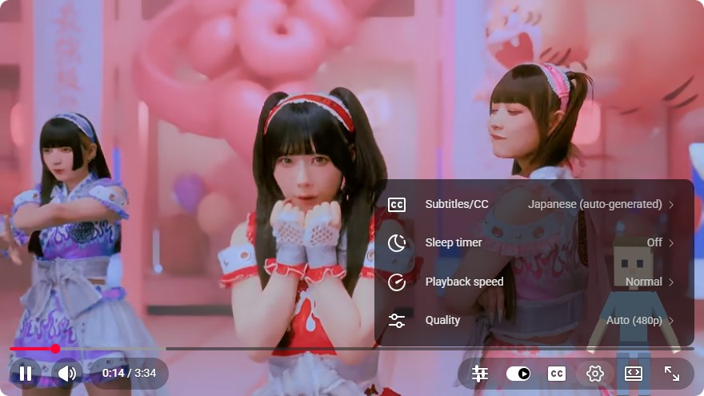
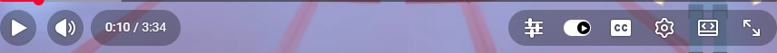

# 塊4 キャラをページの重なりの中に入れる：調べと試作

2026-11-06、Claude Code。ブランチ `codex/chunk4-layering`（塊3 `codex/chunk3-autonomy` の上）。製品の既定の挙動は変えていない。試作は開発用のビルドのフラグ `WW_LAYERING=1`（`scripts/build.mjs`、出力は `.work` の中だけ）で切り替える。

## 0. 結論

| 問い                                                         | 答え                                                                                                                                                                                                                                                                                       |
| ------------------------------------------------------------ | ------------------------------------------------------------------------------------------------------------------------------------------------------------------------------------------------------------------------------------------------------------------------------------------ |
| プレーヤーの中で、動画より手前・操作部品より奥に入れられるか | **できる**。プレーヤー（`#movie_player`）は `position:relative; z-index:0` で、それ自体が重なりの文脈（stacking context）。動画の器は z10、操作類はすべて z16〜2300。キャラの層を「動画の器の直後に、同じ z10 で」差し込むと、ブラウザが動画の上に描くものは、すべてキャラの上にも描かれる |
| 止めずに済むか                                               | **済む（試作で確かめた）**。本物の YouTube で、カーソルの出入り・k・クリック・設定メニュー・右クリックのメニュー・広告の間、キャラが止められたコマは **0**（今の方式では、同じ手順で 28〜253 コマ止まる）                                                                                  |
| G1 は守れるか                                                | **守れる**。バーの記号の画素はキャラに1つも隠されず（1,879画素を比較）、本物のボタンに届き、クリックも効く。手前と**証明できない**部品は、今までどおりガードが止める                                                                                                                       |
| プレーヤーの外（カード・タイトル）                           | カードの奥は**条件付きでできる**。タイトルの文字の奥は**難しい**（YouTube の CSS を変えずには無理）                                                                                                                                                                                        |
| 作品データ                                                   | 置き場所の名前を選ぶだけにできる。この塊では版を上げていない（案だけ）                                                                                                                                                                                                                     |
| Playground                                                   | **できる**。ページが自前なので、同じ名前の置き場所を、証明しやすい形で用意できる                                                                                                                                                                                                           |

## 1. 出発点（今の作り）

- プレーヤーの中の層（`src/renderers/dom/scene.ts` の `videoSlot`）は、もともと動画の器のすぐ上（z11）・操作部品の下に置かれていた。描く順番だけを見れば、すでに「操作部品より奥」だった
- それでも止まっていた理由は3つ
  1. 帯の切り抜き：上 64px・下 112px を切り抜く（バーが隠れている間だけ外す、塊3の帯の規則）
  2. `verifiedPlayer()`（`src/sites/youtube-operations.ts`）：メニュー・広告・エラー・中央のボタンが見えている間は、層ごと使うのをやめる。使えないとキャラは画面全体の層へ移り、メニューの「窓全体」の保護範囲で止まる
  3. ガード（`src/host/operation-guard.ts`）：読み取りが古い間（HOLD・SHIFTED）と、カーソルが操作部品に近い間（接近の保持）は、層を問わずすべての絵を止める
- つまり、描く順番は正しかったのに、ガードはそれを使わず「どこに何があるか」の読み取りだけで守っていた。試作は、その順番を**証明して**ガードに渡すようにした

## 2. 調べたこと

### 2.1 プレーヤーの中の重なり（本物の YouTube、2026-11-06、headless で読み取り）

`#movie_player` の直接の子と、その描く深さ（その文脈の中での z）。

| 部品                                                                                                                                                   | z                                   | キャラ（z10・動画の直後）との順                                      |
| ------------------------------------------------------------------------------------------------------------------------------------------------------ | ----------------------------------- | -------------------------------------------------------------------- |
| `.html5-video-container`（動画）                                                                                                                       | 10                                  | 下（キャラはこの直後）                                               |
| `.ytp-seek-overlay`・`.ytp-speedmaster-overlay`                                                                                                        | 10                                  | 上（同じ z で木の順が後）                                            |
| `.ytp-storyboard-framepreview`                                                                                                                         | 16                                  | 上                                                                   |
| `.ytp-spinner`・`.ytp-bezel`（k のアイコン）                                                                                                           | 18・19                              | 上                                                                   |
| `.ytp-gradient-bottom`・`-top`                                                                                                                         | 24・25                              | 上                                                                   |
| `.html5-endscreen`（終了画面）                                                                                                                         | 36                                  | 上                                                                   |
| `.ytp-chrome-top`・`.ytp-chrome-bottom`（バー）                                                                                                        | 58・59                              | 上                                                                   |
| `.ytp-overlays-container`（カードの予告・有料の表示など）                                                                                              | 59                                  | 上                                                                   |
| `.ytp-large-play-button`                                                                                                                               | 63                                  | 上                                                                   |
| `.ytp-miniplayer-ui`・`.ytp-fullscreen-grid`                                                                                                           | 67・72                              | 上                                                                   |
| `.ytp-playlist-menu`・`.ytp-overflow-panel`・`.ytp-share-panel`                                                                                        | 73〜75                              | 上                                                                   |
| `.ytp-unmute`・`.ytp-settings-menu`                                                                                                                    | 1001・2300                          | 上                                                                   |
| `.ytp-caption-window-container`・`.ytp-player-content.ytp-iv-player-content`・`.video-ads`・`.ytp-suggested-action`・`.ytp-gated-actions-overlay` ほか | なし（static か z の無い absolute） | **証明できない**（中の要素の z で決まる。1件ずつ確かめる。下の 2.5） |

- プレーヤーは `overflow:hidden`。キャラの層には `clip-path: inset(0)` も掛けるので、層の絵はプレーヤーの箱の外に出ない
- 文脈の祖先：`#movie_player` から `html` まで、ほかに文脈を作る祖先はない（`ytd-app` は absolute・z なし）
- シアターモードでも同じ形。全画面は headless では `document.fullscreenElement` が `html` になり、プレーヤーの形は変わらなかった（headed の全画面は未確認）

### 2.2 プレーヤーの外

| 置き場所                                 | 結果                 | 理由                                                                                                                                                                                                                                                                                                                                                                            |
| ---------------------------------------- | -------------------- | ------------------------------------------------------------------------------------------------------------------------------------------------------------------------------------------------------------------------------------------------------------------------------------------------------------------------------------------------------------------------------- |
| 右の列のカード（`yt-lockup-view-model`） | **条件付きでできる** | カードの外枠 `.ytLockupViewModelHost` が `position:relative`（z なし）。z の無い positioned な層を、カードより**木の順で前**に差し込めば、カードはその上に描かれる。ただし同じ文脈の static な中身（並べ替えのチップ・見出しなど）は、positioned な層より下に描かれるので、層が重なる範囲に static な部品がないことを、置き場所ごとに確かめる必要がある                         |
| タイトル（`ytd-watch-metadata h1`）      | **難しい**           | 祖先が `#below`（relative、z なし）まで static。static な文字より奥に入れるには、負の z の層をタイトルを含む文脈の中に入れる必要があるが、その文脈は `html` までなく、`ytd-app` の白い背景の下に隠れる。YouTube 側に `isolation:isolate` を付ければできるが、それは「ネイティブのスタイルを変えない」（`src/host/operation-composition.ts` の方針）に反する。今の切り抜きで守る |

### 2.3 層の外にはみ出せない問題（乗り換え）

- 今の描画では、3D は共有の WebGL で描き、キャラごとの **2D の canvas に写す**（`src/renderers/three/models.ts` の `drawImage`）。キャラの要素を別の層へ動かしても WebGL の文脈は失われない。今も、層を移るときはこの要素を動かしている
- 案は3つ

| 案                        | やり方                                                                                                                                       | 見立て                                                                                 |
| ------------------------- | -------------------------------------------------------------------------------------------------------------------------------------------- | -------------------------------------------------------------------------------------- |
| A. 乗り換える（おすすめ） | プレーヤーの中にいる間は奥の層。箱の縁にかかったら、今の画面全体の層（切り抜き付き）へ移り、行き先の置き場所の中に入りきったら、その層へ移る | 今の仕組みの組み合わせで済む。縁をまたぐ間だけ、今と同じ守り方になる                   |
| B. 2つの層で同時に描く    | 同じコマを2つの 2D canvas に写し、プレーヤーの箱で切り分ける                                                                                 | 写しが1回増える（1キャラあたり drawImage 1回）。縁でも途切れない。A で足りなければ試す |
| C. 1つの層だけで描く      | 奥の層のまま、箱の外は描かない                                                                                                               | はみ出す動き（逃げる・帰る）が箱の縁で切れる。試作はこの形                             |

### 2.4 YouTube がページを作り直したとき

- 試作では、毎回の描画で「層の要素の1つ前が動画の器か」を見て、違えば器の直後へ差し込み直す（`scene.ts`）。プレーヤーは今までどおり `querySelector` 1回、動画の器はプレーヤーの直接の子から探す。文書全体は探さない
- 「読み取り待ちでも止めなくてよいか」（下の 3.2）は、ページの変化の通知が集めた「変わった要素」だけを見て、その要素の中（プレーヤー自身のクラスが変わったときは、プレーヤーの中）だけを探す

### 2.5 奥に入れる部品・入れない部品

判定は1件ずつ、読み取りのたびに `paintsAbove`（`src/host/operation-composition.ts`）で行う。下の表は、2026-11-06 に本物の YouTube で見た結果。

| 部品                                                               | 結果                                                                                           | 守り方                         |
| ------------------------------------------------------------------ | ---------------------------------------------------------------------------------------------- | ------------------------------ |
| 下のバー・上の帯のボタン、進行バー、音量                           | 奥に入る（z58・59 の中）                                                                       | 描く順番                       |
| 設定・再生リスト・共有などのメニュー                               | 奥に入る（z73〜2300）                                                                          | 描く順番                       |
| 右クリックのメニュー                                               | 奥に入る                                                                                       | 描く順番                       |
| 広告の「スキップ」・広告のカード                                   | 奥に入る（試作の実測で、キャラの上に描かれた）                                                 | 描く順番                       |
| 終了画面のカード                                                   | 奥に入る（z36）                                                                                | 描く順番                       |
| 大きな再生ボタン                                                   | 奥に入る（z63）。ただし起動直後の1回の読み取りで「証明できない」と出た（原因は未確認、下の 6） | 証明できないときは今までどおり |
| 字幕の窓                                                           | **分からない**（字幕を出せず確かめられなかった）。入れ物は z なし                              | 証明できなければ今までどおり   |
| `.ytp-suggested-action`・`.video-ads` の入れ物の中の、z の無い部品 | 入れない                                                                                       | 今の切り抜き・止め方           |
| プレーヤーの外の部品                                               | 関係しない（下の理由）                                                                         | ―                              |

- プレーヤーの外の部品は、キャラが新しく隠すことがない：キャラの層はプレーヤーの箱の中に切り抜かれ、描く順番は動画の器と隣り合う。外の部品は「動画より手前（＝キャラより手前）」か「プレーヤー全体より奥（＝すでにプレーヤーの下で、クリックもプレーヤーが受けている）」のどちらか

### 2.6 作品データ（案。この塊では版を上げていない）

- 置き場所はアダプターが名前で渡し、作品は名前を選ぶだけにする。例：`player.under-controls`（プレーヤーの操作の下）、`cards.behind`（カードの後ろ）
- 作品に入るのは決まった名前の一覧の1つだけ。選択子・CSS・z の数値は入れない。どこに差し込むか、何を証明するかはアダプターとエンジンが持つ
- `video-player` を基準にした層は、`player.under-controls` を**既定**にしてよい（今の帯の切り抜きより、見える範囲が広く、止まらない）。そうすれば作品データに項目は要らない。名前を選ぶ項目が要るのは、ページの置き場所（カードの後ろなど）を足すとき。そのときに版を1段上げる

### 2.7 Playground

- Playground のアダプター（`src/sites/playground.ts`）は、今は `videoSlot` を渡していない
- Playground のページは自前なので、動画の部品を「z の付いた文脈の中に、z の付いた動画の器」という形で作れば、同じ `paintsAbove` で証明でき、同じ名前の置き場所を渡せる。カードの後ろも、カードを `position:relative` にして作れば同じ（コードは書いていない）

## 3. 試作（`WW_LAYERING=1`）

### 3.1 変えたところ

| ファイル                                         | 内容                                                                                                                                                                                                                                              |
| ------------------------------------------------ | ------------------------------------------------------------------------------------------------------------------------------------------------------------------------------------------------------------------------------------------------- |
| `scripts/build.mjs`・`src/host/world-options.ts` | `__WW_LAYERING__`（`LAYERING`）。`.work` への出力だけで使える                                                                                                                                                                                     |
| `scripts/g11/build.mjs`                          | `WW_LAYERING=1` で `.work/g11-layering-dist` に計測ビルドを作る（交互に測るため）                                                                                                                                                                 |
| `src/host/operation-composition.ts`              | `paintsAbove(element, reference)`：2つの要素の文脈の鎖を比べ、共通の文脈の中で「深さが上」か「同じ深さで木の順が後」なら手前、と証明する。文脈を持たない中身（ふつうの流れ・z の無い positioned）は、正の深さより下に描かれるので「証明できない」 |
| `src/sites/youtube-operations.ts`                | `beneathPlace()`（プレーヤーが文脈で、動画の器に z があること）。読み取りのたびに、プレーヤーの中の部品へ `aboveBeneath` を付ける。読み取り待ちの変化が、描く順番で守られているか（`settled`）を返す                                              |
| `src/host/operation-source.ts`                   | `beneathSlot()`（変わった要素と変化の種類を、アダプターへ渡す）、部品の `aboveBeneath`                                                                                                                                                            |
| `src/world/operations.ts`                        | 描き方 `native-beneath`。`aboveBeneath` の部品は調べず、それ以外は今の層と同じく重なれば止める。接近の保持から外す                                                                                                                                |
| `src/host/operation-guard.ts`                    | `settled` の `native-beneath` の絵には、読み取り待ちの止め（HOLD・SHIFTED・入力の照合の止め・見た目の変化の HOLD）を掛けない                                                                                                                      |
| `src/renderers/dom/scene.ts`                     | 編集中でなく、プレーヤーを基準にした層のとき、層を動画の器の直後・同じ z に差し込む。帯の切り抜きなし（`inset(0)` だけ）。穴は証明できない部品にだけ開ける                                                                                        |

フラグが off のとき、`beneathSlot` は何も返さず、`native-beneath` の絵は作られない。既定の挙動は変わらない。

### 3.2 読み取り待ちでも止めなくてよい条件（`settled`）

次のどれかなら止めない。それ以外は今までどおり止める。

1. 読み取りの後、何も変わっていない
2. 前の読み取りで、プレーヤーの箱にかかる部品がすべて証明済み。かつ、変わった要素がどれも次のどれか
   - 動画の器の中
   - それ自身がキャラより手前と証明できる（バーのボタンのクラスの変化など）
   - プレーヤーの中で、その要素の中に「見えていて証明できない操作部品」がない（k のアイコンの入れ物 `.ytp-bezel-text-hide` など）
   - プレーヤー自身や祖先（クラスの変化：バーの出入り・シアター・ダーク）で、プレーヤーの中に「見えていて証明できない操作部品」がない
   - プレーヤーの外の要素（2.5 の理由）
3. 変化が1件ずつ分からない（全体の読み直し待ち）か 64 件を超えるときは、プレーヤーの中に「見えていて証明できない操作部品」がないこと

調べ方の手順は、トレースのビルド（`WW_GUARD_TRACE=1`）で、止めた理由をキャラの層の要素の `data-ww-beneath-unsettled` に書き出して決めた。最初は、k のアイコンの入れ物のクラスの変化・バーが消えるときの opacity の変化・設定メニューを開くときの全体の読み直しで止まっていた。

## 4. 結果

### 4.1 本物の YouTube（`tests/layering-live.spec.ts`、マネキン、headless）

右下の角に、バーと重なる位置に置いた（自律 off・計算の動き off、置いた位置のまま描く）。毎コマ、キャラがガードに止められているかを数えた。

| 場面                           | 今の方式（止められたコマ／全コマ） | 試作   |
| ------------------------------ | ---------------------------------- | ------ |
| 何もしない（バーは隠れている） | 56／257                            | 0／258 |
| カーソルを載せる（バーが出る） | 96／136                            | 0／134 |
| カーソルを離す                 | 81／524                            | 0／523 |
| k で一時停止                   | 157／265                           | 0／289 |
| k で再生                       | 44／185                            | 0／179 |
| 再生ボタンをクリック           | 28／120                            | 0／120 |
| 設定メニュー                   | 253／455                           | 0／467 |
| 右クリックのメニュー           | 155／155                           | 0／199 |

- 今の方式の止めた理由：HOLD（操作部品が動いている間）・SHIFTED（位置が変わった）・メニューの窓全体の保護範囲
- 試作の G1：再生・設定・全画面のボタンの中心で `elementFromPoint` がそのボタン。再生ボタンのクリックで一時停止した。バーの箱の中で、キャラは 730 画素に写り、バーの明るい記号の画素 1,879 のうち、キャラで変わったものは 0
- 広告：試作の1回目に広告が流れ、その間もキャラは止められず、「Skip」ボタンと広告のカードがキャラの上に描かれた（`layering-advert.png`）。今の方式では、広告の間キャラは消えていた（`baseline-advert-paused.png`）。広告は狙って出せないので、毎回は確かめられない

| 試作                                                                             | 今の方式                                                                  |
| -------------------------------------------------------------------------------- | ------------------------------------------------------------------------- |
|  カーソルを載せた：バーの記号が脚の上  |  同じ場面：止められて消えている |
|  設定メニュー：メニューがキャラの上 |  同じ場面：消えている        |
|  右クリックのメニュー           |  同じ場面：消えている    |
|  広告：Skip がキャラの上              |  広告の間：消えている   |

バーだけを切り出した比較：キャラあり  ／キャラの canvas を透明にしたもの 

### 4.2 性能（短い確かめ。合否の計測ではない）

`tests/r32-perf.spec.ts` の `corner`（右下の角、自律 off）を、計測中に毎秒カーソルをプレーヤーに出し入れしてバーを出し入れしながら（`WW_PERF_R32_WIGGLE=1`）、通常と試作の計測ビルド（`scripts/g11/build.mjs`、試作は `WW_LAYERING=1`）で交互に2組測った。値は拡張の rAF の CPU 時間（1フレームあたり、ms）。各組2回の窓（各5秒、合わせて約820フレーム）。記録：[layering-short-cpu.json](benchmarks/chunk4/layering-short-cpu.json)

| 組  | 通常 中央値 | 試作 中央値 | 通常 平均     | 試作 平均     | 通常 p95（参考） | 試作 p95（参考） |
| --- | ----------- | ----------- | ------------- | ------------- | ---------------- | ---------------- |
| 1   | 0.8 / 0.8   | 0.7 / 0.7   | 1.018 / 0.980 | 0.981 / 0.917 | 2.1 / 2.0        | 2.1 / 2.2        |
| 2   | 0.8 / 0.8   | 0.8 / 0.7   | 1.025 / 0.957 | 0.973 / 0.939 | 2.1 / 2.1        | 2.2 / 2.2        |

- 中央値・平均は試作がわずかに軽い（平均で約 0.04ms）。p95 は試作が 0.1ms ほど重い。差は測りの細かさ（0.1ms）と同じくらいで、「軽くなった」とまでは言えない
- 公平でない点：通常のビルドでは、キャラが止められている間は描画の仕事も減る（4.1 の表で、この場面の多くのコマで止まっている）。試作は止まらずに描き続けたうえで同じくらい
- p95 が少し重いのは、読み取り待ちの間に毎回の描画で `settled` を調べる分（6 の2つめ）と見ている。CPU プロファイルは取っていない
- 起動直後・SPA 遷移直後は測っていない

### 4.3 テスト

| 種類                                                                                                                                                                                                                                                                            | 件数 | 結果                                                                                                                                                                                                                                     |
| ------------------------------------------------------------------------------------------------------------------------------------------------------------------------------------------------------------------------------------------------------------------------------- | ---- | ---------------------------------------------------------------------------------------------------------------------------------------------------------------------------------------------------------------------------------------- |
| unit 全件                                                                                                                                                                                                                                                                       | 566  | 通過（3 skip は前から）                                                                                                                                                                                                                  |
| 触った部分の e2e（通常のビルド）：`operation-safety`・`operation-bands`・`operation-controls`・`operation-player-overlays`・`operation-editing-input`・`g13-fix-bound`・`g13-look-regression`・`g13-sparse-visual`・`g14-idle-recheck`・`layering`・`character-autonomy-editor` | 66   | 通過                                                                                                                                                                                                                                     |
| 同じ G1 の spec（`layering` と `character-autonomy-editor` を除く）を試作のビルドで                                                                                                                                                                                             | 62   | 通過。ただし模擬ページのプレーヤーは重なりの文脈になっていないので、試作の道（`native-beneath`）を通るのは `layering.spec.ts` だけ。今ある G1 のテストは、試作の道をほとんど通っていない                                                 |
| 新しい e2e `tests/layering.spec.ts`                                                                                                                                                                                                                                             | 3    | 通過：`paintsAbove` の証明（同じ深さの前後・文脈のない中身・外の fixed）、YouTube と同じ重なりにした模擬プレーヤーで「バーの出入りとメニューで止まらない・ボタンに届く・クリックが効く」、「z の無いボタンが重なると今までどおり止まる」 |
| 実サイト `tests/layering-live.spec.ts`（`WW_LIVE_LAYERING=1`）                                                                                                                                                                                                                  | 1    | 試作で通過（最後の4回連続）。通常のビルドでは `WW_LIVE_LAYERING_BASELINE=1` で記録だけ                                                                                                                                                   |

中核（`src/sites/`・`src/host/`・`src/world/`）を触った。どれもフラグの裏で、フラグが off のときの道は変えていない。Codex の検証では e2e 全件（Windows）が要る。

## 5. 次にすること（案）

1. 乗り換え（2.3 の案 A）：縁をまたぐ間だけ画面全体の層、入りきったら奥の層
2. `video-player` 基準の既定を `player.under-controls` にするか（2.6）。するなら、帯の規則（塊3）と `verifiedPlayer()` のメニュー・広告の条件は、奥に入れないときだけのものになる
3. カードの後ろの置き場所（2.2）と、Playground の同じ置き場所（2.7）
4. 字幕の窓・広告の入れ物の中を、本物で1件ずつ確かめる（2.5 の「分からない」）

## 6. 分からない点・危ないと思う点

- **プレーヤーの中に、証明できない操作部品が1つでもある間は、読み取り待ちのたびに止まる**（`settled` は前の読み取りの「証明できない部品」をプレーヤー全体で見ていて、キャラと重なるかどうかは見ていない）。起動直後の1回、大きな再生ボタンがこれに当たった（z63 のはずだが、そのときの読み取りでは証明できなかった。原因は未確認）。キャラの範囲と重なるものだけに絞れるが、試作ではしていない
- `settled` を決めるとき、変わった要素の中を `querySelectorAll` で探し、見つけた部品の `getBoundingClientRect` を読む。プレーヤー自身のクラスが変わると、プレーヤーの中（50件ほど）を毎回の描画で探す。読み取り待ちの間（100〜180ms）に何度も繰り返すので、結果を変化ごとに覚えれば減らせる（試作ではしていない。4.2 の計測を見て決める）
- 証明は「キャラの層が動画の器の**直後**にある」ことに頼っている。YouTube がその間に要素を差し込んだら、次の描画で差し込み直すまでの1コマ、その要素の z が 10 ならキャラの下になる
- プレーヤーの外の部品を「関係しない」としたのは、プレーヤーの箱がその部品のクリックをすでに受けているから。プレーヤーの背景が透明なところでは、外の部品がプレーヤー越しに見えていて、キャラがそれを隠すことはありうる（見た目だけ。押せないのは今も同じ）
- 編集中は試作を使わない（今の方式のまま）。ハンドルが奥の層に入ると、バーの下のハンドルをつかめなくなるため
- headed の全画面、字幕、終了画面、ミニプレーヤーでは確かめていない
- 本物の YouTube の確認は headless で、1回ずつ。広告が出るかどうかは回によって違う
