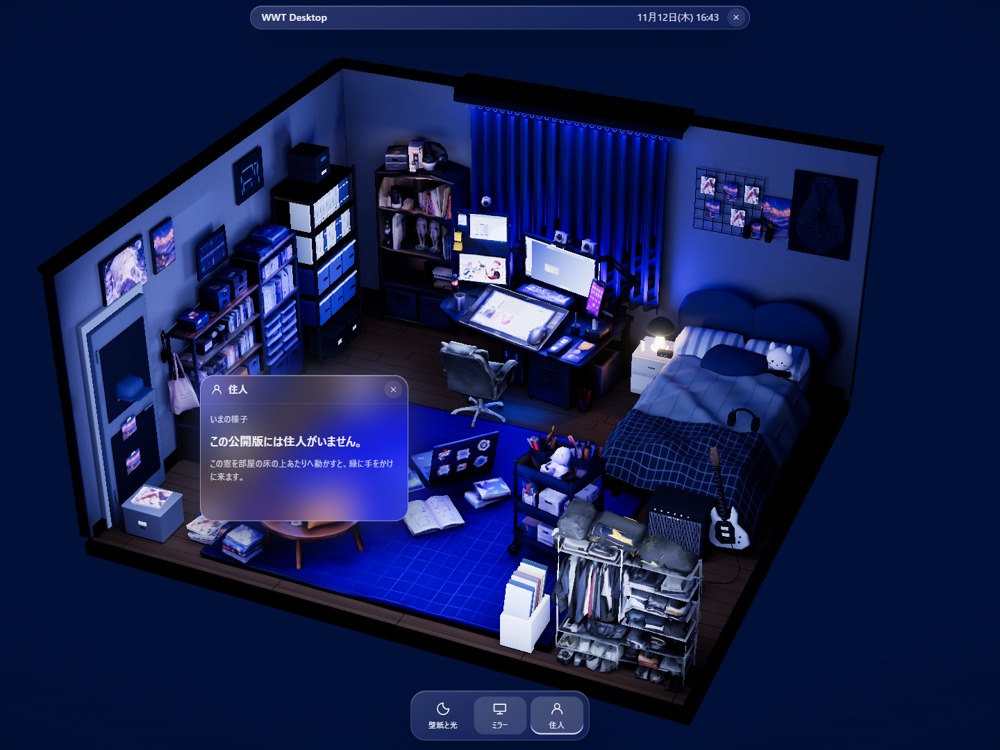
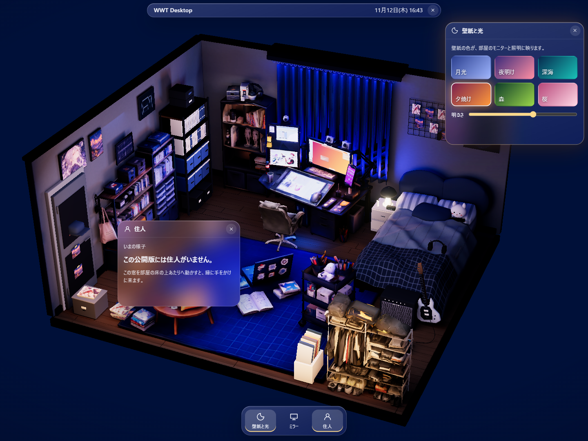

# 仮想デスクトップと部屋の融合（2026-11-12、ノート PC、Claude Code）

`feat/living-onboarding`。翔太の方針（優先 1「UI と 3D 空間の融合」・優先 2「仮想デスクトップ」）と 4 つの基準を、1 つの塊で実装した。

| 基準                                   | 実装                                                                                                                                         |
| -------------------------------------- | -------------------------------------------------------------------------------------------------------------------------------------------- |
| 操作可能な WWT 独自の仮想デスクトップ  | 部屋の上に重なるガラス調の窓・バー・ドック。窓はドラッグと矢印キーで動かせ、閉じる・前に出すができる。アプリは「壁紙と光」「ミラー」「住人」 |
| その画面と部屋の 3D モニターの連動     | 同じ状態を、机のモニターの面にも描く。閉じている間は壁紙と時計、開くと窓の配置がそのまま映る                                                 |
| 任意で現実の画面を映すミラーモード     | 「ミラー」の窓のボタンを押したときだけ、ブラウザーの画面共有の確認が出る。映像は部屋のモニターと窓の中のプレビューに映る                     |
| 映し出した画面の色による部屋の照明変化 | 部屋の光を 3 層に分けて焼き直した。モニターの光と、手前のデスクトップからの光を、表示中の色で染めて足す                                      |





[「深海」](../art/living-room/renders/desktop-sea.png)。フェリスが写る画像と録画は `C:\wwt-private\Felis_v0.8.1\work\living-desktop\`（リポジトリの外）。

## 1. 全体の作り

状態は 1 つ（`src/living-room/desktop/state.ts`、純粋な関数）。そこから 4 つが同時に決まるので、ずれない。

| 出力           | 部品                                                 | 中身                                                                                                                                 |
| -------------- | ---------------------------------------------------- | ------------------------------------------------------------------------------------------------------------------------------------ |
| ページの窓     | `desktop/view.ts`・`style.css`                       | DOM。窓ごとに `backdrop-filter` で下の部屋だけを曇らせる。部屋全体は曇らせない（フェリスが窓に来るのが見えるように）                 |
| 部屋のモニター | `desktop/paint.ts`                                   | 640×360 のキャンバスに同じ状態を描き、モニターの面（`dyn_monitor_screen`）のテクスチャにする。変わったときと分が変わったときだけ描く |
| 部屋の光       | `screen-glow.ts`・`desktop/index.ts`                 | 下の「光の層」                                                                                                                       |
| フェリス       | `desktop/index.ts`・`desktop/edge.ts`・`resident.ts` | 下の「フェリスの反応」                                                                                                               |

ミラーは `desktop/mirror.ts`。`getDisplayMedia`（最大 1280×720・15fps）。映像は `<video>` → モニターの `VideoTexture` と、8×8 のキャンバスで 250ms ごとに取る平均色だけに使う。送信・保存・録画はしない。ブラウザー側の「共有を停止」でも止まる。

## 2. 光の層（焼き直し）

これまでは部屋の光を 1 枚に焼いていたので、実行時に色を変えられなかった。`80_bake.py` を、印（`layer`）の付いた照明を別に焼くように広げた。

| 層       | Blender の照明                                                | 使い方                                          |
| -------- | ------------------------------------------------------------- | ----------------------------------------------- |
| 土台     | それ以外の全部                                                | これまでどおり（`lightmap.png`・頂点色）        |
| `screen` | メインモニターの面光源 `L_screen_<n>`（白で焼く）             | モニターが映している色 × 2.6                    |
| `ui`     | 部屋の開いた手前側から中へ向く大きな面光源 `L_ui`（白で焼く） | デスクトップの色 × 1.5 × 開き具合（閉じると 0） |

- 大きな面は層ごとに半分の大きさのライトマップ（`light-ui.png` 868KB・`light-screen.png` 454KB。同じ UV）。それ以外のメッシュは頂点ごとの属性 `_UI`・`_SCREEN`（glTF の独自属性として書き出す）
- 影と照り返しが入った本物の光なので、手前から差す光は家具の影を作り、ベッドや棚の手前側だけが染まる
- Web では、部屋の材質のシェーダーに 1 項足すだけ（`screenGlow().layer(name, r, g, b, power)`）。`room.json` に `layers` がない古い部屋は今までどおりに描ける
- モニターの面は、Tripo の画面の上に置いた 0〜1 の UV を持つ四角（`reference_models.py` の `monitor_face`）。いちばん大きい垂直の面をメインモニターとして選ぶ
- フェリスには別に、同じ色のランプを 2 つ当てる（手前からの平行光と、モニターの位置の点光源）

## 3. フェリスの反応（最初のオンボーディング体験の 1〜5）

| 場面                   | 実装                                                                                                                                                                                                                                             |
| ---------------------- | ------------------------------------------------------------------------------------------------------------------------------------------------------------------------------------------------------------------------------------------------ |
| 1 普段の生活           | 1 日の流れを「ベッドへ行ってスマホを取る」所から始める（`startLife(step, phoneAt)`）                                                                                                                                                             |
| 2 デスクトップが現れる | 「デスクトップを開く」を押すと、`ui` の層が 0→1 に上がり、部屋とフェリスが手前から染まる                                                                                                                                                         |
| 3 反応する             | 目が先に窓へ向く → イヤホンを左右外す → スマホをその場に置く → 起き上がる → 興味の気分で駆け寄る。窓に手が届く床がないときは、スマホを下ろして 7 秒ほど眺め、元の生活に戻る                                                                      |
| 4 干渉する             | 前に出ている窓の縁（下辺と左右の下側の外）の点を、カメラからの視線が手の高さを通る場所として部屋の座標に直し、そこへ手を伸ばす。手が着いた瞬間に窓が少したわむ。窓をドラッグすると、置き直した場所へ追いかけてくる。触れている間に窓を押すと喜ぶ |
| 5 閉じる               | `ui` の光が消え、止めていた 1 日の流れの続きに戻る（スマホは置いた場所で拾う）                                                                                                                                                                   |

- 窓の縁の点は、窓が止まったときにだけ選び直す（毎フレーム選ぶと 2 点の間で迷う）
- デスクトップが開いている間、ポインターでの視点の回り込みを止める（窓を操作している最中に部屋が動くと、手を置いた点がずれる）
- スマホを使うのは、流れが決めた場所に体が落ち着いているときだけ。戻る途中で部屋の向こうのスマホへ手を伸ばす不具合を直した
- テスト用にあった「クリックで目印を置く」は、Alt を押しながらのクリックだけにした

## 4. 自分で決めたこと

- 仮想デスクトップにした（任せてもらった点）。壁紙の色がそのまま部屋の照明になるので、「UI と 3D の融合」がいちばん直接に伝わる
- 部屋全体をぼかさず、窓の下だけを曇らせる。参考画像の「背景が曇って UI が浮き出る」は窓ごとに実現し、フェリスは窓の外で鮮明に見える
- 窓は部屋の中の板ではなく、画面に貼り付いた DOM。本物のボタンなので操作の守り（G1）は要らず、文字もぼけない。部屋との結び付きは光・モニター・フェリスの手で作る
- 層の色は急に変えず、6/秒でなじませる（壁紙の切り替えが部屋を流れる。映像のカットで明滅しない）
- ミラー中、フェリスがいない公開版は毎秒 30 コマまでに描画を抑える（映像は 15fps）

## 5. 確かめた結果（ノート PC・Chromium 画面の外・本物の GPU）

- 公開用（フェリスなし）・フェリス入りの両方で、開く → 壁紙を替える → 閉じる、ミラーの開始と停止がエラー 0
- フェリス入り：ベッドでスマホ → 開く → イヤホンを外す → スマホを置く → 起きる → 駆け寄る → 縁に触れる → ドラッグに付いてくる → 閉じる → ベッドへ戻ってスマホを取る、が通る
- 公開用は、止まっている間（閉・開とも）描画 0 回。ミラー中だけ描く

短い負荷の比較（フェリス入り、1440×1080、同じページで閉・開を 2 組。[要約](benchmarks/living-desktop.json)）。2 組なので目安。

| 場面            | 閉・組1 | 開・組1 | 閉・組2 | 開・組2 |
| --------------- | ------: | ------: | ------: | ------: |
| 体の処理 ms     |    0.73 |    0.82 |    0.71 |    0.81 |
| 描画呼び出し ms |    1.48 |    1.39 |    1.47 |    1.31 |
| フレーム間隔 ms |   16.65 |   17.57 |   17.02 |   17.59 |

部屋のデータ：`room.glb` 10.95MB → 12.77MB（頂点の層の属性の分）、層のライトマップ 2 枚で 1.32MB。

## 6. 残り・気になる所

- **ミラーの確認で実画面が映った**：自動テストで「このタブ自身」を選ばせる設定が効かず、PC の画面全体が共有された。映像はページの中だけで使われ送信はないが、確認用の画像に縮小された実画面が入ったので、その場で消した。ミラーの自動確認は、映す対象を固定できる方法が分かるまで手で行う
- ドラッグ中に窓を押し返す動きはない。手が着いたときにたわむだけ
- 窓の縁に手が届くのは、窓の縁が「部屋の床の上」に見える位置にあるとき。画面の上の方や右のベッドの上では眺めるだけになる
- 触れたあと、窓を少し動かしただけでも歩き直す。小さな動きは腕だけで追うほうが自然
- アプリは 3 つ。中身の楽しさ（優先 2 の目的）はこれから。音楽・メモ・写真などを足す土台（状態・窓・ドック・モニターへの映り）はできている
- `screen` の層は値が小さく（最大 0.21）、8 ビットの PNG では暗い所の階調が粗い。目では分からなかった
- 中核は `playwright.config.ts`（unit の一覧に 1 行）だけ。作品データの版は上げていない

## 7. 再現

```bash
# 部屋を焼き直す（約 4 分。層が 2 つ増えた）
"C:/Program Files/Blender Foundation/Blender 5.2/blender.exe" -b --factory-startup --python scripts/living-room/run_all.py
# 公開用
WW_LIVING_TEST=1 WW_LIVING_OUT=.work/living-room-public node scripts/build-living-room.mjs
# フェリス入り（.work の中だけ）
WW_LIVING_TEST=1 WW_LIVING_OUT=.work/living-room-preview \
  WW_LIVING_CHARACTER=C:/wwt-private/Felis_v0.8.1/work/felis-1024.vrm WW_LIVING_MOTIONS=C:/wwt-private/Felis_v0.8.1/motions \
  node scripts/build-living-room.mjs
node scripts/playground/serve.mjs .work/living-room-preview 4183
```

（2026-11-12 深夜の追記：`resident.setUi`・`says`・`touching` は、心と演出役への置き換えでなくなった。今の入口は [living-mind.md](living-mind.md) の 10。）

テスト用の入口：`__wwLivingRoom.desktop()`（状態）、`resident.says()`・`resident.touching()`・`resident.setUi(point)`。unit は `tests/living-desktop.spec.ts`（8 件：窓の管理、はみ出さないこと、光の色、縁の点）。
