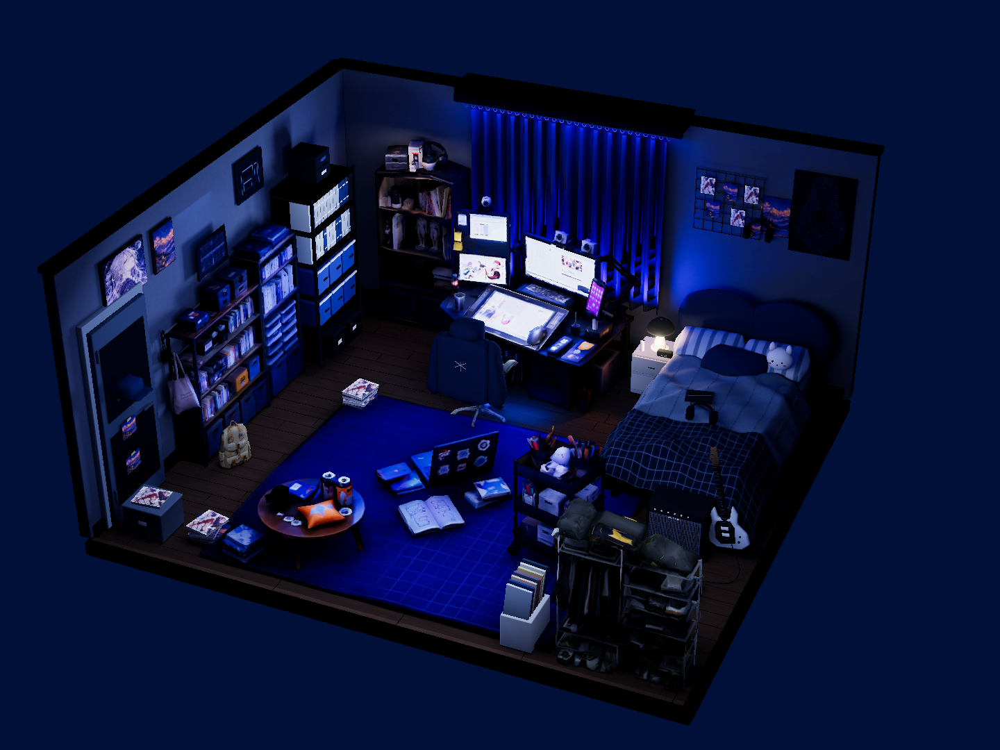
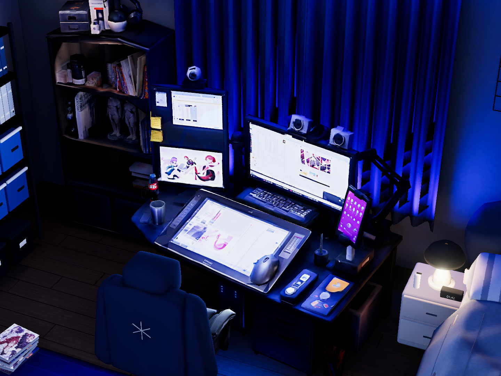
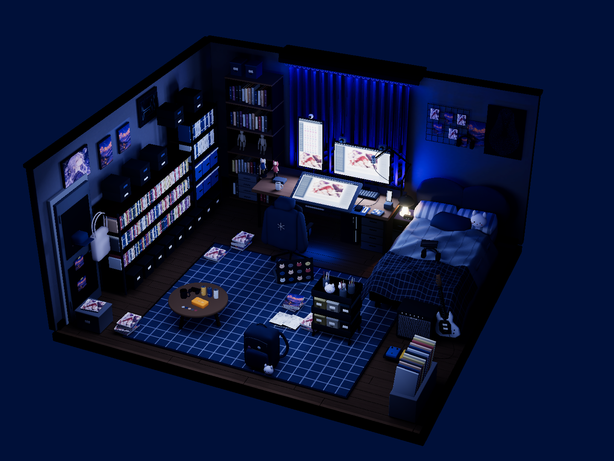
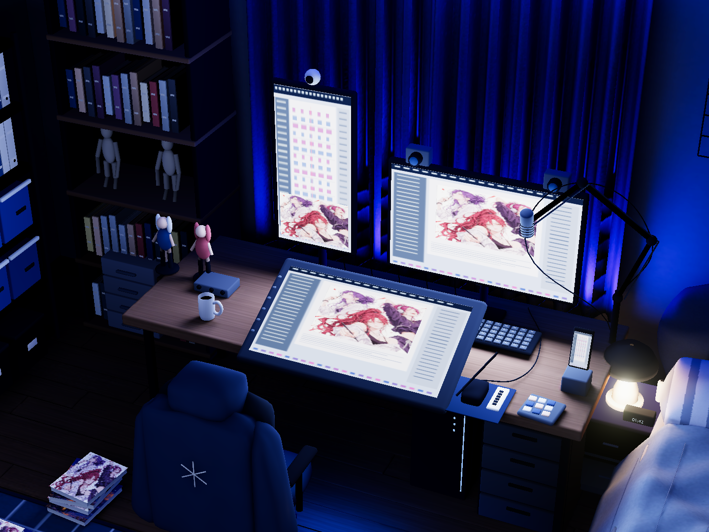
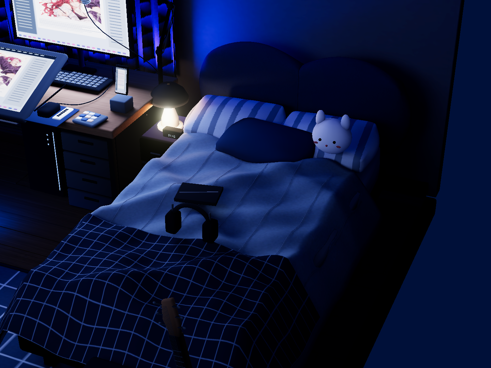

# 夜の制作部屋（2026-11-12、ノート PC）

## 翔太の Tripo モデルへの置き換え（2026-11-12 午後、Claude Code）

翔太が Tripo で作った7つのモデル（`C:/wwt-private/room/source` の GLB）を部屋に入れ、参考画像に寄せた。リポジトリに入れることは翔太が許可した（「入れてよい」）。元の GLB はリポジトリの外に置いたまま、整えた結果だけを `art/living-room/models/`（LFS）に置く。





[ベッドの近景](../art/living-room/renders/models-bed.png)・[縦長画面](../art/living-room/renders/models-portrait.png)。

| モデル             | 置いた所                                    | 直したこと                                                                                                                                             |
| ------------------ | ------------------------------------------- | ------------------------------------------------------------------------------------------------------------------------------------------------------ |
| design workstation | 制作机（2.1 m 幅）                          | 一体になっていた青い小さな椅子と、宙に浮いた破片を外した。画面は同じ平面の面をまとめて光る面（`dyn_workstation_screen`）にし、面ごとに面光源を置いた   |
| chair              | 机の椅子                                    | 翔太の指定で、机の付属ではなく独立した椅子を使う。パーカーは椅子の背に合わせて掛け直した                                                               |
| desk setup         | ラグ・丸テーブル・カート・ノート PC・床の本 | そのまま。手作りの同じ物は外した                                                                                                                       |
| storage bookshelf  | 左の壁の金属棚と引き出し                    | 浮いた紙片3枚を外した。上の設計図のポスターと端のトートは、モデルに付いている物を使う（手作りのトートは外した）                                        |
| dark bookshelf     | 机の左の暗い本棚                            | そのまま                                                                                                                                               |
| clothing rack      | 右手前のラック                              | 上の鞄のブランドの印（2か所）を周りの布の色で塗りつぶした。暗い角で黒く沈むため、中間調を持ち上げ（γ 1.45）、手前から弱い面光源 `L_rack_fill` を当てた |
| khaki backpack     | 左の棚の前の床                              | そのまま                                                                                                                                               |

- 全モデル共通：テクスチャは 4096 から 2048（椅子とリュックは 1024）へ平均で縮め、Tripo の細かいまだらを減らしてから、弱いアンシャープマスクで背表紙や縫い目の線を戻した。UV の継ぎ目で分かれた頂点はつなぎ直した。
- `scripts/living-room/prepare_models.py`：元の GLB から `models/*.glb` を作る（ヘッドレス専用。ファイルを初期化するので、部屋を開いた MCP の中では動かさない）。`reference_models.py`：整えたモデルを置き、画面を分ける。`run_all.py` が `reference_props.py` の次に読む。
- 焼き込み：`tex_` で始まる物は `tex_models` にまとめ、色を含まない光だけを頂点色に焼く。Web では「元のテクスチャ×光×`lightScale`」で描く（`room.json` の `texturedMesh`、`src/living-room/index.ts`）。古い `room.json`（`texturedMesh` なし）は今まで通りに描ける。
- 歩ける床と目印（`reference_meta.py`）は、置いたモデルの実際の足元に合わせて測り直した。体の半径 0.14 m で、10 か所すべてに歩いて届く（Web で `reach()` を確認）。床の本の山は通路をふさがない位置へ動かした。
- 容量：`room.glb` 16.26 MB → 11.21 MB、ライトマップ 3.53 MB → 3.43 MB。手作りの細かい部品が減った分が、7つのテクスチャより大きかった。

短い比較（ノート PC、144 Hz、1440×1080、表示あり・画面外、キャラクターなし、同じページのコードで部屋のデータだけを替えて2組。[要約](benchmarks/living-room-models.json)）。2組なので傾向の目安にとどめる。

| 場面                | 前・組1 | 新・組1 | 新・組2 | 前・組2 |
| ------------------- | ------: | ------: | ------: | ------: |
| 表示まで ms         |    1242 |    1262 |    1330 |    1125 |
| 描画の平均 ms       |    2.00 |    1.67 |    2.03 |    1.99 |
| 静止 2 秒の追加描画 |       0 |       0 |       0 |       0 |

残り・気になる所：

- ラックの服は Tripo の段階で黒い服が多く、参考画像の色とりどりの服とは違う。色を塗り替えるなら、元の Tripo の生成をやり直すか、服の部分のテクスチャを手で描き直す。
- 机のモデルの画面は、明るい画素から同じ平面に広げて選んでいる。暗い場面の画像に替えたモデルでは、画面の一部が光らないことがある。
- 椅子はほとんどパーカーに隠れる。椅子そのものを見せたいときは `reference_desk.py` のパーカーを外す。
- Tripo の布や本の形は柔らかく、手作りの部品ほど角が立たない。近景で気になる所があれば、その部分だけ手作りの部品に戻す。
- ラグは床の柔らかい面の名前（`rug_`）から外れたので、キャラクターが座ったときのラグの沈みはなくなった。キャラクターを戻すときに材質の名前を足す。

`codex/living-room-realism` の `1fa65a4` を確認し、`codex/living-room-reference` で制作。星の旅は進めず、独立した Living Onboarding の部屋を、翔太の新しい参考画像 `0fd187c0-8955-4e66-a2a6-2bcd853bee8c.png` に合わせて作り直した。Blender MCP から、この PC の Blender 5.2.2 LTS を操作した。中核と DesignDocument の形式は変更していない。

## 画面で確かめる基準

- 左の密な本棚、中央奥のカーテンと制作机、右のベッド、手前の格子ラグを、参考画像と同じ関係で配置する。
- 横・縦モニターと液晶タブレットを主光源にする。青いカーテンの照り返しと床の光、ベッド脇の小さな暖色を、暗い室内の中で見分けられる。
- 机の機材・配線、棚の中身、ベッドの布、カート、リュック、床の本、楽器を近景で見ても内容が分かる。
- Blender のレンダーだけでなく、実際の専用 Web ページで全景・机・ベッド・縦長画面を確認する。







[縦長画面](../art/living-room/renders/reference-portrait.png)と、編集原本からの[Cycles レンダー](../art/living-room/renders/reference-blender.png)も保存した。

## 内容

6.0 × 5.4m の切断した部屋。古い出窓の張り出しと植物主体の配置は今回の参考にはないので置き換えた。

棚には本、背表紙の帯、穴付きバインダー、収納箱、引き出し、デッサン人形。ドアにはカード、テープ、トートと帽子。机には三つの画面、カメラ、Web カメラ、キーキャップ、マウス、スタイラス、携帯、マクロパッド、オーディオ機材、マイクアーム、電源と配線。椅子にはパーカーを掛けた。

ベッドは二つの丸いヘッドボード、枕、折れと垂れのある布団、格子柄のスロー、猫のぬいぐるみ、ヘッドホンとノート。枕元に引き出し、キノコ型ランプ、時計とボトル。床には格子ラグ、開いたノート PC、スケッチブック、積んだ本、丸テーブルと飲料・菓子。三段のカートにはペンと箱とぬいぐるみ、リュックにはポケット・ファスナー・バッジ・キーホルダー。右にはギター、弦とフレット、アンプ、ペダル、雑誌ラックを置いた。

モニター用の面光源、カーテンの青い照明、床の照り返し、棚と枕元の暖色を Blender で計算する。Web は大きな面のライトマップと小物の頂点色を使い、画面の絵柄は発光テクスチャとして残す。床の薄い仕上げ層だけは起動時に一度作る環境反射を使う。

## 再現と素材

- `scripts/living-room/run_all.py` は `lib.py`、`reference_*.py`、`80_bake.py` を順に実行する。旧番号スクリプトは過去の部屋の記録として残す。
- `art/living-room/living-room.blend` は編集原本。`web/room.glb`、`lightmap.png`、`room.json` が表示用。
- `reference_meta.py` は家具を避ける床と今回の部屋にある席・隠れ場所・立つ場所を作る。なくなったビーズクッション等の目印は残さない。身体・行動の実装は触っていない。
- `80_bake.py` は印刷物の `ArtUV` を色のベイクが終わるまで保持する。書き出しでは静的面をライトマップの UV 一つに整理し、発光画面の画像は GLB に埋め込む。
- 統合する前のオブジェクト座標を頂点属性に保存する。統合後の部屋全体の座標で木目や格子を計算してしまう問題を直した。布・枕・印刷物の UV 面積を広げ、格子の端に濃淡を付け、4096² のまま線の欠けを減らした。深い影の階調のため `lightScale` は 2。発光画面はこの範囲に丸めない。
- 原本は圧縮保存し、`.blend1` を作らない。作り直し時の不要なデータブロックと焼き込みの浮動小数画像を解放する。Web 用に統合した複製は原本の表示では隠す。
- `src/living-room/index.ts` は、焼いていない面の `emissiveMap` / `map` を保持する。背景は暗い紺色にした。

造形はスクリプトによる自作。参考画像そのものは公開素材に含めていない。ポスター、コミック、画面内の絵とスケッチは `imagegen` スキルの内蔵ツールで新規に生成した `art/living-room/textures/studio-art-atlas.png`。画像内の細かい絵柄や文字を同一に複写したものではない。Blender の UV で四つの領域を使い、原本にも画像をパックする。外部の 3D 素材、私用モデル、Mixamo は配布データに含めない。

生成プロンプト：

> Create one square production texture atlas for a detailed miniature anime illustrator's bedroom. This is a flat graphic texture, NOT a room render or mockup. Exactly four equal square quadrants with absolutely no padding, gaps, border, frames or perspective. The boundary is precisely x=50%, y=50%. Upper left: refined Japanese anime art print of an original silver lavender haired young adult woman, delicate detailed eyes, elegant flowing hair and dark indigo jacket, shoulder-up portrait, navy celestial star background, beautiful fine traditional anime linework, muted blue violet white palette, no lettering. Upper right: a professional full color original manga illustration sheet with three stylish adult women in different expressive dynamic drawing poses, purple and crimson hair, white background with small red graphic accents, crisp exquisite anime linework, no text or branding. Lower left: sophisticated stylized orange twilight mountains and a tiny dark lake cabin, cobalt sky and scattered stars, fine graphic print. Lower right: a white sketchbook sheet of graphite pencil studies of an original anime adult woman, face from different angles and hands, delicate soft shading, spare layout and light construction lines. Flat artwork only, clean edge-to-edge quadrants, no watermark, no logos. Each quadrant will become a small poster or screen image in a 3D scene.

Blender MCP で `run_all.py` を実行した。同じ処理はヘッドレスでも再実行できる：

```powershell
& 'C:/Program Files/Blender Foundation/Blender 5.2/blender.exe' -b --factory-startup --python-exit-code 1 --python scripts/living-room/run_all.py
$env:WW_LIVING_TEST='1'
$env:WW_LIVING_OUT='.work/living-room-preview'
node scripts/build-living-room.mjs
node scripts/playground/serve.mjs .work/living-room-preview 4181
```

## 検証

型チェック・lint は通過。unit は **665 件通過・3 件スキップ**。最初の実行は sparse checkout にテストが読む参照資料がなく失敗したため、追跡済みの `agent-skills` と `docs/wwt-studio-design-system/components` だけを追加し、全件をやり直した。サンドボックスで長いプロセスが中断された検査は通常環境で完了した。テストの条件や判定は緩めていない。

実ページの全景・机・ベッド・430×900 の縦長画面を開いて比較した。白く広がりすぎたモニターの bloom、毛布と布団の交差、枕の浮いた縞、格子の欠け、手前の暗さを修正した。画面のエラーは 0。床は 48 三角形、10 か所の目印はすべて歩ける床にあり、到達できる。リュックの位置とノート PC の足元に合わせて通路を調整した。

`living-room` を `tests/` で検索し、専用ページを通る `tests/living-room-body-live.spec.ts` を選んだ。このノート PC に変換済み Felis はないため、既存のローカル `mirdo-1024.vrm` と `motions-pass` を検証用ビルドだけに使用した。初回は新しい経路が向き直りの前提を満たさず、中央の目印の位置と向きを調整した。最終データでは接近・接触・喜び・待機への復帰まで進むが、**足の固定の検査で失敗**した（累積滑り 1.380m、基準 0.06m 未満）。同じミルドと動作で前版の部屋に戻しても同じ項目が失敗した（0.791m）。今回の経路とモデル・動作の寄与は分離できていない。30fps 側の検査へは進んでいない。身体・移動のコードは変えず、アニメーションを再開するときの確認事項として残す。

中核を変更していないので e2e 全件と YouTube の計測は行っていない。今回の結果を、Felis の動作確認が通ったという意味には使わない。

## 短い負荷確認

ノート PC（i7-13650HX）、144Hz、Chromium 153.0.8010.12、1440×1080、表示あり・画面外。WebGL は Intel UHD Graphics を使用した。Blender の焼き込みは RTX 3050 6GB。キャラクターなしで静止 2 秒とポインターに追従する視点移動 2 秒を、新旧で 2 組比較した。[要約](benchmarks/living-room-night-reference.json)。GPU 時間や長時間のキャラクター動作を測った結果ではない。

| 場面                | 旧・組1 | 新・組1 | 旧・組2 | 新・組2 |
| ------------------- | ------: | ------: | ------: | ------: |
| 初回表示 ms         |    2294 |     592 |     480 |     512 |
| 描画呼び出し平均 ms |    1.52 |    1.28 |    1.36 |    1.32 |
| 静止 2 秒の追加描画 |       0 |       0 |       0 |       0 |

初回表示はキャッシュ準備の影響があり、2 組だけで高速化とは判断しない。新しい細部を追加した状態でも、この場面では描画呼び出し時間の増大は見られず、静止時には止まることを確認した。

## 残りとレビュー箇所

- 配置と夜の照明を参考画像に寄せたが、同一の画像を三次元で完全に複写したものではない。ポスター・表紙・画面内の絵柄や文字は新規作成で、小物の形や置く数にも差がある。
- 布は数式による造形。参考の布のしわそのものとは異なる。Web は主に焼いた拡散光なので、Cycles と比べると布や金属の反射は簡略化される。
- 全景の明暗、机の密度、ベッド周りの形を翔太・Claude Code に見てほしい。動作を再開する場合は、Felis のある環境で足の接地と席の連続移動を確認する。

## 保存・同期・後片付け

原本 13.94MB、GLB 16.26MB、ライトマップ 3.53MB。Web 用の部屋データは約 19.80MB。依存物は既存 `living-onboarding/node_modules` への junction を使い、複製・追加インストールしなかった。今回の `.work` 内の検証ビルド、途中の画像・ログ・trace、LFS 確認 clone **129,815,282 bytes（約130MB）を削除した**。報告で参照する画像5枚と計測要約は約5.09MB。確認用に最終の `dist-living-room` 一つ（20.58MB）を残した。元の参考画像、他の worktree、既存の未コミットデータは変更していない。

実装は **`8e7508e`**、GitHub の `codex/living-room-reference` へ push 済み。標準の pre-push でも型チェック・lint・unit 665 件通過（3 件スキップ）。LFS 2件・約30MBをアップロードし、新規の sparse clone から `git lfs pull` して次の SHA-256 の一致を確認した。

- `living-room.blend`：`491f7137c845d9eb18844a0d1a4d0f91427d5dd8df3fd2d43764c3d5184042fc`
- `room.glb`：`68bd06818380bf3dfbdd5affc5442c33240aefa5deac69819c5f8e46f3f22232`

この専用ブランチ名は `.github/workflows/check.yml` の push 対象外。上の検証結果は手元と pre-push の実行による。main や元の作業ブランチへの取り込みはしていない。

作業終了時の確認用 URL は `http://127.0.0.1:4181/`。最終ビルドで `data-ready`、エラー0、テスト用フックなし、配信 GLB と原本の一致を確認した。プロセスが終了した場合は、この worktree で `node scripts/playground/serve.mjs dist-living-room 4181` から起動できる。
