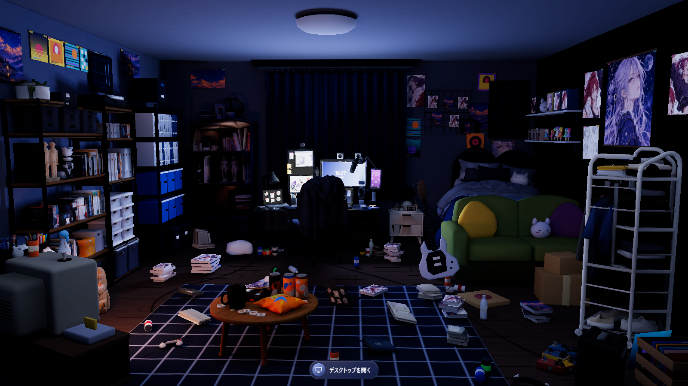

# ネットオタクの部屋への改修（2026-11-13、ノート PC、Claude Code）

翔太の新しい Tripo モデル 9 個（`C:/wwt_room_work/src`）を入れ、参考の GIF（暗い部屋をモニターが照らす、物であふれたネットオタクの部屋）に寄せて部屋を作り直した。作業ブランチは `feat/living-onboarding`。Blender MCP はつながらなかったので、同じスクリプトをヘッドレスの Blender 5.2 で動かした（手順は [living-room-night-reference.md](living-room-night-reference.md) の「再現と素材」と同じ）。



[制作机](../art/living-room/renders/otaku-desk.png)・[ベッドとソファ](../art/living-room/renders/otaku-bed.png)・[編集原本からの Cycles レンダー](../art/living-room/renders/otaku-blender.png)。

## 完成の基準（先に決めたもの）

- ページの視点（部屋の手前・目の高さ）で、左に棚、奥に制作机、右にベッドとソファ、手前に散らかった床が一枚に収まる
- 光は画面だけ。暗い部屋の中で、机のモニターの前が一番明るく、遠い所ほど沈む（翔太の決定、下の「光」）
- 近景（机・ベッド・テレビの角・音楽コーナー）で、物が浮いたり刺さったりしていない
- フェリスの暮らしが壊れない：10 か所の目印に歩いて届く、椅子が沈んで反る、ベッドとラグが沈む、机のモニターに仮想デスクトップが映る

## 入れたモデル

| 元の番号 | 部屋での名前（`art/living-room/models/`） | 置いた所・直したこと                                                                                                                                                                                                        |
| -------- | ----------------------------------------- | --------------------------------------------------------------------------------------------------------------------------------------------------------------------------------------------------------------------------- |
| #112     | `workstation`                             | 制作机（幅 2.0 m）。画面は同じ平面の面をまとめて光る面にする。新しいモデルは面が少し波打つので、平面の判定を緩めた（法線 0.93、面からの距離 1.2 cm）                                                                        |
| #114     | `chair`                                   | 机の椅子（パーカー付き）。座面の沈みと背の反りの形状キーを、この椅子の寸法で作り直した。パーカーは背と一緒に反る                                                                                                            |
| #115     | `storage`                                 | 左の壁の金属棚                                                                                                                                                                                                              |
| #118     | `bed`                                     | 右奥のベッド。材質の名前を `duvet_bed` にして、ページの「沈む面」に入れた                                                                                                                                                   |
| #120     | `nightstand`                              | ベッド脇のチェスト（キノコ型ランプと時計付き。ランプは点けていない）                                                                                                                                                        |
| #105     | `table`                                   | ラグの上の丸テーブル                                                                                                                                                                                                        |
| #107     | `cart`                                    | 三段のカート。左の棚の端、ドアの前                                                                                                                                                                                          |
| #109     | `rack`                                    | 服のラック。右の壁、ソファの手前                                                                                                                                                                                            |
| #99      | `floor_items`                             | 床の小物 14 個が棚のように並んだ1つのモデル。つながった部品ごとに切り分け、1つのファイル・1枚のテクスチャのまま、部屋の中へ1個ずつ置く（ノート PC・スケッチブック・本の山・アンプ・ペダル・ケーブル・観葉植物・雑誌箱など） |

前回のモデルのうち `dark_shelf` と `backpack` は残した。`floorset`（ラグ・テーブル・カートが一体）は新しい個別のモデルに置き換えて外し、格子のラグは自作に戻した（材質 `rug_charcoal`。ページの「沈む面」に入る）。手作りのベッド・チェスト・アンプ・ペダルボード・雑誌ラックは、同じ物がモデルに入ったので外した。

## 足した物（すべてスクリプトの自作、`scripts/living-room/reference_otaku.py`）

- ベッドの足元のソファ（オリーブ色、クッションとぬいぐるみ）、肘掛けに立てかけたギター
- 手前左の角：ブラウン管テレビとゲーム機、カセット、ビデオ、コントローラー 2 つ（線はゲーム機まで）
- 手前右の角：木箱 2 つに入ったレコード、ターンテーブル、アンプとペダル
- 右の壁：棚 2 段にフィギュア 7 体・漫画・箱入りフィギュア・ロボット、タペストリー、レコードのジャケットの格子、ポスター
- 奥と左の壁：ポスターとジャケット（マスキングテープ留め）
- 床：缶 15、カップ麺 2、ペットボトル 4、ピザの箱、ティッシュ、漫画の山 5、電源タップと床を這う線、未開封の段ボール
- 殻：右の壁と天井を本物にした（焼いた面）。天井の照明は消えている

絵柄は既存の `studio-art-atlas.png` の切り出しと、スクリプトで描いた図形のジャケット・ゲーム画面。外部の 3D 素材・画像は使っていない。

## 光（翔太の決定、2026-11-13）

最初の案ではミラーボール・ネオン・ピンクの LED・豆電球・ラバランプを足したが、翔太の指示で外した：**余計なライティングは要らない。光は主にモニターだけ**。あわせて、前からあったカーテンの青い間接照明・棚の照明・枕元のランプの光も消した。

- 光源は机の画面 4 枚（`L_screen_*`、明るさを 1.5 倍に）と、手前左のテレビ（`L_tv`）だけ
- 切り欠きで省いた手前の壁からの照り返しの代わりに、弱い面光源を 2 つ残した（`L_room_bounce` 48 W、`L_front_wall_bounce` 12 W。前は 120 W と 25 W）。手前が真っ黒にならず、物が読める程度
- 光の層（机のモニター `screen`、手前の UI `ui`）の作りは変えていない

## ページ側

`src/` は変更していない。本物の右の壁と天井は、ページが部屋の大きさを測る箱（焼いた面の箱）の内側すれすれに置いた1枚の面にした。ページが足していた光らない壁と天井（`enclose.ts`）はその外側になり、見えなくなる。ライブモードの舞台の計算（`live/stage.ts`）が使う箱の大きさは変わらない。

## 目印と歩ける床

`reference_meta.py` を新しい配置で測り直した。名前は前と同じ（ページと `room-life.ts` が知っている名前）。カートが左へ移ったので `marker_hide_trolley` はドアの前、`marker_stand_guitar` は手前右の音楽コーナーの前にある。座る高さ・寝る高さ・スマホを置く高さは、置いたモデルの表面へ上から線を下ろして測る（`top_at`）。

## 再現

```powershell
# 元の GLB から models/*.glb を作る（新しい 9 個は WW_TRIPO_NEW、既定は C:/wwt_room_work/src）
& 'C:/Program Files/Blender Foundation/Blender 5.2/blender.exe' -b --factory-startup --python scripts/living-room/prepare_models.py
# 組み立てて、ページの視点で試し描き（焼かない）。保存先と画像は絶対パスで渡す
$env:WW_SKIP_BAKE='1'; $env:WW_SAVE="$PWD/.work/room-preview/test.blend"; $env:WW_RENDER="$PWD/.work/room-preview/view.png"
& 'C:/Program Files/Blender Foundation/Blender 5.2/blender.exe' -b --factory-startup --python scripts/living-room/run_all.py
# 焼いて GLB まで
$env:WW_SKIP_BAKE=''; $env:WW_SAVE=''; $env:WW_RENDER=''
$env:WW_LM_SIZE='4096'; $env:WW_SAMPLES='128'; $env:WW_VC_SAMPLES='128'; $env:WW_OUT='art/living-room/web'
& 'C:/Program Files/Blender Foundation/Blender 5.2/blender.exe' -b --factory-startup --python scripts/living-room/run_all.py
```

Blender は、相対パスで渡した画像の保存先をドライブの直下から解決する（`art/…` が `C:/art/…` になる）。`run_all.py` は `WW_SAVE`・`WW_RENDER`・`WW_OUT` を絶対パスに直してから使う。

`WW_RENDER` は、ページと同じ視点（手前・目の高さ）で描くようにした。`WW_RENDER_VIEW="x,y,z,tx,ty,tz,fov"` を `;` で並べると、近景もまとめて描ける。`camera_main`（上から見下ろす昔の視点）は天井ができたので絵には使えない（書き出しには残る）。

## 確かめた結果

| 項目                                                     | 結果                                                                                                                       |
| -------------------------------------------------------- | -------------------------------------------------------------------------------------------------------------------------- |
| 実ページ（1600×900、表示あり・画面外、キャラクターなし） | 全景・机・ベッドとソファを撮って見た。エラー 0                                                                             |
| 目印                                                     | 10 か所すべて歩ける床の上にあり、歩いて届く（`reach()`）。床は 48 三角形                                                   |
| 机のモニター                                             | 仮想デスクトップがメインモニターの枠に収まる（面の中心を頂点の平均で取ると左へずれたので、広がりの中央で取るように直した） |
| 椅子の形状キー                                           | `seat_sink` 515 頂点、`back_recline` 4,603 頂点が動く。両方を最大にして横と前から描き、破綻がないことを見た                |
| 型チェック・lint                                         | 通過                                                                                                                       |
| unit                                                     | 714 件通過・3 件スキップ                                                                                                   |
| 容量                                                     | `room.glb` 12.77 MB → 24.73 MB、`lightmap.png` 3.37 MB → 2.84 MB、原本 17.4 MB → 34.9 MB                                   |
| 三角形                                                   | ライトマップ面 63,716、頂点色の面 107,628、テクスチャのモデル 161,854                                                      |

`src/` を変えていないので e2e は回していない。性能は測っていない（下の「残り」）。フェリスを入れた動作の確認（`npm run living`）はしていない。

## 残り・気になる所

- **重さ**：テクスチャのモデルが約 16 万三角形、`room.glb` が約 2 倍になった。止まっている間は描かないが、視点が動く間とフェリスが動く間の描画時間は測っていない。重ければ、Tripo のモデルを `prepare_models.py` で間引く（今は 1 個約 2 万三角形のまま）
- **フェリスの暮らし**：家具の位置が変わった（机と椅子は奥へ約 0.45 m、ベッドは短く奥へ、ソファが増えた）。座る・寝る・スマホを置くの高さは測り直したが、フェリスを入れて一連を見てはいない。ソファには座る目印を付けていない
- **ライブモード**：スクリーンの位置（奥行き −0.95 m）は前のまま。新しいソファはスクリーンの手前、ベッドの足元はスクリーンをまたぐ（前の部屋のベッドも同じだった）。実際の見え方は未確認
- **ドア**：左の壁のドアの前にカートとテレビがある。気になれば、ドアを殻から外すか、カートを動かす
- **暗さ**：光を画面だけにしたので、右手前（ラック・音楽コーナー）と左の棚の上は暗い。ページの色（青み）は、ページ側の壁紙の色の掛け方による。明るさを足すなら `L_room_bounce` を上げる
- **服のラック**：全景の右手前で大きく見える。奥へ置くと、ソファかベッドの前をふさぐ
- **床の小物**：#99 の向き（どちらが正面か）は見た目で合わせた。ノート PC は蓋の背（ステッカー）が手前を向く
