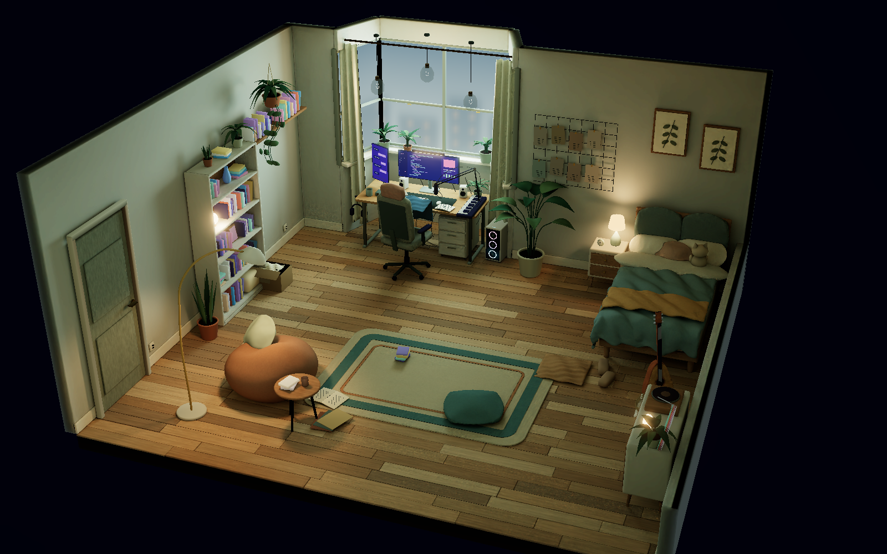
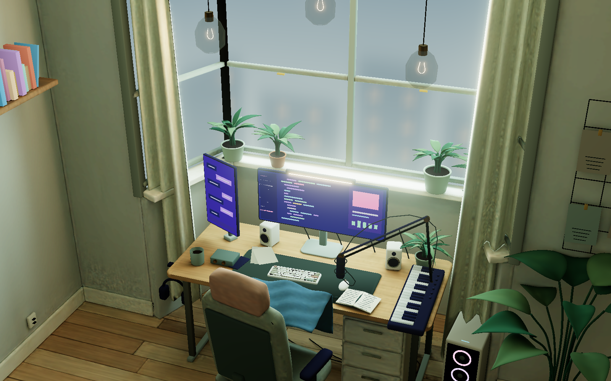
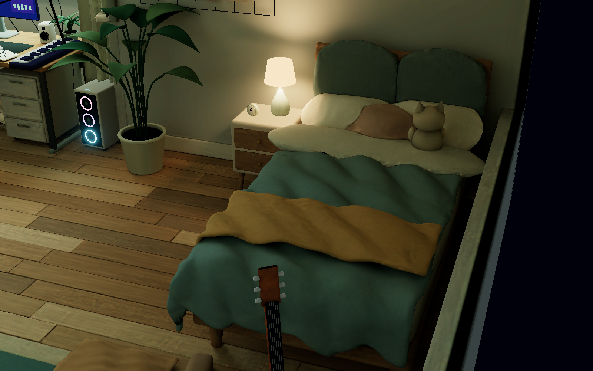

# 出窓と生活感のある部屋（2026-11-11）

Codex。`feat/living-onboarding` の `2db67c9` から、`codex/living-room-realism` で制作。翔太から届いた、窓際の制作机・植物・機材・生活の途中が見える参考画像に合わせた。**中核の変更、DesignDocument の版上げはない。** 独立した Living Onboarding の素材と専用ページが対象。旧版は [living-room-art.md](living-room-art.md)、全体の引き継ぎは [living-onboarding-handoff.md](living-onboarding-handoff.md)。

## 完成基準と画面

- 全景で正方形から変えた間取りと窓際の奥行きが分かり、家具を人の寸法で置いた中央を歩ける。
- 机の近景で機材を使っている途中と分かり、支え、接続、紙、飲み物、楽器に置いた理由がある。
- 寝床と読書場所に、しわ、置きっぱなしの物、複数の高さの光があり、木・布・壁を区別できる。
- 実際の Web ページで材質・明るさ・目印と床の配置を確認する。動作の調整は、翔太の最新指示により対象外にする。







上はブラウザーの実画面。参考画像そのものを素材として複製したり、外部サービスへ送ったりしていない。

## 変えたこと

- 本体 6.0 × 5.4m、奥行き 0.8m の三面の出窓。床面積は約 34.2m²。元の 4.8m 四方から拡張した。
- 板ごとの継ぎ目と長さの違い、巾木、框、建具、窓の桟と取っ手、コンセント、丈の長いカーテンを造形。
- 机を出窓へ移動。MIDI キーボード、オーディオインターフェース、クランプ式マイクアーム、ヘッドホン、配線、電源タップ、開いたノート、紙、ペン、スマートフォン、コーヒーとカップの跡を追加。
- 植物を窓台・床・吊り鉢に分け、本棚の上にも棚を追加。メモを留めたワイヤーグリッドと植物画を壁に掛けた。
- 椅子に布、床に本・雑誌・スリッパ・衣類、脇に洗濯かご・開けかけの段ボール。通路を残すため大きな物は家具の周囲へ寄せた。
- 木目、布目、塗り壁の表面をプロシージャル材質で作成。木・生成り・くすんだ緑を中心に、窓の冷たい光と電球の暖かい光を合わせた。
- 小さな金属・ガラスに実際の部屋の環境反射を使用。全室の動的な影の再計算は足していない。

## 保存場所と作り直し

| 物                     | 場所                                                               |
| ---------------------- | ------------------------------------------------------------------ |
| 造形・材質・照明・配置 | `scripts/living-room/10_shell.py`〜`70_meta.py`、`lib.py`          |
| 色と照明の書き出し     | `80_bake.py`、`denoise.py`                                         |
| 編集できる原本         | `art/living-room/living-room.blend`（LFS）                         |
| Web 用                 | `art/living-room/web/room.glb`（LFS）、`lightmap.png`、`room.json` |
| 専用ページ             | `src/living-room/`、`scripts/build-living-room.mjs`                |
| 検証画像               | `art/living-room/renders/realism-*.png`                            |

Blender 5.2 で全作り直し（PowerShell、worktree 直下）：

```powershell
& 'C:/Program Files/Blender Foundation/Blender 5.2/blender.exe' -b --factory-startup --python-exit-code 1 --python scripts/living-room/run_all.py
$env:AROUND_LIVING_TEST='1'
$env:AROUND_LIVING_OUT='.work/living-room-preview'
node scripts/build-living-room.mjs
node scripts/playground/serve.mjs .work/living-room-preview 4181
```

既定はライトマップ 4096²、照明 128 samples、頂点照明 128 samples。`AROUND_SKIP_BAKE=1` と `AROUND_SAVE=<path.blend>` で造形だけ確認できる。`AROUND_RENDER=<path.png>` は Blender のカメラレンダー。通常版の `dist` は使わない。

Web の画像は `scripts/living-room/capture.mjs <out.png> 1600 1000`。`AROUND_LIVING_OUT` をビルド先、`PLAYWRIGHT_BROWSERS_PATH` を本体の `.work/browsers` に指定する。近景は `AROUND_LIVING_VIEW=desk` または `bed`。画面外・本物の GPU で撮る。

## 描画と素材の約束

大きな面の照明と素材の色を別々に焼く。照明を Blender 付属の OpenImageDenoise で滑らかにしてから色を掛け、ライトマップへ保存する。先に色を混ぜる方法は、木目と照明の粒を区別しにくく近景にむらが残った。この PC の HIP デバイスでは OIDN がクラッシュしたため、ノイズ除去は CPU、照明の計算は GPU。中間 EXR は書き出し先の一時ディレクトリに置き、その呼び出しの終了時に除去する。

`room.json` の `bakedColor: true` が色込みの形式。Web は焼いた色 × `lightScale` を表示する。指定がない旧データは、従来どおり材質の色 × 焼いた光 × `lightScale`。DesignDocument とは別の、この専用ページの素材メタデータである。

小物は頂点の色、`dyn_*` は発光、`pbr_*` は小さな反射面。環境反射は読み込み時に 128px で一度生成する。キャラクターなしの静止状態では継続描画せず、キャラクターがいる場合は従来どおり毎フレーム描く。

切断面は開いて見えるが、光を焼く間は `lighting_baffles` の天井・手前・右上の壁が反射光と陰を作る。GLB には入れず、原本のビューポートでも隠した。窓の外景は光を遮らない。書き出し用の複製でも `visible_shadow` を引き継ぐ。薄い窓面やカーテンは、Web の材質でも原本の両面設定を保つ。

造形・材質はすべて自作。外部の 3D 素材・写真・テクスチャは追加していない。私用のキャラクターは環境変数で指定し、`.work` のビルドだけに載せる。

## 検証

型チェックと lint は通過。最終コードの unit 全件は 666 件通過、2 件スキップ。最初の実行では 1 件だけサンドボックスが junction の作成を拒否した。通常環境で再実行して通過し、条件は変えていない。

モジュール名 `living-room` を `tests/` で検索し、専用ページを使う `tests/living-room-body-live.spec.ts` を選んだ。実物のローカル Felis と動作を指定し、通常・30fps の駆け寄り、足の接地、接触、喜び、待機への復帰が通過（1 件）。旧 YouTube 向けの `living-room-live.spec.ts` は今回の専用ページを通らないため対象外。中核を触っていないので Windows e2e 全件と YouTube 計測は実施していない。

床は 66 三角形。12 か所の目印はすべて歩ける床の上にあり、中央から到達できた。全景・近景でコンソールエラーなし。`2db67c9` の旧 GLB・ライトマップ・設定を新しい描画で開き、従来の色の表示と 12 か所の到達性も確認した。縦長 430×900 でも部屋は切れず収まるが、小物は小さくなる（[縦長の実画面](../art/living-room/renders/realism-portrait.png)）。

ベッド・椅子・ビーズクッションへの着席も画面で確認した。続けて次の席へ向かうと、椅子 → ビーズクッション、ビーズクッション → 床の座布団で待機のままになるケースがあった。`floorPath` の格子への丸めと家具の境界で経路が取れない組み合わせを確認した。低い席では身体が沈みすぎる見え方も残る。**ここで翔太から「アニメーションはいったんいいよ」と指示があったため、動作の調整を止めた。** 身体・経路のコードや判定を変更していない。この部屋を生活行動へ接続するときの確認事項として残す。

負荷は、デスクトップ（Ryzen 5 5600X、RX 6800、165Hz）、Chromium 153.0.8010.12、1600×1000、表示あり・画面外・実 GPU で 2 組の A/B。Felis を載せた同じ待機場面、ページを開いた最初の 6 秒と、その後の 6 秒を測った。記録は [benchmarks/living-room-realism.json](benchmarks/living-room-realism.json)。窓の最終仕上げ前の部屋に対する短い参考計測で、GPU 時間やノート PC の合否を示すものではない。

| 比較     | 初回表示 ms | 起動 6 秒の JS CPU 合計 ms | 定常の身体 ms/フレーム 中央値 / p95 | 定常の描画呼び出し ms/フレーム 中央値 / p95 |
| -------- | ----------- | -------------------------- | ----------------------------------- | ------------------------------------------- |
| 旧・組 1 | 1462        | 2313                       | 0.40 / 0.70                         | 1.00 / 1.60                                 |
| 新・組 1 | 2280        | 3222                       | 0.40 / 0.60                         | 1.00 / 1.50                                 |
| 旧・組 2 | 791         | 2052                       | 0.40 / 0.50                         | 0.80 / 1.10                                 |
| 新・組 2 | 834         | 1719                       | 0.40 / 0.60                         | 0.90 / 1.40                                 |

定常のフレーム間隔は両方とも中央値 6.1ms、p95 6.2ms。起動は初回シェーダー準備（`onFirstUse`）とライトマップ転送の影響が大きく、2 組では傾向を断定しない。公開前に初回の読み込みとノート PC を確認する。プロファイルの生データは保存せず、合計と上位関数だけを残した。

## 残りとレビューしてほしい所

- 窓の外は三面に続く、ぼかした街の色。実際の街並みの 3D や写真による外景ではなく、奥行きの表現は簡略化している。
- 布は式で作るしわ。布団の大きなしわ、椅子に掛けた布、床の衣類の輪郭にはまだ造形の余地がある。
- 金属とガラス以外は焼いた拡散光が中心。床の艶や陶器の反射は抑えている。
- 色は落ち着いた緑と木へ寄せた。参考画像のさらに密な植物や機材の重なり、生活感の量を、次に翔太・Claude Code が見て調整してほしい。
- GLB は 14.54MB、ライトマップは 5.02MB、編集原本は 13.12MB。公開前の圧縮とノート PC の実 GPU の確認は残る。

## 同期と後始末

実装は `2e55cb1`、GitHub の `codex/living-room-realism` へ push 済み。標準の LFS hook で 2 件の実体が送信され、新しい sparse clone から `git lfs pull` して SHA-256 の一致まで確認した。

- `living-room.blend`：`697a326d5e289475c8a634121143ad9f49a553dd404c899f4862f91f56389b42`
- `room.glb`：`da99ee4b663a8a89361606c96218997ad89ac1491f1d20a7193e472cb5bce29b`

このブランチ名は `.github/workflows/check.yml` の push 対象に含まれず、Actions の実行は 0 件。検証結果は上記の手元の実行による。

旧版は Git 履歴と `renders/v01`〜`web_v07` に残る。今回の検証用ビルド・中間 Blender ファイル・途中の画像・ログなど約 159MB と、LFS 確認用の clone を削除した。新しい原本と Web 用データのほかに残した検証記録は、参照する画像 4 枚と計測要約だけ（合計 3.47MB）。依存物は本体の `node_modules` への junction を使い、複製していない。
