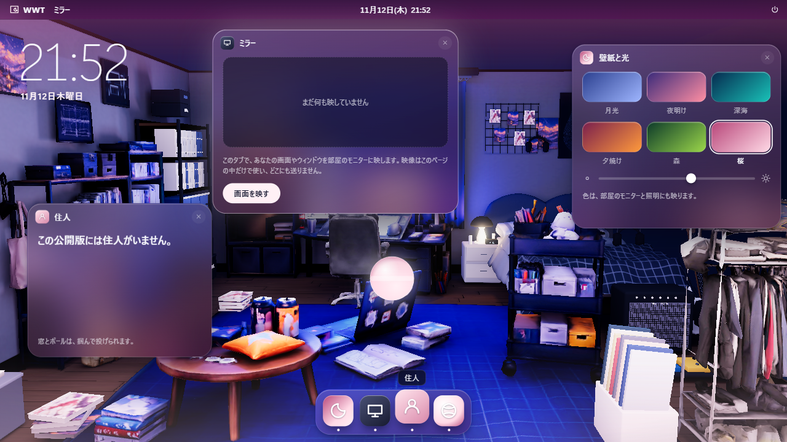
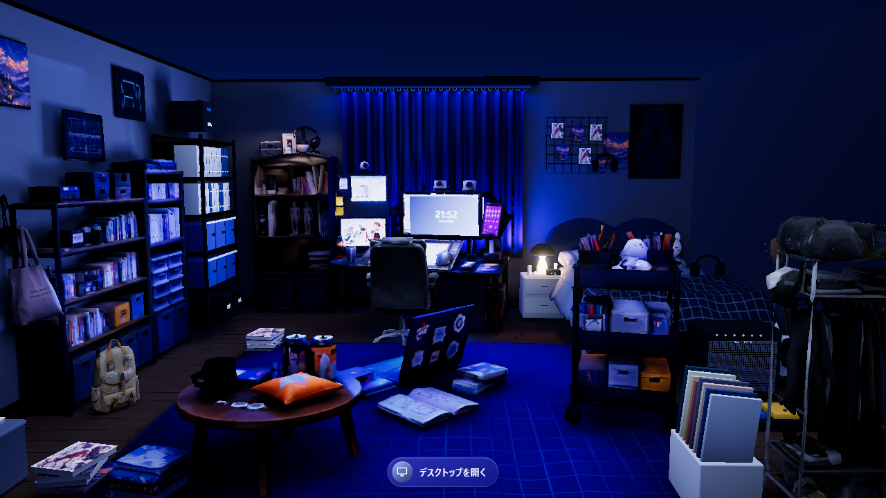

# 生きたデスクトップの見た目と、部屋の中からの視点（2026-11-12、ノート PC、Claude Code）

`feat/living-onboarding`。翔太の依頼は 2 つ：仮想デスクトップの UI を全面的に作り直すこと（参考 1：3D の部屋を背景にしたガラスの UI、参考 2：ウィジェットとドックのある洗練されたデスクトップ）、そして途中で届いた「部屋を俯瞰ではなく、参考 1 の角度から同じ広さで見たい」。機能は増やさず、見た目と操作の体験を作り直した。心・演出役・窓の物理（[living-mind.md](living-mind.md)）はそのまま動く。





## 1. 完成の基準（先に決めたもの）

| 場面               | こう見えたら完成                                                                                                                           |
| ------------------ | ------------------------------------------------------------------------------------------------------------------------------------------ |
| 閉じた部屋         | 部屋の手前に立って中を見ている。画面いっぱいに部屋があり、右と上が「何もない暗がり」で終わらない。フェリスは引きの画より大きく、顔が分かる |
| 開いたデスクトップ | 上に細いバー、下にドック、左右にカード。真ん中（フェリスのいる床と机）は空いている。ガラスの向こうの部屋がぼけて透ける                     |
| 壁紙を替える       | ガラス・ドックのタイル・メーター・画面の上下の色・部屋のモニター・部屋の光が、同じ色に変わる                                               |
| フェリス           | カードの縁に手をかける、上に座る、投げ落とされる、画面を叩く、が新しい視点でも成り立つ。叩くときは見ている人のほうを向く                   |

## 2. 視点

部屋のファイルのカメラ（`camera_main`）は、角の上から模型を見下ろす視点だった。ページの側で視点を持つことにした（`src/living-room/index.ts` の `VIEW`）。Blender の再ベイクも LFS の変更もない。

| 項目   | 値                                                      |
| ------ | ------------------------------------------------------- |
| 位置   | 部屋の開いた手前の外、目の高さ：`(0.1, 1.7, 5.6)` m     |
| 見る先 | 部屋の奥の半分、フェリスの頭の高さ：`(-0.05, 0.95, -1)` |
| 画角   | 縦 42°（16:9 以上で）。それより縦長の画面では横幅を保つ |

- **壁と天井を足した**（`src/living-room/enclose.ts`）：部屋は切り欠きの模型で、右の壁は腰の高さまで、天井はない。中から見ると右と上が空になる。部屋の大きな面（ライトマップの面）の箱から、右の壁と天井を光を持たない板として足した。色は部屋の暗い隅の色で、明るい側から暗い側へ少し変える。光は受けない（そのため壁紙の色では変わらない）
- 部屋のファイルのカメラは使わなくなった（ファイルには残っている）。テスト用の `reviewCamera`・`closeUp` は今の視点を基準に動く。視点を試す入口 `__wwLivingRoom.view(position, target, fov)` を足した

### 視点が水平になって変えた計算（`src/living-room/desktop/index.ts`）

俯瞰では、画面のほとんどの点が視線に沿って床に届いた。水平な視点では、地平線より上の点は床に届かない。

| こと             | 前                                         | 今                                                                                                                               |
| ---------------- | ------------------------------------------ | -------------------------------------------------------------------------------------------------------------------------------- |
| 手が届く所       | 視線が肩の高さ ×0.86 を通る点              | 腰から頭の上までの高さ 5 つ（肩の ×0.86・1.08・0.64・1.26・0.46）で探し、部屋の中にある点を使う。画面の下 6 割ほどにある物に届く |
| 座る所           | 視線の上で、高さを下から順に試す           | 視線の上で、部屋の奥行きを真ん中から外へ順に試し、跳べる高さ（身長の 0.6〜2.5 倍）にある最初の点。地平線の近くでも安定する       |
| 窓の光だまりと影 | 窓の真下の床                               | 窓は部屋の手前寄り（`PANE_Z` = 1.2m）に立って吊られている物として、その位置に光、真下の床に影（高い窓ほど薄い）                  |
| 叩く向き         | 手前の立ち位置から見ている人のほうへ 0.36m | 見ている人のほうへ歩ける床の端を探し、その少し外を「ガラス」にする。手が届くのは部屋の側だけなので、必ず外を向いて叩く           |

地平線より上にあるボールには手が届かない（目で追い、止まれば諦める）。高い所にある窓には座れる（大きく跳ぶ）。

## 3. デスクトップの見た目（`desktop/view.ts`・`style.css`・`desktop/paint.ts`）

考え方：**部屋が壁紙**。選んだ「壁紙」は、ガラスの色・画面の上下の色・部屋の光になる。真ん中は部屋とフェリスのために空ける。

| 部品             | 中身                                                                                                                                                               |
| ---------------- | ------------------------------------------------------------------------------------------------------------------------------------------------------------------ |
| 上部バー         | 画面の幅いっぱい、高さ 32px。左に印と今前にある窓の名前、中央に日付と時刻、右にフェリスの今（気分の色の点と、していること）・ミラー中の印・閉じるボタン            |
| 時計             | 左上に大きく細い時刻と日付。板を持たず、部屋の上に直接置く（操作は通す）                                                                                           |
| カード（窓）     | 角丸 22px のすりガラス。仕切り線のない題字、中身は余白を広めに。**カード全体が掴む所**（ボタンとスライダーを除く）。前の窓は縁が壁紙の色で光り、掴むと影が深くなる |
| 住人のカード     | していること、気分のチップ（気分の色）、欲求 4 つを輪のメーターで                                                                                                  |
| 壁紙と光のカード | 壁紙 6 つのタイル（選択中は白い輪）、明るさのスライダー                                                                                                            |
| ドック           | 角丸のタイル 4 つ（名前はホバーとフォーカスで上に出る）、開いている物の下に点。タイルの色は壁紙の色。ポインターを乗せると浮く                                      |
| 開くボタン       | 閉じている間、下の中央に丸い印つきのカプセル                                                                                                                       |
| 部屋のモニター   | 同じ状態を、新しい配置（全幅のバー、大きな時計、タイルのドック）で描く                                                                                             |

最初に開く位置は左右の端にした（住人は左下、壁紙は右上、ミラーは上の中央寄り）。真ん中の床と机は覆わない（unit で確かめている）。

### 生きたデスクトップとしての工夫

OS の真似で終わらせないために、フェリスの存在を UI の側にも出した。どれも飾りではなく、今起きていることを映す。

- バーの右：フェリスが今していることが、気分の色の点と一緒に常に出る
- ドックの住人のタイル：気分の色の印が付く
- フェリスが窓を開くと、ドックのそのタイルが跳ねる（見ている人が開いても同じ）
- フェリスの手が窓に着くと、ガラスの上を光が横切る
- フェリスが座っている窓は、上の縁が光る（前からある「重みで沈む」に加えて）
- 明るさのスライダーは、画面の上下の色の濃さにも効く

### 壁紙の色が届く先

| 先                                       | 仕組み                                                            |
| ---------------------------------------- | ----------------------------------------------------------------- |
| ガラス・ドックのタイル・メーター・縁の光 | CSS の変数 `--desk-from`・`--desk-to`・`--desk-accent`            |
| 画面の上と下                             | `.desk-veil`：上から `from`、下から `to` の色が入る。真ん中は透明 |
| 部屋のモニター                           | `paint.ts`                                                        |
| 部屋の光・窓の光だまり・フェリスへの光   | 前回のまま（焼いた光の層と `screen-glow.ts`、ランプ）             |

## 4. 自分で決めたこと

- 視点はページの定数にした（Blender のカメラを直して焼き直す方法は取らない）。光は視点に依らないので、焼き直す理由がない
- 壁と天井は板 2 枚で足した。焼いた光は持たない。暗がりの中なので目立たず、角ができる効果のほうが大きいと判断した。きちんと作るなら Blender で壁と天井を足して焼く
- 固定のウィジェット（天気・音楽など）は足さない。画面の上の物はすべて「フェリスが触れる物」か「本当の状態を映す物」にした
- 窓の題字の仕切り線と、ドックの文字のラベルをやめた（情報を減らして余白を取る）
- バーの高さに合わせて、窓が入れる範囲を変えた（`BAR_H` 44→38、`DOCK_H` 84→90）

## 5. 確かめた結果（ノート PC・Chromium を画面の外で表示・本物の GPU・144Hz、1280×720）

録画と画像は `C:\wwt-private\Felis_v0.8.1\work\living-shell\`（リポジトリの外。フェリスが映る）。

- 何もしない 180 秒：スマホ → パソコン（自分で開く）→ 叩く → 窓を調べる → ボール → 窓に座る → パソコン → 叩く → スマホ → 調べる → 座る → …。エラー 0
- 手を入れる：座っている窓を運ぶ → 投げる →「！」で振り落とされる → 目を回す → なでると「ごきげん」。エラー 0
- 公開用（フェリスなし）：開く・壁紙 3 つ・ボール・ミラーの窓・ドックのホバーでエラー 0。420×800 でも開ける（窓は重なる）
- 負荷（フェリス入り、デスクトップ開、中央値）：体 0.75〜0.79ms、描画呼び出し 1.2〜1.3ms、フレーム間隔 11.6〜14.8ms。前回（俯瞰）は体 0.74ms・描画 1.25ms。合否の計測ではない
- 型チェック・lint 通過。unit 701 件通過（3 件スキップ）。新規 1 件（最初に開く位置が真ん中を覆わず、互いに重ならない）
- ミラー（画面共有）は、自動で試すと実画面を写すので今回も動かしていない。窓の見た目だけ確認した

## 6. 残り・気になる所

- 手前の家具（丸テーブル、服のラック、レコード）が大きく写る。奥行きは出るが、右下は込み入っている。部屋の物の配置を視点に合わせて直すなら Blender の作業
- 足した壁と天井は光を受けない。明るい壁紙（桜など）にすると、奥の壁だけが染まり、右の壁は暗いまま
- 地平線より上のボールには届かない。高く投げ上げたボールは、落ちてくるまで見ているだけ
- 叩いたときの波紋は胸の位置から出る（手の位置ではない）
- 縦長の画面では窓が重なり、部屋がほとんど隠れる
- 住人のカードは、公開版（住人なし）では中身が少ない
- 身体の e2e（`living-room-body-live`）の足の固定の失敗は以前のまま。今回は回していない

## 7. 再現

```bash
WW_LIVING_TEST=1 WW_LIVING_OUT=.work/living-room-preview \
  WW_LIVING_CHARACTER=C:/wwt-private/Felis_v0.8.1/work/felis-1024.vrm WW_LIVING_MOTIONS=C:/wwt-private/Felis_v0.8.1/motions \
  node scripts/build-living-room.mjs
node scripts/playground/serve.mjs .work/living-room-preview 4183
```
