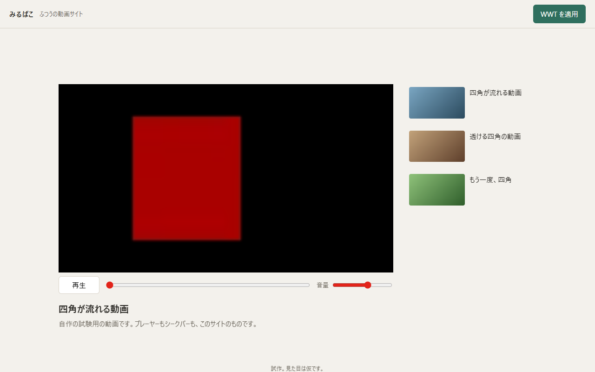
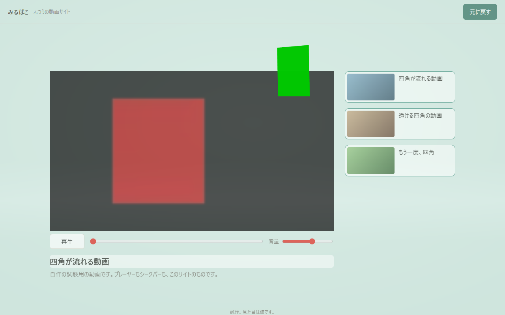
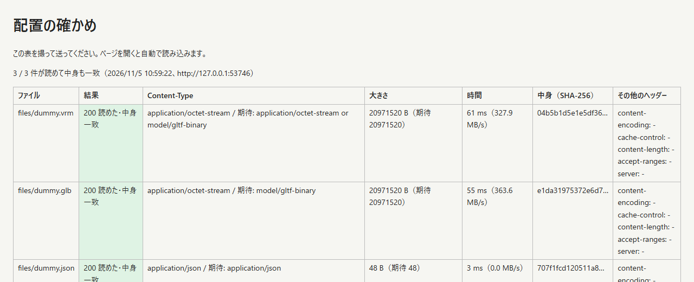
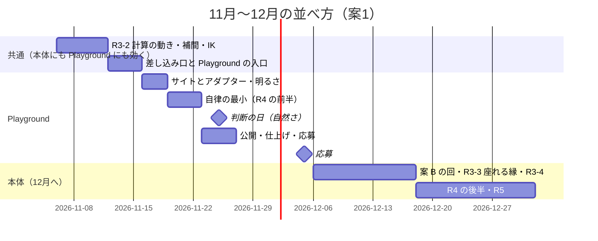
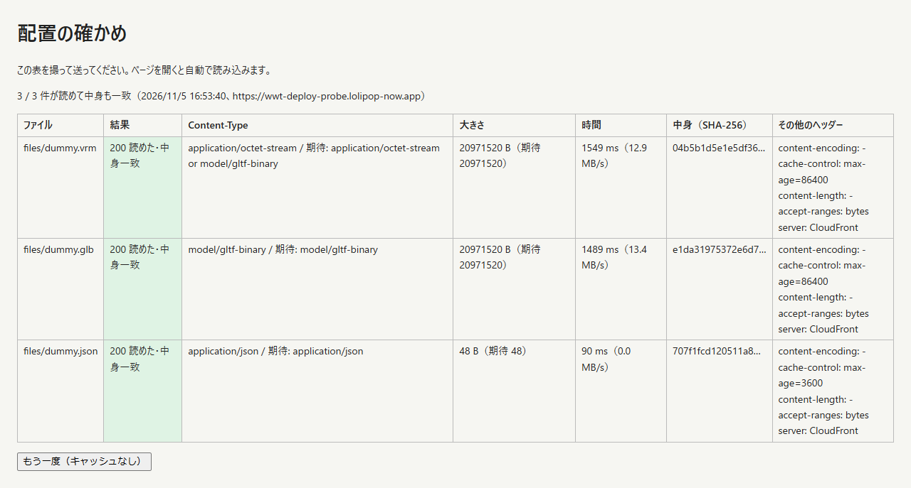

# Playground（コンテスト用の公開サイト）：調べと設計案

2026-11-05、Claude Code。コードは変えていない。ロリポップ!「デプロイナウコンテスト2026」（締切 12/8、目標は **12/5 に応募**）に向けて、拡張なしで WWT のエンジンを動かす自前の動画サイトを作れるかを調べた。キャラの自律行動は [autonomy-plan.md](autonomy-plan.md)。

## 塊1の独立検証（2026-11-05、Codex）

`0638453` を `447b2bf` と比較した。Windows の e2e 全件は280通過・61スキップ、対象 SHA の CI は成功。実 YouTube で共通の層データを適用したときのキャラの座標は前後で一致した。Playground の切り替え・不正入力の拒否・操作面の保護と、守りを壊した場合の検出を確認した。

実 YouTube の交互計測では、キャラなし起動時の拡張 CPU の p95 が 4.40 → 6.90 ms で基準を超えた。ほかの5場面は基準内。`chrome.*` の検査には角括弧と別名参照の見逃しがある。両版で起きた実サイトの失敗と、対象側だけで起きた事象は分けて記録した。製品コードと既存テストの差分は0。[検証報告と再現手順](playground-verification.md)

## 塊1の修正（2026-11-05、Claude Code。1回目）

対象は Codex の検証（`7eafd12`）の3件。**製品のコード（`src/`）は変えていない。中核も触っていない**（変えたのは ESLint の設定・lint のスクリプト・テスト・docs）。

| #   | 件                               | 結果                                                                                                                                                                                                                  |
| --- | -------------------------------- | --------------------------------------------------------------------------------------------------------------------------------------------------------------------------------------------------------------------- |
| 1   | キャラなし起動の p95 が +2.50ms  | **原因を特定できなかった。直していない。** CPU プロファイル8組で、増えた関数は見つからず、起動の約6秒の拡張の合計も同じ（下）。翔太の判断が要る                                                                       |
| 2   | 音量のドラッグが古い位置を押した | 拡張が動かした証拠はない。YouTube のプレーヤーが読み込みの途中で動いた見込み（確定ではない）。テストを「押す直前に、2回続けて同じ位置になるまで読み直す」形にし、押した先が本物の音量の部品であることを足して確かめる |
| 3   | `chrome.*` の検査の穴            | 文字列の検索をやめ、ESLint のスコープを見る規則（`no-restricted-globals` と、`globalThis`・`window`・`self` 経由の `no-restricted-properties`）にした。Codex が見つけた3つの書き方が落ちることを確かめた              |

### 1. 起動の p95：プロファイルで分かったこと

`tests/startup-profile.spec.ts`（`WW_PROFILE_STARTUP=1`、診断用）で、447b2bf と 0638453 の通常のビルド（Codex の worktree のもの）を交互に、実 YouTube の視聴ページを再読込してからの6秒の V8 の CPU プロファイルを取った。場面は Codex と同じ「キャラなし」（`petal.png` の1層、プレーヤー基準）。headless、200µs ごとの標本。

| 組（交互）          | 447b2bf の拡張の自分の時間                  | 0638453                                     |
| ------------------- | ------------------------------------------- | ------------------------------------------- |
| 1〜2（最初の実行）  | 443・194 ms                                 | 507・188 ms                                 |
| 3〜8（2回目の実行） | 264・289・527・369・303・393 ms（平均 357） | 445・344・356・350・370・295 ms（平均 360） |

- 関数ごと（名前で集計、6組の平均）の増えた順：`shifted` +18.5ms、`pageSlot` +13.1、無名 +11.0、`same` +6.5。どれも操作面の読み取り（`src/host/operation-source.ts`・`operation-composition.ts`）で、**塊1では変えていない**。組ごとの振れ（14〜54ms）より小さく、最初の2組では増えていない。0638453 にだけ出た関数は 1ms 以下（`lookRegions` など、標本の偶然）
- コードの差：起動の道（`src/content/index.ts`・`src/host/page-controller.ts`）は、同じ関数を引数で渡す形に変えただけ。読み込みの順番・Promise の段数・読み込みの回数は変わっていない。`src/sites/youtube.ts` の位置の基準は同じ値の凍結した配列。content script の大きさは 2,827,290 → 2,828,157 バイト（+867）で、含まれるモジュールも同じ。`scripts/build.mjs`・`scripts/ui1/`・依存は差なし
- 計測版でだけ起きた「VRM の表示待ちの失敗（2回）」：起動時の素材の読み込みの道（`AssetPort.load` は同じ `loadAsset`）に差がないので、同じ原因の候補は見つからなかった。Codex の再現の4条件は全部通っている。原因は未確定のまま
- 見立て：プロファイルの合計が同じで、Codex の計測で「変更後のほうがフレーム数が少ない」ことから、拡張の処理が増えたのではなく、同じ処理が少ないフレームに集まった（ページ全体のフレームが落ちた）可能性がある。ただし確かめていない。推測で直さない決まりなので、コードは変えていない
- 直していないので、決まりの「直したあとの短い計測（2組）」はしていない

**翔太に決めてもらいたいこと（1回目の結果）**：

| 選択肢                        | 中身                                                                                                                                                 |
| ----------------------------- | ---------------------------------------------------------------------------------------------------------------------------------------------------- |
| a. Codex が測り直す（すすめ） | 起動だけを8組以上に増やし、同じ版どうし（447b2bf と 447b2bf）の比較も1回取って、計測の振れの幅を出す。その幅の中なら、基準超えとして扱わない         |
| b. 2回目の調査                | フレームごとの合計の分布（何フレームに集まったか）とページ全体のフレーム数を、プロファイルと同じ区間で取り、拡張の処理とページのフレーム落ちを分ける |
| c. 基準を見直す               | 起動の p95 は組ごとの振れが大きい（Codex の4組で +1.9〜+3.4）。起動の場面だけ、判定を中央値と合計にする                                              |

### 2. 音量のドラッグ

- Codex の記録では、読み取った箱 (128,398) から押した時の箱 (120,431.75) へ、**プレーヤー全体が (−8, +33.75) 動いた**（幅・高さは同じ 52×40）。押した先は `<html>` で、部品ではない。ほかの回はずっと (120,431.75) で安定していた
- 拡張は YouTube のプレーヤーの位置を動かす処理を持っていない（この場面の作品は PNG の層だけ）。x の −8 は縦のスクロールバーが出て中央寄せがずれた幅、y の +33.75 は上に帯が差し込まれた幅に合う。YouTube が読み込みの途中で配置を変えた見込みだが、**再現していないので確定ではない**
- `tests/operation-live.spec.ts`：押す直前に、2フレームあけて2回続けて同じ箱になるまで読み直す（20回で止まらなければ失敗）。そのうえで、押した瞬間の対象が `ytp-volume-slider` の中で、そのときの箱が読み取った箱と同じことを確かめる（判定を足した。緩めていない）。実 YouTube で1回通った

### 3. `chrome.*` の境界

- `scripts/browser-boundary.mjs` は ESLint の設定（`browserBoundaryConfig`）を返す形にし、`eslint.config.mjs` に入れた。`scripts/lint.mjs` の文字列の検査は外した
- 許すのは `src/browser/`・`src/background/`・`src/popup/`・`src/backup/page.ts`・`src/content/index.ts`・`src/assets/read-frame.ts`・`src/diagnostics/`。型だけの参照（`chrome.runtime.MessageSender`）・コメント・文字列・`chrome` という名前の引数は使用に数えない
- わざと書いて確かめた：`src/host/` に `chrome['storage']`・`const c = chrome`・`chrome?.storage` を置くと `eslint` が3件のエラー（`no-restricted-globals`）。unit（`tests/browser-boundary.spec.ts`）でも、この3つと `globalThis.chrome`・`window.chrome`・`self["chrome"]` を、3か所のパスで全部拒否することを確かめる
- 限界：`window` の別名（`const w = window; w.chrome`）や動的なプロパティ名（`globalThis[name]`）は見逃す。うっかりを防ぐための検査で、Playground の出力に `chrome` の参照が0件であることの検査と合わせて使う

### テストと CI

| 種類              | 結果                                                                                                                                                            |
| ----------------- | --------------------------------------------------------------------------------------------------------------------------------------------------------------- |
| 型チェック・lint  | 通った（新しい ESLint の規則を含む）                                                                                                                            |
| unit              | 全件（下の CI）。`browser-boundary` 3件                                                                                                                         |
| e2e（触った部分） | `operation-live`（`WW_LIVE_OPERATIONS=1`、実 YouTube）1件通過                                                                                                   |
| 診断              | `startup-profile`（`WW_PROFILE_STARTUP=1`）2回・計8組                                                                                                           |
| CI                | `7688942` 成功（unit と e2e 4台）。塊2（`codex/chunk2-r3-2`）はこの上に載せ直した（型チェック・lint・unit 546 通過、塊2で触った部分の e2e 37 通過・1 スキップ） |

後回しにした2件（`operation-live` の `k`、`signal-timeline-live` の wheel）は [r3-plan.md の「後回し」](r3-plan.md)に1行ずつ書いた。

## 塊1の完了報告（2026-11-05、Claude Code）

### 決めるための3つ

| #   | 確かめたこと               | 結果                                                                                                                                                                                                                                                                                                         |
| --- | -------------------------- | ------------------------------------------------------------------------------------------------------------------------------------------------------------------------------------------------------------------------------------------------------------------------------------------------------------ |
| 1   | 拡張なしでエンジンが動くか | **動いた**。拡張を読み込まないふつうの headless Chromium で、自前の動画サイト（みるばこ）に作品を当て、「WWT を適用」で切り替えて戻せた。素材は `fetch`、作品は `parseDesign`、素材の検査は拡張と同じ `validateAssetBytes`。CSP の違反とコンソールのエラーは0件（`tests/playground.spec.ts`）                |
| 2   | VRM を縁に置けたか         | **置けた**。リポジトリの試験用の骨組み（`vrmFixture`、私用 VRM・トルーシェ・Mixamo なし）を、拡張と同じ three.js の描画でプレーヤーの上辺の右寄りに置いた。キャラの箱がプレーヤーの上辺をまたぐこと、中心が右から2割以内にあることを e2e で確かめた。作品の位置の基準は YouTube と同じ定数（`video-player`） |
| 3   | 配置の確かめの束を作ったか | **作った**。`npm run build:deploy-probe` → `dist-deploy-probe/`（20MB の `.vrm` と `.glb`、表を出すページ）。手元の静的サーバーでは3件とも読めて中身一致。**DeployNow に置いたあとの確かめは翔太の手元で**（手順は 10 節「確かめの束」）                                                                     |

スクリーンショット（どれも開いて見た）：

| 適用前                                       | 適用後                                      | 確かめの束（手元、20MB）                               |
| -------------------------------------------- | ------------------------------------------- | ------------------------------------------------------ |
|  |  |  |

- 適用後：背景（部屋の層）・カードの枠・見出しの面が変わり、緑の箱（試験用の骨組みのキャラ）がプレーヤーの上辺に乗っている。サイトの文字はそのまま読める
- 最初に作った作品は暗い配色で、サイトの黒い文字が読めなくなった（作品データには文字色の項目がない）。仮の作品を明るい配色に直した。文字色を作品から変えたいなら、それは作品データの項目を足す話になる（この塊では版を上げていない）
- 画面全体が少し白っぽいのは、部屋の層が「雰囲気」（atmosphere）で、拡張と同じく上限の不透明度でページの上に重なるため。仕様どおり

### 変更点と理由

| コミット  | 変更                                                                                                                                                                                         | 理由                                                                |
| --------- | -------------------------------------------------------------------------------------------------------------------------------------------------------------------------------------------- | ------------------------------------------------------------------- |
| `6799166` | 設計書の写し（`docs/product-design-snapshot.md`）。autonomy-plan と本書の食い違いを直した                                                                                                    | 0：設計書に合わせる                                                 |
| `9c21156` | 同じ VRM の読み込み直し：体のない層があるときだけ埋める。なければ今までどおり層を足す。両方の回帰テスト                                                                                      | 1                                                                   |
| `207caca` | 揺れる2件：operation-safety の 300ms は最初の離れる一歩から数える。studio-transfer:211 と同じ形の5か所は、スイッチが押せるようになってから `check()`                                         | 1。テストは緩めていない（300ms のまま）                             |
| `4cca01c` | ポート：素材（`AssetPort`）・設定・作品・テイク。拡張の実装は `src/browser/` へ。描画と page-controller は拡張の実装を import しない。`createPageController(doc, site, ports)`               | 2：拡張なしで同じエンジンを動かすため。拡張の振る舞いは変えていない |
| `9562678` | `chrome.*` は `src/browser/` と拡張の入口だけ、の検査（lint と unit）。わざと違反を置いて両方が落ちることを確かめた                                                                          | 2                                                                   |
| `29ff004` | Playground：自前の動画サイト・アダプター（`src/sites/playground.ts`）・入口（`src/playground/`）・静的なビルド（`dist-playground/`）・出力の検査・共通の位置の基準（`src/sites/anchors.ts`） | 3・4                                                                |
| `0bd1d19` | 配置の確かめの束と、その e2e                                                                                                                                                                 | 5                                                                   |
| `1df7b53` | 配置の確かめの手順（10 節）。キャラの動きはサイトの言葉で書かない、の決まりを autonomy-plan と AGENTS.md に                                                                                  | 5・途中で受けた決まり                                               |

重要な実装：

- **素材の照合**（`src/playground/assets.ts`）：素材の ID は中身の SHA-256 なので、`fetch` したバイトの SHA-256 が ID と一致しなければ使わない。そのあと拡張と同じ `validateAssetBytes` と `prepareVerifiedSource` を通す。配信側が中身を変えても、名前を変えても、別物は入らない
- **出力の検査**（`scripts/playground/check-output.mjs`）：出力の全ファイルの名前と中身（latin1 と UTF-8 で読む）に、トルーシェ・`PochibyKT`・`mixamo`・`usamimi` がないか、ビルドが作っていないモデルや動作（`.vrm`・`.vrma`・`.glb`・`.fbx` など）がないかを見る。違反があれば出力を消して止まる。unit（`tests/playground-output.spec.ts`）で、きれいな出力・各違反・名前を変えた Mixamo の glb を確かめた
- **G1**：アダプターはページの `data-ww-control` を全部、操作面として渡す。e2e で、ページのボタン・リンク・入力・動画が全部一覧にあること、`#play` から印を外すと `['play']` が漏れとして出ることを確かめた。作品を当てた状態でも、各操作部品の中心で `elementFromPoint` が本物の部品に当たり、再生ボタンで再生と停止ができる
- **CSP**：`script-src 'self'`（インラインのスクリプトなし）。`connect-src` に `blob:` が要る（glTF の読み込みが、自分で展開したテクスチャを blob URL で読むため）
- **位置の基準の共有**：YouTube と Playground のアダプターは同じ `SHARED_DECORATION_ANCHORS` を使う。同じ作品が、アダプターを替えるだけで両方に乗る

### 中核を触ったか

**触った**：`src/host/page-controller.ts`（ポートを受け取る形）・`src/content/index.ts`（拡張のポートを渡す）・`src/sites/`（`youtube.ts` は位置の基準を共通の定数に。`playground.ts`・`anchors.ts` は新規）・`playwright.config.ts`（unit の一覧に2件）。**Codex の e2e 全件（Windows）が要る**。

### 設計書・計画と違う判断

- キャラは「縁にまたがる」まで。作品の位置は基準の 0〜1 の割合なので、キャラの中心を上辺に置くことになる（足を縁に乗せる、はできない）。足で乗るのは R3-3 の「座れる縁」から
- 動画は自作の模様の webm（`tests/fixtures/motion/` の2本）。翔太の動画に差し替えるのは後

### 計測（短い確認だけ）

ポート化（`4cca01c`）の前（`207caca`）と後（`29ff004`）を、本物の YouTube（検索結果のページ）で交互に2組。`scripts/ui1/measure.mjs build`、1920×1080、headless。作品は着せ替えだけ（3D の層なし）。

| 比較（交互の組数） | 場面 | 拡張CPU/フレーム 中央値（前→後） | p95（前→後）   | 判定（+0.5ms / +1ms 以内） | 参考：全体p95（前→後） |
| ------------------ | ---- | -------------------------------- | -------------- | -------------------------- | ---------------------- |
| 2組                | 起動 | 0.00 → 0.00 ms                   | 2.90 → 1.70 ms | 増えていない               | 41.5 → 35.2 ms         |
| 2組                | 定常 | 0.00 → 0.00 ms                   | 1.20 → 0.90 ms | 増えていない               | 66.9 → 54.7 ms         |
| 2組                | SPA  | 0.00 → 0.00 ms                   | 0.80 → 0.40 ms | 増えていない               | 56.2 → 41.7 ms         |

- 2組なので合否には使わない（正式な交互計測は Codex）。ポートは関数を1段渡すだけで、フレームごとの処理は増やしていない、という見立てと矛盾しない
- **g11 の計測ビルドは、変更前でも変更後でも作れない**（`Unexpected G1 instrumentation point: recapture end`）。ソースの文字列を探して書き換える古い方式で、このブランチのソースとずれている。今回の変更の前からある。3D と G1 の計測は ui1 では測れないので、Codex が g11 を使うなら先に直す必要がある
- ui1 の記録の `revision` は、変更前のビルドも `29ff004` になっている（`git archive` で取り出したツリーは git の外なので、親のリポジトリの HEAD を拾う）。中身は `207caca`

### テストと CI

| 種類              | 件数                                                                                                                                                                                                    |
| ----------------- | ------------------------------------------------------------------------------------------------------------------------------------------------------------------------------------------------------- |
| 型チェック・lint  | 通った（`chrome.*` の境界の検査を含む）                                                                                                                                                                 |
| unit              | 523 通過・3 スキップ（新規：`browser-boundary` 2、`playground-output` 3、編集の読み込み直し1）                                                                                                          |
| e2e（触った部分） | `playground` 4（Alt+Shift+Q で全部外れて、もう一度で戻る、を含む）・`deploy-probe` 2・`image-editor`・`layer-editor`（計 20、位置の基準を変えたため）、ポート化のときに回した拡張の spec 54。全部通った |
| 実サイト          | 回していない（段階の各回の終わりなので Codex）。短い計測だけ本物の YouTube で                                                                                                                           |
| CI                | `9562678`・`1df7b53`・`0638453`（コードの最後）とも成功（unit と e2e 4台）。この報告のコミットは `[skip ci]`                                                                                            |

### 未確認の点・気になっている点

- **同じ作品を本物の YouTube に当てて、同じ所にキャラが乗るか**は、この塊では見ていない（位置の基準の ID と面の種類が同じことまで）。R3-2 の最初にスクリーンショットで確かめる
- **キャラの動き**（R3-2 の視線・呼吸など）は、まだ Playground に入っていない。新しい決まり（サイトの言葉で書かない）は、R3-2 から効く
- `operation-safety` などに、スイッチが押せるようになる前に `check()` する形が、ほかに 77 か所ある。今回は揺れの出た5か所だけ直した。共通の補助関数にまとめる案がある
- 適用後、画面が「雰囲気」の層で白っぽく見える。作品の作り方（雰囲気ではなく、ページの背面に置く層）の問題で、エンジンの問題ではない。背面に置く層を作者に勧めるかは、作品づくりの段階で決める
- DeployNow の仕様は分からないまま。確かめの束の結果で決める

### 次の担当への引き継ぎ

- 危ない所：ポート化で `src/host/page-controller.ts` と `src/content/index.ts` の初期化の順が少し変わった（ポートを先に作って渡す）。拡張の起動直後と SPA 遷移の e2e 全件で確かめてほしい
- 試していないこと：Playground を携帯で開く。遅い回線での読み込み中の見え方
- `dist-playground/` と `dist-deploy-probe/` は git に入れていない（`.gitignore`）。出力は必ずビルドから作る（出力の検査を通るため）

## 設計書との食い違いと直したこと（2026-11-05）

設計書の写し（[product-design-snapshot.md](product-design-snapshot.md)）と比べた。

| 項目         | この文書の最初の案                             | 設計書                                                                                                          | 直したこと                                                                |
| ------------ | ---------------------------------------------- | --------------------------------------------------------------------------------------------------------------- | ------------------------------------------------------------------------- |
| 判断の日     | 11/26 ごろ                                     | 確認日は 11/15（R3 の縁・バー）・11/25（6場面が通しで動くか）・12/5（応募）。Playground を続けるかは 11/12 ごろ | 自律の自然さの判断も **11/25** にそろえる（11節）                         |
| シークバー   | 「シークバーの数 px 上に縁を作り、そこを歩く」 | 「乗って運ばれる」は「バーのすぐ上に立って運ばれる」。ポインターが近づくと止まり、そこで「よける」              | 合っている。言い方を「バーのすぐ上に立つ」にそろえる                      |
| ウェブストア | なし                                           | 余裕があれば、拡張をウェブストアに限定公開して「あなたの YouTube で試す」入口を足す                             | 10節の形の外（余裕があれば）として書き足す                                |
| 部屋         | 簡単な部屋を別に作る（9節 a）                  | 部屋は翔太の Blender の glTF。描画は R5 の WebGPU。Playground の部屋の扱いは翔太が決める（3案）                 | 塊1では部屋を描かない。9節の選択肢はそのまま（2026-11-06 の変更は下の節） |

### 設計書の更新との関係（2026-11-06）

設計書に「空間の設計思想」が増え、最初の作品は「機械の部屋」から「生活感のある高品質な部屋」に変わった。部屋は固定の視点で、動かない所は Cycles で光を焼き込む（ライトマップ）か、Cycles で描いた絵と奥行きの情報で持つ。

- **9節（素材の扱い）**：部屋の素材に、焼き込んだ光の画像や、描いた絵と奥行きの画像が加わる見込み。どれも画像のファイルなので、「取り出せる」の扱いは同じ。案 a・b・d の考え方は変わらない。描いた絵の形なら、部屋の glTF そのものを公開せずに済むので、案 a（公開してよい物だけ使う）がしやすくなる
- **部屋の層**：今の Playground の部屋の層は「雰囲気」（atmosphere）として、ページの上に上限の不透明度で重ねている（上の「適用後」の見え方）。新しい空間では、部屋は **UI の奥**に置き、UI はガラスの板として手前に浮かぶ。Playground はページが自前なので、部屋を UI の奥に置く形を先に試しやすい（`codex/chunk4-layering` の docs/layering-plan.md、Playground の節）
- **R5 の大きさ**：R5「世界の層」と R6 は、新しい方針で組み直すことになった。下の「本体の R3〜R5 との並べ方」の「R5 の大きさ次第」は、さらに分からなくなった。コンテストの範囲には入れない（設計書）
- 最初の作品の中身とデモの台本は、これから決まる。Playground の見せ場（「WWT を適用」でただの動画サイトが別の世界に変わる）は変わらない

## 0. 結論

- **作れる見込みが高い。** エンジンの中心（world・描画・sites・host の大部分）は chrome.* を直接使っていない。差し替えが要るのは「設定・緊急 OFF・作品の読み込み・素材の読み込み・テイクの保存」の5か所で、どれも「差し込み口（port）を作り、Playground 用の実装を渡す」形で済む
- サイトが自前なので、YouTube で G1 が禁じていたこと（プレーヤーの上の帯に足をかける、など）は**サイトの作り方で避けられる**。ただし「シークバーの上を歩く」は、シークバーが操作部品なので、G1 のままでは隠れる所が切り抜かれる。**シークバーの少し上に「歩ける縁」を作る**のがよい（8節）
- 見る人のブラウザに届く素材は、**全部取り出せる**。守れるのは「取り出しにくくする」まで（9節）
- 12/5 に間に合う一番小さな形は、**約18〜24作業日**の見積もり。今日（11/5）から始めれば間に合うが、R3-3・R3-4 は12月に回す必要がある（10節）

## 7. 普通の Web ページでどこまで動くか

### そのまま動くもの

| 範囲                                             | 中身                                                                             |
| ------------------------------------------------ | -------------------------------------------------------------------------------- |
| `src/world/`                                     | 評価・シグナル・姿勢・G1 の数値の検査。ブラウザーの API も読まない               |
| `src/design/`                                    | 作品データの検証・移行・CSS の組み立て                                           |
| `src/renderers/`                                 | DOM・three・VRM の描画（素材の読み込みだけ差し替え、下の表）                     |
| `src/signals/`・`src/characters/`・`src/models/` | 登録表・体型の測定・3D の設定                                                    |
| `src/host/` の大部分                             | world の実行、操作面の守り、シグナルの読み取り（サイトのアダプターから受け取る） |
| `src/assets/` の検証                             | `inspectAsset`・`inspectGlb`・`inspectVrma`（バイト列を受け取る純粋な関数）      |

### 差し替えが要るもの

| 何                     | 今（拡張）                                                                                 | Playground                                                                                       | 境界                                                                                                                                                                                     |
| ---------------------- | ------------------------------------------------------------------------------------------ | ------------------------------------------------------------------------------------------------ | ---------------------------------------------------------------------------------------------------------------------------------------------------------------------------------------- |
| 設定（作品を表示する） | `src/storage/settings.ts`（`chrome.storage.local`）                                        | 「WWT を適用」ボタンの状態（ページのメモリー。残したければ `localStorage`）                      | `storage/` は `browser/` の外で chrome.* を使っている                                                                                                                                    |
| 緊急 OFF               | `src/storage/safety.ts`（`chrome.storage`）＋ Alt+Shift+Q                                  | 同じキーと「元に戻す」ボタン。メモリーだけ                                                       | 同上                                                                                                                                                                                     |
| 作品の読み込み         | `src/storage/designs.ts`（`chrome.storage`）                                               | サイトに置いた作品の JSON を `fetch` し、`parseDesign` で検証                                    | 同上                                                                                                                                                                                     |
| 素材の読み込み         | `src/assets/client.ts`（`chrome.runtime` で background と IndexedDB、読み取り用の iframe） | サイトに置いたファイルを `fetch`。**同じ `inspectAsset` を通す**（自分の素材でも検証は省かない） | **描画（`renderers/three/models.ts`・`media/resources.ts`・`renderers/dom/scene.ts`）が `assets/client` を直接 import している。** `models.ts` だけは `readAsset` を引数で差し替えられる |
| テイクの保存           | `src/browser/take-storage.ts`（`host/page-controller.ts` が直接 import）                   | 使わない（空の実装）                                                                             | `host` が `browser` を直接 import している                                                                                                                                               |
| 入口                   | `src/content/index.ts`（`chrome.runtime.onMessage`・サイドパネル・Studio）                 | 新しい `src/playground/index.ts`。編集画面・Studio・サイドパネルは入れない                       | —                                                                                                                                                                                        |
| 設定の画面             | `src/settings/`（`chrome.storage`）                                                        | 入れない                                                                                         | `settings/` は `browser/` の外で chrome.* を使っている                                                                                                                                   |
| 診断                   | `src/diagnostics/*`                                                                        | 入れない（ビルドの設定で外す）                                                                   | —                                                                                                                                                                                        |

### 今の境界が守れていない所

「サイトの違いは `src/sites/`、ブラウザーの違いは `src/browser/`」の決まりに対して：

| 所                                                                                      | 内容                                      | 直し方の案                                                     |
| --------------------------------------------------------------------------------------- | ----------------------------------------- | -------------------------------------------------------------- |
| `src/storage/*`（settings・safety・designs）                                            | `browser/` の外で `chrome.storage` を使う | 「設定の口」「作品の口」を作り、拡張の実装を `browser/` へ移す |
| `src/assets/client.ts`・`studio-upload.ts`・`read-frame.ts`                             | 同上（`chrome.runtime`）                  | 「素材の口」（`loadAsset(id)` → バイト列と情報）を作る         |
| `src/renderers/three/models.ts`・`src/media/resources.ts`・`src/renderers/dom/scene.ts` | 描画が拡張の素材の読み込みを直接 import   | 上の「素材の口」を、page-controller から渡す                   |
| `src/host/page-controller.ts`                                                           | `browser/take-storage` を直接 import      | テイクの保存を引数で渡す                                       |
| `src/editor/controller.ts`・`launcher.ts`・`src/settings/*`                             | chrome.* を使う                           | Playground では使わないので、今は直さなくてよい                |

- これらは**拡張の動きを変えずに**直せる（差し込み口を作り、今の実装をそのまま渡す）。Playground のためだけでなく、境界の決まりの直しにもなる
- 中核（`src/host/`・`src/content/`）を触るので、その回は Codex の e2e 全件が要る

## 8. Playground のサイト用のアダプター

`src/sites/playground.ts`（新）。サイトが自前なので、選択子は**自分のサイトの `data-*` の印**にする（YouTube の DOM を追う必要がない）。

| 要るもの     | 中身                                                                                                                                                                                                                                                |
| ------------ | --------------------------------------------------------------------------------------------------------------------------------------------------------------------------------------------------------------------------------------------------- |
| 部品の位置   | プレーヤー・タイトル・動画の一覧のカード。`designTargets`・`decorationAnchors`（`video-player`）                                                                                                                                                    |
| 操作面（G1） | 再生ボタン・シークバー・音量・一覧のリンク・「WWT を適用」ボタン。`operationSurfaces` に自分の印で渡す。プレーヤーの操作帯は、YouTube の上 64px・下 112px ではなく、**自分のプレーヤーの実際の範囲**にする                                          |
| 重なりの層   | 拡張の層をどこに入れるか（YouTube の `overlaySlot`・`pageSlot` にあたるもの）。自分のサイトなので、層の要素を最初から置いておける                                                                                                                   |
| ページの変化 | 一覧の差し替え（次の動画を選んだとき）だけ。`connect` の通知に、差し替えた要素を渡す                                                                                                                                                                |
| 動画の再生   | 自分の `<video>` を `PlaybackSource` として渡す                                                                                                                                                                                                     |
| 動画の明るさ | **自分の動画なので取れる**（同じ origin の `<video>` を小さな canvas に描いて平均の明るさを読む）。今の登録表に新しいシグナル（例：`video-brightness`）を1つ足す。新しい仕組みは作らない。読むのは 4〜10回／秒、16×9 ほどに縮めて（CPU を食わない） |
| 座れる縁     | プレーヤーの上の縁、一覧のカードの上の縁、シークバーの上に作る「歩ける縁」                                                                                                                                                                          |

### G1 の守りは同じに働くか

- **同じに働く。** 操作面の守り（切り抜き・押した瞬間の照合・接近の停止・緊急 OFF）はアダプターが渡す操作面に対して動くので、サイトが変わっても同じ。キャラは今どおり入力を受けない
- 違うのは、**操作面を決めるのがこちら**だということ。印の付け忘れが、そのまま「隠してよい」になる。Playground の e2e で、「全部のボタン・リンクが操作面の一覧に入っている」ことを確かめる
- 「シークバーの上を歩く」：シークバーは操作部品なので、キャラが重なると G1 の切り抜きで足が欠ける（隠すことはエンジンが許さない）。**シークバーの数 px 上に、操作部品でない細い「縁」を描き、そこを歩く**ように作る。見た目は「シークバーの上を歩く」になる
- 埋め込みの YouTube プレーヤーは使わない（上に重ねてはいけない決まりのため）。自前の動画と自前のプレーヤーだけ

## 9. 見る人のブラウザに届く素材と、守り方

| 素材                                | 届く形         | 取り出せるか                                                             |
| ----------------------------------- | -------------- | ------------------------------------------------------------------------ |
| VRM（再配布できるもの）             | ファイルのまま | **取り出せる**（再配布できる物なので問題ない。ライセンスの表示を付ける） |
| 姿勢（翔太が Blender で作る .vrma） | ファイルのまま | **取り出せる**                                                           |
| 部屋の glTF・画像（翔太の制作）     | ファイルのまま | **取り出せる**                                                           |
| 動画                                | ファイルのまま | **取り出せる**                                                           |
| 作品の JSON・エンジンの JS          | ファイルのまま | **取り出せる**（JS は圧縮されるが読める）                                |

ブラウザーで描く以上、**描くための素材は必ず見る人の手元に届く**。完全に守る方法はない。選べるのは次のどれか（組み合わせてよい）：

| 案                        | やること                                                                               | 効き目                                                                           | 手間・代償                                                     |
| ------------------------- | -------------------------------------------------------------------------------------- | -------------------------------------------------------------------------------- | -------------------------------------------------------------- |
| a. 公開してよい物だけ使う | 部屋は Playground 用に作り直す（解像度を下げる・作り込みを省く）。本気の作品は出さない | 確実                                                                             | 見た目が少し落ちる                                             |
| b. 利用規約とクレジット   | 素材の著作権と「再配布禁止」をページに書く                                             | 法的な守り。技術的には防げない                                                   | 小                                                             |
| c. 取り出しにくくする     | 素材を1つの独自の束にまとめ、軽く暗号化して JS の中の鍵で開く                          | 右クリック保存・開発者ツールの一覧からは見えにくくなる。**詳しい人は取り出せる** | 中。読み込みが少し遅くなる。エンジンの検証の前に開く処理が要る |
| d. 動画で見せる           | 部屋の作り込みは前後比較の動画だけで見せ、Playground では簡単な部屋にする              | 確実                                                                             | 「その場で触れる」部分が減る                                   |

- すすめ：**a ＋ b**（必要なら d）。c は手間のわりに守れないので、コンテストまではしない

## 10. 12/5 に間に合う一番小さな形

### 形

1. 自前の動画サイト：プレーヤー（自前のシークバー）・タイトル・一覧の1ページ。YouTube に似せない
2. 「WWT を適用」ボタンで、着せ替え（色・枠）と背景の絵の層が切り替わる（今のエンジンでできる）
3. 再配布できる VRM が1体、プレーヤーの上の縁に座る
4. 内部状態は**退屈と驚き（警戒）の2つ**。退屈 → 足をぶらぶら・見回す。カーソルの急接近 → びくっとして身を引く。何度も驚くと警戒が上がる
5. 動画の明るさで背景の光が変わる
6. ロリポップ!デプロイナウに静的なサイトとして置く

### 日数の見積もり（Claude Code の作業日。翔太の素材づくりは別）

| 作業                                                                 | 日数       | メモ                          |
| -------------------------------------------------------------------- | ---------- | ----------------------------- |
| エンジンの差し込み口（素材・設定・作品・テイク）と Playground の入口 | 3〜4       | 中核を触る。Codex の e2e 全件 |
| サイトとアダプター（操作面・縁・動画・明るさのシグナル）             | 2〜3       |                               |
| R3-2 の一部（計算の動き・姿勢の補間・お尻の接点・2本の骨の IK）      | 4〜5       | 本体の R3-2 と同じ物          |
| 自律の最小（退屈と警戒、行動4つ、作品データ v15）                    | 3〜4       | 本体の R4 の前半              |
| 光（明るさ → 背景の色）                                              | 1          |                               |
| 公開・仕上げ・応募の文と画像                                         | 2〜3       |                               |
| 予備                                                                 | 3〜4       |                               |
| 合計                                                                 | **18〜24** | 11/5〜12/5 は 30日            |

翔太にお願いすること：再配布できる VRM を選ぶ（VRoid Studio で自作するのが一番確実。配布されているサンプルは規約を確かめる）、Blender の姿勢（座る・驚く・眠る・見回すの4〜6コマ）、動画（自作で数本）、部屋の絵。

### 本体の R3〜R5 との並べ方

- 年内完成の本体のうち、R3-3（座れる縁）と R3-4（移り方）を12月に回すことになる。12/6〜12/31 の約25日で R3-3・R3-4・R4 の後半・R5 が入るかは、**R5 の大きさ次第で、入らない可能性がある**（R5 の中身を見積もっていないので分からない。2026-11-06 に R5・R6 を新しい空間の方針で組み直すことになり、さらに分からなくなった）

### デプロイナウ

- **分からない**：デプロイナウの仕様（静的なファイルだけを置けるか、ファイルの大きさと全体の容量の上限、`.vrm`・`.vrma`・`.glb` の Content-Type、圧縮、キャッシュ、転送量）。検索では公式の仕様を見つけられなかった
- Playground は**静的なサイトで足りる**（サーバーで動かす物はない。作品の JSON も素材もファイルを置くだけ）
- 試し方：最初の週に、空のページと 20MB ほどの仮のファイル（.vrm と同じ拡張子）を置き、`fetch` で読めるか・Content-Type・読み込みの時間を確かめる。応募の規約（作品の条件・公開の期間）も翔太に読んでもらう

#### 確かめの束（2026-11-05 に作った）

`npm run build:deploy-probe` で `dist-deploy-probe/` ができる（git には入らない）。中身：

| ファイル           | 中身                                                                                   |
| ------------------ | -------------------------------------------------------------------------------------- |
| `index.html`       | 表を出すだけのページ。Playground と同じ CSP                                            |
| `probe.js`         | `probe.json` の一覧を `fetch` し、状態・Content-Type・大きさ・時間・SHA-256 を表に出す |
| `probe.json`       | 各ファイルの大きさと SHA-256（期待値）                                                 |
| `files/dummy.vrm`  | 20MB。種から作った乱数（圧縮できない。本物の質感の画像に近い）。先頭4バイトだけ `glTF` |
| `files/dummy.glb`  | 同じく 20MB（別の種）                                                                  |
| `files/dummy.json` | 48 バイトの JSON（作品データの代わり）                                                 |

手元では、1MB 版を静的なサーバーに置く e2e（`tests/deploy-probe.spec.ts`）で、全件「中身一致」になること、配信側が1バイト変えると「中身が違う」になることを確かめた。20MB 版も手元で開いて表を見た（3件とも 200・中身一致・約 330〜440MB/s）。

**翔太が置いたあとに確かめること**

1. `dist-deploy-probe/` の中身を、フォルダーの形のまま DeployNow に置く（`files/` の下も）。置けなかったら、そのときの画面か文言を撮る（大きさの上限で断られたのか、拡張子で断られたのか）
2. 公開の URL を、ふだんの Chrome（拡張なしの窓でよい）で開く。表が出て、上に「3 / 3 件が読めて中身も一致」と出れば、読める・中身が変わらない
3. 表をそのまま撮って送る。次を見る：
   - **結果**：3件とも「読めた・中身一致」か。「中身が違う」なら、配信側が書き換えている（圧縮のかけ直しなど）
   - **Content-Type**：`.vrm` と `.glb` が何で届くか。`text/html` なら、ファイルがなくて別のページが返っている。`application/octet-stream` か `model/gltf-binary` なら問題ない
   - **時間**：20MB が何秒か。初回と「もう一度（キャッシュなし）」の両方を撮る
   - **その他のヘッダー**：`content-encoding` が `gzip`・`br` でも、中身一致なら問題ない。`cache-control` は2回目の速さの説明に使う
4. スマートフォンでも同じ URL を開いて撮る（審査の人が携帯で開くことがあるため。モバイル回線での時間の目安になる）
5. 置いた URL で、DevTools のコンソールに CSP の違反（`Refused to …`）が出ていないかを見る。出ていたら、その行を撮る（配信側が別の CSP ヘッダーを足している）

結果で決めること：3件とも読めて中身一致なら、Playground（`npm run build:playground` の `dist-playground/`）をそのまま置ける。`.vrm` を断られたら、拡張子を `.glb` にして置く（中身は同じ。素材は SHA-256 で照合するので名前に依らない）。20MB が10秒を超えるなら、キャラの素材を小さくする（テクスチャを縮める）か、読み込み中の表示を足す

#### 置いて確かめた結果（2026-11-05、Claude Code）

**静的なファイルのまま置けて、20MB の `.vrm`・`.glb` も中身を変えずに読めた。** Next.js の入れ物は要らない（`deploy/` は作っていない）。公開の URL は `https://wwt-deploy-probe.lolipop-now.app/`（プロジェクト `wwt-deploy-probe`、Free プラン）。

| ファイル           | 結果          | Content-Type               | 時間（初回 → キャッシュなしの2回目） | 配信のヘッダー                                                               |
| ------------------ | ------------- | -------------------------- | ------------------------------------ | ---------------------------------------------------------------------------- |
| `files/dummy.vrm`  | 200・中身一致 | `application/octet-stream` | 1549 ms（12.9MB/s）→ 857 ms          | 圧縮なし・`cache-control: max-age=86400`・`accept-ranges: bytes`・CloudFront |
| `files/dummy.glb`  | 200・中身一致 | `model/gltf-binary`        | 1489 ms（13.4MB/s）→ 894 ms          | 同上                                                                         |
| `files/dummy.json` | 200・中身一致 | `application/json`         | 90 ms → 31 ms                        | `max-age=3600`                                                               |

- ページ（`/`）は `text/html`、`probe.js` は `text/javascript`、どちらも brotli 圧縮。配信側は CSP のヘッダーを足さない（ページの `<meta>` の CSP だけが効く）。コンソールのエラー・CSP の違反は0件
- 測った場所は翔太の PC の回線（headless の Chromium）。スマートフォン・遅い回線では測っていない
- 記録：[probe-result.json](benchmarks/playground-deploy/probe-result.json)（応答ごとのヘッダー、2回分の表）

分かった上限と注意（公式の案内と、置いてみて分かったこと）：

| 項目                    | 中身                                                                                                                                                                                           |
| ----------------------- | ---------------------------------------------------------------------------------------------------------------------------------------------------------------------------------------------- |
| 1回のデプロイの大きさ   | Free 100MB・Personal 500MB（[プラン](https://deploy.lolipop.jp/docs/plans)）。CLI は送る前に tar.gz にまとめる（確かめの束 40MB → 42.0MB と表示）。単一ファイルの上限は記載なし。20MB は通った |
| 静的なサイト            | `--framework static`。ルートは `index.html`。名前が `.` で始まるファイルは公開されない（[静的サイト](https://deploy.lolipop.jp/docs/frameworks/static)）                                       |
| `index.html` を直接開く | `/index.html` は 404、`/` だけが返る。リンクは `./` かフォルダの名前にする                                                                                                                     |
| `.gitignore`            | CLI はリポジトリの `.gitignore` を守る。`dist-deploy-probe/` は無視の対象なので、リポジトリの中からは「deploy 対象のファイルがありません」で失敗した。リポジトリの外に写してから置いた         |
| 置いた直後              | READY になった直後の1回目は、ブラウザーで HTTP のエラー（数十秒後には 200）                                                                                                                    |
| 名前                    | 最初の失敗でもプロジェクトとサブドメインは作られる。2回目は `--project <ID>` で同じ所へ置く                                                                                                    |
| ログイン                | `npx -y lolipop@2.0.8 login`（ブラウザーで承認）。Windows では `%APPDATA%\lolipop\credentials.json` に入る（リポジトリの外）。ウェブのログインは CLI に引き継がれない                          |

**Playground 本番を置くときの手順**

1. `creator-editor`（または作業ブランチ）で `npm run build:playground`。出力の検査（トルーシェ・私用 VRM・Mixamo・一覧にないモデル）が通らないと出力を消して止まる
2. `dist-playground/` を、リポジトリの外の空のフォルダに写す（`.gitignore` の対象なので、中からは置けない）
3. そのフォルダで、初回は `npx -y lolipop@2.0.8 deploy --name <名前> --framework static --org <組織の ID>`。2回目からは `--project <ID>`（`npx -y lolipop@2.0.8 project list`）
4. `npx -y lolipop@2.0.8 deployment show <デプロイの ID>` が READY になってから、1分ほど待って開く。Playground の e2e と同じ確かめ（適用・解除・Alt+Shift+Q・コンソールのエラー0件）を、公開の URL で headless に回す
5. 応募には、この公開の URL を使う。審査が終わるまで消さない・非公開にしない（[コンテストの注意事項](https://lolipop.jp/deploy-now/contest/)）

## 11. 自律が「見せられる自然さ」に届かなかったときの逃げ道

| 逃げ道                            | 中身                                                                                                               | 今のエンジンでできるか                                            | 手間                                                  |
| --------------------------------- | ------------------------------------------------------------------------------------------------------------------ | ----------------------------------------------------------------- | ----------------------------------------------------- |
| 1. 作った動きを状態で選ぶ         | 翔太が Blender で作る短い動作（数秒の idle・驚く・眠る）を、内部状態で選んで切り替える。計算の動きは呼吸と視線だけ | できる（R3-1 で .vrma の再生と切り替えがある）。Mixamo は使わない | 翔太の動作づくりが増える                              |
| 2. 2D の連番をシグナルで動かす    | キャラを2D で描き出した連番（アニメの層）を、シグナルの規則で切り替える                                            | **今すぐできる**（アニメの層とシグナルの規則は今ある）            | 絵の枚数しだい。3D の「その場で作る」見せ場はなくなる |
| 3. 自律を「退屈と驚き」だけにする | 状態を2つに絞り、行動を3つにする                                                                                   | できる                                                            | 小                                                    |

- **判断の日は 11/25 ごろ**（応募の10日前。設計書の確認日にそろえた）。その日までに、Playground で自律が動く画面を翔太が見て、「見せられる」かを決める
  - 見せられない → 逃げ道1（動作が間に合うなら）か2に切り替える。残り9日で、公開と仕上げを含めて足りる
  - それより遅いと、逃げ道に切り替えたあとの仕上げの時間が足りない

## 選択肢

| #   | 選択肢                                                                                                                              | コンテスト（12/5）                               | 年内の本体                                               |
| --- | ----------------------------------------------------------------------------------------------------------------------------------- | ------------------------------------------------ | -------------------------------------------------------- |
| 1   | **R3-2 に自律の「体」を混ぜ、Playground を先に作る**（上の図）。R4 の前半を Playground の中で作る                                   | 間に合う見込み（18〜24日）                       | R3-3・R3-4 を12月に回す。R5 まで年内に入るかは分からない |
| 2   | **本体を先に進め（R3-2〜R3-4）、R4 のあとに自律を独立の段階にする**。Playground は自律なし（作った動きを状態で選ぶ＝逃げ道1）で作る | 間に合うが、見せ場の「その場で作る動き」は弱い   | 予定どおり。自律は来年                                   |
| 3   | **Playground 用の試作だけを先に（1週間）**、差し込み口と、退屈・驚きの2状態の試作を作って、11/12 ごろに続けるかを決める             | 試作の結果しだい。続けるなら1に合流、やめるなら2 | 1週間遅れる                                              |

どれにするかは翔太が決める。Claude Code のすすめは **1**（R3-2 と R4 の前半は本体にもそのまま残るので、無駄になる作業が少ない）。

## できる・難しい・分からない（まとめ）

| 区分       | 項目                                                                                                                                                                        |
| ---------- | --------------------------------------------------------------------------------------------------------------------------------------------------------------------------- |
| できる     | エンジンの中心をそのまま使う。差し込み口5か所の差し替え。自前のサイト用のアダプターと G1。動画の明るさのシグナル。静的なサイトとして置く                                    |
| 難しい     | 素材を取り出せないようにすること（できない。取り出しにくくするまで）。シークバーそのものの上を歩くこと（G1 で切り抜かれる。上に縁を作って代える）。年内に R5 まで入れること |
| 分からない | デプロイナウの仕様（10節の試し方）。再配布できる VRM の規約（翔太が確かめる。自作なら確実）。自律の自然さ（11/25 に判断）。R5 の大きさ                                      |
