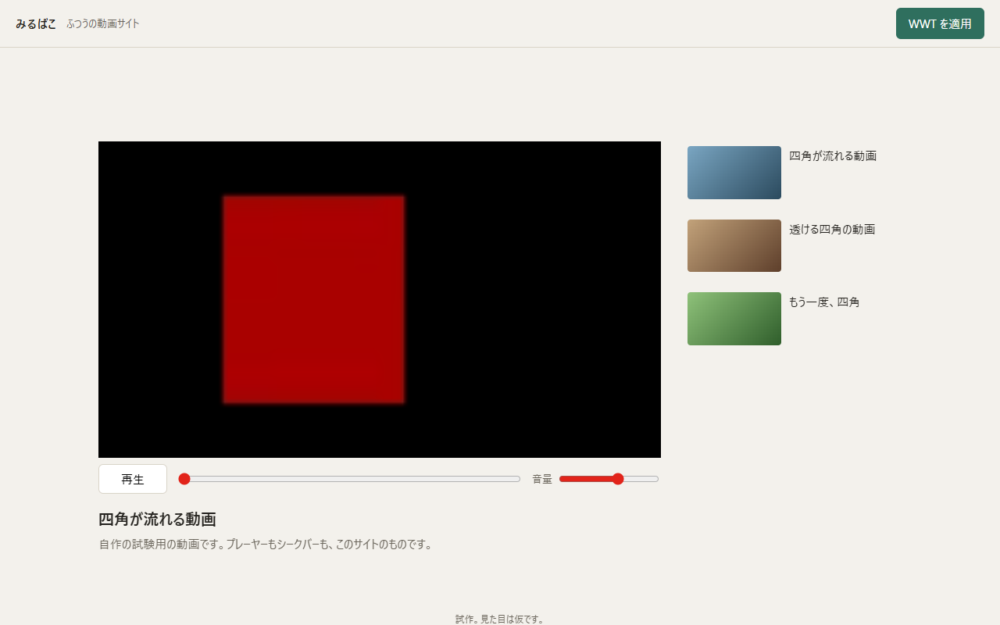
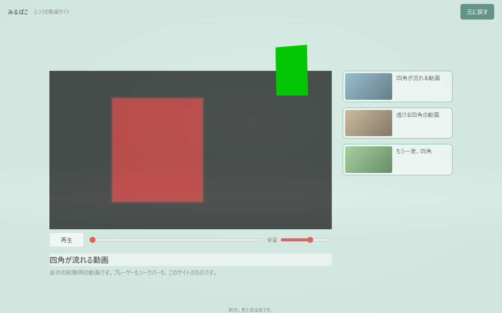
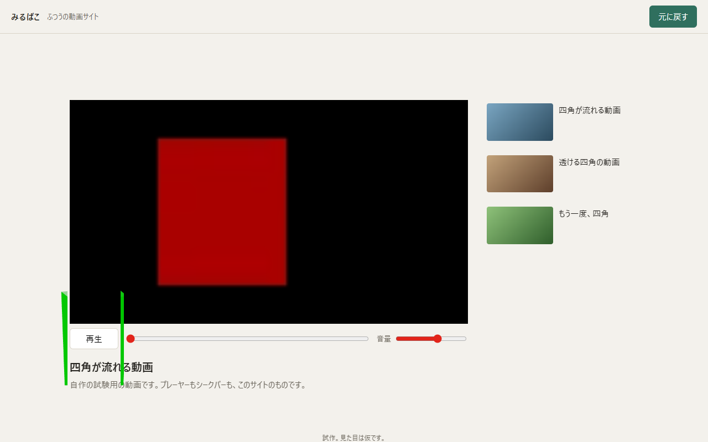
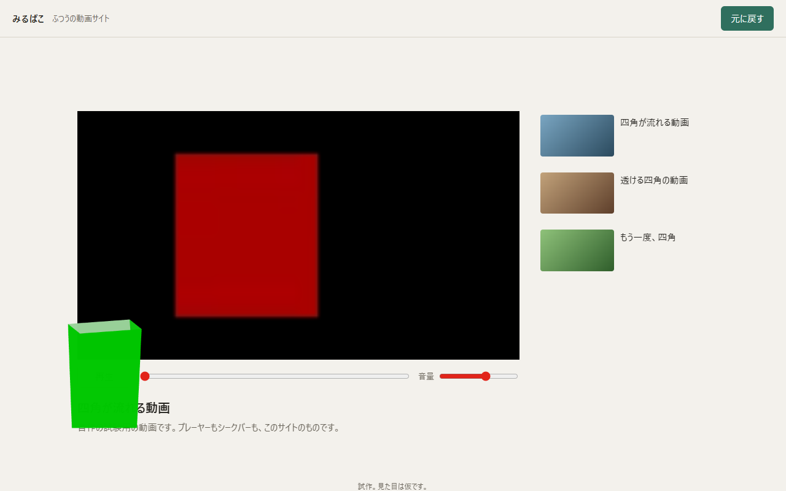
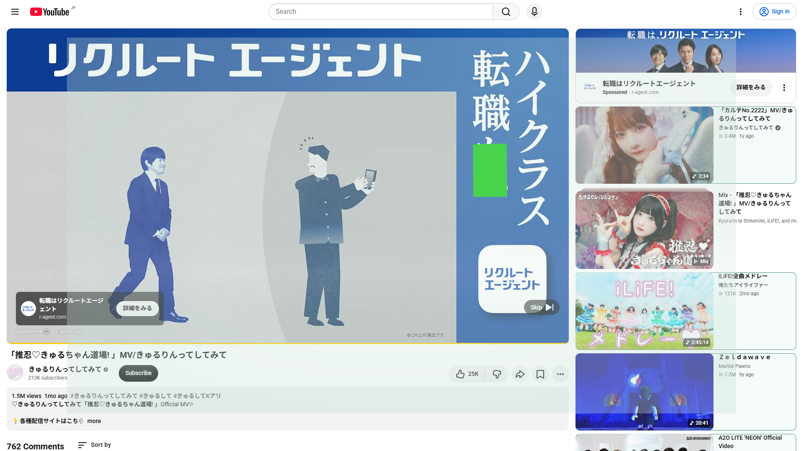
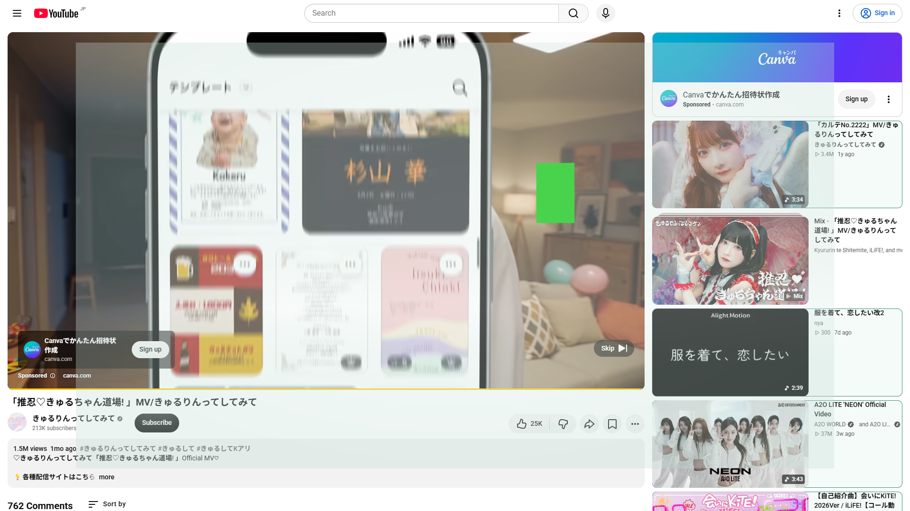

# Playground 塊1の独立検証（Codex）

2026-11-05。対象は `063845318167ae3c37ccb9ed0e285870a95eefbe`、比較は R3-1 修正の最後の製品コード `447b2bf31e319051e327f9ada2b83954276b8ff8`。`wwt-verify` に従い、製品コードと既存のテストは修正していない。

**性能基準は未達。** Windows の全件 e2e と対象 SHA の CI は通過し、Playground の操作面の保護と実 YouTube でのキャラの位置を確認した。実 YouTube の交互計測ではキャラなしの起動時だけ拡張 CPU の p95 が 4.40 → 6.90 ms に増えた。今回の差分のどの変更が寄与したかは未特定。新規の Chrome API 境界検査では、角括弧記法と別名参照を見逃すことも確認した。

## 対象と手順

- `git worktree add --detach` で `.work/playground-v1-after` と `.work/playground-v1-before` を作った。両方の自身の `scripts/build.mjs` で `.work/extension` を作り、通常の `dist` と main は変更していない。依存関係は同じ lockfile の既存 `node_modules` を junction で共用した。
- 計画は `docs/playground-plan.md`、完了報告は報告先ブランチの `c34df18` の冒頭を読んだ。対象製品の後に入った `12b2706` は作業ルールと ignore の変更で、検証対象の製品コードには含めていない。
- コミット列、差分、スクリーンショットを確認した。差分全体の111ファイルには前回の R3-1 の検証資料も含まれる。`src`・`tests`・`scripts`・設定類に限ると68ファイル、1,682行追加・291行削除。manifest と DesignDocument の schema / migrations は変わっていない。
- 中核を触った回なので、CI の確認に加え Windows の e2e 全件を workers=1 で実行した。Chrome は headless または `launchExtension()` の画面外引数を使い、未ログインの新しいプロファイルで確認した。
- 実行手順と追加ハーネスは [repro/README.md](benchmarks/playground-verification/repro/README.md)。[checks.json](benchmarks/playground-verification/checks.json) に各実行の成否と失敗箇所、[source-proof.json](benchmarks/playground-verification/source-proof.json) に SHA・ビルドのハッシュ・ソースの変更がないことを残した。

## 主張の一覧

| #   | 主張                                                                            | 確かめ方                                                                                    | 結果                                                                                                                                                |
| --- | ------------------------------------------------------------------------------- | ------------------------------------------------------------------------------------------- | --------------------------------------------------------------------------------------------------------------------------------------------------- |
| 1   | ポート化で拡張の作品表示・素材読込・緊急OFF・テイク・バックアップを変えていない | Windows 全件、通常版の実 YouTube、追加の保存確認                                            | 通常の全件は280通過・61スキップ。実 YouTube の共通の層データの表示・停止／再開・再読込・実ボタンのクリックは前後とも通過。テイクの追加結果は後述    |
| 2   | 体型がないコピーを補い、全コピーに体型があれば同じ VRM の再取り込みで層を増やす | 既存 unit / e2e、体型あり・なしのコピーを混ぜた独立 unit、同じ試験を比較版の session に接続 | 対象は通過。混在時は2層の ID を維持して補修し、Undo / Redo 後も全層計測済みなら3層へ。比較版は最後の層追加で2層のまま失敗し、今回の修正を検出できた |
| 3   | 揺れる2件の修正で判定を緩めていない                                             | 差分、同じ現行テストを前後それぞれ各10回、解除時間を壊すビルド                              | 両版とも20/20通過。300ms の下限は維持。解除を短縮した開発ビルドは133msでその下限に失敗した                                                          |
| 4   | `src/browser/` と拡張の入口の外で Chrome API を呼ばない検査が効く               | `src/host/` に一時的な違反ファイルを作り lint / unit を実行                                 | `chrome.storage.local.get(...)` は両方で失敗。ただし角括弧記法と別名は見逃す。下の「今回追加した検査の穴」に記載                                    |
| 5   | Playground は拡張なしで適用・解除、Alt+Shift+Q が往復でき、CSP 違反がない       | 通常の headless Chromium、既存 Playground e2e 4件、画面を開いて確認                         | 通過。背景・カード・3Dの層が外れ、再適用で戻る。既存 e2e の console / CSP エラーは0件                                                               |
| 6   | 作品は `parseDesign`、素材は `inspectAsset` を含む検査を通る                    | 余分な項目、任意CSS、URL、未対応版、ハッシュ不一致、正しいハッシュを付けた壊れた素材        | 壊れた作品4種・素材3種を拒否。ハッシュを合わせた不正ファイルと壊れた GLB も拒否し、ハッシュだけの検査ではないことを確認                             |
| 7   | Playground 出力にトルーシェ・私用 VRM・Mixamo の動作が入らない                  | 通常出力の全件検査、合成した禁止名・骨名のファイルを実際の出力のコピーに追加                | 通常は0件。禁止名、私用名、名前を変えた Mixamo 骨名入りの GLB、日本語の名前入りテキストは非ゼロ終了。実物の私用素材は使っていない                   |
| 8   | Playground の全ボタン・リンク・入力・動画が操作面に入る                         | 操作可能な要素と adapter の一覧を比較し、`#play` の印だけを外す                             | 正常時は漏れ0。印を外すと `play` を挙げて追加 e2e が失敗する                                                                                        |
| 9   | キャラが重なっても本物のボタンを読めて押せる                                    | キャラを再生ボタンに重ね、表示前後のボタンの PNG と実クリックを比較                         | ボタンの画素が完全一致し、再生／停止も通過。キャラの緑の画素も3,092あり、全部非表示にして通してはいない。切り抜きを無効にすると画素比較が失敗       |
| 10  | 共通にした位置の基準で、既存 YouTube の配置を変えていない                       | 同じ層データを通常の前後ビルドへ読み込み、player とキャラの矩形・正規化座標を測定           | 前後の矩形と正規化座標が一致。移植した項目は「位置と見た目」に記載                                                                                  |
| 11  | ポート化で拡張 CPU が増えていない                                               | ui1 のプローブで校正後、実 YouTube の起動・定常・SPA を交互に測定                           | 4組でキャラなし起動の p95 が +2.50ms、上限 +1ms を超過。ほか5場面は基準内                                                                           |

## 位置と見た目

Playground が生成した自作の試験用 VRM と背景を、正式なエディターから読み込んで保存した。キャラと背景の decoration データ、カードの着せ替えルールを共通とし、`siteId` を `youtube` に替え、YouTube にない `page`・`primary-heading` の着せ替えルールを除いた。

| 場面                                 | 447b2bf                       | 0638453 |
| ------------------------------------ | ----------------------------- | ------- |
| プレーヤーの矩形                     | x=16, y=68, 1344×756          | 同じ    |
| 作品どおり x=.86, y=0 のキャラの矩形 | x=1096.828125, y=-27, 150×190 | 同じ    |
| 同じキャラの正規化座標               | x=.8599911644, y=0            | 同じ    |
| 再読込後の正規化座標                 | x=.8599911644, y=0            | 同じ    |
| 見える位置へ別途 y=.45 とした確認    | x=.8599911644, y=.4499834656  | 同じ    |

YouTube で y=0 に置くと、両版ともキャラの多くが画面上端・ヘッダー・プレーヤー上64pxの保護帯にかかる。位置の比較にはキャラの箱の中心を使った。描画の確認用に y=.45 に置いた別の試行では、両版とも緑のキャラが見えた。

| Playground 適用前                                                    | 適用後                                                              |
| -------------------------------------------------------------------- | ------------------------------------------------------------------- |
|  |  |

| ボタンを守る通常版                                                                          | 切り抜きを壊した開発版                                                                          |
| ------------------------------------------------------------------------------------------- | ----------------------------------------------------------------------------------------------- |
|  |  |

| 実 YouTube：比較版の可視性確認                                                      | 対象の可視性確認                                                                 |
| ----------------------------------------------------------------------------------- | -------------------------------------------------------------------------------- |
|  |  |

画像は開いて確認した。実サイトの撮影では再読込後に広告が出た画面もある。画像は配置と描画の記録。白っぽい背景には作品の atmosphere の層が重なっている。

## 退行と、前からある残件

同じ現行のテストコードで読み込む拡張だけを替え、前後で起きた症状と対象だけで起きた症状を分けた。

| 分類                           | 症状と前後の結果                                                                                                                                          | 影響×頻度                                                             | 本物の YouTube                                     | 扱い・次の確認                                                                                                                               |
| ------------------------------ | --------------------------------------------------------------------------------------------------------------------------------------------------------- | --------------------------------------------------------------------- | -------------------------------------------------- | -------------------------------------------------------------------------------------------------------------------------------------------- |
| 前からある残件                 | `operation-live:89` の `k` で paused が切り替わらない。対象・比較版の両方で、作品を置く前の区間に同じ失敗                                                 | テスト上は再生キーの操作が破綻する×条件がそろうと                     | 両版で発生                                         | 翔太が扱いを決める。フォーカス・動画の準備状態・キーの宛先の記録が不足しており、原因は未確定。エンジンの退行とは扱わない                     |
| 前からある残件                 | `signal-timeline-live:368` の wheel の「説明できない非表示」が比較版25/357フレーム、対象51/384フレーム。両方に HOLD と解除の状態通知がある                | 描画が一時的に見えなくなる×条件がそろうと。クリック破壊の証拠ではない | 両版で発生                                         | 不要な HOLD なのか、試験の説明判定が HOLD を扱えていないのか未確定。守りを弱めて通さない。この既存試験は記録開始の前で止まった               |
| 未判定・試験の座標の問題を確認 | 対象の操作反復1回で音量が変わらなかった。読み取った箱は (128,398)、入力時の箱は (120,431.75)。mousedown の宛先は HTML。比較版で同じ音量失敗は採れていない | テスト上はドラッグが届かない×条件がそろうと                           | 対象で発生                                         | 古い座標を押したことは確認できる。部品が動いた原因とポート化との関係は未確定。実ユーザーの操作破壊、または前からある製品不具合とは断定しない |
| 未判定・計測版の読込失敗       | 最初の交互計測で対象の VRM 表示待ちが2回失敗。比較版の対応する2回は完了。通常版／計測版の前後4条件による独立の再読込は全件通過                            | 素材を表示できない×条件がそろうと（最初の計測版に限る）               | 計測版で発生。通常版ではこの失敗を再現できていない | 元の試行は保存。原因と製品への影響は未確定。計測終了時には別途 Playwright の trace ZIP の破損エラーも出たが、同一原因とは断定していない      |

操作の実サイト試験の有効な4回ずつでは、対象は2通過・`k` 1失敗・音量1失敗、比較版は3通過・`k` 1失敗。途中のユーザー指示で中断した比較版の反復は、この4回に数えていない。反復の成功で最初の失敗を消していない。通常版の別のキャラ表示試験では、両版とも本物の再生ボタンのクリック・緊急OFF・復元を確認した。

## 今回追加した検査の穴と制約

- ブラウザー境界の検査は、コンパイル後の文字列に `chrome.` / `chrome?.` があるかを見る方式。`chrome["storage"].local.get("x")` と `const c = chrome; c.storage.local.get("x")` は通ってしまった。比較版にはこの検査がなく、今回加えた検査のカバー範囲の不足に当たる。見逃しは一時的に入れた違反で確認した。値としてのグローバル `chrome` 参照を AST / ESLint のスコープで判定する方法がある。
- 境界の例外は `src/browser/`、background / popup などの拡張の入口、開発用 diagnostics。入口まで含めて「src/browser の外に文字列 chrome が一切ない」という検査ではない。通常の Playground bundle の `chrome.` は0件だった。
- 出力検査はファイル名・中身の既知の名前・ビルドが許可していないモデル拡張子の検査。素材の権利関係を自動で証明する検査ではない。今回の出力は生成元も確認し、リポジトリの自作 fixture・背景・動画だけを使っている。

## わざと壊した検査

製品ソースを保存し直さず、開発用の出力か一時ファイルだけで壊した。置換ビルドは esbuild の依存差し替えを使い、計測のためにソース文字列の needle 置換は使っていない。

| 壊したもの                                                                                     | 実行した検査                                          | 結果                                                                                   |
| ---------------------------------------------------------------------------------------------- | ----------------------------------------------------- | -------------------------------------------------------------------------------------- |
| `src/host/verification-chrome-fault.ts` に `chrome.storage.local.get` を置く                   | 境界 lint、`browser-boundary` unit                    | 両方とも非ゼロ終了。finally で一時ファイルを削除し、正常な lint が通ることを確認       |
| 禁止名の合成 VRM・私用名・名前を変えた Mixamo 骨名入り GLB・日本語の名前を、出力のコピーに追加 | 実際の `playgroundOutputProblems` を呼ぶコマンド      | 4条件とも非ゼロ終了。実物の私用モデルや動作はコピーしていない                          |
| 作品パーサーを恒等関数に差し替える                                                             | 壊れた作品を拒否する追加 e2e                          | 拒否の表示が空のままとなり失敗。通常版では4種を拒否                                    |
| `#play` の `data-ww-control` を外した HTML を配信する                                          | 操作面の全件比較 e2e                                  | 漏れとして `play` が出て失敗                                                           |
| 最後の `protectionClip` を全画面の領域に替える                                                 | キャラを重ねたボタンの画素・実入力 e2e                | ボタンの PNG の完全一致で失敗。元の版は緑のキャラを残しつつ画素一致・実クリックが通過  |
| 接近の解除履歴を無効にする                                                                     | G1.2 の現行テストに時間の出力だけを足したコピー、10回 | 10回とも解除状態の待ちで失敗。300ms の下限が失敗点だった、とは扱わない                 |
| 解除の待ちと起床タイマーを開発版だけで短縮する                                                 | 同じ G1.2 の300msの下限                               | 133msで解除され、`>= 300` の判定で失敗。時計の開始を移した後も早すぎる解除を検出できる |

## 性能

`scripts/g11` は今回使っていない。前回の `docs/benchmarks/r31-fix/repro/perf.spec.ts` と `scripts/ui1` の isolated world v3 プローブを基に、各ツリーのビルドを使った。rAF・タイマー・Observer・イベント・Promise の継続をフレームごとに合算する。async / await は計測版で Promise の継続へ変換し、待っている時間は CPU に足さない。測るのはページの主スレッドの拡張コールバックで、service worker 全体の CPU 時間ではない。

- Windows `10.0.26300`、Intel i7-13650HX、Chromium `143.0.7499.4`、1920×1080、倍率1。表示あり・画面外、実 GPU の backend を確認する。新しい未ログインのプロファイル、同じ URL を使う。
- 場面は「PNG 1層」と「同じ PNG＋自作の試験用 VRM 1層」。両版とも同じ素材・動作で、私用 VRM と外部の動作は使っていない。大きな実用アバター全般の性能を示すものではない。
- 起動は遷移先の文書の時計で約6秒、定常は8秒待った後の6秒、SPA は実際の検索から6秒。前後を組ごとに AB / BA と交互にする。CPU の合格基準は中央値 +0.5ms・p95 +1ms 以内。
- 広告・裏タブ・採取窓・フレーム数・実 GPU の条件で採否を決める。背景 CPU は前後に記録するが、ユーザーの決定に従い足切りに使わない。raw の `Quiet` / `CodeQuiet` は旧 audit の参考欄であり、採否には使っていない。
- 最初の試行は上記の VRM 読込失敗で有効な組がそろわず、中断した。トレース ZIP のエラーの後、正式採取は Playwright の自動 trace を切り、Chrome Tracing と CPU カウンターを残した。描画判断を変えないエラー記録用の開発フックを両版に同じ形で追加した。正式採取の3組目は比較版の PNG の SPA 区間を採った後で止まった。有効な1・2組目と3組目の途中データを保存し、次の組から再開した。再開時はブラウザー操作に時間の上限を設けた。
- この構成でも校正を取り直し、await 後の2msの追加で中央値 +2.00ms・p95 +2.10ms を検出した。通常のビルドにプローブは入っていない。

有効な組は 1・2・4・5（前→後、後→前、後→前、前→後）。3組目のほか、有効な組の中でも広告を含んだ起動4区間を除外し、同じ条件で取り直した。有効な組の背景 CPU は全論理 CPU 平均の採取前後で 6.23〜15.36%。以下は各場面の4組のフレームをまとめた値。

| 場面             | 拡張 CPU 中央値 前→後 ms | 拡張 CPU p95 前→後 ms | 増分 中央値 / p95 ms | 判定   | 全体 p95 前→後 ms（参考） |
| ---------------- | ------------------------ | --------------------- | -------------------- | ------ | ------------------------- |
| キャラなし・起動 | 0.00 → 0.00              | 4.40 → 6.90           | 0.00 / **+2.50**     | 超過   | 51.70 → 64.23             |
| キャラなし・定常 | 0.00 → 0.00              | 0.00 → 0.00           | 0.00 / 0.00          | 基準内 | 7.57 → 7.49               |
| キャラなし・SPA  | 0.00 → 0.00              | 2.20 → 1.70           | 0.00 / −0.50         | 基準内 | 26.11 → 25.99             |
| キャラあり・起動 | 1.30 → 1.10              | 8.70 → 8.70           | −0.20 / 0.00         | 基準内 | 58.31 → 66.59             |
| キャラあり・定常 | 1.00 → 1.00              | 2.00 → 2.10           | 0.00 / +0.10         | 基準内 | 12.47 → 12.53             |
| キャラあり・SPA  | 0.00 → 0.00              | 3.20 → 1.70           | 0.00 / −1.50         | 基準内 | 24.30 → 25.66             |

キャラなし起動の p95 は個別の組でも +1.90・+3.40・+2.70・+2.30ms。約6秒間の拡張コールバックの合計は比較版で約362〜392ms、対象版で約378〜438ms。フレーム数は各組とも対象版が少なかった。この比較ではポート化以外の差分や実サイト側の起動条件も含む。起動時のどの処理がフレーム当たりの増加に寄与したかは未特定。

組ごとの値と全試行の採否は [performance.md](benchmarks/playground-verification/performance.md) と [performance.json](benchmarks/playground-verification/performance.json)。フレームごとの CPU、コールバック時刻、GPU 標本、動画の区間差は圧縮した raw に残した。Chrome Tracing は定常とキャラなし起動の代表区間を前後1つずつ、`args` を除いて添付した。

GPU は Intel UHD Graphics / ANGLE D3D11。キャラあり定常の GPU 標本は前後96件ずつ、中央値 / p95 は 1.52 / 2.65 → 1.45 / 2.47ms。250ms ごとに直近値を読んだ参考値。定常の動画フレーム落ちはキャラなし 0/572 → 0/566、キャラあり 0/572 → 0/562、作品OFF 0/577 → 0/577。起動はキャラなし 0/436 → 3/421、キャラあり 0/416 → 4/434。SPA は検索先で動画カウンターがリセットされるため集計対象外。拡張なしの参考値は未採取。

## テスト・CI と変更したもの

| 実行                                         | 結果                                                                        | 補足                                                                                                                             |
| -------------------------------------------- | --------------------------------------------------------------------------- | -------------------------------------------------------------------------------------------------------------------------------- |
| 型チェック・build・format・lint・ESLint      | 通過                                                                        | 境界検査を含む。製品のソース・既存テストの変更0                                                                                  |
| 対象の unit 全件（Windows）                  | 523通過・3スキップ                                                          | 正常系                                                                                                                           |
| 対象の e2e 全件（Windows）                   | 280通過・61スキップ、失敗0・flaky0                                          | 約20分。実サイトなど明示 opt-in のものは別に実行                                                                                 |
| 対象 SHA の CI                               | unit 523通過・3スキップ、e2e 280通過・61スキップ、別枠のネイティブ操作4通過 | [Theme checks #41953141736](https://github.com/a3681299-png/web-world-themes/actions/runs/41953141736) は対象 SHA と一致して成功 |
| 比較 SHA の CI                               | 成功                                                                        | [Theme checks #41839637095](https://github.com/a3681299-png/web-world-themes/actions/runs/41839637095)                           |
| 揺れ2件の反復                                | 対象20/20、比較版20/20通過                                                  | 同じ現行テスト、各々10回ずつ                                                                                                     |
| Playground の追加正常系                      | 4/4通過                                                                     | raw 保存先の上書きを避けた再採取も4/4。故障版の期待される失敗は上の表に分離                                                      |
| 混在コピーの独立 unit                        | 対象1通過、比較版1失敗（期待値）                                            | 全計測後の新しい層の追加を検出                                                                                                   |
| 実サイトの位置・素材・停止／再開・クリック   | 前後とも1/1通過                                                             | 同じ最終ハーネス。初期の接続準備や権限外 URL 参照を待ったハーネスの失敗とは分離                                                  |
| VRM 再読込の診断4条件                        | 4/4通過                                                                     | 前後 × 通常版／計測版。長い採取の読込失敗の原因を確定したものではない                                                            |
| 実サイトの既存テスト                         | 失敗を含む                                                                  | 前からある `k` と wheel、対象のみの音量失敗は上記のとおり                                                                        |
| 実サイトのテイク保存・バックアップの追加試験 | 前後とも1/1通過                                                             | 記録・保存・再読込後のプレビュー・書き出し・新規プロファイルへの復元                                                             |

既存の wheel 試験は記録に入る前に止まったため、テイクは別の headless 試験で確認した。実 YouTube のスクロールを記録し、保存された入力を取得した。比較版45標本、対象43標本。再読込したテイクを途中までシークし、GIF の不透明度がテイクの評価値と一致した。両版とも書き出したバックアップから作品1件・素材1個・テイク1個を新規プロファイルに復元し、作品とテイクのデータが保存時と一致した。追加試験の最初の失敗は描画要素の親を測ったこと、次の失敗はブラウザーの画像デコーダーを Node から呼んだことによる。両版の失敗ログも分けて保存した。

`git log --all --stat` とファイル名での履歴確認で、私用 `PochibyKT_Pochi*` のコミットは見つからなかった。コミットに含めたものは報告、計測データ、画面、再現ハーネス。製品と既存テストの差分は0。

## 翔太が手動で確かめること・次の担当へ

1. ふだんの Chrome で同じ作品を開き、動画の再生が落ち着いた状態で `k`・シーク・音量・シアター／全画面を確認する。失敗したらフォーカス先と、入力前後に部品が動いたかを残す。今回の実サイトの自動試験の失敗を、製品の不具合か試験準備か分けるため。
2. 拡張のネイティブな `Alt+Shift+Q` は、OS 上の実キーでも確認する。Playground はページ内のショートカットを自動確認済み。拡張の headless 確認では正式な緊急OFFボタンを使っており、合成したページ内キーを Chrome コマンドの確認として数えていない。
3. ログイン後のコメントなどは未確認。新しい未ログインのプロファイルでは、実際の投稿や登録はしていない。
4. DeployNow の配信、スマートフォン、遅い回線は未確認。ローカルの deploy-probe 2件は Windows 全件の中で通ったが、本番のホスティングの結果ではない。

次の段階では、共通の anchor ID だけで作品の全項目がサイト間で一致すると解釈しないこと、ブラウザー境界の別名参照を見逃す点、HOLD の説明判定、計測時の VRM 読込失敗を引き継ぐ。守りや既存テストの期待値を緩めて解消したことにしない。
