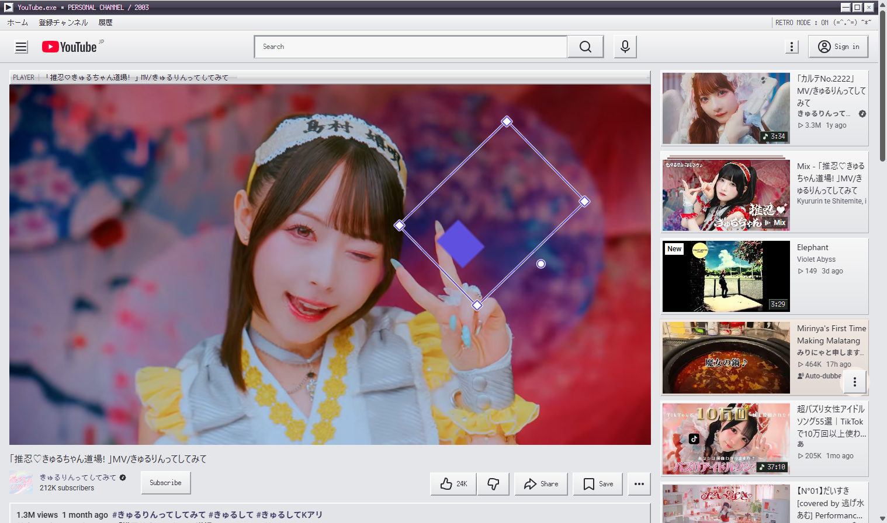
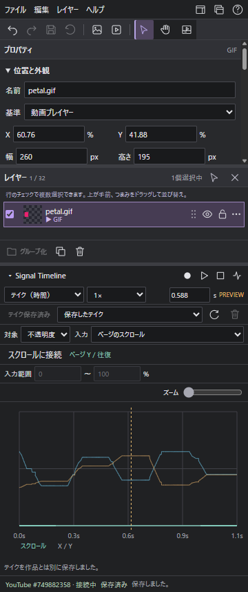
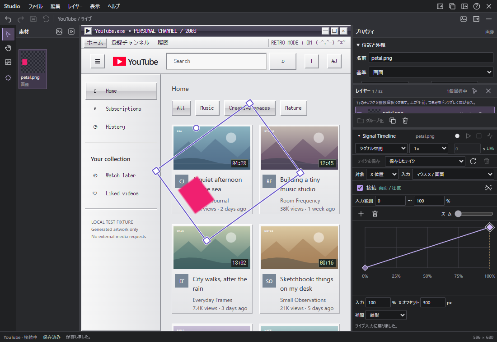
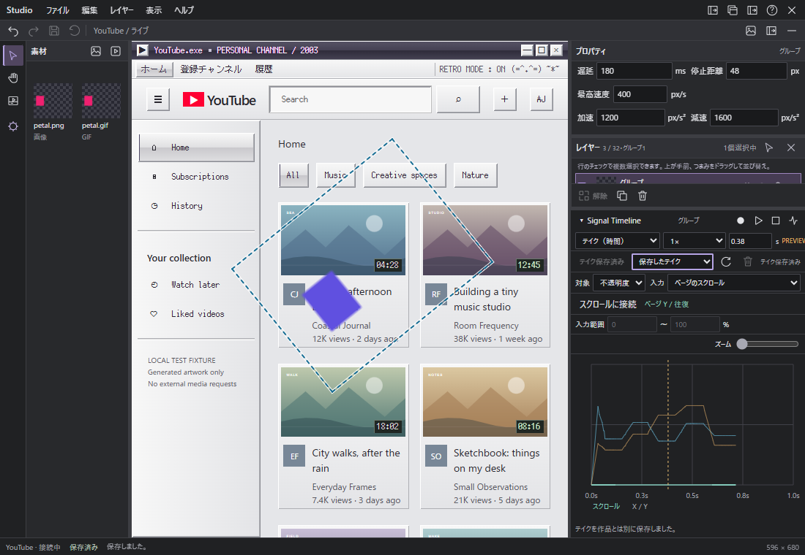

# Signal Timeline v2 検証結果

2026-10-19。専用worktree `.work/creator-editor`、ブランチ `codex/creator-editor-spike`。起点は `21312c0`。

## コミット

| 段階 | コミット | 内容 |
| --- | --- | --- |
| 評価コア | `37e34ad` | マウス信号、非破壊オフセット、追跡状態、v9移行 |
| Host／Renderer／UI | `73834f9` | 共通の追跡設定、評価済み配置、選択枠、直接編集 |
| Timeline／テイク | `74c36ea` | 駆動元・対象切替、入力範囲、録画・再生・波形・ゴースト |
| 最終検証 | この文書と同じコミット | 実サイトテスト、単位表示、ベンチマーク、操作手順と証拠 |

## 自動テスト

- 型チェック：通常・DOMなしWorld Runtime・DOMなしEditor Coreの3構成で成功。
- lint／ビルド：成功。依存関係・Chrome権限は追加していない。
- 第1段階：全体278件成功／9件条件付きスキップ。v8 fixture追加後の移行テスト9件も成功。
- 第2段階：全体を実行後、旧モックの採取時計不足、非表示入力の幅測定、別フレームの座標比較を修正。該当範囲16件が再成功。
- 第3段階：関連32件成功、全体287件成功／9件条件付きスキップ（296件、6.2分）。
- 最終実行：**287件成功／10件条件付きスキップ（297件、5.6分）**。条件付きの実YouTubeテストは下記の別実行で確認。

新しい純粋テストは、座標変換、距離・角度・速度、X/Y/回転の加算、基本値の保護、最大速度・加減速・停止、30/60/144Hzの比較、グループ合成、データ検証、履歴入力の再評価、逆シークを確認する。30/60/144Hzで、静止目標を1秒追跡した位置の差が2px未満であることを検証している。

拡張を読み込んだfixtureでは、PNG＋GIFのグループ追跡とマスク、数値・キー操作、ロック、Undo／Redo、保存・破棄・再読込、テイク別保存、ライブ入力の遮断、OFF／reduced-motionを確認。既存の静止画・GIF・APNG・WebP・WebM・Lottie、32レイヤー、グループ、アンカー、カード編集、サイドパネル・独立Studioの回帰も全体テストに含む。

## 実YouTube

fixtureへ置換しない公開YouTubeを、新規のログアウト済みChrome for Testing **153.0.8010.12**で検証した。ユーザーの通常プロファイルは使用していない。

1. `WW_LIVE_SIGNAL_MOTION=1`：新しいGIF追跡、速度360px/s・遅延150ms・停止36pxの設定、移動方向への回転、操作録画、シーク、ライブ入力遮断、作品とテイクの保存・再読み込み、1366／1920／1000pxへの幅変更後も停止36pxまで再追跡、設定ボタンの実クリック、強さ0%での撤去。**1件成功（34.1秒）**。
2. `WW_LIVE_SIDE_PANEL=1`：既存のグループマスク、実動画の再生／停止フェード、ネイティブの設定ボタン、シアター、全画面、スクロールアンカー、保存・再読込、検索によるSPA往復、強さ0%の撤去。
3. `WW_LIVE_SIGNAL_TIMELINE=1`：v1スクロールルール、速度・方向によらない不透明度、録画、ゴースト、逆再生、入力遮断、保存・再読込。上の2と合わせて **2件成功（56.8秒）**。

追跡テイクの座標は、同じ入力を純粋なTakeSamplerで評価した値と照合した。実測CSS数値誤差は **0.000399px未満**。初回のテストはCSSの数値丸めより厳しい精度を要求して失敗したため、描画比較を0.01px未満に変更した。Runtimeの決定性テストは数値構造全体の完全一致を維持している。

公式パネル内のフォーム操作は、ネイティブWebContentsへCDP接続し、ユーザーアクティベーション付きのDOM操作で行う。マウス追跡とYouTubeの設定ボタンにはブラウザー入力を使う。手作業だけで検証したという意味ではない。[実測チェックとヒットテスト](signal-timeline-v2-live-checks.json)を同梱。

以下はローカルfixtureであり、実YouTubeの画像ではない。

## 性能

Windows x64、Core i7-13650HX、Node **v24.16.0**。Chromeテスト終了後にベンチマークを順次実行した。以下は数値評価の時間であり、DOM更新、描画、GPU、デコード、通信を含まない。[生データ](signal-timeline-v2-benchmarks.json)を参照。

`npm run benchmark:motion` は32素材＋16グループ、48マスク、48ルールを使う。360入力×10周を準備後、30周を交互に比較する。

| 配置準備済みの評価 | 中央値 | p95 |
| --- | ---: | ---: |
| 既存の48スクロールルール | 0.025ms | 0.031ms |
| 48マウスキー＋48追跡コントローラー | **0.092ms** | **0.109ms** |

これは機能あり／なしの比較であり、同一処理の高速化率を表さない。3600入力の追跡テイクはJSON 1,501,662文字、約60秒。検証・準備8.66ms、初回末尾シーク367.84ms、キャッシュ作成後のランダムシーク256回は中央値1.648ms／p95 3.309ms。状態キャッシュ113個。初回の長距離シークは同期処理のため待ちが出る。

同じ実行の未GCのJSヒープ差は約41.8MBだった。中間オブジェクトやGCのタイミングを含み、保持サイズ、ピークメモリ、Chromeプロセスのメモリとしては扱わない。

既存の `benchmark:timeline` も成功。48スクロールルールは中央値0.022ms／p95 0.027ms、3分テイク初回末尾シーク114.76ms、ランダムシーク中央値0.473ms／p95 0.965ms。Motionベンチとは入力列が異なるため、数値を直接比較しない。

`benchmark:world` は旧数値評価との出力一致を確認したうえで実行。配置を含む評価の中央値は、表示混在で旧47.9μs→現46.1μs、全表示で旧52.3μs→現49.4μsだった。実ページのFPSやCPU使用率の向上を保証する結果ではない。

## 分離・互換性

mainは `022a576e5fb486b5c2fe5632feee66fcb018c953` を維持。通常版distの12ファイルは着手前のSHA-256と比較し、全ファイルの一致を確認した。更新するビルドは実験用worktreeのdistのみ。Chrome権限は既存のstorage／sidePanelを維持し、バックエンド・生成AI・外部コード実行は追加していない。

v1〜v8のfixtureからv9への純粋移行、旧Runtime 1.1のテイク読み込みを検証。v8 fixtureはGitにある形式を再構成した回帰データであり、実ユーザーの保存ファイルを網羅したものではない。

## 残る制約

- v2のキー対象は不透明度・X/Yオフセット・回転。拡縮キー、ばね、経路探索、衝突、3Dは未実装。UIは1レーンずつ編集し、プロパティごとのルールは併用できる。複数の有効なルールによる同一プロパティの合成は拒否する。
- 基準点への距離は手動の基本位置から導出する。動いた結果を自己参照する追跡・フィードバック回路は今回扱わない。
- 追跡録画は全評価入力を残すため、3600件の上限に先に達する。未保存テイクのブラウザー再起動後の復旧は保証しない。作品とテイクは別々に保存する。
- 再現対象はRuntime評価。映像・GIF等のコマ位相やサイト全体の再現は保証しない。異なるviewportで記録を再生すると、記録時の配置が現在の画面外に出る場合がある。
- Chrome自身のサイドパネル境界を手でドラッグする確認は未実施。ウィンドウ幅変更と、パネルWebContentsの幅変更による自動検証は区別している。
- 新しい追跡の録画とシアター／全画面／SPAを同時に組み合わせた実サイト検証、全素材形式×追跡×グループ内拡縮、ログイン済みYouTubeの全実験UI、長時間連続使用は未網羅。
- CPU／GPU使用率、ブラウザープロセスのピークメモリ、実サイトの総フレーム時間は未測定。数値評価の時間だけで60fps動作を保証しない。

次段階では、長いテイクの初回シーク準備を分割／Worker化し、状態キャッシュと記録予算を調整する。点を受け取る追従計算と、シグナルから点を作る接続は分離したまま、アンカー上の目的地や新しいコントローラーへ拡張する。
