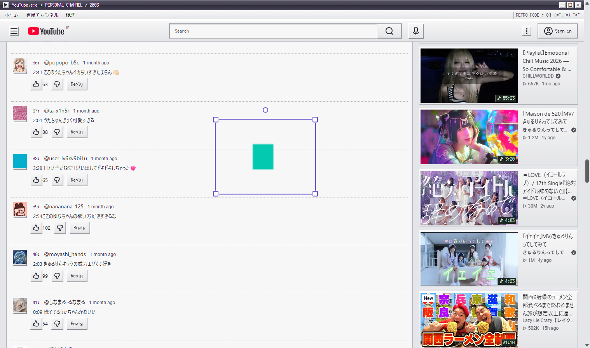
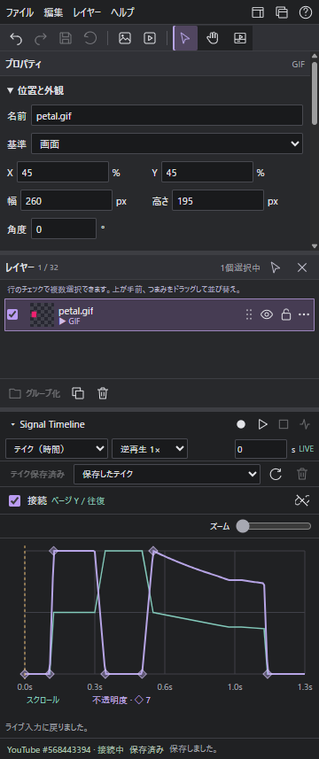
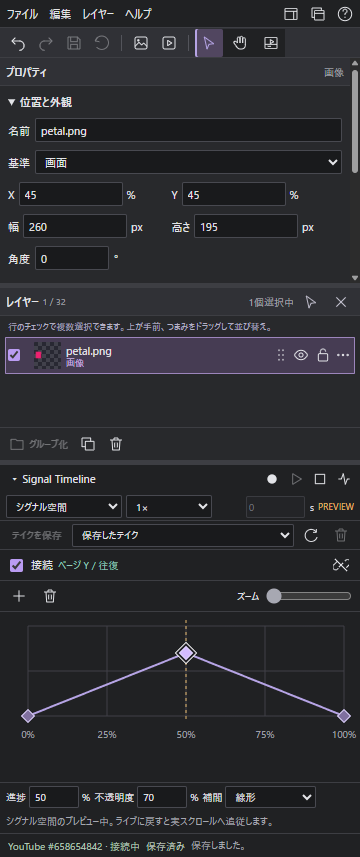

# Signal Timeline v1 検証記録

2026-10-19、`codex/creator-editor-spike` の専用worktreeで実施。起点は `9c9cd88`。通常版main・distは変更せず、権限・依存パッケージ・外部サービスの追加もない。

## 段階

| Stage                | コミット               | 全体回帰の最終結果                                    |
| -------------------- | ---------------------- | ----------------------------------------------------- |
| 1 ルールエンジン     | `281b59c`              | 256成功 / 8 opt-inスキップ（264件）                   |
| 2 キー編集UI         | `29be615`              | 259成功 / 8 opt-inスキップ（267件）                   |
| 3 録画・保存・再生   | `ddff4d7`              | 266成功 / 8 opt-inスキップ（274件）                   |
| 4 投影・性能・仕上げ | この文書を含むコミット | 272成功 / 9 opt-inスキップ（281件、2 workers、5.7分） |

各段階で `npm run lint`、`npm run build` を実行。buildは通常・World Runtime・Editor Coreの3つのTypeScript設定を型チェックする。

Stage 4では最初の全体回帰（271成功・9スキップ）の後、停止状態を追加監査した。フェード途中のテイクで値が固定されてもRAFを自己予約し続ける問題を制御時計のテストで再現・修正し、ライブへ戻すとフェードが再開することも確認。録画ボタンのSpace操作を保ったうえで、全281件を再実行した。実サイトと性能テストは全体回帰と別に実行した。

## 自動テストで確認する範囲

- v1〜v7 JSON移行、v8の厳格なルール検証、未知バージョンの保存値保護。v1〜v6は履歴のテスト生成物、v7は旧パーサーで検証した合成データ。実ユーザーの過去保存JSONは未取得。[fixtureの出典](../tests/fixtures/designs/README.md)を参照。
- 速度・往復・範囲外・スクロール不可・ページ高さの変化、各イージング、グループ／子の不透明度とマスク、opacity 0からの復帰。
- 同じ入力列の完全なRuntimeフレーム／状態の一致、逆順・ランダムシーク、状態遷移途中からの録画、編集後のルールでの再評価。投影キーは元データを変更しない。
- 共通Coreの保存・破棄・Undo/Redo、キーのドラッグ1操作、ロック、キーだけのDelete、旧v7セッション復旧時の誤った競合表示の防止。
- 本物のMV3拡張とChrome Storage、公式サイドパネル・独立Studio・インページStudioの共通UI、通信切断・再接続、テイク専用IndexedDBのブラウザー再起動後の復元。
- 入力欄の秘密文字列がテイクに入らないこと、不正フィールド・実行コードの拒否、記録件数・容量、保存8件の原子的な上限、非表示タブの停止、OFF／強さ0%の撤去。
- 既存のPNG・WebP・GIF・APNG・WebM・Lottie、asset ID／lease、カード、レイヤー・グループ・マスク・アンカー・シグナルの回帰。

通常の全体テストはローカルfixtureを使う。以下の実サイト確認とは分けている。

## 実YouTube + 公式サイドパネル

Chrome for Testing 153.0.8010.12、ログアウトした専用プロファイルで実施。YouTubeをiframeやfixtureへ置き換えていない。

`WW_LIVE_SIGNAL_TIMELINE=1` の `tests/signal-timeline-live.spec.ts` で次を確認した。

1. 実YouTube上にGIFを追加し、スクロール→不透明度を接続。中央キーを削除し、ヘッドのマウス操作から再追加して保存。
2. 0/25/50/75/100%と往復、速い操作と待ちを入れた操作で、実ページの生スクロール範囲から期待する不透明度へ一致。
3. 明示録画→停止→テイク別保存→波形と複数のゴーストを表示。
4. 記録した途中時刻の純粋なRuntime評価値と実DOMのopacityを比較。シーク中に実ページをスクロールしても記録値へライブ入力が混ざらない。
5. 逆再生してもページへscrollイベントやクリックを再送しない。
6. 実Chromeウィンドウ1366/1920/1000pxで再配置を確認。
7. ページ再読込、Studio再接続、保存ルールとテイクの復元、再シーク、OFFで完全撤去。

実行の切り分けで、テーマ反映前の開く操作と録画停止の通信完了前の保存操作をテストが先行していた箇所を修正した。さらに、プレビュー直後に古い進捗を通知する問題を修正し、10Hz通知でも最後の評価値を必ず届ける回帰テストを追加した。修正後の実サイト1件＋純粋テスト8件は **9件成功（36.4秒）**。

`WW_LIVE_SIDE_PANEL=1` の既存 `tests/side-panel-live.spec.ts` も今回実行し、グループマスクのマウス追従、実動画の再生・停止フェード、設定ボタンのクリック、シアター、全画面、スクロールアンカー、保存・再読込、検索によるSPA往復、強さ0%での撤去を確認した。

停止処理の修正後もGIFの実サイトフローは再成功した。既存の実サイトテストではテーマ反映前のStudio起動待ちがタイムアウトしたため、同じ初期化完了待ちと操作単位のタイムアウトを追加。再実行は **1件成功（27.2秒）**。最終的に2つの実サイトフローを別々の実行で確認している。

公式パネル内のフォーム操作は、Playwright Pageに現れないWebContentsにCDPで接続し、ユーザーアクティベーション付きDOM操作を行う。ヘッド追加はCDPのマウス入力、実YouTubeの動画ボタンはPlaywrightの実クリックを使う。すべてを手作業で確認したという意味ではない。

## 性能

計測環境はWindows x64、Core i7-13650HX、Node v24.16.0。性能結果はこの環境での参考値であり、CPU使用率やGPU負荷、デコード時間を表さない。

`npm run benchmark:timeline` は32素材＋16グループ、48マスク、48ルールを用いる。20周ウォームアップ後、180入力×50周を交互に比較した。全体回帰が終わってから単独計測した値は次のとおり。[生の計測結果](signal-timeline-benchmarks.json)を同梱している。

| 純粋な計算                                       |  中央値 |     p95 |
| ------------------------------------------------ | ------: | ------: |
| 配置準備済み・ルールなし                         | 0.020ms | 0.044ms |
| 配置準備済み・48ルール                           | 0.029ms | 0.068ms |
| 3分テイク・キャッシュ作成後のランダムシーク512回 | 0.560ms | 1.535ms |

3600入力のテイクはJSON 1,198,733文字。検証・準備12.34ms、初回の末尾シーク144.30ms、状態キャッシュ113個。配置再利用前の同じベンチマークでは初回末尾265.70ms、暖まった後の中央値1.086ms／p95 2.254msだった。前後は別時刻の参考測定で、厳密な同時A/Bではない。状態は32入力ごと、配置は同じアンカー／viewportで再利用し、フレーム画像をキャッシュしない。

既存の `benchmark:world` もフレーム一致を検証して再実行。ルールなし・32素材／16グループの配置を含む評価は、混在表示で旧49.7μs→現47.6μs、全表示で旧84.3μs→現79.7μs（中央値）。これは上の「配置準備済み」と異なる計測範囲である。

`tests/signal-timeline-performance.spec.ts` は本物の拡張＋fixtureで、同一の120スクロール操作を変更前と変更後に流す。32素材／16グループマスクの表示値が一致し、評価は **240回→120回**。ジオメトリ更新とシグナル通知に由来する重複RAFを集約した。数値評価のブラウザー計測には0.1ms程度のタイマー精度とJITの影響があるため、評価回数の半減をCPU時間の半減とは扱わない。最終単独実行は6.9秒で成功し、数値評価の計測合計は12.3ms→17.8ms。時間の改善は確認できず、p95も0.2ms→0.3msだった。描画・GPU・メディア再生を含む処理全体の速度向上を主張する結果ではない。

mainは `022a576e5fb486b5c2fe5632feee66fcb018c953` のまま。通常版distは全12ファイルのSHA-256を着手前と比較し、一致を確認。更新したビルドは専用worktreeのdistだけである。Chrome権限は既存のstorage／sidePanelから変更していない。

## 残る制約・未確認

- v1はページY進捗→opacity／往復に限定。複数レーン同時表示、他プロパティ、他ソース、一方通行・一度だけ・平滑化・合成・本格的な時間アニメーション制作は未実装。
- 再現対象はRuntimeの数値状態。YouTubeの動画内容・DOM全体・GIF等のコマ位相は再現しない。記録したアンカーとviewportが現在の画面と異なる場合も、記録値を評価へ渡す。サイトと配置の描画は現在のライブ画面を使うので、異なる画面幅で見た目全体が一致する保証はない。
- テイク3分／3600入力／4MiB文字相当、保存8件／合計16MiB文字相当。作品と独立し、未保存テイクのブラウザー再起動復旧は保証しない。ゴーストは計算4096個・表示先頭256個まで。紫の投影線は201点で表示し、非常に細かい往復は省略される場合がある。Runtimeや元の記録入力は省略しない。
- 長いテイクで初めて遠くへシークすると、状態キャッシュ作成が一度発生する。Worker化や事前の分割準備は次段階。
- 実Chromeウィンドウ幅は変更したが、**Chrome自身のサイドパネル境界を手でドラッグする検証は今回未実施**。公式パネル寸法変更と選択枠追従のfixture回帰は維持している。
- CPU使用率・GPU使用率・プロセスのピークメモリ、長時間連続利用、ログイン済みYouTubeの全実験UIは未測定／未確認。
- 実サイトではGIFのTimelineとグループマスクの通常操作を別のフローで確認した。録画中の全画面切替、全素材形式×グループ×Timelineの組み合わせは実サイトでは網羅していない。

次はテイクの準備を分割して初回シークを短くし、同じソース→変換→ターゲットの境界で位置・回転などの対象を追加する。UIレーン、Runtime評価、Host入力、テイクの保存は引き続き分離する。
