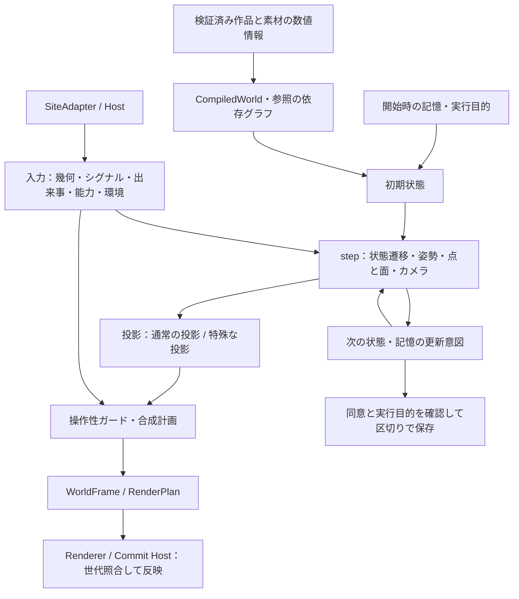
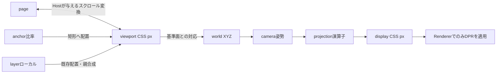
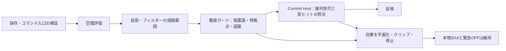

# G0 空間表現の設計

2026-10-22。調査対象は `6721ce4`。依頼者から提示された「Web World Themes ロードマップ」（2026-10-21）の順序を採用する。
これはG1以降の設計案であり、将来案と採用済みの範囲を区別する。G1の実装記録は別紙に残す。
最初のキャラクターは2026-10-23に依頼者がA（外部制作した2Dのパーツ変形）へ決定した。
G0では本書だけを成果物にし、src・manifest・保存データ・通常版distを変更しない。

## 0. 土台と責務

3Dの世界座標で点・面・姿勢を扱い、2Dの絵として出す。通常のカメラ、特殊な投影、描画手段を独立させる。
旧作品を新しいカメラへ自動的に作り直すことはしない。既定の正投影は従来の座標計算・CSS・個別モデル描画をそのまま使う互換表示とする。

設計上の固定条件は次のとおり。

- 同一Runtime版・初期状態・作品・素材情報・入力列から、同じ評価状態と描画指示を得る。異なるGPUのピクセル完全一致までを決定性とは呼ばない。
- 時間、マウス、スクロール、動画、操作していない時間は登録表に載る入力。時刻や乱数を評価コアが外から勝手に読むことはない。
- 点を受け取る機能は共通のSpatialPoint参照を受け取る。集中線だけのマウス参照、照明だけのボーン参照を別に作らない。
- 操作の破綻を防ぐ条件はエンジン側に置き、作品から解除できなくする。読みにくさや作風の好みまで強制補正しない。
- 作品に入るのは検証可能なデータだけ。JS、任意式、CSS文字列、シェーダーコード、DOMセレクターを実行形式として受け取らない。
- G0〜G6・段階3〜7は現在のYouTube対象範囲と既存権限 `storage` / `sidePanel` で設計する。`tabCapture`、`desktopCapture`、`scripting`、`tabs`、追加ドメインの権限を先行追加しない。

| 責務                   | 所有するもの                                                                        | 所有しないもの                                       |
| ---------------------- | ----------------------------------------------------------------------------------- | ---------------------------------------------------- |
| SiteAdapter / Host     | ネイティブDOMの観測、アンカー・操作面、入力の時刻と世代、動画の意味の判定、能力情報 | 作品の状態遷移、作品由来のセレクター実行             |
| Asset Runtime          | 今の検証済み原本、素材ID・lease、解析、読み取り専用のリグ情報、共有資源と参照数     | 個体の姿勢、表情、接地、揺れの可変状態               |
| World Runtime          | 空間変換、点と面、状態遷移、姿勢・接地・光・演出の評価、操作性の数値検査            | DOM、ThreeのRenderer、ブラウザー時計、保存API        |
| Renderer / Commit Host | 数値指示をDOM/CSS/Canvas/Threeへ反映、マスク・合成、実DOMとの最終照合、GPU資源      | 状態遷移の判断、独自の再生時計、保存データの変更     |
| Editor / Storage       | 検証付き編集コマンド、構造共有・Undo、保存・復旧、記憶への同意と書き出し            | 毎フレームの作品全体の再検証、実行状態の作品への混入 |

現在の入口は `src/world/evaluate.ts` の `evaluateWorld` / `evaluatePreparedWorld`、版はRuntime 1.3.0。
将来の `step(state, input)` は、検証・コンパイル済みの不変なWorldへの参照をstateに持つ入口とする。
現行APIを互換アダプターで包める形にし、フレームごとのparseDesignや作品全体の複製を再導入しない。



RenderPlanはDOM要素やコールバックを含まない。レイヤーID、変換、投影後の形、色、姿勢、マスク、合成領域、必要な再描画だけを含む。
Rendererの準備完了・コンテキスト喪失・品質段階は次の入力として返す。Rendererの隠れた状態で世界の判断を変えない。

時刻も `time.scene.elapsed`、`video.content.time`、`user.idle.duration` 等の型・単位付きシグナルとして接続する案とする。
同じ曲線の入力を時間からスクロールへ取り替えても、カメラやキャラ側の処理を作り直さない。
再生クロックはinputとstateから導き、Rendererの独自タイマーに置かない。記録・シークもその入力時刻を使う。
受け手も、property ID・値の型・範囲・合成方法・解決段階を持つ登録表にする。
数値、色、点の接続を型付きで検証し、任意のオブジェクトのキーや式を実行する仕組みにしない。

## 1. 空間とカメラ

### 座標の契約

| 空間                    | 原点・単位                                                      | 用途・変換                                                                       |
| ----------------------- | --------------------------------------------------------------- | -------------------------------------------------------------------------------- |
| page                    | 文書の左上、右X・下Y、CSS px                                    | 文書に留まる点。通常の表示では `page = viewport + rootScroll`                    |
| viewport                | 既存のclient座標・DOM矩形と整合するようHostが正規化したCSS座標  | 画面に留まる点、操作面、最終表示。DPRを掛けない                                  |
| anchor                  | 解決されたアンカー矩形の左上                                    | 既存placementのx/yは矩形に対する比率、width/heightはCSS px。消失時は未解決       |
| layer                   | レイヤーのローカル座標                                          | 既存の配置・回転・グループ合成を維持。新しい3D変換はその後に合成する             |
| world                   | pageの左上を `(0,0,0)`、右X・上Y・手前Zの右手系、1単位=1 CSS px | 点・面・接地・光の共通空間。viewportの点は通常 `(vx+sx, -(vy+sy), z)` に埋め込む |
| camera / clip / display | カメラ姿勢、投影途中、表示先のCSS座標                           | World内部の導出値。素材や作品の配置値へ書き戻さない                              |

HostはrootScrollに加え、スクロールコンテナー、VisualViewportのoffset/scale、DPR、幾何の世代を入力にする。
上の単純なpage変換を、そのままピンチズームや入れ子スクロールへ流用しない。
DOM矩形・ポインター・描画先を同じviewportへ揃える変換をHostが提供し、G2で通常ズーム・ピンチ・全画面を検証する。
pageとworldは保存できる安定した基準、viewportとanchorは毎回解決する基準とする。



スクロールの大きい文書でも、評価は倍精度のpage/world座標を持つ。
GPUへ渡す直前にカメラ近傍の原点を引き、巨大なpage座標をそのままFloat32へ落として精度を失わないようにする。
逆変換は常に可能とは限らない。画面の点からworldへ戻すにはレイと基準面が必要で、基準面はPoint参照や編集操作に明示する。
面と平行、カメラの後ろ、複数解、特異変換なら「なし」を返す。

### 奥行きと互換正投影

通常表示のviewportがW×H、rootScrollがsx/syなら、互換カメラの中心は
`(sx + W/2, -(sy + H/2), C)`、向きは-Z、upは+Y。
正投影の幅と高さをW/Hにし、z=0を表示面とする。サイズはzによらず一定になる。
これは正投影の性質と一致する。[Three OrthographicCamera](https://threejs.org/docs/pages/OrthographicCamera.html)

重要なのは、**互換表示で既存の位置をworld→NDC→CSSと往復計算し直さない**こと。
従来と同じ数値、演算順、CSS文字列、DOM階層、モデル用の個別正投影カメラを使う。
worldへの埋め込みは点や面を解決するための並行した表現にする。正投影が数学的に等しいだけでは、アンチエイリアスまで不変とは保証できない。

- 新しいzの既定値は0、追加回転はidentity、scaleは1、投影後の追加変形はなし。
- 既存の `zIndex` はCSSの重なり順。worldのzへ変換しない。同一奥行きの順序も現在のグループと配列順を維持する。
- 既存の `rotationDeg` は画面上で時計回り。右手系のworldのZ回転へ使うときだけ符号を変える。
- 既存model3dは、現在のフィット・照明・カメラで描く平面として埋め込む。最初から共通3D空間の立体へ変えない。
- 立体として共有カメラへ参加する設定は明示操作とする。素材の単位からCSS pxへの倍率もその時点で決める。

G2の受入条件は、v1〜v11の履歴由来fixtureと現在の代表作品について、互換表示の評価値・CSS・同一ブラウザーのスクリーンショットが一致すること。
旧データを読むだけで保存を発生させたり、dirtyやUndoを増やしたりしない。

### カメラ、投影、作画モード

| 層         | 担当                                                                   |
| ---------- | ---------------------------------------------------------------------- |
| 空間       | レイヤーや面の姿勢・親子関係。カメラが変わっても素材と配置を壊さない   |
| Camera     | position、向き、視点・注視点。Point参照を解決する                      |
| Projection | 正投影、透視、レンズ変形、作画上の変形。投影結果と必要なら逆変換を返す |
| Renderer   | DOM/CSS、Canvas、Threeのどれで表示するか。カメラの意味を再定義しない   |

表示モードは `compat`、`camera`、`drawing` の3つを提案する。
保存時にはcamera用とdrawing用の設定を別に保持し、activeだけを切り替える。
切り替えはUndoできる1コマンド。レイヤー座標を自動ベイクしたり、片方の設定を削除したりしない。

- **3Dカメラモード**：1つの姿勢と投影から消失点を導く。レンズシフトは許しても、複数の消失点を互いに無関係に動かして物理整合と呼ばない。
- **作画モード**：消失点、地平線、4隅を自由に置き、面や領域ごとの作画ルールとして保持する。単一の3Dカメラでは成立しない組み合わせも残す。
- 切り替え時に見え方が変わることはプレビューする。現在の見た目を固定したい場合の「作画面へベイク」は、別の明示操作にする。
- cameraから導く消失点と、作者が置いた作画ガイドは別kind。平行方向の消失点が無限遠なら、Infinityを流さず未解決とし、編集用には別途方向矢印を出す。

### 特殊な投影の方式

| 表現                | DOM/CSSを使う案                                            | Canvas / WebGLを使う案                                  | 方針と限界                                                                     |
| ------------------- | ---------------------------------------------------------- | ------------------------------------------------------- | ------------------------------------------------------------------------------ |
| 1〜3点透視・4隅変形 | 作者の平面にmatrix3dのホモグラフィ                         | 同じ平面をメッシュとして描く                            | G2はDOM案から。平面内の直線を保つ                                              |
| 逆遠近              | 正の同次座標を保つ範囲で、面ごとのmatrix3dや奥行き別拡大   | 独自の投影演算を既存WebGL描画へ渡す                     | 物理カメラではなく作画投影。CSS perspectiveの値を負にする実装にはしない        |
| 画面内の魚眼レンズ  | 作者DOMにSVG displacement filterを掛ける余地がある         | 作者の絵・面をテクスチャ化し、メッシュ/ポスト処理で変形 | 単一matrix3dでは曲線になる変形を表せない。DOM filter案も捨てず小実験候補にする |
| 180度級の魚眼視野   | 1枚のDOM平面の変形だけでは、元の画面外の景色を復元できない | 複数方向の描画やキューブマップから魚眼へ投影            | 画面レンズと全周に近い視野を別機能として扱う。後者は段階5以降に負荷を測る      |
| 不可能空間          | 分割した面、領域ごとの前後関係とクリップ                   | 複数ビュー、ポータル、領域合成                          | 単一の全域3D変換や1枚のdepth bufferへ押し込めない。G6で扱う                    |

CSS/SVG filterは描画を変えてもhit-testingを変えないため、本物の操作UIへ非線形変形を掛ける手段にはしない。
作者の非操作レイヤーに限った候補として残す。[Filter Effectsの合成とhit-testing](https://www.w3.org/TR/filter-effects-1/#FilterProperty)
WebGLでページのDOMを丸ごと読める前提も置かない。再描画できるのは自分たちが所有する絵・テキスト・モデル。

魚眼・逆遠近は作者のレイヤーと仮想面を対象にすれば実現の余地がある。本物のUIを巻き込まないことは、技法を削る理由にはならない。
入力の逆写像が一意でない領域では、作者レイヤーの直接ドラッグを平面編集へ戻し、誤った座標でドラッグを続行しない。

投影結果には最初からview IDと領域/描画インスタンスの区別を持たせる。通常はprimaryの1ビューだけを使う。
同じworldの点が複数のビューや再帰表示に現れる場合も、元の点とキャラの状態を複製したことにはしない。
画面効果や逆変換は対象viewを明示し、別ビューのCSS座標を混ぜない。G6の不可能なつながりは、まず面/領域とビューの合成側に表す。

## 2. 点と面

### SpatialPointの拡張

現在の `src/world/points.ts` はpointer、anchor、layer、fixedを登録し、2D Pointを返す。
新しい解決結果は「worldの位置」と、解決に使った幾何・姿勢の世代を持つ。必要なら同じ点をviewportへ投影する。
未解決の理由は診断用に残せるが、値を受け取る側には既存方針どおり「なし」を渡し、作者の既定値を使う。

| kind            | 参照データ                                                   | 解決と未解決条件                                                         |
| --------------- | ------------------------------------------------------------ | ------------------------------------------------------------------------ |
| pointer         | ポインター種別、worldへ持ち上げる基準面                      | 画面レイと指定面の交点。ポインターなし・平行ならなし                     |
| anchor          | セマンティックID、相対位置、必要なら奥行き                   | Hostの矩形から解決。DOMセレクターは保存しない                            |
| layer           | layerId、位置、placement/evaluatedの基準                     | レイヤー変換から解決。非表示だけを理由に点を消さず、既存の挙動を維持する |
| fixed           | 座標空間と有限な座標                                         | viewport固定とpage/world固定を区別する                                   |
| bone / joint    | キャラID、ボーンまたは2DジョイントID、姿勢の段階、局所offset | 2D/3D共通の姿勢データから解決。ボーン不在ならなし                        |
| vanishing-point | 作画ガイドID、またはカメラと軸、基準面                       | 画面上のガイドから基準面上の点へ変換。無限遠・不成立ならなし             |
| surface         | surfaceId、UV、法線方向offset                                | 面の現在の姿勢から解決。面が消えたらなし                                 |

同じ参照を光・ピント・視線へ接続したら、同じworld位置を使う。
画面の点を光へ渡すときだけ勝手な奥行きを付ける、といった受け手別の解釈はしない。pointer等の基準面は参照側に置く。
既存pointer.distance / pointer.angleの `space: anchor | layer` とplacement基準の意味は変更しない。
旧ルールは現行の2D解決を維持し、新しいorigin参照を使うルールだけが3Dの点を選べるようにする。
非表示と未解決は別の状態とする。存在するレイヤーの既知の位置や休止中の姿勢は参照でき、面の消失や未ロードの骨は参照できない。
見えている間だけ反応させる条件は、点を受け取る機能ごとの暗黙処理ではなく、作者が状態の条件として指定する。

legacy-billboardのボーン点は、既存のモデル用カメラとフィットで投影した位置を、そのDOM面のworld平面上へ置く。
元モデルの奥行きを、共有カメラの奥行きとして偽って流さない。
volumeに明示参加したモデルでは、同じリグから実際のworld位置を返す。Studioでも「投影面上の頭」と「立体の頭」を区別する。
必要な数値姿勢がまだ得られない場合は未解決とし、Rendererから翌フレームに読み戻した位置を同一フレームの値と呼ばない。

追加手順は、信頼された点の登録表へ次を1項目追加することから始める。
`kind / 参照の許可リスト検証 / 値の空間 / 必要な入力と依存 / 解決関数 / 解決段階 / 編集用ラベル`。
型、セレクターの選択肢、参照検証、必要入力の収集はそこから導く。必要なHost取得がなければ、登録表とHostの取得処理を追加する。
作品データから解決関数やプラグインをロードしない。

### 解決順と循環

ボーン位置が必要なのに、Threeで描いた後の座標を次フレームへ返すだけにはしない。
基本姿勢→カメラ→画面レイ→視線/接地後の姿勢→最終点→光/投影、という依存をコンパイル時に整理する。
実際の順序は依存グラフで決め、同じ点の解決とid→レイヤー対応表をフレーム内で共有する。

カメラが見ている頭を、そのカメラから解決したマウスで動かすと循環し得る。
「視線適用前の頭」を参照するか、作者が明示した1tick遅延を使う。暗黙に前フレームを読むことはしない。
通常の循環参照は保存・コマンド入口で理由付きで拒否する。未解決と循環を同じエラーにしない。

### 面のデータ

面はDOM要素ではなく、幾何と意味を持つSpatialSurface参照にする。
既存のSiteAdapterのSurface（装飾用の意味タグ）とは別の数値型であり、そのタグ自体を3D面へ改名しない。

| 項目        | 内容                                                                   |
| ----------- | ---------------------------------------------------------------------- |
| ID / source | 作者の固定面、またはHostが公開するアンカー/面のID                      |
| geometry    | 原点o、軸U/V、UV領域、法線。矩形・凸多角形から始める                   |
| transform   | `P(u,v) = o + uU + vV` をworldへ移す変換                               |
| role        | 壁、接地面、座れる縁、光を受ける面。操作面とは別の分類                 |
| validity    | document/geometry世代、存在・準備状態。見失ったDOMを保持し続けない     |
| contact     | 接地できる範囲・縁、厚み、許される接近側。物理的なUIの厚みを推測しない |

UI矩形から、正面の壁と、上端から奥へ伸びる仮想的な床/縁を作れる。
壁は右U・上Vで法線+Z、縁は右U・奥Vで法線+Yとする。
プレイヤーの上端に足や腰を合わせても、元のプレイヤーを移動・再配置・3D化しない。
UIに画像としての厚みが生まれたように見える部分は、作者の描画だけで作る。

Hostが同じ意味の面を複数公開する場合は、意味IDと文書内のinstance IDを分ける。
作品には「主プレイヤーの上縁」等の検証済みの選択方針を保存し、短命なDOM instance IDやセレクターを保存しない。
接地中のstateは実際のinstanceと世代を保持する。要素交換や候補の曖昧さを、同じ面が動いただけと扱わない。
旧anchorの選択規則は変更せず、新しい複数面への参照だけでこの明示的な規則を使う。

### 4隅とmatrix3d

元のDOM平面上の点(x,y)を次のように写すホモグラフィHを使う。4隅から8自由度を解く。

```text
X = (a*x + b*y + c) / (g*x + h*y + 1)
Y = (d*x + e*y + f) / (g*x + h*y + 1)
CSS matrix3d = (a,d,0,g, b,e,0,h, 0,0,1,0, c,f,0,1)
```

列優先であること、transform-originを0 0にすること、余分な祖先のperspectiveを重ねないことをRendererの契約にする。
[CSS Transforms Level 2](https://www.w3.org/TR/css-transforms-2/#three-d-transform-functions)

実装時は座標を正規化して解き、有限値、凸性、面積、逆行列の条件、面内の同次座標wが正で十分離れていること、拡大率を検査する。
凹形・交差する四隅や折れた面は単一平面として扱わず、面の分割・メッシュ方式へ案内する。座標を勝手に並べ直さない。
opacity、filter、maskなどでCSSの3D階層がflattenされる点もあり、DOMのpreserve-3dだけを全合成の土台にしない。
[CSSの3Dコンテキストとflattening](https://www.w3.org/TR/css-transforms-2/#grouping-property-values)

G0の検証では972点/回、3回で最大誤差0.04221 CSS px未満だった。ただしゼロ誤差でも、印刷・文字のラスタライズ・ブラウザー間一致は別問題。
near-plane付近、極端な拡大、ネストしたmask、実際のChromeズームはG2の受入試験へ残す。

## 3. 操作性の保証（G1）

G1の実装範囲、保護領域、既存作品への制限と検証記録は[操作性の保証の実装記録](operation-safety.md)にまとめる。以下は後段の空間変形も含む設計上の契約である。

### 操作面のHost契約

SiteAdapterは、WorldへDOMを渡さず、次の数値スナップショットを公開する。

| 項目                      | 内容                                                                                         |
| ------------------------- | -------------------------------------------------------------------------------------------- |
| id / owner / generation   | セマンティックID、native/engine/editor、文書と幾何の世代                                     |
| kind                      | click、text-input、drag、gesture、native-menuなど                                            |
| shape / protectedEnvelope | 本物の未変形の矩形または多角形、必要なラベル・フォーカス枠・ネイティブメニューを含む保護範囲 |
| availability              | 出現、非表示、無効、編集中、ドラッグ中、pointer capture中                                    |
| policy                    | 変形禁止、前面遮蔽禁止、クリック奪取禁止。ドラッグ型は常に固定平面                           |
| compositionCapability     | ネイティブUIが常に上になる配置先、保守的な除外領域、または未対応                             |

実DOMとidの対応、フォーカス・入力中の要素、elementFromPointの照合はHostだけが保持する。
影DOMのホスト/子要素も正しい操作先として扱う。作品はこの表を編集・除外できない。
未知のネイティブ操作領域が残る場所へは、新しい空間効果を積極的に描かず、安全な既存表示へ戻す。

### 3段階と検査位置

見た目の変更は自由、文字の読みにくさや小さく見えるボタンは作者の表現として許容する。
一方、届かないクリック、表示と当たりのずれ、壊れたドラッグ、操作面の遮蔽は強制的に止める。
コントラスト等への助言と、エンジンが止める検査を分ける。



本物のUIはG2の仮想面の変換対象にしない。作者が持つ面・絵・外枠を変形する。
シークバー、音量、入力欄などは特に、元の座標・親・操作を変えず、独自の座標変換や偽イベントで補正しない。
将来ネイティブのclick部品自体を変形する案を試すなら、Adapterが安全と確認した部品に限る別能力とし、G2で実操作を検証するまで許可しない。
この留保で装飾のパースや、周りの面が近づくと平らになる表現まで禁止することはない。

「近づく」の判定は、本物の操作面の未変形の位置、ポインターの経路、フォーカス、タッチ/キーボード操作から行う。
演出で移動した見かけの位置を再び判定の基準にすると、逃げるボタンや境界での振動になるので使わない。
近接時や操作中は即座に安全側へ寄せ、離れたときだけヒステリシス付きで演出へ戻す。ネイティブのドラッグ型は常に平らなまま。

### クリック透過と遮蔽

G0で、不透明な作者レイヤーをpointer-events:noneにしても、下のボタンが完全に隠れることを確認した。
elementFromPointと実クリックは成功していた。したがって、クリック検査だけのPASSを操作性の保証にしない。

- 非操作の作者描画はクリックを受けない。制作ハンドルは明示的な編集モードの所有領域だけで入力を受ける。
- 合成計画で操作面の前面への不透明な描画を除く。blur・影・filterのはみ出しも判定範囲へ含める。
- まずnativeが上に残る検証済みの配置先を使う。それがない場所では保守的な保護範囲へクリップする。
- ページ全体の巨大な上乗せcanvasを、動くUIの古い矩形だけで穴抜きして安全と扱わない。非同期スクロール等で穴がずれるため。
- プレイヤーの操作部品が隠れている間も、出現し得る領域を予約する。G1の初版は必要ならプレイヤー全体を保護し、G2以降で実証できた領域だけ狭める。
- 移動する操作面に対し、コンポジター上で位置関係を保てる配置先/クリップも、十分な保護範囲も確保できなければ、その空間効果を出さない。
- 表示前と重要な入力の前に、世代と実DOMを再照合する。警告表示だけで危険な効果を残さない。

任意サイトの全CSSや将来のDOM変更を、矩形のサンプリングだけで証明することはできない。
保証は「Adapterが扱える操作面・合成方法以外には、危険な描画を許可しない」という能力の制限とセットにする。
スクロール観測→幾何取得→step→反映は同じHostフレームにまとめ、二重のrequestAnimationFrameで1フレーム遅らせない。
主スレッド停止中の非同期スクロールまでJS更新で追いかける保証は置かず、そこでも壊れない配置先/保護範囲を使う。

### 緊急OFF・復帰・reduced-motion

緊急OFFはRuntimeの作品パラメーターではなくHostの最優先の禁止状態。
Chrome commandsのキーと、Popup/Side Panelの表示設定の両方から実行できるようにする。
追加のChrome権限は不要で、キーは既存Alt+Shift+Eと分け、競合・未割当も表示する。
G1の隔離Chromeでは候補Alt+Shift+Xが未割当になったため、割当を確認できたAlt+Shift+Qを既定にする。利用者が変更できる。
[Chrome Commands API](https://developer.chrome.com/docs/extensions/reference/api/commands)

OFFは新しい描画を止め、所有レイヤー・購読・一時lease・GPUを既存の終了処理で解放する。作品・保存・Undoを破棄しない。
作品に解除命令や再有効化のイベントは持たせない。ページ上のESCは補助にできるが、ネイティブのESC操作を奪わず、唯一の退路にはしない。

幾何世代不一致、特異投影、クリック先の不一致、コンテキスト喪失では該当効果を停止/平面化する。
一時的な幾何消失なら、同じ面が安定して戻り、操作中でないことを確認して復帰できる。
手動の緊急OFFや繰り返す破綻からは自動再ONしない。停止理由はStudioで確認できる。

prefers-reduced-motionはHostが取得してinput.environmentへ渡し、Runtimeの動きとRendererの補間を両方止める。
カメラ移動、追従、揺れ、点滅、ピント送り、慣性は静止した作者の基本状態へ戻す。色や静的な絵は残せる。
これはユーザーの環境設定として作者より優先する。[Media Queries Level 5](https://www.w3.org/TR/mediaqueries-5/#prefers-reduced-motion)

G1の「操作していない時間」は、Hostが最後のユーザー操作の時刻を保持し、登録表の数値シグナルへ渡す。
本文・入力文字・押したキーの内容は記録しない。非表示中を「操作していないから広げてよい」とは扱わない。
アイドルで広がる演出も操作面の保護を解除せず、近接・フォーカス・入力開始ですぐ安全な表示へ戻す。

## 4. キャラクター（段階3・4）

### 状態遷移と姿勢

現行は `world/models.ts` がクリップ時刻・クロスフェード・歩行等の状態・視線角を決め、rig-playerがクリップをサンプルする。
VRMの表情適用・制約・揺れ物には `renderers/three/vrm-player.ts` 側の状態がある。
「Rendererで更新した結果をWorldの点として使う」だけでは、シークと同一フレームの点解決が一致しない。

新しいキャラクターは次のデータで組み立てる。

| データ         | 内容                                                                                                      |
| -------------- | --------------------------------------------------------------------------------------------------------- |
| rig facts      | ジョイント階層、基準姿勢、接地点、表情名、クリップと補間トラック。素材ID/ハッシュに対応する不変の数値情報 |
| behavior       | 状態、優先順位付き遷移、条件、最小滞在時間、クリップ/姿勢/表情の割当。信頼された処理へのデータ指定        |
| instance state | 現状態、時刻、前状態とブレンド、視線の慣性、接地、揺れの位置/速度、乱数が必要ならseedと進行状態           |
| frame          | 最終的なジョイント/パーツ姿勢、表情の重み、接地点、描画に必要なクリップ情報                               |

条件は登録済みシグナルに対する比較、範囲、出来事、一定時間だけで始める。JSの条件式は保存しない。
同時に成立した遷移はpriorityと安定したID順で決め、1tickの遷移回数に上限を設ける。0時間の循環を許さない。
現在のidle/walk/run・ヒステリシスを既定の行動として表せるようにし、既存作品の動きを勝手に新しい状態機械へ置き換えない。

姿勢の適用順は、基本クリップのサンプル→クロスフェード→明示的な加算/向き→接地/IK→角度制限付き視線→表情・制約→揺れ物を基本とする。
VRM規格上の更新順との整合は専用アダプターで検証する。順序の違いで既存VRMの見た目を変える変更を、空間導入へ紛れ込ませない。
新しい骨・接地・記録に参加させる際は、Worldが読める姿勢を得る純粋なサンプル処理を用意する。
既存ローダーから得た数値トラックを、World内の有界なサンプル/FK/必要なIK処理へ渡す案とする。
既存AnimationMixer等を比較の基準にし、対応する補間・回転・クリップ境界で一致することを先に確認する。
Rendererが保持するAnimationMixerやVRM個体を評価コアの入力として渡さない。
Threeの一括importでブラウザー依存や乱数をWorldへ持ち込まず、既存のworld-boundariesテストを弱めない。
骨の点や新しい接地が不要な旧作品へ、追加のpose評価を一律に課さない。

新しい揺れは固定tickの状態更新とし、積分の余り時間もstateに置く。描画FPSを落としても時刻の所有者を変えない。
長い中断で無制限に追いつこうとせず、入力に明示した中断/再開方針で休止・再初期化する。
VRMライブラリの内部状態を取り出せない場合は、純粋な数値処理への適合か、初期状態からの有界な再評価を検証する。
再現できる前に、新しいボーン接続・巻き戻しの対応済みと表示しない。既存のVRM表示経路はその間も維持する。

### 解析結果の共有

段階3の解析共有は描画基盤の採否と独立させる。
共有できるものは検証済み原本、解析済みの不変階層/トラック、読み取り専用の画像・geometry等。
ボーン、skeleton、mixer、表情、SpringBone、接地、個体ごとに変更するmaterialは分離する。
同じアバターを2体置き、一方の表情・ポーズ・揺れ・削除が他方へ伝わらないことを検証する。
参照数、解析キャッシュの予算、OFF/非表示/コンテキスト喪失時の破棄も計測し、現在の原本96MiBとGPU等の予算を勝手に増やさない。
VRM表示中央値1.5秒以下は目標として残し、C4の既存記録と交互計測する。G0の小実験をその達成証拠にはしない。

解析factsは素材ハッシュとコンパイル版に対応付け、信頼済みの生成処理だけが所有する。
作品の検証済み印、原本のverified-source、解析結果の印を流用しない。Object.freezeしただけで解析結果を信頼しない。
共有する数値バッファは所有権と読み取り専用の窓口で守り、呼び出し元の可変TypedArrayをそのまま不変データとみなさない。

### 面との関係

接地は `character → surfaceId / UVまたは縁上の距離 / 向き / 足・腰の接点` の関係として保存する。
UIのDOMをキャラクターの親にしない。Worldが面の移動を解決し、その面に対する接地点と姿勢を評価する。
ここでいう親は作品と評価上の関係である。G1の既存メディアは、ネイティブと一緒に動くクリップのため描画ノードをプレイヤー内へ置くが、座標・親子関係はWorldの数値から決める。DOMの親から作品の面や姿勢を逆算しない。
歩行の進行距離と接地する足はWorldの時刻から決め、描画FPSや実際のCSS位置の読み戻しで決めない。
画面上の見かけの幅と、面上の移動距離は区別する。

プレイヤーが消えた/交換された場合は、古い矩形へ座り続けない。
明示された安全な待避点があれば既定の姿勢へ戻し、なければ一時的に非表示にする案を推奨する。
再接続時は同じ意味の面か確認し、いきなり別のUIへ吸着させない。
3D骨格だけでなく、2Dパーツの腰・足・目も同じ接点とSpatialPointを公開する。

### 最初の表現方式の比較

| 項目              | A. 2Dパーツの変形                                                                               | B. イラストに見える3D                                                               |
| ----------------- | ----------------------------------------------------------------------------------------------- | ----------------------------------------------------------------------------------- |
| 必要素材          | 透過パーツ、重なり順、ピボット、親子関係、接点。滑らかな変形にはメッシュ/重み、表情パーツも用意 | GLB/VRM、スキン付きリグ、テクスチャ、クリップ、表情。トゥーン系materialと輪郭の調整 |
| 制作の手間        | 正面〜少数方向のイラストを用意しやすい。隠れていた部分を描く手間、分割と関節調整が必要          | モデリング・UV・リグ・ウェイト・材質まで必要。完成後の別角度や照明は再利用しやすい  |
| 最初の実装        | 外部制作した完成クリップに接点を置き、状態とシグナルへ割り当てる。rigの編集は外部ソフトで行う   | 現在のmodel3d/VRMを使い、状態と接地を拡張                                           |
| Runtimeへの載せ方 | 最初は既存形式のクリップ時刻と接点。骨入り形式は後段で姿勢と接点を出す専用アダプターを検証      | 同じCharacterStateから骨の姿勢・表情・接点を出し、Threeへ適用                       |
| 得意              | 作者の線・塗りを保つ、誇張、少数パーツの演技、漫画的な変形                                      | 視点変更、立体的な手足の回り込み、接地IK、実際の奥行き遮蔽                          |
| 視線・振り向き    | 顔/目/体のパーツや連続変形で作る。後ろ向きは追加素材が要る                                      | 骨/目/表情で作れる。リグと絵柄に合う角度制限が必要                                  |
| 接地              | 腰・足のピボットや2D IKで可能。視点が大きく変わると追加の絵が必要                               | 3D IKと面で扱いやすい。自動で自然な演技になるわけではない                           |
| 光                | パーツ単位の色・明暗、任意のnormal map。真の立体陰影を得るには追加情報が必要                    | 面法線とmaterialで照明。ただしMToon等と通常PBRの見た目は同じにならない              |
| 苦手・追加制作    | 1枚の正面画だけから未描画の背面を作れない。方向別の絵やリグを足して対応                         | 元のイラストそのものの輪郭を全視点で保つのは難しい。絵柄合わせと材質調整が必要      |
| 負荷              | 小さなパーツなら軽くできるが、パーツ数・透過重ね・変形メッシュ次第                              | 既存VRMの解析/テクスチャ/シェーダー負荷。共有と表示解像度の管理が重要               |

2026-10-23のG1依頼で、最初のキャラクターは **A（2Dのパーツ変形）に決定**。
実写の背景に手描きのキャラが重なり、少ない枚数で素朴に動くMVを目指す。
Bも同じ点・面・行動の契約へ載せる。段階3の既存3D改善はこの決定と並行して行う。

### 外部制作とWWTの担当（G1での設計追記、実装は後段）

作画、パーツ分け、rig、アニメーションは作者が外部ソフトで作る。
WWTは完成した素材の置き方、シグナルとクリップの割当、接点、光、撮影処理、コマ打ちを担当する。
WWT内にrigエディターやIKの制作機能は作らない。後段の接地で必要なIKは、形式の既存ランタイムか検証済みの解析解を利用する。
PSDや任意SVGをページへ直接挿入しない。1キャラにまとまっても、素材数、画像展開量、GPUの合計上限を迂回させない。
以下は将来のキャラクター用素材契約の案であり、G1でDesignDocument v11へ新しいフィールドを追加するものではない。

### 少数枚の差し替えとクリップの契約

外部のrigには、連続変形トラックと、少数枚の手描き差し替えを共存させる。
線のゆらぎ、まばたき、振り向きはパーツ/表情ごとの短いループとして書き出せる。
最初は完成クリップに接点を付ける。骨入り形式を採用した場合も、WWTがrigそのものを再編集する契約へ広げない。

| データ           | 案                                                                                                                                                                           |
| ---------------- | ---------------------------------------------------------------------------------------------------------------------------------------------------------------------------- |
| rig facts        | `assetId / runtimeFormat / formatVersion / parts[{id,parent,pivot}] / clips / contacts`。生成元とハッシュを固定し、検証後だけ不変データにする                                |
| パーツの差し替え | `variants[{id,frames:[{assetId,durationTicks}],loop}]`。例：目のopen/closed、体のfront/turn/back、輪郭2枚の揺れ                                                              |
| クリップ         | `id / durationTicks / loop / transformTracks / swapTracks[{partId,variantId,keys}] / contactTracks`。外部形式なら同名クリップへの参照                                        |
| 状態への割当     | `states[{id,clipId,rate,loop,entryPhase}] / transitions[{from,to,signal,operator,value,priority}]`。表情や差し替えも登録シグナルから有限の選択肢を選ぶ                       |
| 接点             | `id / role(seat,foot-left,foot-right,eye…) / clipId / space:'clip-local' / position:[x,y] / keys?`。0〜1の画像内座標、基準キャンバス寸法、向き、必要なら手描きの接点トラック |
| 骨入り接点       | 上記に代えて、作者が `boneId / localOffset / role` を対応付ける。骨名から足や腰を勝手に推測しない                                                                            |
| 表示             | `poseSampling:{fps,phaseTicks}`。例：fpsは8または12。キャラの既定を持ち、レイヤーで継承/上書きする                                                                           |

状態遷移の優先順位、同時成立のID順、ループ境界と上限は先述の規則を使う。
条件式・式文字列・JS・Luau等の作品内スクリプトは実行しない。ID、参照先、数値、キー順、総フレーム数、テクスチャと展開量を入口で検証する。
差し替えの選択はWorldのframeに含め、Rendererの時計や乱数で決めない。
接点のUVは「透過ピクセルを除いた外接矩形」ではなく、作者が固定したクリップのキャンバスを基準にする。差し替えで足元が跳ねないためである。

段階4の前の縦切り試作は、既存WebM/Lottie等の完成クリップに座る点・足・目を置き、idle/watch/turnの状態へ割り当てるUIを対象にする。
面の上縁と座る点を合わせるのはキャラ全体の移動で行う。外部ソフトへのrig再編集往復はこの試作に含めない。
目の接点を公開できても、完成動画の目だけを回せるわけではない。視線は方向別クリップ/表情の切替か、外部rigで公開された入力を使う。

### コマ打ち、録画、シーク

Worldの状態、シグナル、出来事、接地と安全検査は従来どおり評価し続ける。
コマ打ちは表示姿勢の採用時刻だけを `q=floor((t-phase)*fps/1000)` に量子化する。12fpsなら約83.33ms、8fpsなら125msごとに姿勢を替える。
キャラ/レイヤー単位で指定し、UIの入力、操作面の幾何、クリップの終了イベントを間引かない。
面の移動へ追従する基準変換とG1のクリップは毎フレーム更新し、保持した姿勢が古いUI位置へ取り残されないようにする。

単純な外部クリップは量子化したクリップ時刻を直接サンプルする。
入力追従・状態遷移・物理を含む姿勢は、その採用時刻までの入力履歴と状態から評価する。画面を描いた直前の姿勢を無条件に保持する実装にはしない。
同じ入力列・時刻・seedなら同じ採用姿勢を返すことを受入条件とする。区間番号と採用姿勢/再構築に必要な状態をcheckpointへ含める。
録画には生の入力とfps/phaseを残し、間引いたフレームだけを唯一の記録にしない。
巻き戻し/シークはcheckpointから入力を再生する。直接時刻サンプルのできない形式は、初期化と有界な固定刻みの再評価が必要になる。
ブラウザーのRAF頻度が変わっても同じ時刻に同じ姿勢になるかを形式ごとに検証し、未確認のランタイムを決定的と呼ばない。
reduced-motionではコマ打ちで点滅を残さず、差し替え、動き、揺れを静的な基本姿勢へ戻す。

### カメラと撮影処理の例

YouTubeのページを背景写真に見立て、`page.scroll.progress → 仮想カメラのpan.y/zoom` を結ぶ。
例はスクロール0〜1を、作者の背景枠とキャラのパン0〜80px、寄り1〜1.08へ割り当てるもの。
本物のページ・動画・検索欄にはカメラ変換を掛けない。作者のフレームや絵だけをカメラで動かすため、元のUIは写真の背後にそのまま残る。
G2のカメラ値を登録シグナルのターゲットへ公開した後の例であり、G1でカメラ制御やスキーマ項目を実装しない。
接近中、入力中、reduced-motionでは基本のカメラに戻す。録画はカメラの入力も同じ時系列で再現する。

光の帯は作者が描いた光の形を、キャラ/パーツのアルファ形状で切り抜き、色と明るさを合成する2Dの技法とする。
`lightShape.assetId / targetCharacterId / partIds / blend / opacity / transform` を宣言し、各パーツのアルファまたは合成済みキャラのアルファをmaskにする。
Canvasなら `source-atop` 等、WebGLなら既存のアルファmask合成を使う。3Dの法線や照明計算を要求しない。
動画の色を取得できれば帯の色/強さへ結び、取得できなければ作者の色を使う。合成は自分たちのキャラ用バッファの中で完結する。

背景の雰囲気は、半透明の光の層や、あらかじめ端をぼかして描いたフレームの絵を重ねて作る。
ページ本体へのfilter/blur/backdrop-filterは加えず、作者の画像だけにぼけを焼き込むか、その所有バッファに有界な効果を掛ける。
半透明であるだけで操作面の保護を免除しない。影・filterの広がり込みの最終描画がG1の除外領域を越えず、クリックを受けず、重ねた結果も操作面を隠さないことが条件になる。
映像部分へ重ねる場合はネイティブと一緒に動くクリップ領域を使う。制御部・メニューには掛からない。背景全体を覆う光の層は保護範囲で欠ける場合がある。

### 取り込み形式の比較（2026-10-23調査）

形式自体、素材の権利、制作ソフト、再生ランタイムのライセンスは別に確認する。
既存対応の範囲はこのリポジトリのinspectAssetとサンプラーで確認した。追加候補は今回実装・配布しない。

| 形式             | 外部制作・できること                                                              | 状態/入力と接地                                                                                          | Web実行、CSP、Chrome権限                                                                                                                                                                  | 取り込み検証                                                                                                                               |
| ---------------- | --------------------------------------------------------------------------------- | -------------------------------------------------------------------------------------------------------- | ----------------------------------------------------------------------------------------------------------------------------------------------------------------------------------------- | ------------------------------------------------------------------------------------------------------------------------------------------ |
| GIF              | 作画/動画ソフトから少数枚の線揺れ。色数/透過の制約あり                            | クリップ単位の選択。足・座る点はWWTの接点。骨はない                                                      | 既存デコーダー/ブラウザー。追加ランタイム契約・CSP変更・権限追加なし                                                                                                                      | 既存の寸法、フレーム、時間、展開量、ハッシュ検証                                                                                           |
| アニメWebP/APNG  | 透過と描線を保った短いループ。外部から書き出す                                    | 同上。WebP/APNGの任意時刻サンプル能力は既存サンプラーの能力表に従う                                      | 既存の再生経路。新しい権限/CSPは不要                                                                                                                                                      | 既存のコンテナ構造・フレーム/展開量・SHA-256。静止画像扱いで上限を迂回させない                                                             |
| WebM             | 外部アニメ/編集ソフトの完成クリップ。長めの演技を扱える                           | 状態ごとにクリップ。骨を編集できず、全体の移動で平面へ接地                                               | 既存video経路。追加権限/CSP不要。アルファは実ブラウザーの既存能力確認が必要                                                                                                               | 既存のコーデック・時間・寸法・サイズ・ハッシュ検証。フレーム精度はシーク完了/デコード完了を待つ                                            |
| Lottie           | After Effects等から許可されたJSONサブセット。パーツ変形と少数の差し替え候補       | 既存WWTでは外部クリップの再生。任意状態機械や骨の入力は提供しない                                        | 同梱Lottie Light（MITの固定版、既存NOTICE）。expression/JSを動かさない。現CSP/権限のまま                                                                                                  | 現行の許可リストを維持。対応しない効果、式、外部参照を拒否                                                                                 |
| スプライトシート | Aseprite/Krita/任意作画ソフトからPNG/WebP atlas＋宣言JSON。手描きの差し替えに向く | クリップ/表情/接点を自前の小さなデータ契約へ載せやすい。骨はない                                         | 画像＋Canvas/DOMで追加の商用ランタイム不要。新権限/CSP不要                                                                                                                                | 新規導入時にatlas境界、trim/pivot、整数rect、時間、総フレーム/展開量、未知キー/参照先を厳密検証                                            |
| Spine            | Spine Editorでrig/変形/clip/IKを外部制作                                          | 実行中にIKのtarget boneを動かせる。WWTは作者の足/腰/目/target対応を設定する                              | 公式spine-tsはJS/TS。WASMを必須にせず同梱でき、CSP/Chrome権限追加は不要な構成。独自Spine Runtime Licenseで、Editor契約に基づく配布条件の確認が必要                                        | skeleton/atlas/textureをハッシュ管理。対応版固定、bone/constraint/キー/添付の上限、外部URL/パストラバーサル、未知データを拒否              |
| Rive             | Rive Editorで変形、clip、状態、入力を外部制作                                     | 数値/真偽/triggerやdata bindingがある。IK targetの公開方法は下記の追加確認が必要                         | WebランタイムはMIT、JS＋WASM。同梱WASMには現CSPとの差分（wasm-unsafe-eval）が生じる。Chrome権限とは別の審査事項。G1では変更しない                                                         | `.riv`版・構造・参照/リソース上限を検証。script/外部イベント/URLを拒否できるまで受け付けない。WASMに読ませて成功しただけで検証済みとしない |
| Live2D           | Cubism Editorでパーツ/デフォーマ/parameter/表情/motionを外部制作                  | parameter入力は可能。一般的な骨IKの共通窓口は確認できていない。視線や姿勢は作者が公開したparameterで駆動 | WebGL＋Frameworkと専用Core。FrameworkはLive2D Open Software License、Coreは独自契約。配布/公開条件を確認。利用するCore配布物のWASM/eval要否は固定版で検証が必要。G1でCSP/権限を変更しない | model3.json/moc3/texture等を閉じたパッケージに限定。moc3整合性検査に加え、JSON許可リスト、対応版、総資源、参照先を検証                     |

初回の縦切りは既存WebM/Lottie＋接点/状態割当を推奨する。素材を入れて座らせる体験を、ランタイム導入や契約の確認から独立して試せる。
線のゆらぎや表情を細かく選びたくなったら、次の小さな候補はスプライトシート。
斜面での足の追従が必要になった段階で、外部rigのSpine/Riveを実物で比較する。Live2Dは顔の演技に強いが、一般的な歩行IKの代用と決めない。

根拠：同梱ランタイムのNOTICEとソース、[Spineのライセンス](https://github.com/EsotericSoftware/spine-runtimes/blob/4.2/LICENSE)、
[Spine IK](https://esotericsoftware.com/spine-ik-constraints)、[公式の実行中target操作の説明](https://en.esotericsoftware.com/forum/d/11288-ik-supported-by-runtimes-and-do-i-need-the-pro-version)、
[Rive Webの構成](https://github.com/rive-app/rive-wasm)、[Rive MIT](https://github.com/rive-app/rive-wasm/blob/master/LICENSE)、
[Rive状態機械の入力](https://github.com/rive-app/help-center/blob/master/runtimes/state-machines.md)、
[Cubism Webの構成](https://github.com/Live2D/CubismWebFramework)、[Cubism契約の区別](https://github.com/Live2D/CubismWebFramework/blob/develop/LICENSE.md)、
[Cubismのparameter入力](https://docs.live2d.com/en/cubism-sdk-manual/parameters/)、
[Chrome拡張CSPとWASM](https://developer.chrome.com/docs/extensions/reference/manifest/content-security-policy)。

### 接地の段階と外部IK

段階4の初版はクリップと接点を使い、キャラ全体の移動で座る・立つ・平らな面を歩く。
複数の足を任意の斜面へ同時に一致させることや、完成WebMの膝を曲げ直すことはこの段階の能力に含めない。
面が消えたときの待避/非表示、座る点の切替、clipごとの接点移動を先に確かめる。

斜めの面・変形するUIには骨入り形式を用い、作者が骨と足/腰/目/IK targetを対応付ける。
Spineはtarget boneの座標を実行中に更新でき、1/2骨のIKを既存ランタイムで評価できる。
Worldが目標座標・クリップ時刻・blend・曲げ方向を決め、アダプターがAnimationState適用→target設定→world transform/IKの順で呼ぶ。
Renderer独自の時計、pointer listener、自動更新ループを使わない。

Riveには[IK constraintとtarget](https://rive.app/docs/editor/constraints/ik-constraint)がある。
公開したtarget位置をdata bindingまたは数値入力から駆動する素材を作り、Webの固定ランタイム版で制約評価前に値を渡せるか検証する。
高水準の状態機械入力が存在することだけでは、任意の骨/targetを直接操作できると断定しない。
現時点でWWTへ組み込んだ実証はない。公開窓口のない素材はクリップ/接点方式へ戻し、非公開の内部構造への書き込みで実現しない。
Live2Dは公開parameterを駆動できるが、同様の汎用骨IK APIは未確認。作者が用意した姿勢の範囲に限定する。

1本/2本の骨の解析解を利用する場合も、長さ、到達不能、曲げ方向、角度制限、特異点を扱う既存解と比較し、WWTに汎用rig/IK編集システムを作らない。
IKや物理を持つ形式は、同じ入力を2回実行、異なる描画FPS、録画再生、途中/逆方向シークで接点と姿勢の数値を比べる。
隠れたランタイム状態を数値stateへ取り出せなければ、固定刻みで入力履歴を再評価し、checkpoint互換性と再構築上限を定める。
それでも再現しない処理はリアルタイム限定と明示して巻き戻し機能へ参加させないか、決定的な既存ソルバー/焼き込みclipへ戻す。未確認のままG6の土台にしない。

## 5. 光と奥行き（段階6＋G3）

点光源は `position: SpatialPoint`、色、強さ、届く距離、減衰、影の方式を持つ。
向きが必要な光はpositionとtargetの2点から導ける。動画プレイヤーの面を面光源に見立てる場合もSurfaceを参照する。
どの点からでも光を置けるが、点が解決できなければ作者が指定した既定の光へ戻す。

| 共通にできること               | DOM/2Dの近似                                     | 3Dの表現                           |
| ------------------------------ | ------------------------------------------------ | ---------------------------------- |
| 光源の位置・色・時刻・届く範囲 | 同じworldの点から、パーツ/面ごとの明暗・色を導く | 同じ光をThreeの照明へ対応付ける    |
| 面の向きと距離                 | 平面法線、または任意normal mapで明暗を作る       | 頂点/法線・materialで計算          |
| 接地の影                       | 接地点に影の絵・楕円などを置く                   | shadow map等。別のコストとして管理 |
| 不透明度・色空間               | 作者の絵に非破壊で色を掛ける                     | 同じ色空間へ変換して最終合成       |

共通にするのは光の意味と入力であり、CSS brightnessとPBR/MToonが同じ反射になるとはしない。
ネイティブUIや動画そのものへ光・blur・不透明度の親filterを掛けない。作者の部屋とキャラのレイヤーだけを照らす。
legacyの光は無効/従来固定照明が既定で、新しい線形色計算に通しただけで旧作品の色を変えない。

奥行き表現は、world.zそのものより、カメラ前方向への距離dを基準にする。

- 空気遠近法：`T = exp(-density * d)` を有界に評価し、遠方の色へ混ぜる。既定density=0。
- 色の遠近：同じdから作者が設定した色・彩度・コントラストの曲線を評価する。光と競合したときの適用順を固定する。
- ピント：SpatialPointのカメラ前方向の距離をfocusDistanceにする。後方/未解決なら作者の既定値。
- 被写界深度：初版はCSS px単位のぼかし半径を、dとfocusDistanceから有界に導く作画方式。物理的な絞り値を名乗らない。
- DOMの平面は面/レイヤー単位のblur、3Dはdepth付きの処理を候補にする。平面内で連続した深度ぼけが必要なら作者面を分割するかGPUで合成する。

動画から得た平均色や明るさは、登録されたシグナルで光へ接続する。取得不能なら、取り込み済みキービジュアルの色、作者の色を使える。
取得不能を黒や無音として扱わず、能力と有効性をUIへ表示する。配信サイトやDRMにも同じフォールバックを使えるようにする。

## 6. 描画の重ね方（段階5）

現在のThree描画はモデルごとに描き、`models.ts` で2D canvasへdrawImageしてDOMの面に載せる。
その面が既存のグループ、zIndex、不透明度、マスクに参加する。これは単なる原本転送とは別の、毎回の描画結果のコピー。
[既存の比較記録](asset-runtime-results.md)でResidentが速かったという結果だけでは、置き換えの判断にしない。

### 合成計画

RenderPlanはCSSのグループ境界と順序を保った「合成単位」を出す。
立体同士がdepthを共有する単位、平面として順番を守る単位、操作面を避ける領域を区別する。
world.zだけで全レイヤーを並べ直すと、既存のグループ不透明度やマスクの意味が変わるので行わない。

| 案                           | 保てる利点                                                    | 課題・採用条件                                                              |
| ---------------------------- | ------------------------------------------------------------- | --------------------------------------------------------------------------- |
| 今の個別描画→DOM面           | 2D/3Dの交互順序、既存マスク、グループ、不透明度。移行が小さい | コピー量と複数pass。別DOM面の3Dモデル間で本当の立体交差はできない           |
| 同じ合成単位だけ共有canvas   | 単位内のdepth、共有光、資源の共有                             | 単位をまたぐマスクやDOM順序を変えない分割が必要                             |
| Resident iframeに集約        | 原本をページへ出さず、解析/GPU共有を管理しやすい              | iframeはCSS上1つの箱。ページ側DOMをその中へ交互に差し込めない               |
| 作者の2D/文字もGPUへ描き直す | 作者レイヤーを同じdepth/効果へ参加させられる                  | DOMの文字・フィルター・マスクとの表示差、入力、可読性、メモリを検証する必要 |

現在方式を続けられる条件は、真の立体交差が同一合成単位内で完結すること、モデル間は平面の前後関係で足りること、コピーが予算内であること。
全域のdepthが必要な作品だけ別の描画能力を要求できるようにする。全作品を一斉に描き直さない。
iframeを複数に割る、結果をDOM面へ戻す案も残すが、コンテキスト数とコピーの代償を測る。

Residentを本採用するなら、C3の正式な認証境界と同等以上の素材ID承認・文書/タブ世代・再起動時の再承認・lease解放を使う。
診断コードの承認省略や、ページが読めるメッセージへの素材公開を持ち込まない。
全画面で再読込されるプレイヤー内に描画iframeや取得iframeを置かない。

### 段階5で測ること

同じ入力列・作品・画面サイズで、DOM方式と候補方式を変更前後交互に各5回以上実行する。
ウォーム/コールド、実GPU/SwiftShader、1080p/高DPRを分け、中央値・最大値・フレーム区間のp95を記録する。

- 32メディア、グループ、2D/3Dの交互順、マスク・透過の組み合わせ、同じVRM複数体、Aのキャラを含む場面。
- World評価、pose更新、GPU描画、結果のコピー/合成、最初に表示された時点を分ける。CPUとGPUの区間を単純加算しない。
- 画像品質、文字、色空間、マスク、ブレンド、全画面、ズーム、スクロール、実際のネイティブ操作が一致するか。
- 連続追加/削除、30秒の空コンテキスト保持、非表示、喪失/復帰、Worker再起動でメモリが増え続けないか。

`renderer.info.memory` はgeometry/textureの個数で、GPUバイト数そのものではない。両方を区別して計測する。
[Three WebGLRendererの統計](https://threejs.org/docs/pages/WebGLRenderer.html#InfoMemory)

採否の順序は、操作性と互換表示→マスク/順序→ライフサイクル→実測の負荷改善。
性能の候補基準は主スレッドやコピーのp95が20%以上改善し、最大待ちとメモリが悪化しないこと。
これはG0時点の判断案で、立体交差が必要な場面に限る採用もあり得る。差が小さい/互換性を失う場合は今の方式を継続する。
G0ではResidentの本採用を決めない。

## 7. 世界の状態の3分類

| 分類               | 保持場所                               | 読み書きと寿命                                                                    |
| ------------------ | -------------------------------------- | --------------------------------------------------------------------------------- |
| その場の状態       | WorldState                             | 追従、フェード、行動、pose、接地、揺れ、演出。stepが更新。保存作品/Undoとは分ける |
| 永続する記憶       | 拡張内の専用Memory Repository          | 開始時に検証済みseedとして渡し、区切りで更新意図を保存。段階7で実装               |
| サイトをまたぐ住人 | 将来のResident RepositoryとCoordinator | キャラ定義/記憶/居場所と所有権。段階10で実装し、今はIDと境界だけ予約する          |

Worldは記憶の保存先を呼ばない。
入力に `executionPurpose: live / preview / replay`、memoryの版・namespace・seed、利用者の許可状態を持たせる。
出力は、宣言済みの記憶スロットに対する増分/有界な値/出来事IDなどの更新意図とする。任意のstorageキーを書ける命令にはしない。
Hostはliveかつ許可ありの場合だけ、保存・動画境界・終了等の区切りで反映する。

更新はrun/sequence等で冪等にし、Worker停止後の再送で訪問数を重ねない。応答前の保存を成功扱いにしない。
リセット時は世代も変え、待機していた古い書き込みで復活しないようにする。
プレビューは別namespaceのメモリー内コピーを使い、replay/巻き戻しも本物の記憶を更新しない。
作品のUndoで本物の訪問履歴を巻き戻さない。

記憶は既定OFF、明示的オプトイン、ローカル保存、一覧確認・個別/全体リセットを前提とする。
最初は作品単位の回数や経過だけを候補にし、「何を見たか」は別の明示許可・上限・保持期間を持つ。
入力文字やページ本文は集めない。必要なコンテンツ識別子はHostでローカルな識別子へ変換し、タイトル/生URLをWorldの一般記録へ流さない。
作品パッケージやバックアップへ記憶を暗黙に含めない。利用者の許可も作品から持ち込めない。

段階10の住人はextension/profileのローカルIDを持ち、作品のレイヤーIDやサイトのDOM IDとは分離する。
複数タブで同じ住人を所有しないための世代/leaseと、移動のチェックポイントをCoordinatorへ置く。
Workerの常時稼働を前提にせず、受け渡し済みの小さな状態から再開できるようにする。
対象サイト・追加アクセス範囲の決定は段階10の別依頼であり、G0のために権限を増やさない。

## 8. 動画シグナル

### 意味と登録場所

| ID案                               | 種類・値               | 意味・登録                                                          |
| ---------------------------------- | ---------------------- | ------------------------------------------------------------------- |
| 既存 video.ended                   | 出来事                 | 今の要素endedを維持する互換ID。意味を本編終了へ変更しない           |
| video.element.ended                | 出来事                 | 要素がendedを出した。広告や要素交換と区別する前の事実               |
| video.content.ended                | 出来事                 | SiteAdapterが本編の自然終了と確認したときだけ発行                   |
| video.credits.started              | 出来事                 | SiteAdapterがエンドロール開始と確認できた場合。未対応なら発行しない |
| video.volume.setting / video.muted | 値number / 状態boolean | 要素の設定値。実音量と呼ばない                                      |
| video.frame.luminance              | 値number               | 抽出が使える場合の有効なフレームから導く明るさ                      |
| video.frame.color                  | 値color                | 同じフレームから導く色。型と色空間を明記                            |
| video.audio.rms                    | 値number               | captureStream由来の音声PCMの大きさ。OS/スピーカーの音量ではない     |

新IDは `signals/registry.ts` の値/状態/出来事、型、単位、範囲、必要購読、記録可否、評価関数の項目へ追加する。
Hostの取得はvideo、video-frame-sample、video-audio-sample等の能力へ対応付ける。
現在のHostSignalValueはnumber/boolean/2D Pointなので、color/3D pointの追加は型付きで拡張し、録画・再生の検証も一緒に行う。
numericルールへcolor配列を押し込んだり、将来用にunknownな値を無制限に通したりしない。

フレーム色はタイムスタンプ、content/element世代、色空間、有効期限を伴う小さな値へ縮約する。
使うシグナルがある場合だけ、初期案では10Hz以下・小さな作業面で取得する。
生の動画フレームや音声を保存・記録・外部送信する必要はない。欠落・期限切れと、正しい黒/無音を区別する。

### YouTubeの本編終了

現行 `youtube-signals.ts` はメインvideo要素のplay/pause/ended等をそのまま発行する。
新しいcontent終了判定はこの互換信号と別に作り、Adapter内で次を保持する。
`document世代 / content世代 / element世代 / 広告状態 / loopの周回 / seek世代 / 自動再生の切替状態`。

| 状況                                                     | content.endedの扱い                                                        |
| -------------------------------------------------------- | -------------------------------------------------------------------------- |
| 本編と確認できる要素が自然終了、広告ではなくloopでもない | そのcontent世代について1回だけ発行                                         |
| 広告がended、または広告状態が不明                        | 本編終了として発行しない                                                   |
| ループで末尾から先頭へ戻る                               | 周回として区別。HTMLのloopでendedが来ない場合もあり、本編終了を偽造しない  |
| シーク、要素の切断/交換、SPA遷移、再生エラー             | 終了として発行しない                                                       |
| 自動再生で次の動画へ進む                                 | 旧本編の自然終了を確認できた場合だけ旧世代の出来事を確定してから切り替える |

要素ended時の広告判定が遅れる場合は保留して、短い確認窓で確定する。不明のまま期限が来たら発行を取り消す。
currentTimeがdurationに近いことだけを終了の証拠にしない。
ループ検出の時間巻き戻りも、seek/source/広告の変化を除外できなければ不明とする。
生のサイト固有IDはHost内に留め、Worldへは意味と世代を渡す。

エンドロールは「残りN秒」を既定判定にしない。段階10で配信サイトの章情報等を調べ、信頼できる手掛かりがなければ未対応とする。
作者が時刻を置く場合は「作者のマーカー」であり、検出したエンドロールと区別する。
作品はvideo.content.ended / video.credits.startedを参照し、サイトが変わってもIDを書き換えない。
未対応時は作者が定めた本編終了/既定動作へのフォールバックを使う。

### 抽出の制約

G0の自作動画では色とcaptureStreamの音声を取得できたが、別オリジンの同じ動画では両方SecurityErrorだった。
実際のYouTubeのMSE動画がどの条件でorigin-cleanになるかは、この局所実験から断定できない。
DRM/EMEの捕捉も別条件で、Chromeの実装にはEMEやアクセス不能なメディアの拒否がある。
[ChromiumのcaptureStream実装](https://chromium.googlesource.com/chromium/src/+/756af69b67c9e40e0a0c92cb6c0a911c96ea6835/third_party/blink/renderer/modules/mediacapturefromelement/html_media_element_capture.cc)

段階3の最初に、実サイトの広告・通常動画・可能な範囲の保護動画、ループ、要素交換、音量/ミュートを含めて確認する。
`createMediaElementSource(video)` は使わず、成功したcaptureStreamの複製トラックをAnalyserへ接続する。
分析用音声をスピーカーへ重ねて出さず、元videoのsrc・出力先・音量・ミュート・crossOriginを変更しない。
終了時は自分が作ったトラックとAudioContextだけを停止する。

canvasのorigin-clean制約やcaptured trackのmuted/endedを有効性へ反映する。権限追加、メディアの別取得、認証コピーで制限を回避しない。
[HTML Canvasの保護](https://html.spec.whatwg.org/multipage/canvas.html#security-with-canvas-elements)、[Media Capture from DOM Elements](https://w3c.github.io/mediacapture-fromelement/)
取れなければ設定音量・作者の色等を使うが、取れる案をG0で削除はしない。

## 9. 作品データと移行

### v12の最小案

v12はG2の空間基礎に必要な部分から導入する案を推奨する。以下は保存形の案であり、G0では型もparserも追加しない。

| 追加先             | フィールド案                   | 既定値/意味                                                       |
| ------------------ | ------------------------------ | ----------------------------------------------------------------- |
| root               | space.activeView               | compat。camera/drawingへ変えるのは明示編集                        |
| root               | space.cameraView / drawingView | 独立した設定。inactive側も厳密に検証・保持する                    |
| root               | space.points                   | 名前付きSpatialPoint参照。空配列                                  |
| root               | space.surfaces                 | 固定面/Host面への宣言的な参照。空配列                             |
| decoration / group | spatial                        | 既存配置に対するz=0、identity回転/scale等の追加変換。省略時は互換 |
| model3d            | spatial representation         | legacy-billboardが既定。volumeは明示的な共通カメラ参加            |
| signalRule         | 必要な場合のorigin参照         | 省略時は既存spaceのまま。旧ルールの意味を変えない                 |

最小の空間設定例は次のとおり。cameraView等は編集したときだけ保存してもよい。

```json
{
  "space": {
    "activeView": "compat",
    "points": [],
    "surfaces": []
  }
}
```

placement.x/yの比率、width/height、rotation、zIndex、グループchildrenは残す。
spatialの追加変換は既存の配置・親合成との順序を固定し、identityで現在の出力になることを確認する。
グループにもう1組の独立した配置矩形を保存して、既存の子から導く幾何と競合させない。
点・面・カメラの追加参照も同じ依存グラフで検証する。

### v11→v12

既存のv1→…→v11の純粋な移行チェーンは維持し、v11では許されないspace/spatial等をその段で拒否した後にv12へ進める。
移行は互換既定値だけを付け、旧配置・色・光・マスク・再生・ルール・素材IDを書き換えない。
最終v12検証を通った値だけに `design/immutable.ts` の検証済み印を付ける。freezeだけで信頼しない。
変更ノードの検証と構造共有、revision/参照によるdirty、差分通信というDの契約も維持する。

読込時の移行は保存・Undoの操作として扱わず、保存済み参照の初期値を揃える。実ファイルの更新は明示的な保存時。
旧EditorCheckpoint/履歴/復旧/テイクにも対応する移行とRuntime版の検証を用意する。
新しい版から古いエディターが読めるとは約束しない。必要なら互換部分だけの書き出しを別操作にし、黙って機能を捨てない。

未知キー、型違い、NaN/Infinity、巨大配列、無効ID、参照切れ、禁止循環、特異変換を入口で拒否する。
点/面/状態遷移/パーツにも先に件数・深さ・総コストの上限を置く。新しい入れ子の中へ逃がして既存の素材数・展開量上限を迂回させない。
命令名や数値パラメーターから信頼済み処理を選び、自由記述式、任意CSS、GLSL、URLからのコード実行は導入しない。

### 段階ごとの版

すべての未来フィールドをv12へ先に許可する案は推奨しない。未実装のデータが検証や履歴の穴になるため。
v12は空間・点と面、以後は実際に保存形を増やす段階でv13以降へ進める。
キャラの行動/2D rig、光、制作表現のどこで版が必要かは、それぞれの実装依頼で確定する。
Rendererの変更や解析共有だけならDesignDocumentの版を上げる必要はない。
記憶・住人は作品とは別に版を持ち、作品には宣言/接続だけを持たせる。

実際に入った版（G0の案とは順番が違う）：

| 版  | 段階                   | 足した項目                                                                                                                                                 |
| --- | ---------------------- | ---------------------------------------------------------------------------------------------------------------------------------------------------------- |
| v12 | G1.1                   | レイヤー・グループの `renderMode`（雰囲気の層）                                                                                                            |
| v13 | UI1                    | ルールの `skin`（UIの着せ替え）                                                                                                                            |
| v14 | R3-1b                  | 3Dの層の `character`（キャラの動作の一覧）、VRMの `source.vrm.body`（体型の測定）。[r3-plan.md](r3-plan.md)                                                |
| v15 | 塊3（R4 の最小の自律） | キャラの `personality`（臆病さ・好奇心・眠りやすさ）、`computedMotion`・`autonomy` のスイッチ。[autonomy-plan.md](autonomy-plan.md)                        |
| v16 | ミルドの動き（続き）   | 動作の `source.hipsHeight`（取り込み時にファイルから測った腰の高さ。立ち待機を名前でなく測った値で選ぶ）。[characters/mirdo.md](characters/mirdo.md)       |
| v17 | 奥行きの土台           | 作品の `space`（部屋の素材・光の層の重み・カメラ・板の見た目・動画の光）、レイヤーとグループの `depth: 'room'`。[depth-foundation.md](depth-foundation.md) |

互換試験は `tests/fixtures/designs/chain-expected.json` 等の既存14件と導入コミット由来のデータを使う。
これは利用者の実保存JSON一式ではないという由来も維持する。[既存の移行チェーンとfixtureの記録](signal-registry-schema-chain.md)
新機能の無効時は旧parse結果の意味・評価値・描画を比較し、旧形式で不正だった入力が新チェーンでも拒否されることを確認する。

## 10. 性能の予算

以下はG0の**目標予算**で、計測済みの達成値ではない。YouTube自身に時間を残すため、60Hzの16.67msを拡張が使い切る設計にはしない。
初期の基準場面は現行上限の32メディア・16グループ、32ルール×64キーと、少数のキャラ/面/光。
複雑なリグを全て最大数同時に動かせるという保証ではない。

| 区間              | 60Hzでの主スレッドp95目標 | 主な費用                                                                 |
| ----------------- | ------------------------: | ------------------------------------------------------------------------ |
| Hostの取得        |                     0.5ms | 幾何・操作面の世代確認、必要なDOM読み。静的な表は再利用                  |
| Worldの意味の評価 |                     1.0ms | シグナル、点/面、カメラ、行動、必要な姿勢・接地                          |
| 操作性と合成計画  |                     0.3ms | 投影の検査、領域判定、差分計画                                           |
| DOM反映と描画指示 |                     1.2ms | 変更分のstyle、pose適用、draw callの準備                                 |
| コピー/読み戻し   |                     1.0ms | 現在方式のcanvasコピー、必要な小標本。全画面の毎フレームreadbackはしない |
| 合計              |                     4.0ms | 読み→計算→書きをまとめ、余計なlayoutを避ける                             |

作者描画のGPU時間はp95で4msを初期目標とし、被写界深度等はその内数にする。GPU時間は上表と単純加算しない。
120Hzでは主スレッド2.5ms以下を目標にするか、作者の描画頻度だけを落とす。操作性の確認を描画の間引きと一緒に止めない。
現行の3D最大30fpsや解像度/GPU/原本キャッシュの上限は互換経路で維持する。

負荷が超えた場合は、被写界深度・高価な残像/再帰pass→高品質な影→サンプル頻度/解像度→作者描画FPSの順に落とす案とする。
姿勢の意味・出来事の回数・接地点を描画品質のために変えず、描画省略の間も必要な状態は有界なtickで評価する。
操作面ガード、入力、緊急OFF、検証は省略しない。意味の評価自体が上限を超える作品は、負荷の理由を示して効果を休止する。

品質判断はHostの計測結果からヒステリシス付きのqualityTierとして渡す。Runtimeがperformance.nowを読むことはない。
同じ入力列の再生では同じtier列を使い、品質を落としたことも診断できるようにする。
素材の解析/初回GPU準備は定常フレームと分けて測り、シェーダー検証を無効にして予算を達成したことにしない。

## 11. 実装順と完了条件

依頼者の工程表に合わせ、G番号を別の意味へ振り直さない。各行は独立した依頼・レビューの区切りとする。

| 順序 | 工程           | 追加する責務                                                                                           | 完了条件                                                                                                        |
| ---- | -------------- | ------------------------------------------------------------------------------------------------------ | --------------------------------------------------------------------------------------------------------------- |
| 0    | G0             | 本書、未決事項、局所検証                                                                               | コード変更なしで判断材料が揃う                                                                                  |
| 1    | G1 操作性      | 操作面、緊急OFF、復帰、近接/アイドル、reduced-motion                                                   | クリックと遮蔽の両検査。シーク/音量/入力/全画面/キーボードを壊さず、作品から解除不能。未知能力は安全側へ戻る    |
| 2    | 段階3の完成    | 最初に実サイトの色/音の抽出実験、その後動画意味信号・状態遷移・解析共有                                | 広告/loop/自動再生/要素交換の誤終了なし。個体の状態分離、保存/再接続/テイク。VRM表示の交互計測と1.5秒目標の内訳 |
| 3    | G2＋G5の小実験 | world/camera/面、matrix3d、1〜3点透視編集、吸着、アナモルフォーシス試作                                | 旧表示完全一致、投影の特異点拒否、G1の再検証、ズーム/スクロール/全画面で操作が一致。デモ1                       |
| 4    | 段階4          | 面への座り/歩行/接地、最小限の終了時の余韻                                                             | 面の交換/消失から安全に戻る。視線・接地が同じ点の契約を使い、録画/シークでも一致。デモ2                         |
| 5    | 段階5          | ハイブリッド合成、必要なdepth共有                                                                      | マスク・交互順・色・操作・資源破棄の互換と交互計測。ここでResidentの採否を判断                                  |
| 6    | 段階6＋G3      | 光、材質、動画の光、空気/色の遠近、DOF/ピント送り                                                      | 任意のPoint接続、取得不能の既定値、保護UIに効果が掛からない。品質低下と復帰を確認。デモ3                        |
| 7    | 段階7＋G4＋G5  | Timeline拡張、直接描画/外部制作データ、漫画/アニメ表現、本格的なアナモルフォーシス、作者が設定する記憶 | 同じ点・シグナル・状態へ接続。書き出し/Undo/復旧。preview/replayが本物の記憶へ影響しない。入力型・総量の検証    |
| 8    | G6             | 巻き戻し、不可能空間、ドロステ                                                                         | stateと入力列から再現。空間の分割/依存と再帰上限、負荷、操作面の保護を検証。無限の描画/状態更新を許さない       |

段階3の状態遷移はまず今ある3D素材へ載せられる。デモ2の前に、外部制作した2Dクリップの接点と状態割当の縦切り試作を追加する。
それはキャラ素材とRendererの追加であり、SpatialPointやSurfaceの土台の再設計にはしない。

G4の集中線/スピード線/ピント等は共通のPointから中心や方向を得る。残像の時刻・軌跡は有界なWorldStateで扱い、単に描画回数だけで増える状態にしない。
外部ソフト連携の初版は検証付きファイルの入出力で足りる。勝手にローカルサーバーや拡張権限を増やす前提にしない。
G6のドロステは有界なビューの再帰として始め、GPUの前フレーム画像を無条件で世界状態へ戻す仕組みにしない。
巻き戻しも永続の記憶や実際の動画再生を勝手に巻き戻さない。まず世界の状態と入力の記録に限定する。

### デモの区切り

| デモ                        | 作れる時点       | 使う共通機能                                         | 確認すること                                                               |
| --------------------------- | ---------------- | ---------------------------------------------------- | -------------------------------------------------------------------------- |
| 1：線が1枚の絵になる        | G2＋G5の小実験後 | pointerのPoint、視点、分割した作者面、投影           | 特定位置で整合し、他の位置でばらける。UIを曲げず、過剰な投影を安全に止める |
| 2：縁で動画を観ていたキャラ | 段階4後          | rimのSurface、腰/足/目のPoint、状態遷移、content終了 | 広告やシークで振り向かず、正しい終了で余韻へ。プレイヤー操作と接地を共存   |
| 3：動画の光が部屋を照らす   | 段階6後          | 動画色/明るさまたは既定色、面光源、共通の材質/点     | 取得できた動画の色に追従。取得不能時も成立するが、代用していることを区別   |

A/B、Residentの採否によって、このデモの点・面・シグナルの意味を変えない。
各実装工程で型チェック・lint・既存unit/e2e・CI、追加した機能の実サイト試験を通し、失敗をskipで消さない。
性能比較は前後を交互に実行する。段階8〜12、製品名の変更は今回実装しない。

## 12. 依頼者が決めること

固定条件（3Dデータ/2D主体、正投影の既定、操作性の禁止条件、ローカル・オプトイン）を再投票する表ではない。
今は選択肢と影響を示すまでとし、未回答でも本書の作成を止めない。実装する段階の前に決める。

| 時期           | 選択                   | 選択肢と影響                                                                                     | Codexの推奨                                                                                     |
| -------------- | ---------------------- | ------------------------------------------------------------------------------------------------ | ----------------------------------------------------------------------------------------------- |
| 決定済み（G1） | A / B                  | 最初のキャラはA。実写の背景に手描きのキャラを重ねるMVの質感を目指す                              | WWT内にrig/IKの編集機能は作らず、外部制作した素材を演出する                                     |
| 段階4の前      | 最初の取り込み形式     | 完成clipなら制作と演出を分けて早く接地を試せる。骨入り形式は斜面への適応と契約/CSPの確認が増える | 既存WebM/Lottie＋接点と状態割当のUIから。差し替えにはスプライトシート、骨入り形式は別の比較試作 |
| G2             | 最初に前面へ出す編集UI | 作画ガイド/4隅中心なら2D作者に近い。3Dカメラ中心なら空間の整合を把握しやすい                     | 作画ガイド/4隅を主導線にし、物理カメラも別モードで保持                                          |
| 段階4          | 接地先を見失ったとき   | 安全な作者指定位置で待つ、または一時的に非表示。別UIへの自動移動は予想外の動きになる             | 明示した待避点があれば戻り、なければ非表示                                                      |
| 段階6          | Aの光の初期品質        | パーツ単位の色変化は素材を増やさず始められる。normal mapは立体感を増すが追加制作が必要           | 色/明暗から始め、normal mapは任意                                                               |
| G2着手前       | 保存版の進め方         | 全機能をv12へ先入れするか、実装した保存形ごとに版を上げるか                                      | v12は空間基礎だけ。以降は実装に合わせた移行チェーン                                             |
| 段階6〜7       | 負荷時に守る作風       | ピント/影の品質を守るか、線やキャラの動きの更新を守るか。操作性と安全検査は選択対象外            | DOF等を先に落とし、絵の輪郭・キャラの意味・操作を残す                                           |
| 段階7          | 最初の記憶の範囲       | 作品単位の回数/経過だけなら単純。見たコンテンツ単位まで覚えると同意・保持期間・確認UIが増える    | 作品単位から。コンテンツの記憶は別の明示許可で追加                                              |
| 段階5          | Residentの採否         | DOM互換性、深度共有、負荷の比較が必要                                                            | 今は未決。第6節の受入条件と実測で決める                                                         |

## 13. G0の検証記録

### 環境と範囲

Windows、Node v24.16.0、Playwright Chromium 153.0.8010.12の隔離headlessブラウザーで実施。
製品拡張や利用者のプロファイルは読み込んでいない。自作の短い映像/音声と、127.0.0.1の異なるportによる2オリジンを使った。
コード・生結果・自作動画・スクリーンショットは `.work/g0-*` に置き、コミットしない。本書へ結果だけを残す。

| 確認                | 方法                                                                       | 結果                                                                                        |
| ------------------- | -------------------------------------------------------------------------- | ------------------------------------------------------------------------------------------- |
| 4隅のDOM変形        | 矩形/台形/斜め/薄い凸四角形の4種類。各81点、DPR 1 / 1.25 / 2。計972点を3回 | 四隅と内部を含む最大誤差は3回とも0.04220024 CSS px。CSSの小数配置誤差を含む                 |
| 不成立の四隅        | 交差、一直線、同一点を含む3例                                              | 3つとも拒否。単一平面として渡さない設計を確認                                               |
| 正投影の数値往復    | 小数座標1万点、幅1365.6でCSS→NDC→CSS                                       | 3,515点はビット一致せず、最大差1.14e-13 CSS px。互換表示を余計な往復に通さない根拠          |
| クリックと遮蔽      | 本物のbuttonの上に、不透明かつpointer-events:noneの作者面を置いた          | elementFromPointと実クリックはbuttonへ届いたが、見た目は完全に隠れた。画像も目視確認        |
| 色の抽出            | 同一オリジンの自作WebMをcanvasへ描いて読む                                 | 3回とも画素を取得。コーデック変換を経た値で、厳密な測色一致を主張しない                     |
| captureStreamの音声 | 同じ自作WebMの複製トラックをAnalyserへ。元要素はmuted                      | 音声1/映像1トラック。PCM RMSは3回で0.14238〜0.14315。元要素を音声ノードへ接続せず取得できた |
| オリジンによる制限  | 同じWebMをCORS許可なしの別portから再生                                     | 3回とも画素取得とcaptureStreamがSecurityError。権限を増やさず拒否を尊重                     |

生成器の最初の試行は、固定900msで止めた短い素材が準備条件を満たさず中断した。
検証用生成器を、recorder開始と実データ/音声時計の進行を待つ形へ直してから3回連続で成功した。
製品テストのskip・比較の緩和や、製品のタイムアウト変更は行っていない。

### 残る確認

この検証は一般的なブラウザー能力と設計上の落とし穴の確認であり、v12実装・実サイトの抽出・性能達成の証拠ではない。

- YouTube実動画・広告・DRM・実音声の取得可否は段階3で確認する。今回の自作動画の成功で代用しない。
- native controlsのG1/G2実操作、実際のChromeズーム、ピンチ、全画面、スクロール中の保護は未実施。
- SVG displacementによる魚眼、180度級魚眼、逆遠近、不可能空間、Residentの本採用は未実装・未計測。方式の候補を残す。
- 2D rigの制作負担、純粋なpose評価、VRM揺れ物の完全な再現、GPUの機種差は後続段階で検証する。
- G0で製品の新旧性能比較や全e2e/実サイトテストを繰り返す理由はない。設計書の整形・参照・構成を確認し、製品コードに差分がないことを照合する。

関連する現在の契約は [World Runtime](world-runtime.md)、[3Dレイヤー](3d-layer-v1.md)、[ページ変更時の描画](page-change-rendering.md)、[移行チェーン](signal-registry-schema-chain.md) にある。
過去の記録の値と、今回の局所検証の値、今後の目標予算を混同しない。

G0のローカル確認は、Prettier・既存lint・型チェック成功、unit 310件成功（9.5秒）。
本書の14節、3つのMermaid図の記述、ローカル参照6件を確認した。G0用の製品テスト追加・全e2e・CI実行は行っていない。
src/manifest/tests等に差分がなく、通常版dist全12ファイルのSHA-256も作業前と一致する。
