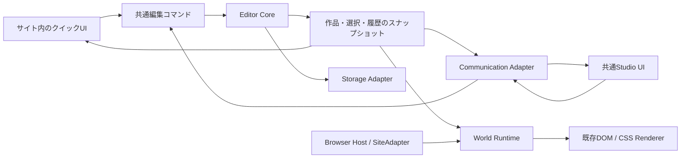

# Studioの独立化

これは独立Studio導入時の記録です。現在の主要UIは[インページStudio](inpage-studio-workspace.md)で、Editor Coreと以下のHost／Storage／通信の境界を維持しています。

起点は `36ecf34`。調査時の `editor/controller.ts` は編集文書、履歴、保存、素材保持とDOMイベントを所有し、`workspace.ts` はChrome Storageを直接参照していた。World Runtimeと画像・グループの純粋な計算は分離済みだった。

## 今回の境界

- **Editor Core**: 選択、宣言的コマンド、文書変更、履歴、編集セッション、保存・破棄と競合判定。DOMやChrome APIを参照しない。幾何情報、ID生成、Storageは引数のポートから受け取る。
- **Studio UI**: 既存のレイヤー／プロパティ／エフェクトを共用する。UI設定の保存も注入する。Studioは全画面の一覧、素材棚、プロパティを使う。
- **Browser Host**: SiteAdapter、DOM選択、ポインター操作、アンカー矩形、Renderer、ライフサイクル。純粋な変形計算は既存Worldモジュールを共用する。
- **Storage Adapter**: 既存のIndexedDB／Chrome Storageとアセットleaseを接続する。DesignDocument v7を変更しない。
- **Communication**: バージョン付きPortメッセージ、対象tab ID、session ID、revision、直列化したコマンドと状態通知。ウェブページへのwindow.postMessage経路や任意コード実行を設けない。

実行中の正本は対象タブのEditor Core一つだけ。StudioとクイックUIは同じコマンドを送る。独立Studioの操作は全機能を別実装せず、既存の編集処理に接続する。Studioの旧リビジョンによる編集は状態を同期して拒否する。同じタブを操作する独立Studioは一つに制限し、クイックUIは共存できる。

## 表示と復旧

Studioを独立した拡張ページ／ウィンドウで開き、実YouTubeをキャンバスとして使う。iframeやページのスクリーンキャプチャは使わない。中央は素材管理と対象の接続情報で、実サイトのライブ映像と誤認させる代替画面を描かない。

Studioは最新の編集文書と履歴を復旧用に保持し、再読み込み時に再接続する。再接続用データは保存済み作品と別のセッションストレージに置く。Undo中の素材も別leaseで保持する。保存済み作品が他から変わった場合は黙って上書きせず、プレビューと最新保存値を区別する。接続を離れたYouTubeでは直接編集を止め、通常操作を戻す。

権限は既存の `storage` のまま。タブIDを列挙し、既存content scriptが応答する対象だけを表示する。ページのURLや閲覧履歴を一括取得しない。[Tabs API](https://developer.chrome.com/docs/extensions/reference/api/tabs)と[Portのメッセージ](https://developer.chrome.com/docs/extensions/develop/concepts/messaging)を利用する。

## 段階

1. 純粋なCore・履歴checkpoint・共通ショートカットと境界テスト。
2. Browser Host／Storage Adapterへ既存controllerを接続し、直接編集を回帰確認してコミット。
3. Portと独立Studio、対象管理、双方向編集、復旧、競合、ワークスペース保存。
4. 全体回帰、実YouTube、スクリーンショット、結果と制約を記録してコミット。

Desktop版は今回実装しない。後からStorage、アンカー／ポインター／RendererのHostポート、通信、ウィンドウとファイル選択の実装を追加する。UI、文書コマンド、履歴、World Runtimeを再利用する。OS操作、Electron／Tauri、ペイント、タイムラインは今回の範囲に含めない。

## 実装したモジュール

| モジュール | 責務 |
| --- | --- |
| `editor-core/session.ts` | 文書・選択・履歴・編集セッションの唯一の正本、保存・破棄、素材保持 |
| `editor-core/types.ts`, `shortcuts.ts` | Host非依存のコマンド、入力ポート、状態、共有ショートカット |
| `studio/app.ts`, `connection.ts` | 独立Studioの組み立て、対象選択、接続表示、素材棚。通信・復旧保存・UI設定は注入 |
| `editor/panel.ts`, `workspace.ts`, `layer-tree.ts`, `effects-panel.ts` | クイック編集とStudioで共有する制作UI |
| `browser/studio-page.ts` | Chrome版のcomposition root。Host名・通信・保存を共通UIへ渡す |
| `browser/studio-client.ts`, `studio-host.ts` | Chrome Portと対象タブの接続、直列コマンド、状態通知、切断・再接続 |
| `studio/protocol.ts` | 通信形式v1、コマンド許可リスト、入力検証。Chrome APIへの依存なし |
| `browser/storage-adapter.ts`, `preferences.ts`, `studio-recovery.ts` | 作品・原本素材・UI設定・復旧データの保存先を接続 |
| `editor/controller.ts` | Browser Host。DOM選択、キー、ドロップ、アンカー矩形をCoreと既存Rendererへ接続 |
| `world/`, `renderers/`, `host/` | 既存World Runtimeと描画。今回描画方式や評価形式を変更していない |

Coreの型チェックは `lib: [ES2022]`, `types: []` で別途実行する。DOM・Chrome・実時計・乱数の直接参照を持たない。共通Studio UIはDOM UIだがChrome APIを持たず、対象の識別子と表示名はHostから受け取る。ファイル選択はUIで受け、Coreの素材Source型はStorage Adapter側が決める。

## 同期と復旧のルール

- 操作は `sessionId + revision + EditCommand`。文書または選択が変わった古い操作は拒否し、最新状態を返す。勝手に再実行しない。
- アンカー位置の再評価は編集revisionを増やさない。スクロールやプレイヤー寸法の変化だけで正常な操作を拒否しないため。
- 状態通知は25msにまとめ、履歴のcheckpointは履歴が変わったときに送る。サムネイルは対象タブで描画済みの画素から取得し、Studioで別のアニメーションプレイヤーを起動しない。
- 同じ対象を編集するStudioは一つ。クイックUIは同じCoreへ接続する。異なるタブのドラフトは別セッションだが、保存済み作品は従来どおりサイト単位で共有する。
- 別タブから保存された場合、未保存プレビューを維持して競合を知らせる。明示的な「保存」は上書き、「破棄」は最新の保存値へ戻す。共同編集・自動マージは行わない。
- 再接続用checkpointは `chrome.storage.session`。文書・選択・最大100操作の履歴だけを保存し、ページ本文・入力フォーム・認証情報・閲覧履歴を保存しない。原本バイナリーは既存IndexedDBのasset IDで参照する。
- StudioがUndo中の素材も別leaseで保持する。保持先は自分の拡張ページの[実行コンテキスト](https://developer.chrome.com/docs/extensions/reference/api/runtime#method-getContexts)で確認し、追加の `tabs` 権限を使わない。対象タブの再読み込みで素材を削除しない。
- クイックUIがない状態で接続を解除すると、YouTubeを保存済みの表示と通常操作へ戻す。Coreの未保存ドラフトはそのタブで保留する。OFF／0%は編集を終了し、描画・再生・編集イベントを撤去する。接続状態を示す受動的なPortは残る。
- タブの再読み込みは最大5秒間隔で再接続。対象タブが閉じられた場合は再試行を止め、対象選択を案内する。

## Desktop Hostの次の作業

1. 対象の列挙・接続・表示を `StudioConnection` で実装する。同じプロセスなら通信を介さず呼び出してもよい。
2. アンカー矩形・ビュー・ポインターとシグナルをHostから提供する。DOMに結び付いた直接操作イベントと現在の選択ハンドルの取り付けはHost側で実装する。移動・拡縮・回転の純粋な計算は既存 `world/geometry.ts` を利用できる。
3. ファイルシステム用 `EditorStorage<Source>`、復旧保存、UI設定を実装し、ID生成とGeometryポートとともにCoreへ注入する。
4. 既存DOM Rendererを使用するか、新しいRendererを実装する。OS UIをどの範囲まで取得・編集できるかは別途検証が必要。

Studio UI、DesignDocument、編集コマンド、履歴とWorld Runtimeは共用する。デスクトップのウィンドウ操作・権限・配布方式は今回保証していない。
